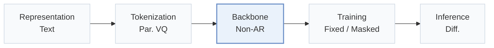
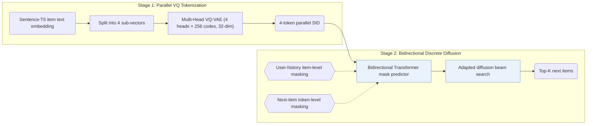
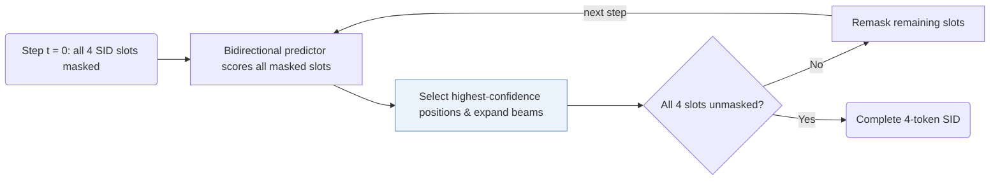
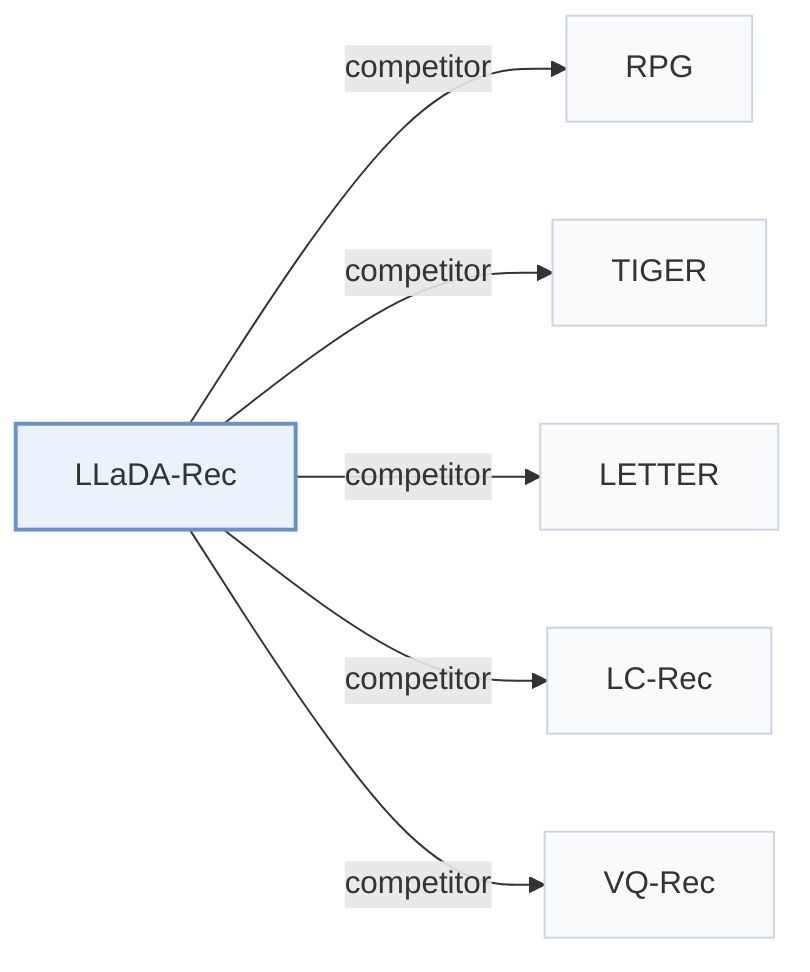

# LLaDA-Rec

[← Problem × Stage Matrix](../../README.md#iii--backbone) · [Papers by Stage](../index/stages.md) · [Papers by Modality](../index/modality.md) · English | [中文](../zh/papers/llada-rec.md)

| **Title** | *Discrete Diffusion for Parallel Semantic ID Generation in Generative Recommendation* |
| :-- | :-- |
| **Authors** | Shi et al. |
| **Venue** | arXiv’25 |
| **Problem × Stage** | `III. SID–Model Alignment` · `Backbone` |
| **Links** | [Paper](https://arxiv.org/abs/2511.06254) · [Code](https://github.com/TengShi-RUC/LLaDA-Rec) |
| **Reading level** | Reading Notes (Level 2) |

**On this page**: [TL;DR](#tldr) · [At a Glance](#at-a-glance) · [1. Why It Matters](#1-why-this-paper-matters) · [2. Method](#2-how-it-works) · [3. Experiments](#3-experimental-findings) · [4. Limitations](#4-limitations--critical-analysis) · [5. Related Work](#5-connections-to-related-work)

- `Text`: Textual item metadata (titles, descriptions, categories, or prompts).
- `Par. VQ`: Parallel multi-codebook vector quantization without sequential residual dependency.
- `Non-AR`: Non-autoregressive.
- `Fixed`: SIDs are built first and not changed while the generator trains.
- `Masked`: Masks part of the codes and reconstructs them (includes masked diffusion).
- `Diff.`: Diffusion decoding.

### TL;DR

> [!NOTE]
> LLaDA-Rec generates parallel Semantic IDs by discrete diffusion with bidirectional attention, history-level and item-level masking, and an adapted beam search, instead of left-to-right autoregressive decoding.

---

### At a Glance

| Aspect | Summary |
| :-- | :-- |
| Research Problem | III. SID–Model Alignment: Can the generator read, write, and reason over SIDs, and do the tokenizer and generator work toward the same goal? |
| Key Contribution | LLaDA-Rec generates parallel Semantic IDs by discrete diffusion with bidirectional attention, history-level and item-level masking, and an adapted beam search, instead of left-to-right autoregressive decoding. |
| Modified Stage | Backbone |
| Key Findings | On Amazon Industrial Scientific, Musical Instruments, and Video Games, LLaDA-Rec outperforms ID-based, diffusion, and autoregressive SID baselines, with adaptive-order unmasking beating fixed left-to-right decoding (Table 3, Sec. 5.4.2, Fig. 4). |
| Limitation | Fewer diffusion steps improve generation efficiency but lower recommendation performance, and the authors leave a better trade-off as an open question (Sec. 5.4.3, Fig. 5). |

---

### 1. Why This Paper Matters

Autoregressive generative recommenders decode a Semantic ID (SID) one token at a time under causal attention, which restricts each token to attend only to earlier positions and propagates early prediction errors along the fixed left-to-right order. LLaDA-Rec replaces causal left-to-right decoding with discrete masked diffusion and bidirectional attention over parallel SID tokens.

> "To address these issues, we propose LLaDA-Rec, a discrete diffusion framework that reformulates recommendation as parallel semantic ID generation." (Abstract)

---

### 2. How It Works

#### Parallel Tokenization

Instead of coarse-to-fine residual quantization—which imposes a sequential hierarchy mismatched to bidirectional attention—a Multi-Head VQ-VAE splits each item's Sentence-T5 text embedding into 4 sub-vectors and quantizes each sub-vector independently with its own codebook of 256 codewords (dimension 32), assigning one head per SID slot (Sec. 4.1, Sec. 5.1.4).

#### Masked Training

A bidirectional Transformer mask predictor (4 layers on Scientific and Instrument; 6 layers on Game) is trained with two complementary masking schemes: user-history item-level masking masks entire historical items to capture sequential transitions across items, while next-item token-level masking masks subsets of the target item's 4 SID tokens with the user history visible, teaching the predictor intra-item token co-occurrence (Sec. 4.2.3).

#### Adaptive-Order Decoding

Inference starts at step $`t = 0`$ with all 4 target SID positions masked and unmasks them over a configurable number of steps (Sec. 4.3.4, Sec. 4.4.2). At each step, the predictor scores all masked slots in parallel, keeps the highest-confidence positions, and remasks the remaining slots for re-evaluation in the next step; an adapted beam search tracks multiple candidate trajectories across unmasking steps (Sec. 4.3.3–4.3.4).

> "All unselected positions are remasked so that the MASK predictor can re-evaluate them in the context of the partially generated sequence." (Sec. 4.3.4)

---

### 3. Experimental Findings

Experimental setup

- **Datasets**: Amazon Reviews 2023: Industrial Scientific (50,985 users / 25,848 items), Musical Instruments (57,439 / 24,587), Video Games (94,762 / 25,612). Filtering rules: not reported.
  - Source: Amazon 2023 categories and ordering: [S5.SS1.SSS1.p1](https://arxiv.org/html/2511.06254v1#S5.SS1.SSS1.p1); statistics: [S4.T2](https://arxiv.org/html/2511.06254v1#S4.T2).
- **Split**: Chronological leave-one-out: last item for test, second-to-last for validation, the rest for training.
  - Source: Leave-one-out allocation: [S5.SS1.SSS1.p1](https://arxiv.org/html/2511.06254v1#S5.SS1.SSS1.p1).
- **Candidates**: not reported (full catalog versus sampled evaluation candidates); top-k lists from the adapted beam search.
  - Source: Metrics only: [S5.SS1.SSS3.p1](https://arxiv.org/html/2511.06254v1#S5.SS1.SSS3.p1).
- **Visibility**: warm; no unseen-item protocol is defined.
  - Source: Standard split with no unseen-item protocol: [S5.SS1.SSS1.p1](https://arxiv.org/html/2511.06254v1#S5.SS1.SSS1.p1).
- **SID**: Parallel semantic IDs from a Multi-Head VQ-VAE over Sentence-T5 embeddings: the embedding is split into 4 sub-vectors, each quantized by its own codebook of 256 codes (dimension 32). Collision handling: not reported.
  - Source: M=4 codebooks x 256 x 32 with Multi-Head VQ-VAE: [S5.SS1.SSS4.p1](https://arxiv.org/html/2511.06254v1#S5.SS1.SSS4.p1) and [S4.SS1.p3](https://arxiv.org/html/2511.06254v1#S4.SS1.p3); no collision rule found.
- **Inference budget**: Discrete-diffusion decoding with beam search over iteratively selected positions and remasking; beam size B: not reported numerically. Bidirectional Transformer encoder (4 layers; 6 for Game). Hardware, inference batch size, and latency: not reported. Recall at 1, 5, 10 and NDCG at 5, 10.
  - Source: Beam search adapted to diffusion decoding: [S4.SS3.SSS3.p1](https://arxiv.org/html/2511.06254v1#S4.SS3.SSS3.p1) and [S4.SS3.SSS4.p1](https://arxiv.org/html/2511.06254v1#S4.SS3.SSS4.p1); no numerical beam size or hardware found.
- **Results from**: Table 3 (Scientific, Instrument, Game versus item-ID, diffusion, and semantic-ID baselines; paired t-tests); Table 4 (ablations including RQ-VAE tokenizer and greedy decoding); Figure 3 (attention mechanisms); Section 5.4 (hyperparameters).
  - Source: Main: [S4.T3](https://arxiv.org/html/2511.06254v1#S4.T3); ablation: [S5.T4](https://arxiv.org/html/2511.06254v1#S5.T4); attention study: [S5.F3](https://arxiv.org/html/2511.06254v1#S5.F3).

- Main comparison: across Amazon Industrial Scientific, Musical Instruments, and Video Games, LLaDA-Rec outperforms item-ID, continuous diffusion, and autoregressive SID baselines (including TIGER, LETTER, LC-Rec, RPG, and VQ-Rec) on Recall@1/5/10 and NDCG@5/10, with statistically significant improvements under paired t-tests (Table 3).
- Ablations on tokenization and attention: replacing Multi-Head VQ-VAE with hierarchical RQ-VAE, replacing adapted beam search with greedy decoding, or replacing bidirectional attention with causal attention all lower accuracy (Table 4, Fig. 3).
- Unmasking order: adaptive confidence-based unmasking consistently outperforms random and fixed orders, whereas fixed left-to-right decoding occasionally yields the lowest accuracy (Sec. 5.4.2, Fig. 4).

  > "The adaptive approach consistently delivers superior performance, with left2right occasionally producing the poorest results, highlighting the shortcomings of the commonly used left2right scheme." (Sec. 5.4.2)

---

### 4. Limitations & Critical Analysis

**Our analysis.**

- The Multi-Head VQ-VAE tokenizer is trained once on item text embeddings and held fixed (`Fixed`, `Text`), which suggests that collaborative filtering signals enter only through the bidirectional diffusion generator rather than the SID assignment itself.
- RPG also predicts unordered parallel codes with a `Non-AR` backbone; RPG uses `Par. OPQ` codes and single-pass `Graph`-constrained decoding, whereas LLaDA-Rec uses `Par. VQ` codes and multi-step iterative `Diff.` unmasking.

---

### 5. Connections to Related Work

- **Competitor** · [RPG](rpg.md): RPG predicts long unordered OPQ codes in parallel with multi-token prediction; LLaDA-Rec generates parallel VQ codes by discrete diffusion with an adapted beam search.
  - Source: LLaDA-Rec v1, Table 1 comparison and semantic-ID baselines: [S4.T1](https://arxiv.org/html/2511.06254v1#S4.T1) and [S5.SS1.SSS2.p2](https://arxiv.org/html/2511.06254v1#S5.SS1.SSS2.p2); Table 3: [S4.T3](https://arxiv.org/html/2511.06254v1#S4.T3).
- **Competitor** · [TIGER](tiger.md): TIGER generates hierarchical RQ-VAE codes left to right with causal attention; LLaDA-Rec uses bidirectional attention and fills code positions in any order.
  - Source: LLaDA-Rec v1, Table 1 and baselines (TIGER and TIGER-SAS): [S4.T1](https://arxiv.org/html/2511.06254v1#S4.T1) and [S5.SS1.SSS2.p2](https://arxiv.org/html/2511.06254v1#S5.SS1.SSS2.p2); Table 3: [S4.T3](https://arxiv.org/html/2511.06254v1#S4.T3).
- **Competitor** · [LETTER](letter.md): LETTER improves a hierarchical tokenizer for left-to-right generation; LLaDA-Rec replaces the hierarchy with parallel codes suited to diffusion.
  - Source: LLaDA-Rec v1, baselines: [S5.SS1.SSS2.p2](https://arxiv.org/html/2511.06254v1#S5.SS1.SSS2.p2); Tables 1 and 3: [S4.T1](https://arxiv.org/html/2511.06254v1#S4.T1) and [S4.T3](https://arxiv.org/html/2511.06254v1#S4.T3).
- **Competitor** · [LC-Rec](lc-rec.md): LC-Rec aligns an LLM to semantic IDs with auxiliary tasks and causal decoding; LLaDA-Rec trains a bidirectional masked predictor with history-level and item-level masking.
  - Source: LLaDA-Rec v1, baselines: [S5.SS1.SSS2.p2](https://arxiv.org/html/2511.06254v1#S5.SS1.SSS2.p2); Tables 1 and 3: [S4.T1](https://arxiv.org/html/2511.06254v1#S4.T1) and [S4.T3](https://arxiv.org/html/2511.06254v1#S4.T3).
- **Competitor** · [VQ-Rec](vq-rec.md): VQ-Rec pools product-quantized codes into an item representation for discriminative ranking; LLaDA-Rec generates parallel codes directly.
  - Source: LLaDA-Rec v1, baselines: [S5.SS1.SSS2.p2](https://arxiv.org/html/2511.06254v1#S5.SS1.SSS2.p2); Table 3: [S4.T3](https://arxiv.org/html/2511.06254v1#S4.T3).

[View all papers in this cell](../../README.md#iii--backbone)
