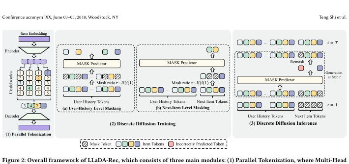

# LLaDA-Rec

*Discrete Diffusion for Parallel Semantic ID Generation in Generative Recommendation* — Shi et al., arXiv’25

[arXiv](https://arxiv.org/abs/2511.06254) · [Record](../../data/papers/llada-rec.yaml) · [← Catalog](../../README.md#iii--backbone)

> Abstract: "error accumulation, where the fixed left-to-right generation order causes prediction errors in early tokens to propagate".

| Problem it fixes | Stage it changes |
| :-- | :-- |
| **III. SID–Model Alignment**: Can the generator read, write, and reason over SIDs, and do the tokenizer and generator work toward the same goal? | **Backbone** |

## Pipeline

| Representation | Tokenization | Backbone | Training | Inference |
| :-: | :-: | :-: | :-: | :-: |
| `Text` | `Par. VQ` | **`Non-AR`** | `Fixed / Masked` | `Diff.` |

- `Non-AR`: Non-autoregressive.
- `Fixed`: SIDs are built first and not changed while the generator trains.
- `Masked`: Masks part of the codes and reconstructs them (includes masked diffusion).
- `Diff.`: Diffusion decoding.

## Architecture

## Evidence

- **`problem`** (arXiv abstract): Abstract: "error accumulation, where the fixed left-to-right generation order causes prediction errors in early tokens to propagate".

## 旧卡片说明

迁自 `d61aa6c:papers/lladarec.md`。保留方法说明、实验叙述与局限；本轮只对照现有记录处理明确冲突，未重新逐句核查原论文。分类和规格以页面上方由记录生成的表格为准。

### LLaDA-Rec：离散扩散并行语义标识生成

> LLaDA-Rec 用离散扩散模型并行生成完整 Semantic ID，以降低自回归推荐的延迟。

### 研究动机与问题定义

自回归 SID 生成需要逐 token 解码，长序列场景延迟较高。LLaDA-Rec 将推荐目标建模为离散序列去噪，让多个标识位置可以并行恢复。

### TL;DR（核心摘要）

`用户历史 → 多头物品分词 → 离散扩散去噪 → 完整SID → 推荐物品`

方法用多头量化器产生物品 token，并训练扩散模型从掩码或噪声状态恢复目标 SID。推理阶段迭代选择待恢复位置，结合自适应位置策略和束式候选保留，最终将完整 SID 映射到物品。

### 输入与使用场景

| 方面 | 说明 |
|---|---|
| 使用信息 | 用户行为与物品语义 |
| 信息融入位置 | SID 分词和扩散模型条件输入 |
| 语义标识结构 | 定长多 token 序列 |
| 适用场景 | 低延迟生成式推荐 |

### 方法设计

#### 4.1 多头 VQ-VAE 并行分词
LLaDA-Rec 为物品学习多个离散 token 头，将语义表示映射为定长 SID。多头结构让不同位置能够分别承载语义信息，并为并行恢复提供独立预测单元。

#### 4.2 离散扩散训练
训练时随机掩码或扰动目标 SID，模型根据用户历史和剩余可见 token 预测被破坏位置。相比左到右目标，扩散训练让模型学习在不同噪声程度下共同恢复多个位置。

#### 4.3 离散扩散推理
推理从全掩码或部分掩码状态开始，迭代选择位置并恢复 token。论文设计自适应位置选择，使置信度高的位置优先确定，并结合候选保留与合法性约束输出完整 SID。

#### 4.4 讨论与实验
实验比较不同注意力、恢复顺序、去噪步数和并行程度，重点评估推荐质量与延迟之间的权衡。

### 实验结论

- 并行扩散生成在保持效果的同时减少解码步数。
- 自适应位置选择优于固定恢复顺序。

### 局限性与研究定位

#### 局限性
- 多轮去噪仍有迭代成本，实际收益取决于步数和硬件。
- 动态新增物品与工业级服务评估仍未报告。

#### 研究定位
LLaDA-Rec 将离散扩散引入 SID 生成，适合放在“并行生成与低延迟解码”章节。

### 标签

`离散扩散` · `并行生成` · `Semantic ID` · `生成式推荐`

### 架构图来源

*图源：原论文，图2。图片使用许可待核实。*

---

### 旧总表补充

来源：`d61aa6c:tables/all-methods.md`。

- 核心贡献：并行去噪生成SID。
- 使用场景：低延迟推荐。

## Same cell: III × Backbone (8 more)

| Paper | Venue | Pipeline |
| :-- | :-- | :-- |
| [DECOR](decor.md) | SIGIR’26 | `Text+CF` → `RQ-VAE` → **`Enc-Dec`** → `Fixed / NTP` → `Beam` |
| [FLASH](flash.md) | NeurIPS’26 | `Text` → `SimHash` → **`Non-AR`** → `Fixed / MTP + Aux.` → `Scoring` |
| [Latte](latte.md) | arXiv’26 | `Text+CF` → `RQ-VAE` → **`Dec-Only`** → `Fixed / NTP` → `C-Beam` |
| [LESSRec](lessrec.md) | arXiv’26 | `Text / Text+CF` → `RQ-VAE / R-KM / LETTER` → **`Enc-Dec`** → `Fixed / NTP` → `C-Beam` |
| [MDGR](mdgr.md) | arXiv’26 | `–` → `Par. OPQ` → **`Non-AR`** → `Fixed / Masked` → `Diff.+Beam` |
| [PrefixMem](prefixmem.md) | arXiv’26 | `MM` → `RQ-VAE` → **`Dec-Only`** → `Fixed / Multi-task NTP` → `Beam` |
| [S2GR](s2gr.md) | KDD’26 | `Text+CF` → `CoBa RQ-VAE` → **`Enc-Dec`** → `Fixed / NTP + Ctr.` → `Beam` |
| [TrieRec](trierec.md) | NeurIPS’26 | `Text` → `RQ-VAE` → **`Enc-Dec`** → `Fixed† / NTP†` → `C-Beam` |
