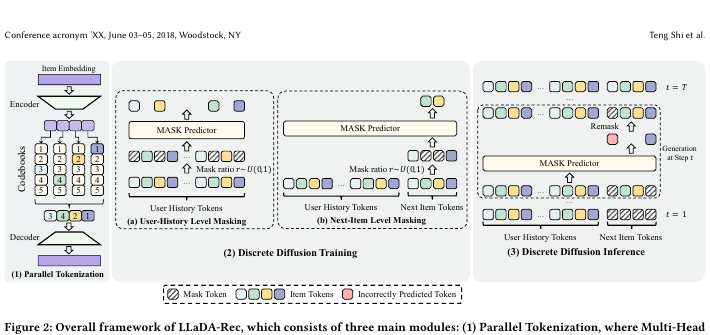

# LLaDA-Rec

*Discrete Diffusion for Parallel Semantic ID Generation in Generative Recommendation* — Shi et al. · arXiv’25

`III. SID–Model Alignment` · `Backbone`

[Paper](https://arxiv.org/abs/2511.06254) · [Code](https://github.com/TengShi-RUC/LLaDA-Rec) · [Matrix](../../README.md#iii--backbone)

Reading level: Overview (Level 1) · On this page: [At a Glance](#at-a-glance) · [2. How It Works](#2-how-it-works) · [3. Experimental Findings](#3-experimental-findings) · [5. Connections to Related Work](#5-connections-to-related-work)

| Representation | Tokenization | Backbone | Training | Inference |
| :-: | :-: | :-: | :-: | :-: |
| `Text` | `Par. VQ` | **`Non-AR`** | `Fixed / Masked` | `Diff.` |

- `Non-AR`: Non-autoregressive.
- `Fixed`: SIDs are built first and not changed while the generator trains.
- `Masked`: Masks part of the codes and reconstructs them (includes masked diffusion).
- `Diff.`: Diffusion decoding.

### At a Glance

| Aspect | Summary |
| :-- | :-- |
| Research Problem | III. SID–Model Alignment: Can the generator read, write, and reason over SIDs, and do the tokenizer and generator work toward the same goal? |
| Modified Stage | Backbone |

### 2. How It Works

### 3. Experimental Findings

**Experimental setup**

- **Datasets**: Amazon Reviews 2023: Industrial Scientific (50,985 users / 25,848 items), Musical Instruments (57,439 / 24,587), Video Games (94,762 / 25,612). Filtering rules: not reported.
  - Source: Amazon 2023 categories and ordering: https://arxiv.org/html/2511.06254v1#S5.SS1.SSS1.p1; statistics: https://arxiv.org/html/2511.06254v1#S4.T2.
- **Split**: Chronological leave-one-out: last item for test, second-to-last for validation, the rest for training.
  - Source: Leave-one-out allocation: https://arxiv.org/html/2511.06254v1#S5.SS1.SSS1.p1.
- **Candidates**: not reported (full catalog versus sampled evaluation candidates); top-k lists from the adapted beam search.
  - Source: Metrics only: https://arxiv.org/html/2511.06254v1#S5.SS1.SSS3.p1.
- **Visibility**: warm; no unseen-item protocol is defined.
  - Source: Standard split with no unseen-item protocol: https://arxiv.org/html/2511.06254v1#S5.SS1.SSS1.p1.
- **SID**: Parallel semantic IDs from a Multi-Head VQ-VAE over Sentence-T5 embeddings: the embedding is split into 4 sub-vectors, each quantized by its own codebook of 256 codes (dimension 32). Collision handling: not reported.
  - Source: M=4 codebooks x 256 x 32 with Multi-Head VQ-VAE: https://arxiv.org/html/2511.06254v1#S5.SS1.SSS4.p1 and https://arxiv.org/html/2511.06254v1#S4.SS1.p3; no collision rule found.
- **Inference budget**: Discrete-diffusion decoding with beam search over iteratively selected positions and remasking; beam size B: not reported numerically. Bidirectional Transformer encoder (4 layers; 6 for Game). Hardware, inference batch size, and latency: not reported. Recall at 1, 5, 10 and NDCG at 5, 10.
  - Source: Beam search adapted to diffusion decoding: https://arxiv.org/html/2511.06254v1#S4.SS3.SSS3.p1 and https://arxiv.org/html/2511.06254v1#S4.SS3.SSS4.p1; no numerical beam size or hardware found.
- **Results from**: Table 3 (Scientific, Instrument, Game versus item-ID, diffusion, and semantic-ID baselines; paired t-tests); Table 4 (ablations including RQ-VAE tokenizer and greedy decoding); Figure 3 (attention mechanisms); Section 5.4 (hyperparameters).
  - Source: Main: https://arxiv.org/html/2511.06254v1#S4.T3; ablation: https://arxiv.org/html/2511.06254v1#S5.T4; attention study: https://arxiv.org/html/2511.06254v1#S5.F3.

## 旧卡片说明

迁自 `d61aa6c:papers/lladarec.md`。保留方法说明、实验叙述与局限；本轮只对照现有记录处理明确冲突，未重新逐句核查原论文。分类和规格以页面上方由记录生成的表格为准。

### LLaDA-Rec：离散扩散并行语义标识生成

> LLaDA-Rec 用离散扩散模型并行生成完整 Semantic ID，以降低自回归推荐的延迟。

### 研究动机与问题定义

自回归 SID 生成需要逐 token 解码，长序列场景延迟较高。LLaDA-Rec 将推荐目标建模为离散序列去噪，让多个标识位置可以并行恢复。

### TL;DR（核心摘要）

`用户历史 → 多头物品分词 → 离散扩散去噪 → 完整SID → 推荐物品`

方法用多头量化器产生物品 token，并训练扩散模型从掩码或噪声状态恢复目标 SID。推理阶段迭代选择待恢复位置，结合自适应位置策略和束式候选保留，最终将完整 SID 映射到物品。

### 输入与使用场景

| 方面 | 说明 |
|---|---|
| 使用信息 | 用户行为与物品语义 |
| 信息融入位置 | SID 分词和扩散模型条件输入 |
| 语义标识结构 | 定长多 token 序列 |
| 适用场景 | 低延迟生成式推荐 |

### 方法设计

#### 4.1 多头 VQ-VAE 并行分词
LLaDA-Rec 为物品学习多个离散 token 头，将语义表示映射为定长 SID。多头结构让不同位置能够分别承载语义信息，并为并行恢复提供独立预测单元。

#### 4.2 离散扩散训练
训练时随机掩码或扰动目标 SID，模型根据用户历史和剩余可见 token 预测被破坏位置。相比左到右目标，扩散训练让模型学习在不同噪声程度下共同恢复多个位置。

#### 4.3 离散扩散推理
推理从全掩码或部分掩码状态开始，迭代选择位置并恢复 token。论文设计自适应位置选择，使置信度高的位置优先确定，并结合候选保留与合法性约束输出完整 SID。

#### 4.4 讨论与实验
实验比较不同注意力、恢复顺序、去噪步数和并行程度，重点评估推荐质量与延迟之间的权衡。

### 实验结论

- 并行扩散生成在保持效果的同时减少解码步数。
- 自适应位置选择优于固定恢复顺序。

### 局限性与研究定位

#### 局限性
- 多轮去噪仍有迭代成本，实际收益取决于步数和硬件。
- 动态新增物品与工业级服务评估仍未报告。

#### 研究定位
LLaDA-Rec 将离散扩散引入 SID 生成，适合放在“并行生成与低延迟解码”章节。

### 标签

`离散扩散` · `并行生成` · `Semantic ID` · `生成式推荐`

### 架构图来源

*图源：原论文，图2。图片使用许可待核实。*

---

### 旧总表补充

来源：`d61aa6c:tables/all-methods.md`。

- 核心贡献：并行去噪生成SID。
- 使用场景：低延迟推荐。

### 5. Connections to Related Work

- **Competitor** · [RPG](rpg.md): RPG predicts long unordered OPQ codes in parallel with multi-token prediction; LLaDA-Rec generates parallel VQ codes by discrete diffusion with an adapted beam search.
  - Source: LLaDA-Rec v1, Table 1 comparison and semantic-ID baselines: https://arxiv.org/html/2511.06254v1#S4.T1 and https://arxiv.org/html/2511.06254v1#S5.SS1.SSS2.p2; Table 3: https://arxiv.org/html/2511.06254v1#S4.T3.
- **Competitor** · [TIGER](tiger.md): TIGER generates hierarchical RQ-VAE codes left to right with causal attention; LLaDA-Rec uses bidirectional attention and fills code positions in any order.
  - Source: LLaDA-Rec v1, Table 1 and baselines (TIGER and TIGER-SAS): https://arxiv.org/html/2511.06254v1#S4.T1 and https://arxiv.org/html/2511.06254v1#S5.SS1.SSS2.p2; Table 3: https://arxiv.org/html/2511.06254v1#S4.T3.
- **Competitor** · [LETTER](letter.md): LETTER improves a hierarchical tokenizer for left-to-right generation; LLaDA-Rec replaces the hierarchy with parallel codes suited to diffusion.
  - Source: LLaDA-Rec v1, baselines: https://arxiv.org/html/2511.06254v1#S5.SS1.SSS2.p2; Tables 1 and 3: https://arxiv.org/html/2511.06254v1#S4.T1 and https://arxiv.org/html/2511.06254v1#S4.T3.
- **Competitor** · [LC-Rec](lc-rec.md): LC-Rec aligns an LLM to semantic IDs with auxiliary tasks and causal decoding; LLaDA-Rec trains a bidirectional masked predictor with history-level and item-level masking.
  - Source: LLaDA-Rec v1, baselines: https://arxiv.org/html/2511.06254v1#S5.SS1.SSS2.p2; Tables 1 and 3: https://arxiv.org/html/2511.06254v1#S4.T1 and https://arxiv.org/html/2511.06254v1#S4.T3.
- **Competitor** · [VQ-Rec](vq-rec.md): VQ-Rec pools product-quantized codes into an item representation for discriminative ranking; LLaDA-Rec generates parallel codes directly.
  - Source: LLaDA-Rec v1, baselines: https://arxiv.org/html/2511.06254v1#S5.SS1.SSS2.p2; Table 3: https://arxiv.org/html/2511.06254v1#S4.T3.

[View all papers in this cell](../../README.md#iii--backbone)
