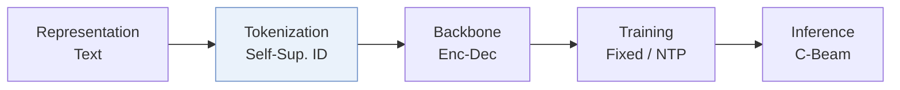
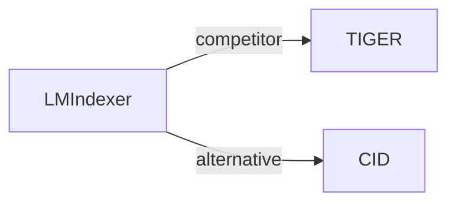

# LMIndexer

| **Title** | *Language Models As Semantic Indexers* |
| :-- | :-- |
| **Authors** | Jin et al. |
| **Venue** | ICML’24 |
| **Problem × Stage** | `I. Informativeness` · `Tokenization` |
| **Links** | [Paper](https://arxiv.org/abs/2310.07815) · [Code](https://github.com/PeterGriffinJin/LMIndexer) · [Matrix](../../README.md#i--tokenization) · [中文](../zh/papers/lmindexer.md) |
| **Reading level** | Overview (Level 1) |

On this page: [TL;DR](#tldr) · [At a Glance](#at-a-glance) · [3. Experiments](#3-experimental-findings) · [5. Related Work](#5-connections-to-related-work)

- `Self-Sup. ID`: Semantic identifiers learned through self-supervision.
- `Enc-Dec`: Encoder-decoder.
- `Fixed`: SIDs are built first and not changed while the generator trains.
- `NTP`: Next-token prediction loss only; continuing from a pretrained LLM (SFT) also counts as NTP.
- `C-Beam`: Constrained beam search.

### TL;DR

> [!NOTE]
> LMIndexer learns sequential Semantic IDs with a generative language model through progressive training, contrastive learning, and self-supervised reconstruction, instead of quantizing embeddings from an off-the-shelf encoder.

---

### At a Glance

| Aspect | Summary |
| :-- | :-- |
| Research Problem | I. Informativeness: Do the SIDs, or the model reading them, carry the collaborative and multimodal signals recommendation needs? |
| Key Contribution | LMIndexer learns sequential Semantic IDs with a generative language model through progressive training, contrastive learning, and self-supervised reconstruction, instead of quantizing embeddings from an off-the-shelf encoder. |
| Modified Stage | Tokenization |

---

### 3. Experimental Findings

Experimental setup

- **Datasets**: Amazon Beauty/Sports/Toys: recommendation and product search, user/item >=5 interactions. Document retrieval: NQ, MS MARCO-1M, merged TREC-DL 2019/2020 restricted to that corpus.
  - Source: Sections 5.1-5.3 and Appendix A.1: [S5.SS1.p2](https://arxiv.org/html/2310.07815v3#S5.SS1.p2) and [S5.SS2.p2](https://arxiv.org/html/2310.07815v3#S5.SS2.p2) and [A1.SS1.p3](https://arxiv.org/html/2310.07815v3#A1.SS1.p3)
- **Split**: Recommendation: per-user last/penultimate test/validation. Product search: original train/test, 1/8 training queries validation. NQ keeps original labels; MARCO uses original train/dev labels.
  - Source: Appendix A.1: [A1.SS1.p1](https://arxiv.org/html/2310.07815v3#A1.SS1.p1) and [A1.SS1.p3](https://arxiv.org/html/2310.07815v3#A1.SS1.p3)
- **Candidates**: not reported
  - Source: Downstream protocols in Sections 5.1-5.3 do not specify negative sampling or complete-catalog enumeration: [S5.SS1](https://arxiv.org/html/2310.07815v3#S5.SS1) and [S5.SS2](https://arxiv.org/html/2310.07815v3#S5.SS2) and [S5.SS3](https://arxiv.org/html/2310.07815v3#S5.SS3)
- **Visibility**: Recommendation: warm; no unseen-item protocol is defined. Zero-shot Beauty product search: unseen by tokenizer too, excluded from both SID self-supervision and downstream finetuning; holdout construction not reported.
  - Source: Sections 4.1/5.1 and Appendix A.10: [S4.SS1.p1](https://arxiv.org/html/2310.07815v3#S4.SS1.p1) and [S5.SS1.p2](https://arxiv.org/html/2310.07815v3#S5.SS1.p2) and [A1.SS10.p1](https://arxiv.org/html/2310.07815v3#A1.SS10.p1)
- **SID**: Reported ID length 3; codebook sizes 512 (Amazon), 5120 (NQ), 51200 (MARCO-1M). A final ID position distinguishes collisions; its assignment rule not reported.
  - Source: Appendix A.3 Table 9 and Appendix A.5: [A1.T9](https://arxiv.org/html/2310.07815v3#A1.T9) and [A1.SS3.p1](https://arxiv.org/html/2310.07815v3#A1.SS3.p1) and [A1.SS5.p2](https://arxiv.org/html/2310.07815v3#A1.SS5.p2)
- **Inference budget**: Prefix-tree constrained beam 20; recommendation Recall/NDCG@5; experiments on 8 A100-40G. Inference batch size not reported. Product-search whole-Beauty-test latency 12.21s, not per request.
  - Source: Sections 3.3/5.1 and Appendix A.9/Table 14: [S3.SS3.p1](https://arxiv.org/html/2310.07815v3#S3.SS3.p1) and [S5.SS1.p4](https://arxiv.org/html/2310.07815v3#S5.SS1.p4) and [A1.SS9.p1](https://arxiv.org/html/2310.07815v3#A1.SS9.p1) and [A1.T14](https://arxiv.org/html/2310.07815v3#A1.T14)
- **Results from**: Original Tables 3/4/6: recommendation/product search/document retrieval; Table 15: zero-shot product search. Generative indexer baselines use matched T5-base finetuning.
  - Source: Original Tables 3/4/6/15: [S5.T3](https://arxiv.org/html/2310.07815v3#S5.T3) and [S5.T4](https://arxiv.org/html/2310.07815v3#S5.T4) and [S5.T6](https://arxiv.org/html/2310.07815v3#S5.T6) and [A1.T15](https://arxiv.org/html/2310.07815v3#A1.T15)

---

### 5. Connections to Related Work

- **Competitor** · [TIGER](tiger.md): Its RQ-VAE indexing approach is adapted as a matched T5-base baseline.
  - Source: LMIndexer v3, Section 5.1: https://arxiv.org/html/2310.07815v3#S5.SS1.p3; https://arxiv.org/html/2310.07815v3#S5.SS1.p4.
- **Alternative** · [CID](cid.md): Cited task-informed item indexing; LMIndexer learns IDs by self-supervised text reconstruction.
  - Source: LMIndexer v3, Section 2, citing Hua et al. (2023): https://arxiv.org/html/2310.07815v3#S2.p2.

[View all papers in this cell](../../README.md#i--tokenization)
