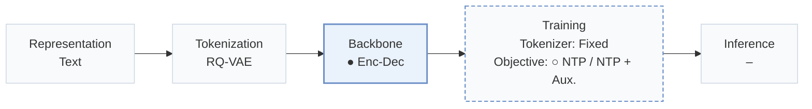
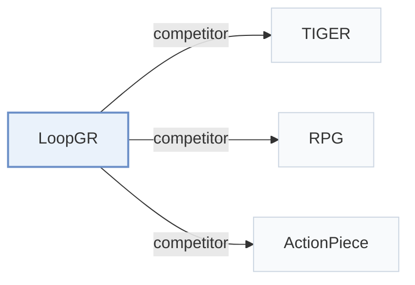

# LoopGR

[← Problem × Stage Matrix](../../README.md#v--backbone) · [Papers by Stage](../index/stages.md) · [Papers by Modality](../index/modality.md) · [Papers by Domain](../index/domain.md) · English | [中文](../zh/papers/loopgr.md)

| **Title** | *Parameter-Efficient Scaling for Generative Recommendation via Recurrent Depth* |
| :-- | :-- |
| **Authors** | Zhang et al. |
| **Venue** | arXiv’26 |
| **Problem × Stage** | `V. Efficiency` · `Backbone` |
| **Changes** | ● Backbone · ○ Objective |
| **SID inputs** | `Text` |
| **Domain** | `E-commerce` · `unknown (industrial)` |
| **Links** | [Paper](https://arxiv.org/abs/2610.34157) |
| **Reading level** | Overview (Level 1) |

**On this page**: [TL;DR](#tldr) · [3. Experiments](#3-experimental-findings) · [5. Related Work](#5-connections-to-related-work)

- `Text`: Textual item metadata (titles, descriptions, categories, or prompts).
- `RQ-VAE`: Residual-Quantized Variational AutoEncoder.
- `Enc-Dec`: Encoder-decoder.
- `Fixed`: SIDs are built first and not changed while the generator trains.
- `NTP / NTP + Aux.`: Next-token prediction alone or jointly optimized with auxiliary objectives.

### TL;DR

> [!NOTE]
> LoopGR adds recurrent depth by alternating a shared generative decoder with a lightweight context updater and distills a low-budget student, to scale computation without proportionally growing model size.

---

### 3. Experimental Findings

Experimental setup

- **Datasets**: Amazon Reviews 2014 Beauty, Sports and Outdoors, CDs and Vinyl; Tencent industrial data. Filtering and industrial dataset statistics not reported.
  - Source: Section 5.1 and Appendix A.1: [S5.SS1.SSS0.Px1.p1](https://arxiv.org/html/2610.34157v1#S5.SS1.SSS0.Px1.p1) and [A1.SS1.p1](https://arxiv.org/html/2610.34157v1#A1.SS1.p1)
- **Split**: Interactions ordered chronologically; sliding-window next-item training. Train/validation/test allocation not reported.
  - Source: Section 5.1: [S5.SS1.SSS0.Px1.p1](https://arxiv.org/html/2610.34157v1#S5.SS1.SSS0.Px1.p1)
- **Candidates**: not reported
  - Source: Evaluation protocol in Section 5.1 and Appendix A.1 does not specify candidate enumeration or sampling: [S5.SS1](https://arxiv.org/html/2610.34157v1#S5.SS1) and [A1.SS1](https://arxiv.org/html/2610.34157v1#A1.SS1)
- **Visibility**: warm; no unseen-item protocol is defined.
  - Source: Section 5.1 and Appendix A.1 define no item-level cold-start experiment: [S5.SS1](https://arxiv.org/html/2610.34157v1#S5.SS1) and [A1.SS1](https://arxiv.org/html/2610.34157v1#A1.SS1)
- **SID**: Sentence-T5 embeddings; 3 RQ-VAE digits plus fourth anti-collision digit for unique SIDs. Codebook sizes not reported.
  - Source: Section 5.1: [S5.SS1.SSS0.Px3.p1](https://arxiv.org/html/2610.34157v1#S5.SS1.SSS0.Px3.p1)
- **Inference budget**: Experiments on 4 NVIDIA H20 GPUs; beam width not reported. Public Recall/NDCG@5/10; industrial Recall@5/10/20/50/100. Table 6, batch 1: 16/8/4 cycles, 211.08/104.01/49.82ms, 17.408/8.415/3.918 GFLOPs.
  - Source: Section 5.1, Table 2, and Appendix A.2/Table 6: [S5.SS1.SSS0.Px3.p1](https://arxiv.org/html/2610.34157v1#S5.SS1.SSS0.Px3.p1) and [S5.T2](https://arxiv.org/html/2610.34157v1#S5.T2) and [A1.SS2.p1](https://arxiv.org/html/2610.34157v1#A1.SS2.p1) and [A1.T6](https://arxiv.org/html/2610.34157v1#A1.T6)
- **Results from**: Tables 1/2: public/industrial comparisons; Table 6: trajectory compression. Industrial baselines adapted by authors; public-baseline reproduction versus copied scores not reported.
  - Source: Section 5.1 and Tables 1/2/6: [S5.SS1.SSS0.Px2.p1](https://arxiv.org/html/2610.34157v1#S5.SS1.SSS0.Px2.p1) and [S5.T1](https://arxiv.org/html/2610.34157v1#S5.T1) and [S5.T2](https://arxiv.org/html/2610.34157v1#S5.T2) and [A1.T6](https://arxiv.org/html/2610.34157v1#A1.T6)

---

### 5. Connections to Related Work

- **Competitor** · [TIGER](tiger.md): Encoder-decoder baseline; LoopGR adds shared recurrent context refinement.
  - Source: LoopGR v1, Section 5.1 and Tables 1/2: [S5.SS1.SSS0.Px2.p1](https://arxiv.org/html/2610.34157v1#S5.SS1.SSS0.Px2.p1); [S5.T1](https://arxiv.org/html/2610.34157v1#S5.T1); [S5.T2](https://arxiv.org/html/2610.34157v1#S5.T2).
- **Competitor** · [RPG](rpg.md): Parallel graph-guided decoding contrasts with LoopGR's recurrent RQ-VAE SID generation.
  - Source: LoopGR v1, Section 5.2 and Table 1: [S5.SS2.p2](https://arxiv.org/html/2610.34157v1#S5.SS2.p2); [S5.T1](https://arxiv.org/html/2610.34157v1#S5.T1).
- **Competitor** · [ActionPiece](actionpiece.md): Context-dependent action tokens contrast with LoopGR's standard RQ-VAE identifiers.
  - Source: LoopGR v1, Section 5.2 and Table 1: [S5.SS2.p2](https://arxiv.org/html/2610.34157v1#S5.SS2.p2); [S5.T1](https://arxiv.org/html/2610.34157v1#S5.T1).

[View all papers in this cell](../../README.md#v--backbone)
