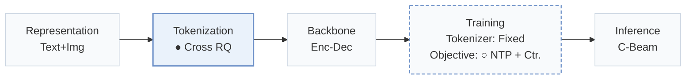
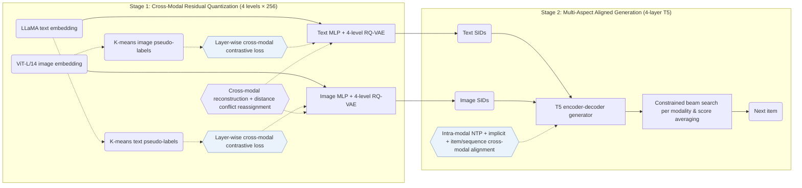
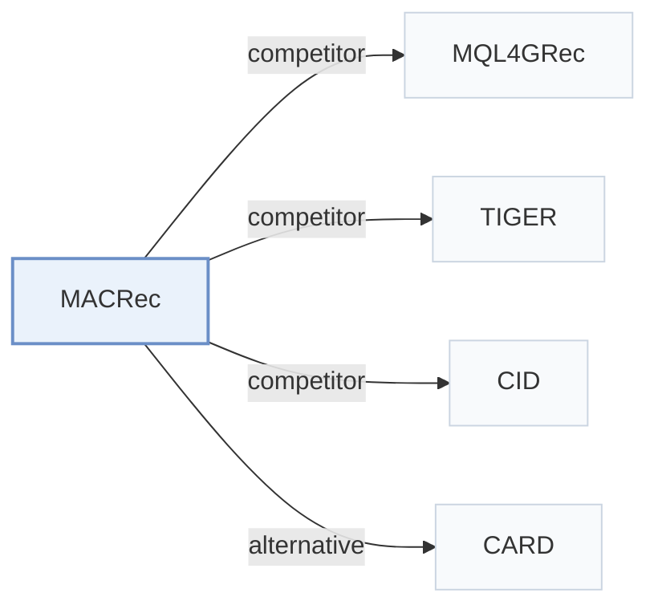

# MACRec

[← Problem × Stage Matrix](../../README.md#i--tokenization) · [Papers by Stage](../index/stages.md) · [Papers by Modality](../index/modality.md) · [Papers by Domain](../index/domain.md) · English | [中文](../zh/papers/macrec.md)

| **Title** | *Multi-aspect cross-modal quantization for generative recommendation* |
| :-- | :-- |
| **Authors** | Zhang et al. |
| **Venue** | AAAI’26 |
| **Problem × Stage** | `I. Informativeness` · `Tokenization` |
| **Changes** | ● Tokenization · ○ Objective |
| **SID inputs** | text: `Text` · image: `Img` |
| **Domain** | `E-commerce` |
| **Scenario** | `General Item Recommendation`; `Public Benchmarks` |
| **Links** | [Paper](https://arxiv.org/abs/2511.15122) · [Code](https://github.com/zhangfw123/MACRec) |
| **Reading level** | Reading Notes (Level 2) |

**On this page**: [TL;DR](#tldr) · [At a Glance](#at-a-glance) · [1. Why It Matters](#1-why-this-paper-matters) · [2. Method](#2-how-it-works) · [3. Experiments](#3-experimental-findings) · [4. Limitations](#4-limitations--critical-analysis) · [5. Related Work](#5-connections-to-related-work)

- `Text+Img`: Text and visual item representations.
- `Cross RQ`: Cross-modal residual quantization.
- `Enc-Dec`: Encoder-decoder.
- `Fixed`: SIDs are built first and not changed while the generator trains.
- `NTP + Ctr.`: NTP plus a contrastive loss.
- `C-Beam`: Constrained beam search.

### TL;DR

> [!NOTE]
> MACRec applies cross-modal quantization over text and image features to build Semantic IDs with fewer conflicts, and adds implicit and explicit cross-modal alignment to generator training.

---

### At a Glance

| Aspect | Summary |
| :-- | :-- |
| Key Findings | MACRec leads all baselines on HR@10, NDCG@5, and NDCG@10 on all three datasets, while on Games HR@5 MISSRec reports 0.0674 against 0.0671 for MACRec (Table 2). |
| Limitation | MACRec trains separate 4-level RQ-VAE tokenizers and runs constrained beam search in both text and image modalities before averaging their scores at inference, and the paper does not report beam width or inference latency (Methodology, Table 4). |

---

### 1. Why This Paper Matters

Generative recommenders require hierarchical, low-collision Semantic IDs (SIDs) that support sequence-to-sequence training. Earlier multimodal generative recommenders quantize each modality independently, so text and image features never guide each other's codebook assignments.

> "However, existing multimodal GR models typically encode each modality separately to obtain semantic IDs for different modalities." (Related Work)

MACRec couples text and visual modalities at two stages: cross-modal contrastive quantization inside the residual codebooks and multi-aspect cross-modal alignment tasks during generator training (Methodology).

---

### 2. How It Works

#### Dual-Modality Pseudo-Labels

MACRec clusters items independently in LLaMA text-embedding space and in ViT-L/14 image-embedding space; the resulting cluster assignments define cross-modal positive pairs for residual contrastive learning (Dual-modality Pseudo-label Generation).

#### Cross-Modal Quantization

Each modality passes through an MLP encoder and a 4-level × 256-codeword RQ-VAE. At every residual quantization layer, a cross-modal contrastive loss supervises one modality's residuals with the pseudo-labels from the other modality (Cross-modal Quantization with Contrastive Learning).

> "More concretely, we use visual pseudo-labels to enhance the residual representations of the text modality, and conversely, use textual pseudo-labels to optimize those of the visual modality." (Cross-modal Quantization with Contrastive Learning)

Cross-modal reconstruction and VQ losses preserve fidelity to the original embeddings (Cross-modal Reconstruction Alignment), and remaining ID collisions are resolved as in MQL4GRec by reassigning codewords based on item-to-codebook distances.

#### Multi-Aspect Alignment

A 4-layer T5 encoder-decoder trains jointly on intra-modal next-item prediction, implicit contrastive alignment between text and visual SID representations, and explicit item-level translation and sequence-level cross-modal prediction tasks; at inference, constrained beam search runs in each modality and averages the two candidate scores (Generative Recommendation with Multi-aspect Alignment).

> "For sequence-level alignment, we construct a prediction task where a historical sequence of textual semantic IDs is used to predict the visual semantic ID of the next recommended item." (Explicit Alignment with Different Generation Tasks)

---

### 3. Experimental Findings

Experimental setup

- **Datasets**: Amazon Product Reviews (May 1996-October 2018): Musical Instruments (17,112 users / 6,250 items), Arts Crafts and Sewing (22,171 / 9,416), Video Games (42,259 / 13,839), with text and image features. Filtering rules: not reported.
  - Source: Datasets and date range: [Sx4.SSx1.p1](https://arxiv.org/html/2511.15122v2#Sx4.SSx1.p1); statistics: [Sx4.T1](https://arxiv.org/html/2511.15122v2#Sx4.T1).
- **Split**: Leave-one-out (following P5 and Hua et al. 2023); the exact validation/test allocation is not reported beyond the label.
  - Source: Leave-one-out named only: [Sx4.SSx1.p3](https://arxiv.org/html/2511.15122v2#Sx4.SSx1.p3).
- **Candidates**: full catalog (full ranking across the entire item collection rather than sampling).
  - Source: Full ranking across the entire collection: [Sx4.SSx1.p3](https://arxiv.org/html/2511.15122v2#Sx4.SSx1.p3).
- **Visibility**: warm; no unseen-item protocol is defined.
  - Source: Standard split with no unseen-item protocol: [Sx4.SSx1.p3](https://arxiv.org/html/2511.15122v2#Sx4.SSx1.p3).
- **SID**: Separate text (LLaMA) and image (ViT-L/14) semantic IDs from RQ-VAEs with 4 levels x 256 codewords, aligned by layer-wise cross-modal contrastive and alignment losses. Conflicting IDs are resolved as in MQL4GRec by reassigning codewords according to item-codebook distances. Pre-resolution collision rates, e.g. Instruments text 2.38% and image 3.23%.
  - Source: Per-modality RQ-VAE, 4 levels x 256, conflict reassignment following MQL4GRec: [Sx4.SSx1.p4](https://arxiv.org/html/2511.15122v2#Sx4.SSx1.p4), [Sx3.SSx1.SSSx2.p2](https://arxiv.org/html/2511.15122v2#Sx3.SSx1.SSSx2.p2), [Sx3.SSx1.SSSx3.p5](https://arxiv.org/html/2511.15122v2#Sx3.SSx1.SSSx3.p5); collision rates: [Sx4.T4](https://arxiv.org/html/2511.15122v2#Sx4.T4).
- **Inference budget**: Constrained beam search generates candidates in each modality, and the two modalities' scores are averaged; beam width not reported. T5 backbone with 4-layer encoder and decoder. Hardware, inference batch size, and latency: not reported.
  - Source: Constrained beam search per modality and score averaging: [Sx3.SSx2.SSSx3.p3](https://arxiv.org/html/2511.15122v2#Sx3.SSx2.SSSx3.p3); T5 backbone: [Sx4.SSx1.p4](https://arxiv.org/html/2511.15122v2#Sx4.SSx1.p4).
- **Results from**: Table 2 (Instruments, Arts, Games; MQL4GRec run without its extra-category pre-training); Table 3 (ablations); Table 4 (item collision rates); Figures 3-4 (hyperparameters and code assignment).
  - Source: Main: [Sx4.T2](https://arxiv.org/html/2511.15122v2#Sx4.T2); ablation: [Sx4.T3](https://arxiv.org/html/2511.15122v2#Sx4.T3); collisions: [Sx4.T4](https://arxiv.org/html/2511.15122v2#Sx4.T4); code distribution: [Sx4.F4](https://arxiv.org/html/2511.15122v2#Sx4.F4); hyperparameters: [Sx4.F3](https://arxiv.org/html/2511.15122v2#Sx4.F3).

- Full-catalog ranking: across Amazon Musical Instruments, Arts Crafts and Sewing, and Video Games, MACRec outperforms sequential, multimodal, and generative baselines (including TIGER, P5-CID, and MQL4GRec without extra-category pre-training) on HR@10, NDCG@5, and NDCG@10, trailing only MISSRec on Games HR@5 (0.0671 vs. 0.0674; Table 2).
- Module ablations: removing cross-modal quantization, implicit alignment, or explicit cross-modal generation tasks lowers HR@10 across all three datasets (Table 3, Figs. 3–4).
- Pre-resolution collision rates: cross-modal contrastive quantization lowers item SID collision rates below single-modality RQ-VAE and MQL4GRec, reaching 2.38% for text and 3.23% for images on Musical Instruments before distance-based reassignment (Table 4).

---

### 4. Limitations & Critical Analysis

**Our analysis.**

- MQL4GRec quantizes text and images with separate tokenizers (`Dual RQ`) and links them only in generator tasks; MACRec couples the residual levels during tokenization (`Cross RQ`) and adds contrastive alignment to the generator (`NTP + Ctr.`), while retaining MQL4GRec's distance-based conflict reassignment and dual-modality score averaging.
- MACRec encodes text and images without collaborative signals (`Text+Img`). CARD later incorporates collaborative neighbors alongside visual and textual fields (`Text+Img+CF`) and quantizes a unified visual card with `NU-RQ`.

---

### 5. Connections to Related Work

- **Competitor** · [MQL4GRec](mql4grec.md): MQL4GRec quantizes each modality into its own SIDs with cross-modal translation; MACRec adds layer-wise cross-modal contrastive learning in quantization and implicit and explicit alignment in generation, and reuses MQL4GRec's conflict resolution and ensemble.
  - Source: MACRec v2, baselines without pre-training: [Sx4.SSx1.p2](https://arxiv.org/html/2511.15122v2#Sx4.SSx1.p2) and [Sx4.SSx1.p4](https://arxiv.org/html/2511.15122v2#Sx4.SSx1.p4); Table 2 and Table 4: [Sx4.T2](https://arxiv.org/html/2511.15122v2#Sx4.T2) and [Sx4.T4](https://arxiv.org/html/2511.15122v2#Sx4.T4); reused conflict resolution: [Sx3.SSx1.SSSx3.p5](https://arxiv.org/html/2511.15122v2#Sx3.SSx1.SSSx3.p5).
- **Competitor** · [TIGER](tiger.md): TIGER quantizes a single text embedding; MACRec quantizes text and image separately and aligns them, while keeping TIGER's T5 backbone and constrained beam search.
  - Source: MACRec v2, baselines and backbone: [Sx4.SSx1.p2](https://arxiv.org/html/2511.15122v2#Sx4.SSx1.p2) and [Sx4.SSx1.p4](https://arxiv.org/html/2511.15122v2#Sx4.SSx1.p4); Table 2: [Sx4.T2](https://arxiv.org/html/2511.15122v2#Sx4.T2).
- **Competitor** · [CID](cid.md): P5-CID uses collaborative clustering IDs for a P5 model; MACRec builds multimodal semantic IDs.
  - Source: MACRec v2, Table 2 baseline P5-CID: [Sx4.T2](https://arxiv.org/html/2511.15122v2#Sx4.T2).
- **Alternative** · [CARD](card.md): CARD later renders image, title, and neighbors into one visual card and quantizes it with a non-uniform RQ-VAE, comparing against MACRec.
  - Source: Evidence is from the later CARD paper: baselines and Table 2: [S4.I1.i9.p1](https://arxiv.org/html/2604.26427v1#S4.I1.i9.p1) and [S4.T2](https://arxiv.org/html/2604.26427v1#S4.T2).

[View all papers in this cell](../../README.md#i--tokenization)
