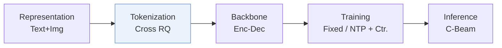
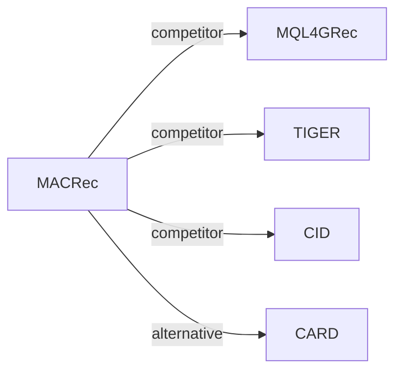

# MACRec

*Multi-aspect cross-modal quantization for generative recommendation* — Zhang et al. · AAAI’26

`I. Informativeness` · `Tokenization` · [Paper](https://arxiv.org/abs/2511.15122) · [Code](https://github.com/zhangfw123/MACRec) · [Matrix](../../README.md#i--tokenization) · [中文](../zh/papers/macrec.md)

Reading level: Reading Notes (Level 2) · On this page: [TL;DR](#tldr) · [At a Glance](#at-a-glance) · [1. Why It Matters](#1-why-this-paper-matters) · [2. Method](#2-how-it-works) · [3. Experiments](#3-experimental-findings) · [4. Limitations](#4-limitations--critical-analysis) · [5. Related Work](#5-connections-to-related-work)

- `Enc-Dec`: Encoder-decoder.
- `Fixed`: SIDs are built first and not changed while the generator trains.
- `NTP + Ctr.`: NTP plus a contrastive loss.
- `C-Beam`: Constrained beam search.

### TL;DR

> [!NOTE]

> MACRec applies cross-modal quantization over text and image features to build Semantic IDs with fewer conflicts, and adds implicit and explicit cross-modal alignment to generator training.

### At a Glance

| Aspect | Summary |
| :-- | :-- |
| Research Problem | I. Informativeness: Do the SIDs, or the model reading them, carry the collaborative and multimodal signals recommendation needs? |
| Key Contribution | MACRec applies cross-modal quantization over text and image features to build Semantic IDs with fewer conflicts, and adds implicit and explicit cross-modal alignment to generator training. |
| Modified Stage | Tokenization |
| Key Findings | MACRec leads all baselines on HR@10, NDCG@5, and NDCG@10 on all three datasets, while on Games HR@5 MISSRec reports 0.0674 against 0.0671 for MACRec (Table 2). |

### 1. Why This Paper Matters

Generative recommendation needs Semantic IDs (SIDs) that are hierarchical, have few conflicts, and support generator training (Abstract). Earlier multimodal generative recommenders quantize each modality on its own, so text and image do not inform each other's IDs.

> "However, existing multimodal GR models typically encode each modality separately to obtain semantic IDs for different modalities." (Related Work)

MACRec adds cross-modal interaction at two points: inside the quantizer and in the generator's training tasks (Methodology).

Based on arXiv v2.

### 2. How It Works

#### Dual-Modality Pseudo-Labels

MACRec clusters items separately by their text embeddings and by their image embeddings. The cluster labels define positive pairs for contrastive learning in the quantizer (Dual-modality Pseudo-label Generation).

#### Cross-Modal Quantization

Each modality passes through an MLP and a residual quantizer. A contrastive loss at the residual levels uses the labels of the other modality (Cross-modal Quantization with Contrastive Learning).

> "More concretely, we use visual pseudo-labels to enhance the residual representations of the text modality, and conversely, use textual pseudo-labels to optimize those of the visual modality." (Cross-modal Quantization with Contrastive Learning)

Reconstruction and quantization losses keep the codes able to recover the original embeddings (Cross-modal Reconstruction Alignment).

#### Multi-Aspect Alignment

The generator trains on next-item prediction within each modality, an implicit alignment of the two SID representations, and explicit item-level and sequence-level tasks across modalities (Generative Recommendation with Multi-aspect Alignment).

> "For sequence-level alignment, we construct a prediction task where a historical sequence of textual semantic IDs is used to predict the visual semantic ID of the next recommended item." (Explicit Alignment with Different Generation Tasks)

### 3. Experimental Findings

Experimental setup

- **Datasets**: Amazon Product Reviews (May 1996-October 2018): Musical Instruments (17,112 users / 6,250 items), Arts Crafts and Sewing (22,171 / 9,416), Video Games (42,259 / 13,839), with text and image features. Filtering rules: not reported.
  - Source: Datasets and date range: [Sx4.SSx1.p1](https://arxiv.org/html/2511.15122v2#Sx4.SSx1.p1); statistics: [Sx4.T1](https://arxiv.org/html/2511.15122v2#Sx4.T1).
- **Split**: Leave-one-out (following P5 and Hua et al. 2023); the exact validation/test allocation is not reported beyond the label.
  - Source: Leave-one-out named only: [Sx4.SSx1.p3](https://arxiv.org/html/2511.15122v2#Sx4.SSx1.p3).
- **Candidates**: full catalog (full ranking across the entire item collection rather than sampling).
  - Source: Full ranking across the entire collection: [Sx4.SSx1.p3](https://arxiv.org/html/2511.15122v2#Sx4.SSx1.p3).
- **Visibility**: warm; no unseen-item protocol is defined.
  - Source: Standard split with no unseen-item protocol: [Sx4.SSx1.p3](https://arxiv.org/html/2511.15122v2#Sx4.SSx1.p3).
- **SID**: Separate text (LLaMA) and image (ViT-L/14) semantic IDs from RQ-VAEs with 4 levels x 256 codewords, aligned by layer-wise cross-modal contrastive and alignment losses. Conflicting IDs are resolved as in MQL4GRec by reassigning codewords according to item-codebook distances. Pre-resolution collision rates, e.g. Instruments text 2.38% and image 3.23%.
  - Source: Per-modality RQ-VAE, 4 levels x 256, conflict reassignment following MQL4GRec: [Sx4.SSx1.p4](https://arxiv.org/html/2511.15122v2#Sx4.SSx1.p4), [Sx3.SSx1.SSSx2.p2](https://arxiv.org/html/2511.15122v2#Sx3.SSx1.SSSx2.p2), [Sx3.SSx1.SSSx3.p5](https://arxiv.org/html/2511.15122v2#Sx3.SSx1.SSSx3.p5); collision rates: [Sx4.T4](https://arxiv.org/html/2511.15122v2#Sx4.T4).
- **Inference budget**: Constrained beam search generates candidates in each modality, and the two modalities' scores are averaged; beam width not reported. T5 backbone with 4-layer encoder and decoder. Hardware, inference batch size, and latency: not reported.
  - Source: Constrained beam search per modality and score averaging: [Sx3.SSx2.SSSx3.p3](https://arxiv.org/html/2511.15122v2#Sx3.SSx2.SSSx3.p3); T5 backbone: [Sx4.SSx1.p4](https://arxiv.org/html/2511.15122v2#Sx4.SSx1.p4).
- **Results from**: Table 2 (Instruments, Arts, Games; MQL4GRec run without its extra-category pre-training); Table 3 (ablations); Table 4 (item collision rates); Figures 3-4 (hyperparameters and code assignment).
  - Source: Main: [Sx4.T2](https://arxiv.org/html/2511.15122v2#Sx4.T2); ablation: [Sx4.T3](https://arxiv.org/html/2511.15122v2#Sx4.T3); collisions: [Sx4.T4](https://arxiv.org/html/2511.15122v2#Sx4.T4); code distribution: [Sx4.F4](https://arxiv.org/html/2511.15122v2#Sx4.F4); hyperparameters: [Sx4.F3](https://arxiv.org/html/2511.15122v2#Sx4.F3).

- Ablation: removing any module lowers HR@10 on all three datasets (Table 3).
- Collisions: MACRec has lower item ID collision rates than MQL4GRec (Table 4).

### 4. Limitations & Critical Analysis

**Our analysis.**

- MQL4GRec also builds separate text and image SIDs (`Dual RQ`); MACRec replaces this with `Cross RQ` and adds a contrastive term to the generator objective (`NTP + Ctr.`).
- The representation uses text and image only (`Text+Img`). CARD adds collaborative signals (`Text+Img+CF`) and quantizes one combined input with `NU-RQ`.

### 5. Connections to Related Work

- **同期对比** · [MQL4GRec](mql4grec.md): MQL4GRec quantizes each modality into its own SIDs with cross-modal translation; MACRec adds layer-wise cross-modal contrastive learning in quantization and implicit and explicit alignment in generation, and reuses MQL4GRec's conflict resolution and ensemble.
  - Source: MACRec v2, baselines without pre-training: https://arxiv.org/html/2511.15122v2#Sx4.SSx1.p2 and https://arxiv.org/html/2511.15122v2#Sx4.SSx1.p4; Table 2 and Table 4: https://arxiv.org/html/2511.15122v2#Sx4.T2 and https://arxiv.org/html/2511.15122v2#Sx4.T4; reused conflict resolution: https://arxiv.org/html/2511.15122v2#Sx3.SSx1.SSSx3.p5.
- **同期对比** · [TIGER](tiger.md): TIGER quantizes a single text embedding; MACRec quantizes text and image separately and aligns them, while keeping TIGER's T5 backbone and constrained beam search.
  - Source: MACRec v2, baselines and backbone: https://arxiv.org/html/2511.15122v2#Sx4.SSx1.p2 and https://arxiv.org/html/2511.15122v2#Sx4.SSx1.p4; Table 2: https://arxiv.org/html/2511.15122v2#Sx4.T2.
- **同期对比** · [CID](cid.md): P5-CID uses collaborative clustering IDs for a P5 model; MACRec builds multimodal semantic IDs.
  - Source: MACRec v2, Table 2 baseline P5-CID: https://arxiv.org/html/2511.15122v2#Sx4.T2.
- **替代方案** · [CARD](card.md): CARD later renders image, title, and neighbors into one visual card and quantizes it with a non-uniform RQ-VAE, comparing against MACRec.
  - Source: Evidence is from the later CARD paper: baselines and Table 2: https://arxiv.org/html/2604.26427v1#S4.I1.i9.p1 and https://arxiv.org/html/2604.26427v1#S4.T2.

[查看同格全部论文](../../README.md#i--tokenization)
