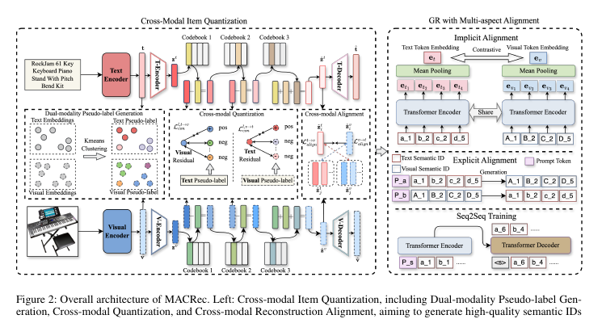

# MACRec

*Multi-aspect cross-modal quantization for generative recommendation* — Zhang et al. · AAAI’26

`I. Informativeness` · `Tokenization`

[Paper](https://arxiv.org/abs/2511.15122) · [Code](https://github.com/zhangfw123/MACRec) · [Matrix](../../README.md#i--tokenization)

Reading level: Overview (Level 1) · On this page: [At a Glance](#at-a-glance) · [2. How It Works](#2-how-it-works) · [3. Experimental Findings](#3-experimental-findings) · [5. Connections to Related Work](#5-connections-to-related-work)

| Representation | Tokenization | Backbone | Training | Inference |
| :-: | :-: | :-: | :-: | :-: |
| `Text+Img` | **`Cross RQ`** | `Enc-Dec` | `Fixed / NTP + Ctr.` | `C-Beam` |

- `Enc-Dec`: Encoder-decoder.
- `Fixed`: SIDs are built first and not changed while the generator trains.
- `NTP + Ctr.`: NTP plus a contrastive loss.
- `C-Beam`: Constrained beam search.

### At a Glance

| Aspect | Summary |
| :-- | :-- |
| Research Problem | I. Informativeness: Do the SIDs, or the model reading them, carry the collaborative and multimodal signals recommendation needs? |
| Modified Stage | Tokenization |

### 2. How It Works

### 3. Experimental Findings

**Experimental setup**

- **Datasets**: Amazon Product Reviews (May 1996-October 2018): Musical Instruments (17,112 users / 6,250 items), Arts Crafts and Sewing (22,171 / 9,416), Video Games (42,259 / 13,839), with text and image features. Filtering rules: not reported.
  - Source: Datasets and date range: https://arxiv.org/html/2511.15122v2#Sx4.SSx1.p1; statistics: https://arxiv.org/html/2511.15122v2#Sx4.T1.
- **Split**: Leave-one-out (following P5 and Hua et al. 2023); the exact validation/test allocation is not reported beyond the label.
  - Source: Leave-one-out named only: https://arxiv.org/html/2511.15122v2#Sx4.SSx1.p3.
- **Candidates**: full catalog (full ranking across the entire item collection rather than sampling).
  - Source: Full ranking across the entire collection: https://arxiv.org/html/2511.15122v2#Sx4.SSx1.p3.
- **Visibility**: warm; no unseen-item protocol is defined.
  - Source: Standard split with no unseen-item protocol: https://arxiv.org/html/2511.15122v2#Sx4.SSx1.p3.
- **SID**: Separate text (LLaMA) and image (ViT-L/14) semantic IDs from RQ-VAEs with 4 levels x 256 codewords, aligned by layer-wise cross-modal contrastive and alignment losses. Conflicting IDs are resolved as in MQL4GRec by reassigning codewords according to item-codebook distances. Pre-resolution collision rates, e.g. Instruments text 2.38% and image 3.23%.
  - Source: Per-modality RQ-VAE, 4 levels x 256, conflict reassignment following MQL4GRec: https://arxiv.org/html/2511.15122v2#Sx4.SSx1.p4, https://arxiv.org/html/2511.15122v2#Sx3.SSx1.SSSx2.p2, https://arxiv.org/html/2511.15122v2#Sx3.SSx1.SSSx3.p5; collision rates: https://arxiv.org/html/2511.15122v2#Sx4.T4.
- **Inference budget**: Constrained beam search generates candidates in each modality, and the two modalities' scores are averaged; beam width not reported. T5 backbone with 4-layer encoder and decoder. Hardware, inference batch size, and latency: not reported.
  - Source: Constrained beam search per modality and score averaging: https://arxiv.org/html/2511.15122v2#Sx3.SSx2.SSSx3.p3; T5 backbone: https://arxiv.org/html/2511.15122v2#Sx4.SSx1.p4.
- **Results from**: Table 2 (Instruments, Arts, Games; MQL4GRec run without its extra-category pre-training); Table 3 (ablations); Table 4 (item collision rates); Figures 3-4 (hyperparameters and code assignment).
  - Source: Main: https://arxiv.org/html/2511.15122v2#Sx4.T2; ablation: https://arxiv.org/html/2511.15122v2#Sx4.T3; collisions: https://arxiv.org/html/2511.15122v2#Sx4.T4; code distribution: https://arxiv.org/html/2511.15122v2#Sx4.F4; hyperparameters: https://arxiv.org/html/2511.15122v2#Sx4.F3.

## 旧卡片说明

迁自 `d61aa6c:papers/macrec.md`。保留方法说明、实验叙述与局限；本轮只对照现有记录处理明确冲突，未重新逐句核查原论文。分类和规格以页面上方由记录生成的表格为准。

### MACRec：多方面跨模态量化生成式推荐

> MACRec 在 SID 量化和生成推荐训练中同时建模文本、图像及其交互，减少跨模态语义损失和标识碰撞。

### 研究动机与问题定义

已有多模态生成推荐常独立量化不同模态，难以利用互补信息。MACRec 将跨模态对比学习放入量化过程，并在生成阶段加入多方面对齐。

### TL;DR（核心摘要）

`文本/图像 → 跨模态量化 → 多模态SID → 生成模型 → 内部集成 → 推荐物品`

模型分别编码文本和图像，通过伪标签、跨模态残差量化和重构对齐学习语义标识；生成推荐阶段包含隐式表示对齐、显式 item/sequence 对齐和 Seq2Seq 目标。推理时对两种模态进行约束束搜索并在模型内部平均分数，得到最终物品。

### 输入与使用场景

| 方面 | 说明 |
|---|---|
| 使用信息 | 物品文本、图像和用户交互 |
| 信息融入位置 | 量化目标、对齐任务和生成输入 |
| 语义标识结构 | 文本/视觉多级离散序列 |
| 适用场景 | 多模态序列推荐 |

### 方法设计

#### 3.1 双模态伪标签
MACRec 分别用文本编码器和视觉编码器获得物品表示，再在两种模态上聚类生成伪标签。伪标签用于构造跨模态正样本，使文本和图像在量化过程中能够相互提供监督。

#### 3.2 跨模态量化与重构
文本、视觉表示分别经过 MLP 和多级残差量化。跨模态对比损失让一类模态的残差表示吸收另一类模态的相似性；重构损失和量化损失保证离散 code 能恢复原始表示。

#### 3.3 多方面生成对齐
生成推荐阶段包含同模态 next-item 生成、跨模态 item/sequence 对齐，以及隐式表示对齐。模型由一种模态的历史 SID 预测另一种模态的目标 SID，促进两套标识的协同。

#### 3.4 训练与推理
训练目标联合推荐损失和对齐损失。推理时两种模态分别进行约束束搜索，最后在模型内部平均候选分数并去重，得到推荐结果。

### 实验结论

- MACRec 在三个 Amazon 数据集上优于比较方法。
- 跨模态量化和多方面对齐均改善效果，并降低碰撞。

### 局限性与研究定位

#### 局限性
- 双模态生成和结果集成增加推理成本。
- 图像缺失、动态物品和线上服务效率仍需验证。

#### 研究定位
MACRec 的贡献是把跨模态交互前移到 SID 学习阶段，适合放在“多模态语义标识与生成推荐”章节。

### 相关资源

- [论文原文](https://arxiv.org/abs/2511.15122)

### 标签

`跨模态量化` · `多方面对齐` · `多模态推荐` · `生成式推荐`

### 架构图来源

*图源：原论文，图2。图片使用许可待核实。*

---

### 旧总表补充

来源：`d61aa6c:tables/all-methods.md`。

- 核心贡献：在量化阶段建模跨模态交互。
- 使用场景：多模态推荐。

### 5. Connections to Related Work

- **Competitor** · [MQL4GRec](mql4grec.md): MQL4GRec quantizes each modality into its own SIDs with cross-modal translation; MACRec adds layer-wise cross-modal contrastive learning in quantization and implicit and explicit alignment in generation, and reuses MQL4GRec's conflict resolution and ensemble.
  - Source: MACRec v2, baselines without pre-training: https://arxiv.org/html/2511.15122v2#Sx4.SSx1.p2 and https://arxiv.org/html/2511.15122v2#Sx4.SSx1.p4; Table 2 and Table 4: https://arxiv.org/html/2511.15122v2#Sx4.T2 and https://arxiv.org/html/2511.15122v2#Sx4.T4; reused conflict resolution: https://arxiv.org/html/2511.15122v2#Sx3.SSx1.SSSx3.p5.
- **Competitor** · [TIGER](tiger.md): TIGER quantizes a single text embedding; MACRec quantizes text and image separately and aligns them, while keeping TIGER's T5 backbone and constrained beam search.
  - Source: MACRec v2, baselines and backbone: https://arxiv.org/html/2511.15122v2#Sx4.SSx1.p2 and https://arxiv.org/html/2511.15122v2#Sx4.SSx1.p4; Table 2: https://arxiv.org/html/2511.15122v2#Sx4.T2.
- **Competitor** · [CID](cid.md): P5-CID uses collaborative clustering IDs for a P5 model; MACRec builds multimodal semantic IDs.
  - Source: MACRec v2, Table 2 baseline P5-CID: https://arxiv.org/html/2511.15122v2#Sx4.T2.
- **Alternative** · [CARD](card.md): CARD later renders image, title, and neighbors into one visual card and quantizes it with a non-uniform RQ-VAE, comparing against MACRec.
  - Source: Evidence is from the later CARD paper: baselines and Table 2: https://arxiv.org/html/2604.26427v1#S4.I1.i9.p1 and https://arxiv.org/html/2604.26427v1#S4.T2.

[View all papers in this cell](../../README.md#i--tokenization)
