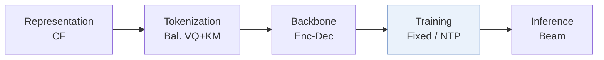
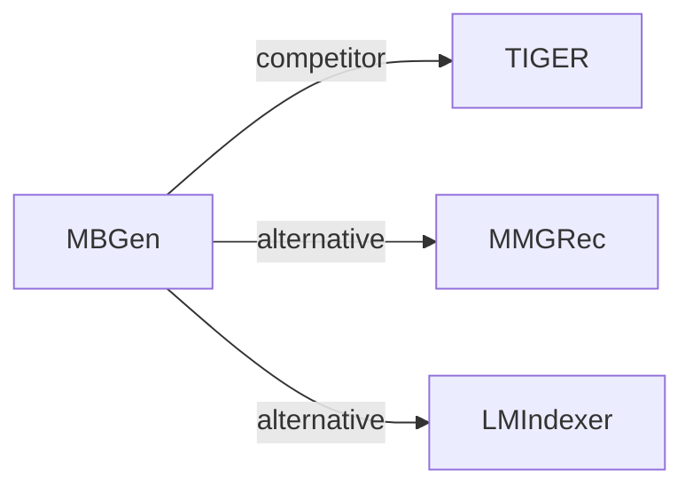

# MBGen

*Multi-Behavior Generative Recommendation* — Liu et al. · CIKM’24

`I. Informativeness` · `Training`

[Paper](https://arxiv.org/abs/2405.16871) · [Code](https://github.com/anananan116/MBGen) · [Matrix](../../README.md#i--training)

Reading level: Overview (Level 1) · On this page: [TL;DR](#tldr) · [At a Glance](#at-a-glance) · [3. Experimental Findings](#3-experimental-findings) · [5. Connections to Related Work](#5-connections-to-related-work)

- `CF`: Collaborative filtering signal.
- `Bal. VQ+KM`: Balanced tokenization combining vector quantization and k-means clustering.
- `Enc-Dec`: Encoder-decoder.
- `Fixed`: SIDs are built first and not changed while the generator trains.
- `NTP`: Next-token prediction loss only; continuing from a pretrained LLM (SFT) also counts as NTP.

### TL;DR

MBGen interleaves behavior tokens and item tokens in one sequence, predicts the next behavior type and then the next item, and scales with a position-routed sparse architecture.

### At a Glance

| Aspect | Summary |
| :-- | :-- |
| Research Problem | I. Informativeness: Do the SIDs, or the model reading them, carry the collaborative and multimodal signals recommendation needs? |
| Key Contribution | MBGen interleaves behavior tokens and item tokens in one sequence, predicts the next behavior type and then the next item, and scales with a position-routed sparse architecture. |
| Modified Stage | Training |

### 3. Experimental Findings

**Experimental setup**

- **Datasets**: Retail (Taobao/Tmall) and IJCAI; purchase/cart/favorite/click behaviors, with purchase as target. Remove items occurring fewer than five times in training sequences; maximum history 50 items.
- **Split**: Per-user leave-one-out: latest interaction test, penultimate validation; remaining interactions training.
- **Candidates**: full catalog; target ranked against all other items rather than sampled negatives.
- **Visibility**: warm; retained items have at least five training occurrences. SID features come from pretrained MB-STR embeddings; pretraining exposure to test interactions not reported.
- **SID**: Three item tokens with per-position size K=64 Retail/96 IJCAI. Balanced SID: K-entry VQ codebook, K-cluster residual K-means per first-token bucket, then random collision-disambiguation token. Balanced CID: random item-number remapping and base-K digits, without features. Behavior token precedes each item.
- **Inference budget**: Beam 50; top-10 outputs; Recall/NDCG@5/10. Hardware, inference batch size and latency not reported.
- **Results from**: Original Tables 3/4/5: target-behavior, behavior-specific, joint behavior-item prediction. Most baselines reproduced in RecBole; MB-GMN excepted, with result provenance not specified. Table 6: ablations; Table 7: token distribution.

Sources

- **Datasets**: [S4.SS1.SSS1.p2](https://arxiv.org/html/2405.16871v1#S4.SS1.SSS1.p2) ; #S4.SS1.SSS1.p3 ; #S4.SS1.SSS1.p4 ; #S4.SS1.SSS3.p1
- **Split**: [S4.SS1.SSS3.p1](https://arxiv.org/html/2405.16871v1#S4.SS1.SSS3.p1)
- **Candidates**: [S4.SS1.SSS3.p1](https://arxiv.org/html/2405.16871v1#S4.SS1.SSS3.p1)
- **Visibility**: [S4.SS1.SSS1.p4](https://arxiv.org/html/2405.16871v1#S4.SS1.SSS1.p4) ; #S4.SS1.SSS4.p2
- **SID**: [S3.SS2.p3](https://arxiv.org/html/2405.16871v1#S3.SS2.p3) ; #S3.SS2.p4 ; #S3.SS2.p5 ; #S4.SS1.SSS4.p2
- **Inference budget**: [S4.SS1.SSS3.p1](https://arxiv.org/html/2405.16871v1#S4.SS1.SSS3.p1) ; #S4.SS1.SSS4
- **Results from**: [S4.T3](https://arxiv.org/html/2405.16871v1#S4.T3) ; #S4.T4 ; #S4.T5 ; #S4.T6 ; #S4.T7 ; #S4.SS1.SSS4.p1

### 5. Connections to Related Work

- **Competitor** · [TIGER](tiger.md): TIGER is a reproduced generative baseline; MBGen balances item tokens and jointly predicts behavior types and items.
  - Source: MBGen v1, Sections 3.2/4.1.2 and Table 3: https://arxiv.org/html/2405.16871v1#S3.SS2.p1; https://arxiv.org/html/2405.16871v1#S4.SS1.SSS2.p2; https://arxiv.org/html/2405.16871v1#S4.T3.
- **Alternative** · [MMGRec](mmgrec.md): MBGen cites MMGRec among RQ-VAE tokenizers whose code imbalance motivates its bucket-specific residual quantization.
  - Source: MBGen v1, Section 3.2, citing Liu et al. (2024): https://arxiv.org/html/2405.16871v1#S3.SS2.p1; https://arxiv.org/html/2405.16871v1#S3.SS2.p2.
- **Alternative** · [LMIndexer](lmindexer.md): LMIndexer learns language-model semantic indices; MBGen instead uses pretrained collaborative embeddings for balanced item tokens.
  - Source: MBGen v1, Sections 2/4.1.4, citing Jin et al. (2023): https://arxiv.org/html/2405.16871v1#S2.p2; https://arxiv.org/html/2405.16871v1#S4.SS1.SSS4.p2.

[View all papers in this cell](../../README.md#i--training)
