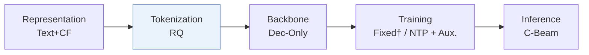
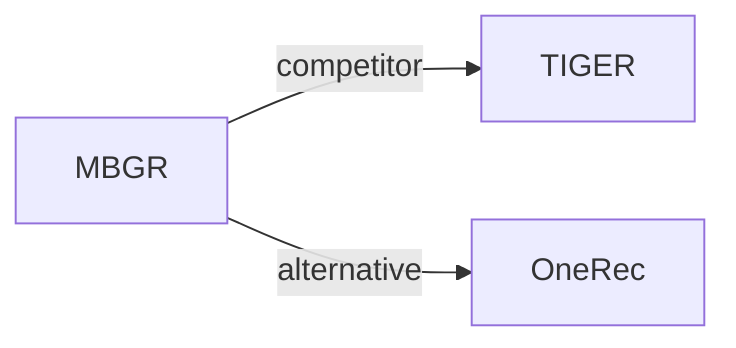

# MBGR

| **Title** | *Multi-Business Prediction for Generative Recommendation at Meituan* |
| :-- | :-- |
| **Authors** | Li et al. |
| **Venue** | arXiv’26 |
| **Problem × Stage** | `VI. Generalization` · `Tokenization` |
| **Links** | [Paper](https://arxiv.org/abs/2604.02684) · [Matrix](../../README.md#vi--tokenization) · [中文](../zh/papers/mbgr.md) |
| **Reading level** | Overview (Level 1) |

On this page: [TL;DR](#tldr) · [At a Glance](#at-a-glance) · [3. Experiments](#3-experimental-findings) · [5. Related Work](#5-connections-to-related-work)

- `RQ`: Residual quantization.
- `Dec-Only`: Decoder-only.
- `NTP + Aux.`: NTP plus another auxiliary loss.
- `C-Beam`: Constrained beam search.

### TL;DR

> [!NOTE]
> MBGR adds business-aware Semantic IDs, business-specific prediction, and dynamic label routing to generative recommendation, to avoid a seesaw between businesses that share one ID space.

---

### At a Glance

| Aspect | Summary |
| :-- | :-- |
| Research Problem | VI. Generalization: Does it still work for new items, new domains, and shifting interests? |
| Key Contribution | MBGR adds business-aware Semantic IDs, business-specific prediction, and dynamic label routing to generative recommendation, to avoid a seesaw between businesses that share one ID space. |
| Modified Stage | Tokenization |

---

### 3. Experimental Findings

Experimental setup

- **Datasets**: Meituan only. Generative training data: one year of click sequences from 38,258,649 users over 54,875,570 merchants in four businesses (A 61.47%, B 9.56%, C 12.31%, D 16.66%). Downstream data: 37,349,276 users and 783,946,360 interactions over a rolling 30-day window. Filtering rules: not reported.
  - Source: Datasets: [S6.SS1.SSS1.p2](https://arxiv.org/html/2604.02684v1#S6.SS1.SSS1.p2), [S6.I1.i1.p1](https://arxiv.org/html/2604.02684v1#S6.I1.i1.p1), [S6.I1.i2.p1](https://arxiv.org/html/2604.02684v1#S6.I1.i2.p1), [S6.I2.i1.p1](https://arxiv.org/html/2604.02684v1#S6.I2.i1.p1), [S6.I2.i2.p1](https://arxiv.org/html/2604.02684v1#S6.I2.i2.p1).
- **Split**: Offline: not reported (the paper mentions a validation set for hyperparameter search but not how train, validation, and test are formed). Online: one-week A/B test with 30% of Meituan production traffic against the baseline without MBP; CTCVR +3.98%.
  - Source: No offline split rule stated; validation used for grid search: [S6.SS1.SSS4.p1](https://arxiv.org/html/2604.02684v1#S6.SS1.SSS4.p1); online test: [S6.SS6.p4](https://arxiv.org/html/2604.02684v1#S6.SS6.p4) and [S1.I1.i3.p1](https://arxiv.org/html/2604.02684v1#S1.I1.i3.p1).
- **Candidates**: not reported (full catalog versus sampled candidates for HR@10); downstream ranking uses business-wise GAUC.
  - Source: Metrics only: [S6.SS1.SSS3.p2](https://arxiv.org/html/2604.02684v1#S6.SS1.SSS3.p2) and [S6.SS1.SSS3.p3](https://arxiv.org/html/2604.02684v1#S6.SS1.SSS3.p3).
- **Visibility**: warm; no unseen-item protocol is defined.
  - Source: No unseen-item protocol: [S6.SS1.SSS1.p1](https://arxiv.org/html/2604.02684v1#S6.SS1.SSS1.p1).
- **SID**: Business-aware semantic IDs: each item's K token embeddings are re-encoded with its business type through a gated encoder and decoded per business; number of SID levels, codebook sizes, and collision handling: not reported.
  - Source: Business-aware encoder/decoder over K input tokens: [S4.SS1.p3](https://arxiv.org/html/2604.02684v1#S4.SS1.p3) and [S4.SS1.p6](https://arxiv.org/html/2604.02684v1#S4.SS1.p6); no codebook settings found.
- **Inference budget**: Decoding method and beam width: not reported. 16-layer Transformer (8 heads, 128-dimensional embeddings), sequences up to 1,500 items; trained and deployed on NVIDIA A100-80GB GPUs; inference batch size and latency: not reported.
  - Source: Hardware and architecture: [S6.SS1.SSS4.p1](https://arxiv.org/html/2604.02684v1#S6.SS1.SSS4.p1) and [S6.SS1.SSS4.p2](https://arxiv.org/html/2604.02684v1#S6.SS1.SSS4.p2).
- **Results from**: Table 1 (HR@10 per business versus SASRec, TIGER, HSTU); Table 2 (downstream CTCVR GAUC); Table 3 (ablations); Tables 4-7 (time decay, business weights, expert count).
  - Source: Generative: [S6.T1](https://arxiv.org/html/2604.02684v1#S6.T1); downstream: [S6.T2](https://arxiv.org/html/2604.02684v1#S6.T2); ablation: [S6.T3](https://arxiv.org/html/2604.02684v1#S6.T3); hyperparameters: [S6.T4](https://arxiv.org/html/2604.02684v1#S6.T4), [S6.T6](https://arxiv.org/html/2604.02684v1#S6.T6), [S6.T7](https://arxiv.org/html/2604.02684v1#S6.T7).

---

### 5. Connections to Related Work

- **Competitor** · [TIGER](tiger.md): TIGER generates one shared semantic ID space for all items; MBGR makes SIDs business-aware and predicts the next item for each business in parallel.
  - Source: MBGR v1, Table 1 baseline Tiger: https://arxiv.org/html/2604.02684v1#S6.T1; related work: https://arxiv.org/html/2604.02684v1#S2.SS1.p1.
- **Alternative** · [OneRec](onerec.md): OneRec unifies the whole pipeline in one end-to-end model; MBGR keeps the industrial cascade and adds multi-business generation for recall.
  - Source: MBGR v1, Section 6.6 contrasts with OneRec: https://arxiv.org/html/2604.02684v1#S6.SS6.p2; related work: https://arxiv.org/html/2604.02684v1#S2.SS1.p1.

[View all papers in this cell](../../README.md#vi--tokenization)
