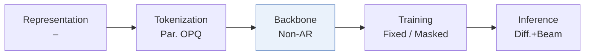
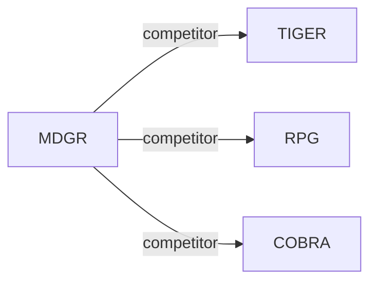

# MDGR

*Masked Diffusion Generative Recommendation* — Mu et al. · arXiv’26

`III. SID–Model Alignment` · `Backbone` · [Paper](https://arxiv.org/abs/2601.19501) · [Matrix](../../README.md#iii--backbone) · [中文](../zh/papers/mdgr.md)

Reading level: Overview (Level 1) · On this page: [TL;DR](#tldr) · [At a Glance](#at-a-glance) · [3. Experiments](#3-experimental-findings) · [5. Related Work](#5-connections-to-related-work)

- `–`: Not reported in the paper.
- `Non-AR`: Non-autoregressive.
- `Fixed`: SIDs are built first and not changed while the generator trains.
- `Masked`: Masks part of the codes and reconstructs them (includes masked diffusion).
- `Diff.+Beam`: Diffusion-based decoding combined with beam search.

### TL;DR

> [!NOTE]

> MDGR uses a parallel codebook, adaptive masking along time and samples, and warm-up two-stage parallel decoding for masked diffusion recommendation, instead of fixed-order autoregressive Semantic ID decoding.

### At a Glance

| Aspect | Summary |
| :-- | :-- |
| Research Problem | III. SID–Model Alignment: Can the generator read, write, and reason over SIDs, and do the tokenizer and generator work toward the same goal? |
| Key Contribution | MDGR uses a parallel codebook, adaptive masking along time and samples, and warm-up two-stage parallel decoding for masked diffusion recommendation, instead of fixed-order autoregressive Semantic ID decoding. |
| Modified Stage | Backbone |

### 3. Experimental Findings

Experimental setup

- **Datasets**: Amazon Electronics/Books: remove users with fewer than five interactions, maximum history 20. Industrial Southeast Asian e-commerce logs: May-December 2025, >1B interactions, 18M users, 25M items, mean history 128; industrial filtering not reported.
  - Source: [S5.SS1.SSS1.p1](https://arxiv.org/html/2601.19501v1#S5.SS1.SSS1.p1)
- **Split**: Sliding-window next-item training; chronological leave-one-out: latest interaction test, penultimate validation, remainder training. Online A/B: January 5-12, 2026, control/treatment each 20% uniformly sampled users.
  - Source: [S5.SS1.SSS1.p1](https://arxiv.org/html/2601.19501v1#S5.SS1.SSS1.p1) ; #S5.SS6.p1
- **Candidates**: not reported
  - Source: Section 5.1 gives metrics but no evaluation universe or negative-sampling protocol: [S5.SS1](https://arxiv.org/html/2601.19501v1#S5.SS1)
- **Visibility**: warm; no unseen-item protocol is defined. Tokenizer fitting exposure to test items not reported.
  - Source: [S5.SS1.SSS1.p1](https://arxiv.org/html/2601.19501v1#S5.SS1.SSS1.p1) ; #S5.SS1.SSS3.p1
- **SID**: OPQ-based parallel codebooks: 8 x 300, 256-dimensional code vectors, using Qwen3-8B content embeddings. Complete SIDs map to item sets through an offline index; collision disambiguation not reported.
  - Source: [S4.SS2](https://arxiv.org/html/2601.19501v1#S4.SS2) ; #S5.SS1.SSS3.p1
- **Inference budget**: Beam 50; four single-position warm-up steps, then two positions/step. Table 3 reports six total steps and 2.527 QPS versus 2.212 for eight serial steps; implementation text inconsistently says four subsequent parallel steps. Recall/NDCG@5/10; inference-specific hardware, batch size and latency not reported.
  - Source: [S5.SS1.SSS3.p1](https://arxiv.org/html/2601.19501v1#S5.SS1.SSS3.p1) ; #S5.T3 ; #S5.SS3.SSS2.p2
- **Results from**: Original Table 2: offline three-dataset comparison; baseline-result reuse not stated. Table 3: industrial efficiency; Table 4: industrial ablations; Section 5.6: online A/B against production TIGER.
  - Source: [S4.T2](https://arxiv.org/html/2601.19501v1#S4.T2) ; #S5.T3 ; #S5.T4 ; #S5.SS6.p1

### 5. Connections to Related Work

- **同期对比** · [TIGER](tiger.md): TIGER generates residual-quantized IDs autoregressively; MDGR denoises parallel-codebook IDs and is also tested against production TIGER online.
  - Source: MDGR v1, Sections 5.1.2/5.6 and Table 2: https://arxiv.org/html/2601.19501v1#S5.SS1.SSS2.p1; https://arxiv.org/html/2601.19501v1#S5.SS6.p1; https://arxiv.org/html/2601.19501v1#S4.T2.
- **同期对比** · [RPG](rpg.md): RPG uses multi-token prediction and graph-constrained parallel decoding; MDGR uses masked denoising with confidence-guided position scheduling.
  - Source: MDGR v1, Sections 4.4/5.1.2 and Table 2: https://arxiv.org/html/2601.19501v1#S4.SS4; https://arxiv.org/html/2601.19501v1#S5.SS1.SSS2.p1; https://arxiv.org/html/2601.19501v1#S4.T2.
- **同期对比** · [COBRA](cobra.md): COBRA supplements sparse IDs with dense vectors; MDGR instead changes discrete-ID supervision and decoding through masked diffusion.
  - Source: MDGR v1, Sections 2.1/5.1.2 and Table 2: https://arxiv.org/html/2601.19501v1#S2.SS1.p1; https://arxiv.org/html/2601.19501v1#S5.SS1.SSS2.p1; https://arxiv.org/html/2601.19501v1#S4.T2.

[查看同格全部论文](../../README.md#iii--backbone)
