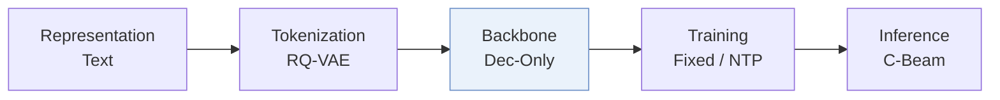
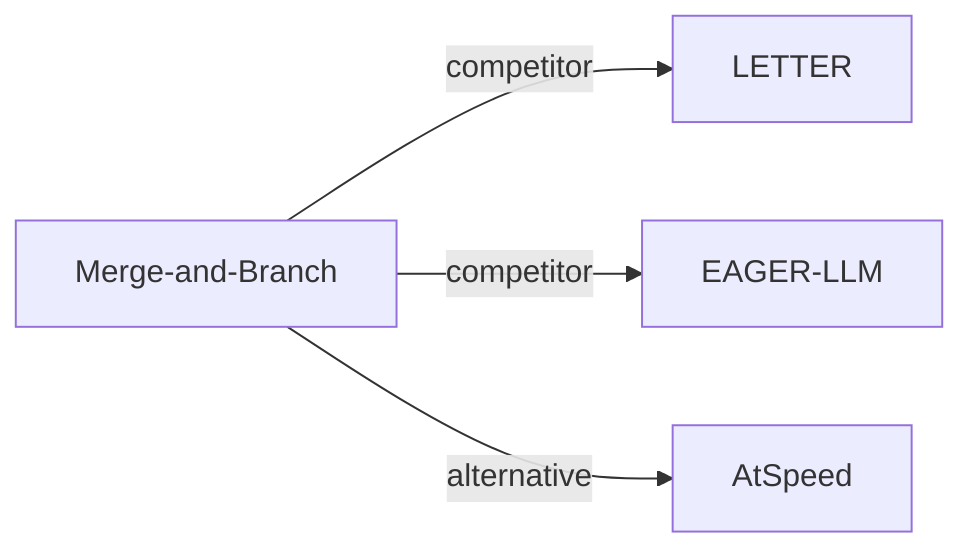

# Merge-and-Branch

*Merge and Branch: Efficient Tree-Structured Supervised Fine-Tuning of LLMs for Recommendation* — Zhu et al. · arXiv’26

`V. Efficiency` · `Backbone` · [Paper](https://arxiv.org/abs/2610.37973) · [Matrix](../../README.md#v--backbone) · [中文](../zh/papers/merge-and-branch.md)

Reading level: Overview (Level 1) · On this page: [TL;DR](#tldr) · [At a Glance](#at-a-glance) · [3. Experiments](#3-experimental-findings) · [5. Related Work](#5-connections-to-related-work)

- `Dec-Only`: Decoder-only.
- `Fixed`: SIDs are built first and not changed while the generator trains.
- `NTP`: Next-token prediction loss only; continuing from a pretrained LLM (SFT) also counts as NTP.
- `C-Beam`: Constrained beam search.

### TL;DR

> [!NOTE]
> Merge-and-Branch compresses each history item's Semantic ID and text into few learned tokens and predicts several target IDs from one shared history in a tree layout, reducing fine-tuning cost.

### At a Glance

| Aspect | Summary |
| :-- | :-- |
| Research Problem | V. Efficiency: Can it be trained and served within latency and cost budgets? |
| Key Contribution | Merge-and-Branch compresses each history item's Semantic ID and text into few learned tokens and predicts several target IDs from one shared history in a tree layout, reducing fine-tuning cost. |
| Modified Stage | Backbone |

### 3. Experimental Findings

Experimental setup

- **Datasets**: Amazon 2014 5-core Beauty, Sports and Outdoors, Toys and Games.
  - Source: Section 4.1 Datasets: [S4.SS1.SSS0.Px1.p1](https://arxiv.org/html/2610.37973v1#S4.SS1.SSS0.Px1.p1)
- **Split**: Per-user chronological last/penultimate interactions test/validation; earlier interactions training. Main M&B result selects the best of five seeds by validation NDCG@10.
  - Source: Section 4.1 Metrics and protocol: [S4.SS1.SSS0.Px2.p1](https://arxiv.org/html/2610.37973v1#S4.SS1.SSS0.Px2.p1)
- **Candidates**: full catalog; invalid or unresolved predictions count as misses.
  - Source: Section 4.1 Metrics and protocol: [S4.SS1.SSS0.Px2.p1](https://arxiv.org/html/2610.37973v1#S4.SS1.SSS0.Px2.p1)
- **Visibility**: warm; no unseen-item protocol is defined. Held-out items do not fill missing future branches; tokenizer/CF-teacher item exposure: not reported.
  - Source: Section 4.4 and Appendix B.2: [S4.SS4.SSS0.Px1.p3](https://arxiv.org/html/2610.37973v1#S4.SS4.SSS0.Px1.p3) and [A2.SS2.p1](https://arxiv.org/html/2610.37973v1#A2.SS2.p1)
- **SID**: Sentence-T5-XXL plus 3-level RQ-VAE, 256 codes/level, deterministic collision suffix: four-token SID.
  - Source: Appendix B.2: [A2.SS2.p1](https://arxiv.org/html/2610.37973v1#A2.SS2.p1)
- **Inference budget**: Main: beam 50, Recall/NDCG@5/10; inference batch/hardware not reported. Efficiency: H200, batch 1, beam 100, synthetic contexts 64-2048, four merged tokens/item; Tree latency 76.33-83.85 ms/request including prefill/search.
  - Source: Section 4.1, Appendix B.3 and Table 4: [S4.SS1.SSS0.Px3.p1](https://arxiv.org/html/2610.37973v1#S4.SS1.SSS0.Px3.p1) and [A2.SS3.p2](https://arxiv.org/html/2610.37973v1#A2.SS3.p2) and [S4.T4](https://arxiv.org/html/2610.37973v1#S4.T4)
- **Results from**: Table 3 mixes authors' runs with original-paper scores (TIGER, LETTER-Beauty, EAGER, EAGER-LLM-Beauty/Sports, GRAM) and GRAM reproductions (P5-CID, LC-Rec). M&B and Table 4 decoding measurements are this paper's experiments.
  - Source: Table 3, Table 4 and Appendix B.1: [S4.T3](https://arxiv.org/html/2610.37973v1#S4.T3) and [S4.T4](https://arxiv.org/html/2610.37973v1#S4.T4) and [A2.SS1.p1](https://arxiv.org/html/2610.37973v1#A2.SS1.p1)

### 5. Connections to Related Work

- **Competitor** · [LETTER](letter.md): LETTER-TIGER is reproduced on Sports/Toys; its Beauty score comes from the original paper.
  - Source: M&B v1, Appendix B.1: https://arxiv.org/html/2610.37973v1#A2.SS1.p1; https://arxiv.org/html/2610.37973v1#A2.SS1.p2.
- **Competitor** · [EAGER-LLM](eager-llm.md): EAGER-LLM is rerun on Toys; Beauty/Sports scores come from its original paper.
  - Source: M&B v1, Appendix B.1: https://arxiv.org/html/2610.37973v1#A2.SS1.p1.
- **Alternative** · [AtSpeed](atspeed.md): AtSpeed uses tree masks for speculative beam verification; M&B shares history during training and decoding.
  - Source: M&B v1, Section 2 and Table 1: https://arxiv.org/html/2610.37973v1#S2.SS0.SSS0.Px3.p1; https://arxiv.org/html/2610.37973v1#S2.T1.

[View all papers in this cell](../../README.md#v--backbone)
