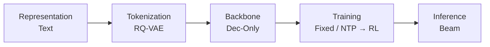
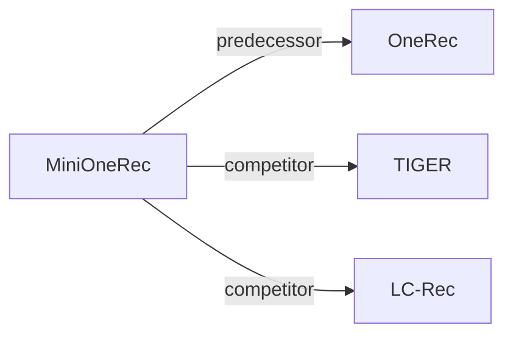

# MiniOneRec

*An Open-Source Framework for Scaling Generative Recommendation* — Kong et al. · arXiv’25

`Paradigms, Systems and Benchmarks` · `No single stage` · [Paper](https://arxiv.org/abs/2510.24431) · [Code](https://github.com/AkaliKong/MiniOneRec) · [Matrix](../../README.md#paradigms-systems-and-benchmarks) · [中文](../zh/papers/minionerec.md)

Reading level: Reading Notes (Level 2) · On this page: [TL;DR](#tldr) · [At a Glance](#at-a-glance) · [1. Why It Matters](#1-why-this-paper-matters) · [2. Method](#2-how-it-works) · [3. Experiments](#3-experimental-findings) · [4. Limitations](#4-limitations--critical-analysis) · [5. Related Work](#5-connections-to-related-work)

- `Dec-Only`: Decoder-only.
- `Fixed`: SIDs are built first and not changed while the generator trains.
- `NTP → RL`: NTP, then reinforcement learning (GRPO, GBPO, etc.).

### TL;DR

> [!NOTE]

> MiniOneRec is an open-source framework for RQ-VAE Semantic ID construction, supervised fine-tuning of Qwen backbones, and reinforcement learning with constrained decoding, to test generative scaling on public benchmarks.

### At a Glance

| Aspect | Summary |
| :-- | :-- |
| Research Problem | Paradigms, Systems and Benchmarks: Baseline (TIGER), end-to-end multi-stage paradigms, open-source frameworks, benchmarks, and diagnostic resources. |
| Key Contribution | MiniOneRec is an open-source framework for RQ-VAE Semantic ID construction, supervised fine-tuning of Qwen backbones, and reinforcement learning with constrained decoding, to test generative scaling on public benchmarks. |
| Modified Stage | No single stage |
| Limitation | The scaling study measures training and evaluation losses as the model grows, not ranking metrics (Sec. 5.2, Fig. 1). |

### 1. Why This Paper Matters

Industrial generative recommenders that replace embedding tables with Semantic ID (SID) sequences are mostly proprietary (Abstract). The authors ask whether scaling laws hold on public benchmarks and which post-training recipe is enough for competitive performance.

> "Yet most industrial deployments remain proprietary, leaving two fundamental questions open: (1) Do the expected scaling laws hold on public benchmarks? (2) What is the minimal post-training recipe that enables competitive performance?" (Abstract)

MiniOneRec answers with an open framework that covers SID construction, supervised fine-tuning (SFT), and reinforcement learning (RL), and releases code, training pipelines, and checkpoints (Sec. 1).

Based on arXiv v1.

### 2. How It Works

#### Item Tokenization

A frozen text encoder embeds item titles and descriptions, and an RQ-VAE quantizes the embedding into a hierarchical SID (Sec. 3.2).

> "The codebooks, the encoder and the decoder are trained jointly, while the text encoder remains frozen." (Sec. 3.2)

#### Full-Process SID Alignment

The SID tokens are added to the LLM vocabulary. Next-item prediction and auxiliary alignment tasks, such as mapping between titles and SIDs, are optimized jointly in both the SFT stage and the RL stage (Sec. 3.3, Sec. 6).

#### Reinforced Preference Optimization

The RL stage uses GRPO with constrained beam search as the sampler, so every generated item is valid (Sec. 3.4.1). The default reward combines a binary correctness rule with a ranking term that penalizes hard negatives (Sec. 3.4.2).

> "The mixed reward discussed combines binary correctness with a soft ranking term, helping the LLM tell hard negatives apart." (Sec. 3.4.2)

### 3. Experimental Findings

Experimental setup

- **Datasets**: Amazon Reviews 2023: Industrial and Scientific, Office Products. Trimming follows Bao et al. (2024): users and items with fewer than 5 interactions removed; events limited to October 1996-November 2018 for Industrial; histories truncated to at most 10 items. Retained sizes: in Appendix B (not restated here).
  - Source: Datasets and trimming: [S5.SS1.p1](https://arxiv.org/html/2510.24431v1#S5.SS1.p1) and [A2.p1](https://arxiv.org/html/2510.24431v1#A2.p1).
- **Split**: Chronological 8:1:1 split into training, validation, and test. OOD study: train only on Industrial and evaluate on Office without tuning.
  - Source: Chronological 8:1:1: [A2.p1](https://arxiv.org/html/2510.24431v1#A2.p1); OOD transfer: [S5.SS4.p1](https://arxiv.org/html/2510.24431v1#S5.SS4.p1).
- **Candidates**: not reported explicitly (the policy predicts among all catalog candidates and returns the top-k beams; whether metrics are full-catalog is not stated).
  - Source: Ranking among all catalog items via beam search: [S3.SS1.p2](https://arxiv.org/html/2510.24431v1#S3.SS1.p2).
- **Visibility**: In-domain: warm; no unseen-item protocol is defined. OOD: Office items are unseen by the generator (trained only on Industrial); whether the RQ-VAE was fit on Office items: not reported.
  - Source: In-domain chronological split; OOD on a never-seen domain: [S5.SS4.p1](https://arxiv.org/html/2510.24431v1#S5.SS4.p1) and [S5.SS4.p2](https://arxiv.org/html/2510.24431v1#S5.SS4.p2).
- **SID**: 3-level RQ-VAE x 256 codewords over Qwen3-Embedding-4B text embeddings; the three layers of 256 SID tokens are appended to the Qwen2.5-Instruct tokenizer vocabulary. Collision handling: not reported.
  - Source: L=3 x K=256 RQ-VAE over Qwen3-Embedding-4B, SID tokens added to vocabulary: [S3.I1.i3.p1](https://arxiv.org/html/2510.24431v1#S3.I1.i3.p1), [S4.p1](https://arxiv.org/html/2510.24431v1#S4.p1), [A1.SS1.p2](https://arxiv.org/html/2510.24431v1#A1.SS1.p2); no collision rule found.
- **Inference budget**: Constrained beam search returns the top-k list; the numerical width at evaluation is not reported (RL rollouts use beam width 16). SFT on 8 NVIDIA H100 GPUs; inference batch size and latency: not reported.
  - Source: Beam search for recommendation lists and RL rollouts (width 16): [S3.SS1.p2](https://arxiv.org/html/2510.24431v1#S3.SS1.p2), [S3.SS4.SSS1.p4](https://arxiv.org/html/2510.24431v1#S3.SS4.SSS1.p4), [S5.SS5.SSS2.p1](https://arxiv.org/html/2510.24431v1#S5.SS5.SSS2.p1); hardware: [S4.p1](https://arxiv.org/html/2510.24431v1#S4.p1).
- **Results from**: Table 1 (Industrial and Office versus traditional, generative, and LLM-based baselines); Table 2 (unseen Office domain); Table 3 (pre-trained versus random initialization); Figures 1 and 4 (scaling and rollout strategies).
  - Source: Main: [S5.T1](https://arxiv.org/html/2510.24431v1#S5.T1); OOD: [S5.T2](https://arxiv.org/html/2510.24431v1#S5.T2); pre-training effect: [S5.T3](https://arxiv.org/html/2510.24431v1#S5.T3); rollout strategies: [S5.SS5.SSS2.p2](https://arxiv.org/html/2510.24431v1#S5.SS5.SSS2.p2).

- Scaling: training and evaluation losses decrease as the Qwen backbone grows from 0.5B to 7B parameters (Abstract, Sec. 5.2).
- Alignment: the variant that keeps SID alignment through the whole pipeline scores highest on every metric among the alignment variants (Sec. 5.5.1, Fig. 4a).
- Cross-domain: a model trained only on Industrial is applied to the unseen Office domain without further tuning (Sec. 5.4, Table 2).
- World knowledge: the paper compares pre-trained and randomly initialized backbones (Sec. 5.6, Table 3).

### 4. Limitations & Critical Analysis

**Our analysis.**

- LC-Rec also aligns a `Dec-Only` LLM to `RQ-VAE` SIDs with auxiliary tasks (`Multi-task NTP`); MiniOneRec keeps such tasks in a following RL stage (`NTP → RL`).
- OneRec builds SIDs from multimodal and collaborative signals (`MM+CF`) with `R-KM`; MiniOneRec uses text only (`Text`) with `RQ-VAE`.

### 5. Connections to Related Work

- **前序工作** · [OneRec](onerec.md): MiniOneRec is an open-source reproduction of the OneRec-style pipeline: SID construction, SFT, and RL with constrained beam rollouts on public data.
  - Source: MiniOneRec v1, Section 1 positions it against OneRec: https://arxiv.org/html/2510.24431v1#S1.p1 and https://arxiv.org/html/2510.24431v1#S1.p3; Section 3.3: https://arxiv.org/html/2510.24431v1#S3.SS3.p1.
- **同期对比** · [TIGER](tiger.md): TIGER trains a small generator with next-token prediction only; MiniOneRec uses an LLM with SID alignment tasks and GRPO.
  - Source: MiniOneRec v1, Table 1 generative baselines: https://arxiv.org/html/2510.24431v1#S5.T1.
- **同期对比** · [LC-Rec](lc-rec.md): LC-Rec aligns an LLM to SIDs with SFT tasks; MiniOneRec keeps such alignment throughout SFT and RL and adds reinforced preference optimization.
  - Source: MiniOneRec v1, Table 1 generative baselines (LCRec): https://arxiv.org/html/2510.24431v1#S5.T1; related work: https://arxiv.org/html/2510.24431v1#S2.SS1.p2.

[查看同格全部论文](../../README.md#paradigms-systems-and-benchmarks)
