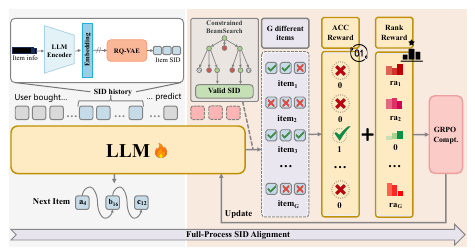

# MiniOneRec

*An Open-Source Framework for Scaling Generative Recommendation* — Kong et al. · arXiv’25

`Paradigms, Systems and Benchmarks` · `No single stage`

[Paper](https://arxiv.org/abs/2510.24431) · [Code](https://github.com/AkaliKong/MiniOneRec) · [Matrix](../../README.md#paradigms-systems-and-benchmarks)

Reading level: Overview (Level 1) · On this page: [At a Glance](#at-a-glance) · [2. How It Works](#2-how-it-works) · [3. Experimental Findings](#3-experimental-findings) · [5. Connections to Related Work](#5-connections-to-related-work)

| Representation | Tokenization | Backbone | Training | Inference |
| :-: | :-: | :-: | :-: | :-: |
| `Text` | `RQ-VAE` | `Dec-Only` | `Fixed / NTP → RL` | `Beam` |

- `Dec-Only`: Decoder-only.
- `Fixed`: SIDs are built first and not changed while the generator trains.
- `NTP → RL`: NTP, then reinforcement learning (GRPO, GBPO, etc.).

### At a Glance

| Aspect | Summary |
| :-- | :-- |
| Research Problem | Paradigms, Systems and Benchmarks: Baseline (TIGER), end-to-end multi-stage paradigms, open-source frameworks, benchmarks, and diagnostic resources. |
| Modified Stage | No single stage |

### 2. How It Works

### 3. Experimental Findings

**Experimental setup**

- **Datasets**: Amazon Reviews 2023: Industrial and Scientific, Office Products. Trimming follows Bao et al. (2024): users and items with fewer than 5 interactions removed; events limited to October 1996-November 2018 for Industrial; histories truncated to at most 10 items. Retained sizes: in Appendix B (not restated here).
  - Source: Datasets and trimming: https://arxiv.org/html/2510.24431v1#S5.SS1.p1 and https://arxiv.org/html/2510.24431v1#A2.p1.
- **Split**: Chronological 8:1:1 split into training, validation, and test. OOD study: train only on Industrial and evaluate on Office without tuning.
  - Source: Chronological 8:1:1: https://arxiv.org/html/2510.24431v1#A2.p1; OOD transfer: https://arxiv.org/html/2510.24431v1#S5.SS4.p1.
- **Candidates**: not reported explicitly (the policy predicts among all catalog candidates and returns the top-k beams; whether metrics are full-catalog is not stated).
  - Source: Ranking among all catalog items via beam search: https://arxiv.org/html/2510.24431v1#S3.SS1.p2.
- **Visibility**: In-domain: warm; no unseen-item protocol is defined. OOD: Office items are unseen by the generator (trained only on Industrial); whether the RQ-VAE was fit on Office items: not reported.
  - Source: In-domain chronological split; OOD on a never-seen domain: https://arxiv.org/html/2510.24431v1#S5.SS4.p1 and https://arxiv.org/html/2510.24431v1#S5.SS4.p2.
- **SID**: 3-level RQ-VAE x 256 codewords over Qwen3-Embedding-4B text embeddings; the three layers of 256 SID tokens are appended to the Qwen2.5-Instruct tokenizer vocabulary. Collision handling: not reported.
  - Source: L=3 x K=256 RQ-VAE over Qwen3-Embedding-4B, SID tokens added to vocabulary: https://arxiv.org/html/2510.24431v1#S3.I1.i3.p1, https://arxiv.org/html/2510.24431v1#S4.p1, https://arxiv.org/html/2510.24431v1#A1.SS1.p2; no collision rule found.
- **Inference budget**: Constrained beam search returns the top-k list; the numerical width at evaluation is not reported (RL rollouts use beam width 16). SFT on 8 NVIDIA H100 GPUs; inference batch size and latency: not reported.
  - Source: Beam search for recommendation lists and RL rollouts (width 16): https://arxiv.org/html/2510.24431v1#S3.SS1.p2, https://arxiv.org/html/2510.24431v1#S3.SS4.SSS1.p4, https://arxiv.org/html/2510.24431v1#S5.SS5.SSS2.p1; hardware: https://arxiv.org/html/2510.24431v1#S4.p1.
- **Results from**: Table 1 (Industrial and Office versus traditional, generative, and LLM-based baselines); Table 2 (unseen Office domain); Table 3 (pre-trained versus random initialization); Figures 1 and 4 (scaling and rollout strategies).
  - Source: Main: https://arxiv.org/html/2510.24431v1#S5.T1; OOD: https://arxiv.org/html/2510.24431v1#S5.T2; pre-training effect: https://arxiv.org/html/2510.24431v1#S5.T3; rollout strategies: https://arxiv.org/html/2510.24431v1#S5.SS5.SSS2.p2.

## 旧卡片说明

迁自 `d61aa6c:papers/minionerec.md`。保留方法说明、实验叙述与局限；本轮只对照现有记录处理明确冲突，未重新逐句核查原论文。分类和规格以页面上方由记录生成的表格为准。

### MiniOneRec：可扩展生成式推荐框架

> MiniOneRec 将语义标识构建、语言模型对齐和偏好强化学习串成统一流程，探索从小模型到大模型的生成式推荐扩展。

### 研究动机与问题定义

现有生成式推荐在模型规模、语义对齐和推荐偏好之间缺少统一训练框架。MiniOneRec 研究如何让语言模型直接生成物品的完整语义标识，并保持规模扩展后的推荐效果。

### TL;DR（核心摘要）

`用户历史 → RQ-VAE 物品标识 → 语言模型对齐 → SID 生成 → 推荐物品`

论文使用标题和描述的文本表示，通过三级 RQ-VAE 构造定长 SID；随后对 Qwen 系列模型进行监督微调，并使用 GRPO/RLVR 类偏好优化。推理时采用束搜索，生成的 SID 查表得到物品；当前 Table 1 记录为 Beam。

### 输入与使用场景

| 方面 | 说明 |
|---|---|
| 使用信息 | 交互历史、物品文本和协同偏好信号 |
| 信息融入位置 | 文本进入 SID 构建，历史进入语言模型，偏好信号进入奖励 |
| 语义标识结构 | 定长层次化序列 |
| 适用场景 | 常规序列推荐与跨领域扩展 |

### 方法设计

#### 3.1 任务形式化与物品分词
MiniOneRec 将下一物品预测写成完整 SID 序列生成。物品标题和描述经过冻结文本编码器后输入三级 RQ-VAE，得到层次化 codebook 和定长 SID。

#### 3.2 与 LLM 对齐
模型在 SFT 阶段把用户历史 SID、文本提示和目标 SID接入 Qwen 等语言模型。论文强调 full-process SID-language alignment，使语言模型不仅记住目标 token，还学习 SID 的层次和语义结构。

#### 3.3 推荐偏好优化
RL 阶段采用推荐导向奖励，综合合法性、去重、协同/排序信号等因素，并用 GRPO 类策略优化调整生成分布。奖励主要用于训练，不改变在线直接生成 SID 的链路。

#### 3.4 训练与评估
论文比较不同模型规模、世界知识、数据设置和生成配置，分析规模扩大对收敛、性能和泛化的影响。

### 实验结论

- 推荐性能随模型规模扩大而提升，并展示了语言模型世界知识对推荐的影响。
- 端到端 SID 对齐和偏好优化均有独立贡献。
- 论文提供了开源框架与多规模训练设置，便于复现实验。

### 局限性与研究定位

#### 局限性
- 自回归束搜索仍带来服务成本。
- 新物品的 SID 更新和动态目录维护未充分验证。
- 真实线上收益与更大规模工业数据上的稳定性仍未报告。

#### 研究定位
MiniOneRec 的主要贡献是把 SID 对齐、语言模型扩展和推荐偏好优化纳入一个可复用框架。它适合放在“规模扩展与训练对齐”章节；后续可关注动态物品和低延迟解码。

### 相关资源

- [论文原文](https://arxiv.org/abs/2510.24431)
- [开源代码](https://github.com/AkaliKong/MiniOneRec)

### 标签

`RQ-VAE` · `生成式推荐` · `强化学习` · `可扩展性`

### 架构图来源

*图源：原论文，图2。图片使用许可待核实。*

---

### 旧总表补充

来源：`d61aa6c:tables/all-methods.md`。

- 核心贡献：统一规模扩展、对齐与偏好优化。
- 使用场景：序列与跨域推荐。

### 5. Connections to Related Work

- **Predecessor** · [OneRec](onerec.md): MiniOneRec is an open-source reproduction of the OneRec-style pipeline: SID construction, SFT, and RL with constrained beam rollouts on public data.
  - Source: MiniOneRec v1, Section 1 positions it against OneRec: https://arxiv.org/html/2510.24431v1#S1.p1 and https://arxiv.org/html/2510.24431v1#S1.p3; Section 3.3: https://arxiv.org/html/2510.24431v1#S3.SS3.p1.
- **Competitor** · [TIGER](tiger.md): TIGER trains a small generator with next-token prediction only; MiniOneRec uses an LLM with SID alignment tasks and GRPO.
  - Source: MiniOneRec v1, Table 1 generative baselines: https://arxiv.org/html/2510.24431v1#S5.T1.
- **Competitor** · [LC-Rec](lc-rec.md): LC-Rec aligns an LLM to SIDs with SFT tasks; MiniOneRec keeps such alignment throughout SFT and RL and adds reinforced preference optimization.
  - Source: MiniOneRec v1, Table 1 generative baselines (LCRec): https://arxiv.org/html/2510.24431v1#S5.T1; related work: https://arxiv.org/html/2510.24431v1#S2.SS1.p2.

[View all papers in this cell](../../README.md#paradigms-systems-and-benchmarks)
