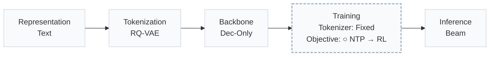
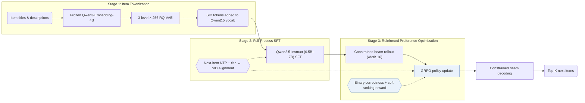
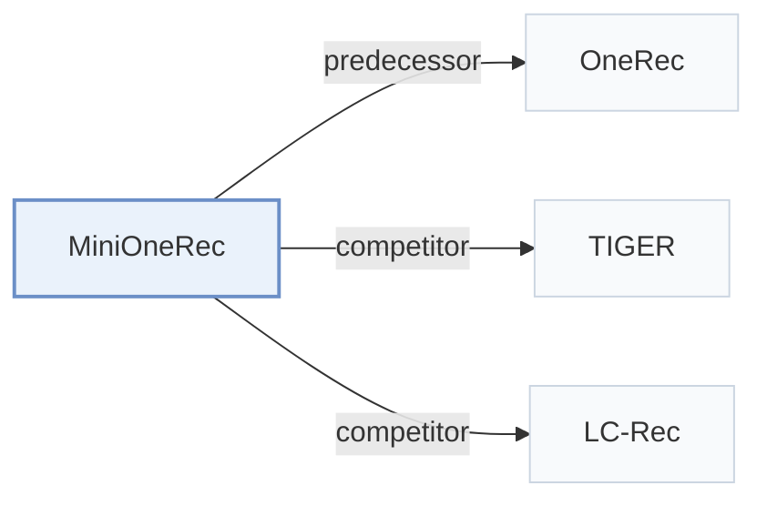

# MiniOneRec

[← Problem × Stage Matrix](../../README.md#paradigms-systems-and-benchmarks) · [Papers by Stage](../index/stages.md) · [Papers by Modality](../index/modality.md) · [Papers by Domain](../index/domain.md) · English | [中文](../zh/papers/minionerec.md)

| **Title** | *An Open-Source Framework for Scaling Generative Recommendation* |
| :-- | :-- |
| **Authors** | Kong et al. |
| **Venue** | arXiv’25 |
| **Problem × Stage** | `Paradigms, Systems and Benchmarks` · `No single stage` |
| **Changes** | ○ Objective |
| **SID inputs** | `Text` |
| **Domain** | `E-commerce` |
| **Settings** | `cross-domain` |
| **Scenario** | `General Item Recommendation`; `Public Benchmarks` |
| **Links** | [Paper](https://arxiv.org/abs/2510.24431) · [Code](https://github.com/AkaliKong/MiniOneRec) |
| **Reading level** | Reading Notes (Level 2) |

**On this page**: [TL;DR](#tldr) · [At a Glance](#at-a-glance) · [1. Why It Matters](#1-why-this-paper-matters) · [2. Method](#2-how-it-works) · [3. Experiments](#3-experimental-findings) · [4. Limitations](#4-limitations--critical-analysis) · [5. Related Work](#5-connections-to-related-work)

- `Text`: Textual item metadata (titles, descriptions, categories, or prompts).
- `RQ-VAE`: Residual-Quantized Variational AutoEncoder.
- `Dec-Only`: Decoder-only.
- `Fixed`: SIDs are built first and not changed while the generator trains.
- `NTP → RL`: NTP, then reinforcement learning (GRPO, GBPO, etc.).
- `Beam`: Autoregressive beam search over Semantic ID tokens.

### TL;DR

> [!NOTE]
> MiniOneRec is an open-source framework for RQ-VAE Semantic ID construction, supervised fine-tuning of Qwen backbones, and reinforcement learning with constrained decoding, to test generative scaling on public benchmarks.

---

### At a Glance

| Aspect | Summary |
| :-- | :-- |
| Key Findings | Scaling the Qwen backbone from 0.5B to 7B parameters monotonically lowers training and evaluation losses, and combining full-process SID alignment with GRPO and constrained beam rollouts outperforms traditional, generative, and LLM baselines on Amazon Industrial and Office (Abstract, Sec. 5.2, Table 1, Fig. 1). |
| Limitation | The scaling study measures training and evaluation losses as the model grows, not ranking metrics (Sec. 5.2, Fig. 1). |

---

### 1. Why This Paper Matters

Industrial generative recommenders that replace item embedding tables with Semantic ID (SID) sequences remain largely proprietary, leaving open whether parameter scaling laws hold on smaller public benchmarks and what minimal post-training pipeline makes an LLM competitive for SID generation.

> "Yet most industrial deployments remain proprietary, leaving two fundamental questions open: (1) Do the expected scaling laws hold on public benchmarks? (2) What is the minimal post-training recipe that enables competitive performance?" (Abstract)

MiniOneRec provides an open-source reproduction of the OneRec-style pipeline—covering RQ-VAE tokenization, full-process SID alignment during supervised fine-tuning (SFT), and reinforcement learning (RL) via GRPO—and releases code, pipelines, and checkpoints across model scales (Sec. 1).

---

### 2. How It Works

#### Item Tokenization

A frozen Qwen3-Embedding-4B text encoder embeds item titles and descriptions, and a 3-level × 256-codeword RQ-VAE quantizes each embedding into a 3-token hierarchical SID (Sec. 3.2, Sec. 4).

> "The codebooks, the encoder and the decoder are trained jointly, while the text encoder remains frozen." (Sec. 3.2)

#### Full-Process SID Alignment

The three layers of 256 SID tokens are appended to the Qwen2.5-Instruct vocabulary. Next-item SID prediction and bidirectional language-SID alignment tasks (mapping item titles and descriptions to SIDs and back) are co-optimized throughout both SFT and RL rather than dropped after warm-up (Sec. 3.3, Sec. 6).

#### Reinforced Preference Optimization

In the RL stage, GRPO samples 16 distinct, valid candidate SIDs per prompt via constrained beam search instead of unconstrained multinomial sampling (Sec. 3.4.1, Sec. 5.5.2). A hybrid reward combines an exact-match binary correctness signal with a rank-aware penalty over hard negative candidates (Sec. 3.4.2).

> "The mixed reward discussed combines binary correctness with a soft ranking term, helping the LLM tell hard negatives apart." (Sec. 3.4.2)

---

### 3. Experimental Findings

Experimental setup

- **Datasets**: Amazon Reviews 2023: Industrial and Scientific, Office Products. Trimming follows Bao et al. (2024): users and items with fewer than 5 interactions removed; events limited to October 1996-November 2018 for Industrial; histories truncated to at most 10 items. Retained sizes: in Appendix B (not restated here).
  - Source: Datasets and trimming: [S5.SS1.p1](https://arxiv.org/html/2510.24431v1#S5.SS1.p1) and [A2.p1](https://arxiv.org/html/2510.24431v1#A2.p1).
- **Split**: Chronological 8:1:1 split into training, validation, and test. OOD study: train only on Industrial and evaluate on Office without tuning.
  - Source: Chronological 8:1:1: [A2.p1](https://arxiv.org/html/2510.24431v1#A2.p1); OOD transfer: [S5.SS4.p1](https://arxiv.org/html/2510.24431v1#S5.SS4.p1).
- **Candidates**: not reported explicitly (the policy predicts among all catalog candidates and returns the top-k beams; whether metrics are full-catalog is not stated).
  - Source: Ranking among all catalog items via beam search: [S3.SS1.p2](https://arxiv.org/html/2510.24431v1#S3.SS1.p2).
- **Visibility**: In-domain: warm; no unseen-item protocol is defined. OOD: Office items are unseen by the generator (trained only on Industrial); whether the RQ-VAE was fit on Office items: not reported.
  - Source: In-domain chronological split; OOD on a never-seen domain: [S5.SS4.p1](https://arxiv.org/html/2510.24431v1#S5.SS4.p1) and [S5.SS4.p2](https://arxiv.org/html/2510.24431v1#S5.SS4.p2).
- **SID**: 3-level RQ-VAE x 256 codewords over Qwen3-Embedding-4B text embeddings; the three layers of 256 SID tokens are appended to the Qwen2.5-Instruct tokenizer vocabulary. Collision handling: not reported.
  - Source: L=3 x K=256 RQ-VAE over Qwen3-Embedding-4B, SID tokens added to vocabulary: [S3.I1.i3.p1](https://arxiv.org/html/2510.24431v1#S3.I1.i3.p1), [S4.p1](https://arxiv.org/html/2510.24431v1#S4.p1), [A1.SS1.p2](https://arxiv.org/html/2510.24431v1#A1.SS1.p2); no collision rule found.
- **Inference budget**: Constrained beam search returns the top-k list; the numerical width at evaluation is not reported (RL rollouts use beam width 16). SFT on 8 NVIDIA H100 GPUs; inference batch size and latency: not reported.
  - Source: Beam search for recommendation lists and RL rollouts (width 16): [S3.SS1.p2](https://arxiv.org/html/2510.24431v1#S3.SS1.p2), [S3.SS4.SSS1.p4](https://arxiv.org/html/2510.24431v1#S3.SS4.SSS1.p4), [S5.SS5.SSS2.p1](https://arxiv.org/html/2510.24431v1#S5.SS5.SSS2.p1); hardware: [S4.p1](https://arxiv.org/html/2510.24431v1#S4.p1).
- **Results from**: Table 1 (Industrial and Office versus traditional, generative, and LLM-based baselines); Table 2 (unseen Office domain); Table 3 (pre-trained versus random initialization); Figures 1 and 4 (scaling and rollout strategies).
  - Source: Main: [S5.T1](https://arxiv.org/html/2510.24431v1#S5.T1); OOD: [S5.T2](https://arxiv.org/html/2510.24431v1#S5.T2); pre-training effect: [S5.T3](https://arxiv.org/html/2510.24431v1#S5.T3); rollout strategies: [S5.SS5.SSS2.p2](https://arxiv.org/html/2510.24431v1#S5.SS5.SSS2.p2).

- Scaling and main benchmark: scaling the Qwen2.5 backbone from 0.5B to 7B parameters monotonically reduces training and evaluation losses (Sec. 5.2, Fig. 1), and the resulting MiniOneRec models outperform traditional sequential models, SID generators (TIGER, LC-Rec), and LLM recommenders on Amazon Industrial and Scientific and Office Products (Table 1).
- Alignment and rollout ablations: maintaining auxiliary SID-text alignment across both SFT and RL achieves the highest accuracy among all alignment schedules (Sec. 5.5.1, Fig. 4a), while constrained beam rollouts of width 16 outperform unconstrained sampling during GRPO (Sec. 5.5.2, Fig. 4).
- Cross-domain transfer and pre-trained initialization: evaluating an Industrial-trained model zero-shot on the unseen Office domain (Sec. 5.4, Table 2) and initializing from pre-trained Qwen weights rather than random weights (Sec. 5.6, Table 3) both yield consistent ranking gains.

---

### 4. Limitations & Critical Analysis

**Our analysis.**

- LC-Rec aligns a `Dec-Only` LLM to `RQ-VAE` SIDs through `Multi-task NTP` SFT alone; MiniOneRec retains those alignment tasks inside a subsequent GRPO stage with constrained beam rollouts (`NTP → RL`).
- Industrial OneRec builds SIDs from multimodal and collaborative features (`MM+CF`) using `R-KM`, whereas MiniOneRec constructs SIDs purely from item text (`Text`) via `RQ-VAE` without specifying an explicit collision-resolution suffix.

---

### 5. Connections to Related Work

- **Predecessor** · [OneRec](onerec.md): MiniOneRec is an open-source reproduction of the OneRec-style pipeline: SID construction, SFT, and RL with constrained beam rollouts on public data.
  - Source: MiniOneRec v1, Section 1 positions it against OneRec: [S1.p1](https://arxiv.org/html/2510.24431v1#S1.p1) and [S1.p3](https://arxiv.org/html/2510.24431v1#S1.p3); Section 3.3: [S3.SS3.p1](https://arxiv.org/html/2510.24431v1#S3.SS3.p1).
- **Competitor** · [TIGER](tiger.md): TIGER trains a small generator with next-token prediction only; MiniOneRec uses an LLM with SID alignment tasks and GRPO.
  - Source: MiniOneRec v1, Table 1 generative baselines: [S5.T1](https://arxiv.org/html/2510.24431v1#S5.T1).
- **Competitor** · [LC-Rec](lc-rec.md): LC-Rec aligns an LLM to SIDs with SFT tasks; MiniOneRec keeps such alignment throughout SFT and RL and adds reinforced preference optimization.
  - Source: MiniOneRec v1, Table 1 generative baselines (LCRec): [S5.T1](https://arxiv.org/html/2510.24431v1#S5.T1); related work: [S2.SS1.p2](https://arxiv.org/html/2510.24431v1#S2.SS1.p2).

[View all papers in this cell](../../README.md#paradigms-systems-and-benchmarks)
