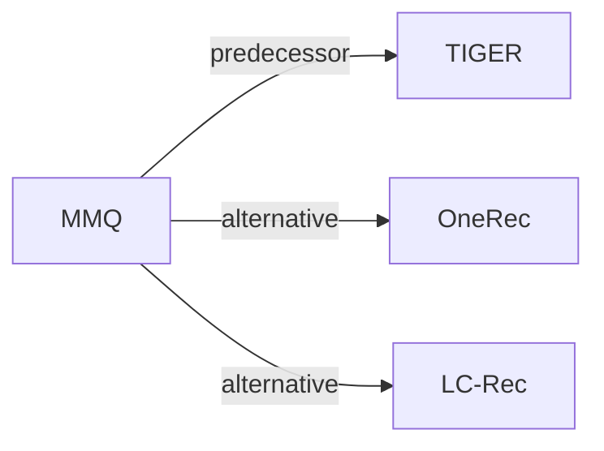

# MMQ

*Multimodal Mixture-of-Quantization Tokenization for Semantic ID Generation and User Behavioral Adaptation* — Xu et al. · WSDM’26

`I. Informativeness` · `Tokenization`

[Paper](https://arxiv.org/abs/2508.15281) · [Matrix](../../README.md#i--tokenization)

Reading level: Overview (Level 1) · On this page: [TL;DR](#tldr) · [At a Glance](#at-a-glance) · [3. Experimental Findings](#3-experimental-findings) · [5. Connections to Related Work](#5-connections-to-related-work)

- `HeterRec`: HeterRec, the named recommendation backbone used in the paper.
- `Joint`: The generator loss updates the tokenizer directly.
- `MTP`: Predicts several codes in parallel at once.
- `–`: Not reported in the paper.

### TL;DR

MMQ trains a multimodal tokenizer with modality-shared and modality-specific experts under orthogonal regularization, then fine-tunes its Semantic IDs on behavior objectives with a multimodal reconstruction loss.

### At a Glance

| Aspect | Summary |
| :-- | :-- |
| Research Problem | I. Informativeness: Do the SIDs, or the model reading them, carry the collaborative and multimodal signals recommendation needs? |
| Key Contribution | MMQ trains a multimodal tokenizer with modality-shared and modality-specific experts under orthogonal regularization, then fine-tunes its Semantic IDs on behavior objectives with a multimodal reconstruction loss. |
| Modified Stage | Tokenization |

### 3. Experimental Findings

**Experimental setup**

- **Datasets**: Amazon Beauty; retrieval uses user/item 5-core filtering and histories capped at 20. Southeast Asian advertising logs, October 2024-May 2025 (30M users, 40M ads); industrial filters not reported.
- **Split**: Beauty ranking: chronological 90% train/10% test; ratings >3 positive, <=3 negative. Retrieval and industrial offline splits not reported. Online A/B: July 6-August 6, 2025; treatment 10% random user traffic.
- **Candidates**: Retrieval: not reported; ranking evaluates labeled ratings, candidate retrieval n/a.
- **Visibility**: warm; no unseen-item protocol is defined.
- **SID**: 6 positions: 2 shared, 2 text-specific, 2 visual-specific; codebook size 100 (Beauty), 3000 (industrial). Collision handling not reported.
- **Inference budget**: Retrieval K=5/10 using HeterRec; ranking uses PPNet. Decoding budget, hardware, inference batch size, and latency not reported.
- **Results from**: Original Table 1: tokenizer comparisons under HeterRec retrieval/PPNet ranking; Section 5: online A/B versus deployed ItemID system.

Sources

- **Datasets**: Section 4.1.1: [S4.SS1.SSS1.p2](https://arxiv.org/html/2508.15281v1#S4.SS1.SSS1.p2) and [S4.SS1.SSS1.p3](https://arxiv.org/html/2508.15281v1#S4.SS1.SSS1.p3)
- **Split**: Sections 4.1.1 and 5: [S4.SS1.SSS1.p3](https://arxiv.org/html/2508.15281v1#S4.SS1.SSS1.p3) and [S5.p1](https://arxiv.org/html/2508.15281v1#S5.p1)
- **Candidates**: Section 4.1.1/4.1.2 gives labels and metrics, not retrieval candidates: [S4.SS1.SSS1.p3](https://arxiv.org/html/2508.15281v1#S4.SS1.SSS1.p3) and [S4.SS1.SSS2.p3](https://arxiv.org/html/2508.15281v1#S4.SS1.SSS2.p3)
- **Visibility**: Section 4.1 defines no item holdout: [S4.SS1](https://arxiv.org/html/2508.15281v1#S4.SS1)
- **SID**: Section 4.1.4: [S4.SS1.SSS4.p2](https://arxiv.org/html/2508.15281v1#S4.SS1.SSS4.p2)
- **Inference budget**: Sections 4.1.2/4.1.4: [S4.SS1.SSS2.p3](https://arxiv.org/html/2508.15281v1#S4.SS1.SSS2.p3) and [S4.SS1.SSS4.p1](https://arxiv.org/html/2508.15281v1#S4.SS1.SSS4.p1)
- **Results from**: Table 1 and Section 5: [S4.T1](https://arxiv.org/html/2508.15281v1#S4.T1) and [S5.p1](https://arxiv.org/html/2508.15281v1#S5.p1)

### 5. Connections to Related Work

- **Predecessor** · [TIGER](tiger.md): MMQ replaces TIGER's separated tokenizer training with behavior-aware joint adaptation.
  - Source: MMQ v1, Section 3.3: https://arxiv.org/html/2508.15281v1#S3.SS3.p1.
- **Alternative** · [OneRec](onerec.md): OneRec aligns modalities before quantization; MMQ separates shared and specific experts.
  - Source: MMQ v1, Section 2: https://arxiv.org/html/2508.15281v1#S2.p3.
- **Alternative** · [LC-Rec](lc-rec.md): LC-Rec aligns indices through multitask fine-tuning; MMQ adapts multimodal tokenization directly.
  - Source: MMQ v1, Sections 2 and 3.3: https://arxiv.org/html/2508.15281v1#S2.p2; https://arxiv.org/html/2508.15281v1#S3.SS3.p1.

[View all papers in this cell](../../README.md#i--tokenization)
