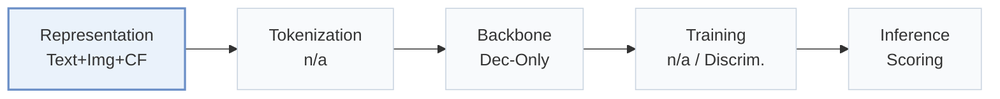

# Molar

[← Problem × Stage Matrix](../../README.md#i--representation) · [Papers by Stage](../index/stages.md) · [Papers by Modality](../index/modality.md) · English | [中文](../zh/papers/molar.md)

| **Title** | *Multimodal llms with collaborative filtering alignment for enhanced sequential recommendation* |
| :-- | :-- |
| **Authors** | Luo et al. |
| **Venue** | arXiv’24 |
| **Problem × Stage** | `I. Informativeness` · `Representation` |
| **Links** | [Paper](https://arxiv.org/abs/2412.18176) · [Code](https://anonymous.4open.science/r/Molar-8B06/) |
| **Reading level** | Overview (Level 1) |

**On this page**: [TL;DR](#tldr) · [At a Glance](#at-a-glance) · [3. Experiments](#3-experimental-findings) · [5. Related Work](#5-connections-to-related-work)

- `Text+Img+CF`: Text and image representations combined with collaborative signals.
- `Dec-Only`: Decoder-only.
- `Discrim.`: Scores items; does not generate SIDs.
- `Scoring`: Direct candidate scoring without step-by-step SID generation.

### TL;DR

> [!NOTE]
> Molar builds item representations from text and images with a multimodal LLM and aligns its user representations with an ID-based model, to add collaborative signals that LLM recommenders lack.

---

### At a Glance

| Aspect | Summary |
| :-- | :-- |
| Research Problem | I. Informativeness: Do the SIDs, or the model reading them, carry the collaborative and multimodal signals recommendation needs? |
| Key Contribution | Molar builds item representations from text and images with a multimodal LLM and aligns its user representations with an ID-based model, to add collaborative signals that LLM recommenders lack. |
| Modified Stage | Representation |

---

### 3. Experimental Findings

Experimental setup

- **Datasets**: Amazon clothing (993,087 users / 301,312 items / 8,813,442 interactions), PixelRec (50,000 / 82,864 / 989,476), MovieLens (6,040 / 3,706 / 1,000,209). Filtering rules: not reported.
  - Source: Datasets: [S4.I2.i1.p1](https://arxiv.org/html/2412.18176v2#S4.I2.i1.p1), [S4.I2.i2.p1](https://arxiv.org/html/2412.18176v2#S4.I2.i2.p1), [S4.I2.i3.p1](https://arxiv.org/html/2412.18176v2#S4.I2.i3.p1); statistics: [S4.T1](https://arxiv.org/html/2412.18176v2#S4.T1); filtering not stated.
- **Split**: Sequential leave-one-out into training, validation, and test; the exact position allocation is not reported beyond the label.
  - Source: Leave-one-out: [S4.SS1.SSS1.p2](https://arxiv.org/html/2412.18176v2#S4.SS1.SSS1.p2).
- **Candidates**: full catalog (the paper states metrics are evaluated on the full amount of data); training uses 1:1 negative sampling with BCE.
  - Source: Evaluated on the full amount of data: [S4.SS1.SSS1.p2](https://arxiv.org/html/2412.18176v2#S4.SS1.SSS1.p2); 1:1 negatives are a training choice: [A2.p1](https://arxiv.org/html/2412.18176v2#A2.p1).
- **Visibility**: warm; no unseen-item protocol is defined.
  - Source: Standard split with no unseen-item protocol: [S4.SS1.SSS1.p2](https://arxiv.org/html/2412.18176v2#S4.SS1.SSS1.p2).
- **SID**: n/a (items are represented by continuous embeddings from a fine-tuned multimodal LLM; no discrete SIDs are built).
  - Source: Continuous item embeddings from the MLLM, no discrete IDs: [S4.SS1.SSS2.p1](https://arxiv.org/html/2412.18176v2#S4.SS1.SSS2.p1); Table 1 judgment in facts/dash.yaml.
- **Inference budget**: Scoring with item embeddings from Qwen2-VL-2B (MIRM) and a user model (DUEG); hardware, inference batch size, and latency: not reported.
  - Source: Backbone and training: [S4.SS1.SSS2.p1](https://arxiv.org/html/2412.18176v2#S4.SS1.SSS2.p1) and [S4.SS1.SSS2.p2](https://arxiv.org/html/2412.18176v2#S4.SS1.SSS2.p2); no inference settings found.
- **Results from**: Table 2 (Amazon, PixelRec, MovieLens versus traditional, content, and LLM-based baselines); Tables 3-5 (modalities, post-alignment model, ablations); Appendix Table 6 (MLLM backbones).
  - Source: Main: [S4.T2](https://arxiv.org/html/2412.18176v2#S4.T2); modalities: [S4.T3](https://arxiv.org/html/2412.18176v2#S4.T3); post-alignment: [S4.T4](https://arxiv.org/html/2412.18176v2#S4.T4); ablation: [S4.T5](https://arxiv.org/html/2412.18176v2#S4.T5); backbones: [A1.T6](https://arxiv.org/html/2412.18176v2#A1.T6).

---

### 5. Connections to Related Work

[View all papers in this cell](../../README.md#i--representation)
