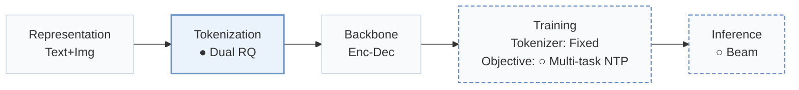
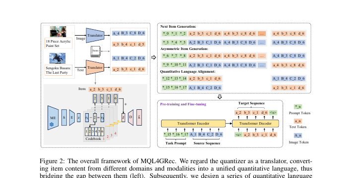
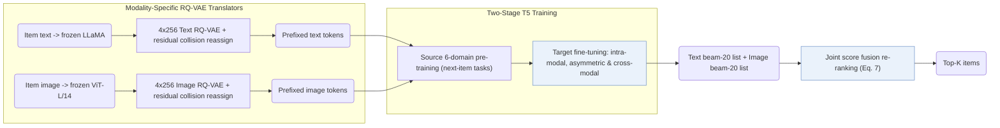
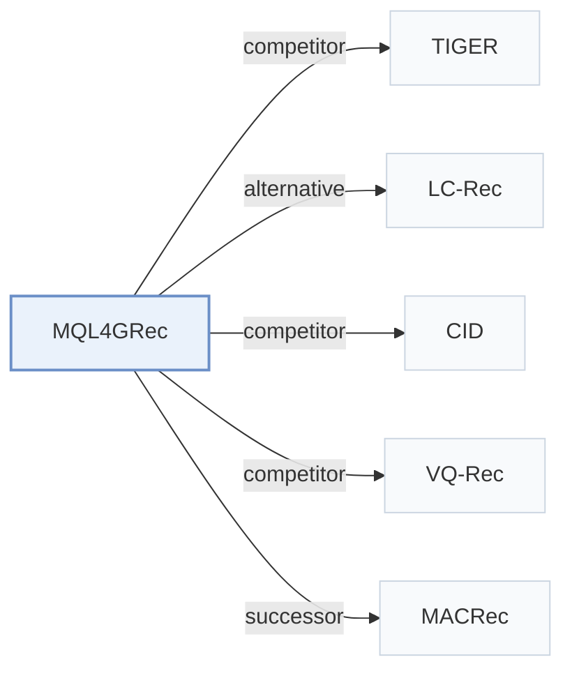

# MQL4GRec

[← Problem × Stage Matrix](../../README.md#i--tokenization) · [Papers by Stage](../index/stages.md) · [Papers by Modality](../index/modality.md) · [Papers by Domain](../index/domain.md) · English | [中文](../zh/papers/mql4grec.md)

| **Title** | *MULTIMODAL QUANTITATIVE LANGUAGE FOR GEN-ERATIVE RECOMMENDATION* |
| :-- | :-- |
| **Authors** | Zhai et al. |
| **Venue** | ICLR’25 |
| **Problem × Stage** | `I. Informativeness` · `Tokenization` |
| **Changes** | ● Tokenization · ○ Objective · ○ Inference |
| **SID inputs** | text: `Text` · image: `Img` |
| **Domain** | `E-commerce` |
| **Settings** | `cross-domain` |
| **Scenario** | `General Item Recommendation`; `Public Benchmarks` |
| **Links** | [Paper](https://arxiv.org/abs/2504.05314) · [Code](https://github.com/zhaijianyang/MQL4GRec) |
| **Reading level** | Reading Notes (Level 2) |

**On this page**: [TL;DR](#tldr) · [At a Glance](#at-a-glance) · [1. Why It Matters](#1-why-this-paper-matters) · [2. Method](#2-how-it-works) · [3. Experiments](#3-experimental-findings) · [4. Limitations](#4-limitations--critical-analysis) · [5. Related Work](#5-connections-to-related-work)

- `Text+Img`: Text and visual item representations.
- `Dual RQ`: Dual residual quantization over two representation streams or entity types.
- `Enc-Dec`: Encoder-decoder.
- `Fixed`: SIDs are built first and not changed while the generator trains.
- `Multi-task NTP`: The same NTP loss over several tasks.
- `Beam`: Autoregressive beam search over Semantic ID tokens.

### TL;DR

> [!NOTE]
> MQL4GRec translates item text and images from several domains into a shared quantitative language and pre-trains generation tasks over it, to transfer recommendation knowledge across domains and modalities.

---

### At a Glance

| Aspect | Summary |
| :-- | :-- |
| Key Findings | Across Amazon Instruments, Arts, and Games under full-catalog ranking, MQL4GRec achieves the best overall accuracy—particularly on NDCG—and source-domain pre-training further lifts Instruments and Arts under dual modalities (Sec. 4.2, Sec. 4.3, Table 1). |
| Limitation | Dual-modality pre-training yields no gain on Games, and un-tuned zero-shot transfer to target domains remains weak (Sec. 4.3, Sec. 4.5). |

---

### 1. Why This Paper Matters

Pre-trained language models carry general linguistic priors misaligned with collaborative patterns and rarely fuse item text with product images in a shared discrete space (Abstract). MQL4GRec translates multi-domain text and visual features into prefixed quantitative code vocabularies (`Dual RQ`), enabling cross-domain pre-training and multimodal list fusion.

> "Our key idea is to transform items from different domains and modalities into a unified language, which can serve as a bridge for transferring recommendation knowledge." (Abstract)

---

### 2. How It Works

#### Quantitative Translators

Frozen modality encoders—LLaMA for text and ViT for images—extract item embeddings that separate 4-level × 256 RQ-VAE translators quantize into modality-specific codebooks, resolving collisions via residual-to-codeword distances before prepending modality prefixes to form one shared dictionary (Sec. 3.1).

> "We train a quantitative translator for each modality, then add prefixes to the codewords from each of the two codebooks to form a dictionary." (Sec. 3.1)

#### Generation Tasks

Three task families link the two token streams: intra-modal next-item generation predicts the next item's tokens within text or vision; asymmetric generation predicts next-item image tokens from a text history or vice versa; and cross-modal alignment translates an item's text tokens into its image tokens and back (Sec. 3.2).

#### Pre-Training and Fine-Tuning

Pre-training across six source Amazon categories optimizes only the two intra-modal next-item tasks, whereas target-domain fine-tuning activates the full multi-task suite (Sec. 3.3). At inference, beam search decodes one candidate list per modality and merges both lists by fused item probabilities (Sec. 3.3, Eq. 7).

---

### 3. Experimental Findings

Experimental setup

- **Datasets**: Amazon Reviews 2018 (May 1996-October 2018). Pre-training on six categories (Pet, Cell, Automotive, Tools, Toys, Sports); target tasks on Instruments (17,112 users / 6,250 items), Arts (22,171 / 9,416), Games (42,259 / 13,839). Users and items with fewer than 5 interactions are filtered; sequences capped at 20 items.
  - Source: Pre-training and target categories: [S4.SS1.SSS0.Px1.p1](https://arxiv.org/html/2504.05314v1#S4.SS1.SSS0.Px1.p1) and [A1.p1](https://arxiv.org/html/2504.05314v1#A1.p1); filtering and length: [A1.p2](https://arxiv.org/html/2504.05314v1#A1.p2); statistics: [A1.T6](https://arxiv.org/html/2504.05314v1#A1.T6).
- **Split**: Leave-one-out (allocation not restated beyond the label). Separate zero-shot study: models pre-trained on source categories are tested on the targets without fine-tuning.
  - Source: Leave-one-out named only: [S4.SS1.SSS0.Px2.p1](https://arxiv.org/html/2504.05314v1#S4.SS1.SSS0.Px2.p1); zero-shot study: [S4.SS5.p1](https://arxiv.org/html/2504.05314v1#S4.SS5.p1).
- **Candidates**: full catalog (full ranking over the entire item set instead of sample-based evaluation).
  - Source: Full ranking over the entire item set: [S4.SS1.SSS0.Px2.p1](https://arxiv.org/html/2504.05314v1#S4.SS1.SSS0.Px2.p1).
- **Visibility**: Main: warm; no unseen-item protocol is defined. Zero-shot: target-domain items are unseen by the pre-trained generator; whether the RQ-VAE translators saw them: not reported.
  - Source: Standard split; zero-shot uses target-domain items absent from pre-training: [S4.SS5.p1](https://arxiv.org/html/2504.05314v1#S4.SS5.p1).
- **SID**: Separate text (LLaMA) and image (ViT-L/14) quantitative languages from RQ-VAEs with 4 levels x 256 codewords (dimension 32). Colliding items have tokens reassigned by the distances between their residuals and code vectors, instead of an appended identifier.
  - Source: 4 levels x 256 x 32 per modality: [A3.p1](https://arxiv.org/html/2504.05314v1#A3.p1); distance-based reassignment for collisions: [S3.SS1.SSS0.Px2.p2](https://arxiv.org/html/2504.05314v1#S3.SS1.SSS0.Px2.p2).
- **Inference budget**: Beam search with beam size 20 in each modality; the two recommendation lists are re-ranked so items in both rank higher. T5 encoder-decoder with 4 layers each. Hardware, inference batch size, and latency: not reported.
  - Source: Beam size 20 and dual-list re-ranking: [S4.SS1.SSS0.Px2.p1](https://arxiv.org/html/2504.05314v1#S4.SS1.SSS0.Px2.p1) and [S3.SS3.SSS0.Px2.p1](https://arxiv.org/html/2504.05314v1#S3.SS3.SSS0.Px2.p1); T5 backbone: [A3.p2](https://arxiv.org/html/2504.05314v1#A3.p2).
- **Results from**: Table 1 (Instruments, Arts, Games versus sequential, multimodal, and generative baselines); Table 2 (collision handling versus TIGER's appended index); Tables 3-4 (generation tasks and pre-training); Figures 3-4 (pre-training data and epochs); Table 5 (zero-shot).
  - Source: Main: [S4.T1](https://arxiv.org/html/2504.05314v1#S4.T1); collisions: [S4.T2](https://arxiv.org/html/2504.05314v1#S4.T2); tasks and pre-training: [S4.T3](https://arxiv.org/html/2504.05314v1#S4.T3), [S4.T4](https://arxiv.org/html/2504.05314v1#S4.T4); zero-shot: [S4.T5](https://arxiv.org/html/2504.05314v1#S4.T5).

- Main comparison: across Instruments, Arts, and Games, MQL4GRec outperforms sequential, multimodal, and generative baselines on most metrics, with the largest margins on NDCG (Sec. 4.2, Table 1).
- Multi-domain pre-training: under dual modalities, source pre-training lifts accuracy on Instruments and Arts while leaving Games flat (Sec. 4.3).

  > "Under dual modalities, pre-training significantly improves performance on the Instruments and Arts datasets; however, it does not yield a notable improvement for the Games dataset, potentially due to overfitting." (Sec. 4.3)

- Zero-shot evaluation: evaluating the source-pretrained generator without target fine-tuning shows modest zero-shot signal on Instruments and Arts and none on Games (Sec. 4.5, Table 5).

---

### 4. Limitations & Critical Analysis

**Our analysis.**

- MQL4GRec trains its text and image RQ-VAEs independently (`Dual RQ`), coupling modalities only downstream in the generator; MACRec instead introduces cross-modal contrastive interaction directly inside quantization (`Cross RQ`).
- TIGER quantizes text alone (`Text`) and decodes a single `Beam` list; MQL4GRec quantizes `Text+Img` into separate prefixed streams and fuses dual modality beams (`Dual Beam`).

---

### 5. Connections to Related Work

- **Competitor** · [TIGER](tiger.md): TIGER uses one text modality and an appended index for collisions; MQL4GRec translates text and images into separate quantitative languages and reassigns colliding tokens by distance.
  - Source: MQL4GRec v1, Table 1 baseline TIGER: [S4.T1](https://arxiv.org/html/2504.05314v1#S4.T1); collision comparison in Table 2: [S4.SS3.SSS0.Px1.p1](https://arxiv.org/html/2504.05314v1#S4.SS3.SSS0.Px1.p1) and [S4.T2](https://arxiv.org/html/2504.05314v1#S4.T2).
- **Alternative** · [LC-Rec](lc-rec.md): LC-Rec spreads items across the last level with a uniform constraint, which MQL4GRec says does not fully remove collisions.
  - Source: MQL4GRec v1, Section 3.1 Handling Collisions cites Zheng et al. (2023): [S3.SS1.SSS0.Px2.p1](https://arxiv.org/html/2504.05314v1#S3.SS1.SSS0.Px2.p1).
- **Competitor** · [CID](cid.md): P5-CID uses collaborative indexing for a T5 model; MQL4GRec uses multimodal content codes with cross-modal generation tasks.
  - Source: MQL4GRec v1, baseline P5-CID: [A2.I1.i8.p1](https://arxiv.org/html/2504.05314v1#A2.I1.i8.p1); Table 1: [S4.T1](https://arxiv.org/html/2504.05314v1#S4.T1).
- **Competitor** · [VQ-Rec](vq-rec.md): VQ-Rec uses product-quantized text codes in a discriminative transferable model; MQL4GRec generates multimodal codes with pre-training across categories.
  - Source: MQL4GRec v1, Table 1 baseline VQ-Rec: [S4.T1](https://arxiv.org/html/2504.05314v1#S4.T1).
- **Successor** · [MACRec](macrec.md): MACRec later reuses MQL4GRec's collision reassignment and dual-modality ensemble and adds cross-modal contrastive alignment during quantization.
  - Source: Evidence is from the later MACRec paper: [Sx3.SSx1.SSSx3.p5](https://arxiv.org/html/2511.15122v2#Sx3.SSx1.SSSx3.p5) and [Sx3.SSx2.SSSx3.p3](https://arxiv.org/html/2511.15122v2#Sx3.SSx2.SSSx3.p3); MQL4GRec is its main baseline in Table 2: [Sx4.T2](https://arxiv.org/html/2511.15122v2#Sx4.T2).

[View all papers in this cell](../../README.md#i--tokenization)
