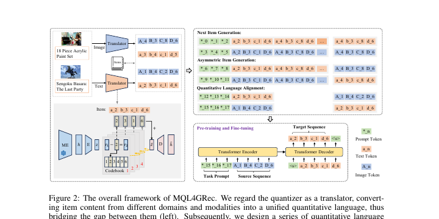

# MQL4GRec

*MULTIMODAL QUANTITATIVE LANGUAGE FOR GEN-ERATIVE RECOMMENDATION* — Zhai et al., ICLR’25

[arXiv](https://arxiv.org/abs/2504.05314) · [Record](../../data/papers/mql4grec.yaml) · [← Catalog](../../README.md#i--tokenization)

> Abstract: "rarely consider the complementary knowledge between the multimodal information of items". Candidates: I / VI (rule: judged by the abstract's complaint first).

| Problem it fixes | Stage it changes |
| :-- | :-- |
| **I. Informativeness**: Do the SIDs, or the model reading them, carry the collaborative and multimodal signals recommendation needs? | **Tokenization** |

## Pipeline

| Representation | Tokenization | Backbone | Training | Inference |
| :-: | :-: | :-: | :-: | :-: |
| `Text+Img` | **`Dual RQ`** | `Enc-Dec` | `Fixed / Multi-task NTP` | `Beam` |

- `Enc-Dec`: Encoder-decoder.
- `Fixed`: SIDs are built first and not changed while the generator trains.
- `Multi-task NTP`: The same NTP loss over several tasks.

## Architecture

## Evidence

- **`problem`** (arXiv abstract): Abstract: "rarely consider the complementary knowledge between the multimodal information of items". Candidates: I / VI (rule: judged by the abstract's complaint first).

## 旧卡片说明

迁自 `d61aa6c:papers/mql4grec.md`。保留方法说明、实验叙述与局限；本轮只对照现有记录处理明确冲突，未重新逐句核查原论文。分类和规格以页面上方由记录生成的表格为准。

### MQL4GRec：生成式推荐的多模态量化语言

> MQL4GRec 将不同领域和模态的物品内容翻译为统一的离散量化语言，并以生成任务迁移推荐知识。

### 研究动机与问题定义

文本和图像内容形式复杂，跨域推荐中的表示难以共享。MQL4GRec 把量化器视为翻译器，将多模态内容映射到共享 codebook 语言，降低跨域迁移的表示差异。

### TL;DR（核心摘要）

`文本/图像 → RQ-VAE量化语言 → 预训练生成任务 → 目标域微调 → 推荐物品`

冻结模态编码器提取文本或图像表示，RQ-VAE 将其转为带模态前缀的离散 token；通过下一物品生成、非对称生成和量化语言对齐任务进行预训练，再在目标推荐数据上微调。论文在生成候选后进行模态结果重排，重排仍属于模型内部流程。

### 输入与使用场景

| 方面 | 说明 |
|---|---|
| 使用信息 | 文本、图像、用户交互和多域数据 |
| 信息融入位置 | 量化语言、预训练任务和目标域生成 |
| 语义标识结构 | 带模态前缀的多级序列 |
| 适用场景 | 多模态、跨域推荐 |

### 方法设计

#### 3.1 量化语言
MQL4GRec 将量化器视为翻译器。冻结的 LLaMA/ViT 编码器提取文本或图像表示，RQ-VAE 为每种模态学习多级 codebook，并通过模态前缀组成统一量化语言。碰撞物品再依据残差距离重新分配 code。

#### 3.2 量化语言生成任务
除同模态下一物品生成外，论文加入非对称生成：用文本历史预测图像量化语言，或反向预测；同时加入 text-to-image 和 image-to-text 的显式量化语言对齐任务。

#### 3.3 训练与推荐
模型先在多域、多模态数据上预训练，再在目标推荐任务上微调。生成器预测目标模态的量化 token，推理阶段综合不同模态生成列表，并依据模型分数进行内部重排。

#### 3.4 零样本与分析
实验考察跨域迁移、模态组合、消融和零样本能力，重点验证量化语言是否能把模态知识和推荐知识传递到新领域。

### 实验结论

- MQL4GRec 在 ICLR 2025 论文报告的跨域设置中优于比较方法。
- 量化语言预训练和跨模态对齐带来迁移收益。

### 局限性与研究定位

#### 局限性
- 模态候选重排增加了推理链路。
- 量化语言依赖模态编码器和离线 codebook。
- 开放物品和动态领域更新仍需验证。

#### 研究定位
MQL4GRec 的主要贡献是将多模态跨域知识迁移表述为量化语言生成，适合放在“跨域与多模态生成推荐”章节。

### 标签

`量化语言` · `多模态` · `跨域迁移` · `生成式推荐`

### 架构图来源

*图源：原论文，图2。图片使用许可待核实。*

---

### 旧总表补充

来源：`d61aa6c:tables/all-methods.md`。

- 核心贡献：以量化语言促进跨域迁移。
- 使用场景：多模态跨域。

## Same cell: I × Tokenization (33 more)

| Paper | Venue | Pipeline |
| :-- | :-- | :-- |
| [CoST](cost.md) | RecSys’24 | `Text` → **`C-RQ`** → `Enc-Dec` → `Fixed / NTP` → `Beam` |
| [LETTER](letter.md) | CIKM’24 | `Text+CF` → **`Learn. RQ`** → `Enc-Dec` → `Fixed / NTP + Rank` → `C-Beam` |
| [LMIndexer](lmindexer.md) | ICML’24 | `Text` → **`Self-Sup. ID`** → `Enc-Dec` → `Fixed / NTP` → `C-Beam` |
| [ActionPiece](actionpiece.md) | ICML’25 | `Text` → **`OPQ`** → `Enc-Dec` → `Fixed / NTP` → `Ensemble` |
| [ADC-SID](adc-sid.md) | arXiv’25 | `Text+Img+CF` → **`MoE-VQ`** → `Enc-Dec` → `Fixed† / NTP` → `–` |
| [DAS](das.md) | CIKM’25 | `Text+CF` → **`Dual RQ`** → `Enc-Dec` → `Fixed / NTP` → `Beam` |
| [EAGER-LLM](eager-llm.md) | WWW’25 | `Text+CF` → **`Dual H-KM`** → `Dec-Only` → `Fixed / Multi-task NTP` → `Beam` |
| [FlexCode](flexcode.md) | arXiv’25 | `Text+CF` → **`Dual RQ-VAE`** → `–` → `Joint / NTP` → `–` |
| [GenSAR](gensar.md) | RecSys’25 | `Text+CF` → **`Shared/Spec. RQ`** → `Enc-Dec` → `Fixed / Multi-task NTP` → `C-Beam` |
| [GNPR-SID](gnpr-sid.md) | KDD’25 | `Attr+Geo+CF` → **`RQ-VAE`** → `Dec-Only` → `Fixed / NTP` → `–` |
| [GRAM](gram.md) | ACL’25 | `Text+CF` → **`H-KM`** → `Enc-Dec` → `Fixed / NTP` → `C-Beam` |
| [KGTB](kgtb.md) | arXiv’25 | `Attr+Geo+CF` → **`KG-RQ`** → `Dec-Only` → `Fixed / Multi-task NTP` → `–` |
| [MME-SID](mme-sid.md) | CIKM’25 | `Text+Img+CF` → **`MM-RQ`** → `Dec-Only` → `Fixed / NTP` → `Scoring` |
| [PSRQ](psrq.md) | CIKM’25 | `Text+Img` → **`Prog. RQ`** → `Encoder` → `Fixed / Discrim.` → `Scoring` |
| [QT-Mob](qt-mob.md) | KDD’25 | `Text+Geo` → **`RQ-VAE`** → `Dec-Only` → `Fixed / Multi-task NTP` → `C-Beam` |
| [TokenRec](tokenrec.md) | TKDE’25 | `CF` → **`Masked VQ`** → `Encoder` → `Fixed / Discrim.` → `Scoring` |
| [CapsID](capsid.md) | arXiv’26 | `Text+CF` → **`Soft-RQ`** → `Dec-Only` → `Fixed / NTP` → `C-Beam` |
| [ChronoID](chronoid.md) | arXiv’26 | `Text+Time` → **`RQ-VAE / Par. VQ`** → `Dec-Only†` → `Fixed / NTP` → `Beam†` |
| [GrIS (RecDMoN / RQ-GAE)](gris-recdmon-rq-gae.md) | CIKM’26 | `Text+CF` → **`RecDMoN / RQ-VAE`** → `Enc-Dec` → `Fixed / –` → `–` |
| [MACRec](macrec.md) | AAAI’26 | `Text+Img` → **`Cross RQ`** → `Enc-Dec` → `Fixed / NTP + Ctr.` → `C-Beam` |
| [MMGRec](mmgrec.md) | TOMM’26 | `Text+Img+CF` → **`Graph RQ-VAE`** → `Enc-Dec` → `Fixed / NTP` → `C-Beam` |
| [MMQ](mmq.md) | WSDM’26 | `Text+Img` → **`MoE-VQ`** → `HeterRec` → `Joint / MTP` → `–` |
| [MSCGRec](mscgrec.md) | arXiv’26 | `Text+Img+CF` → **`RQ-VAE+DINO`** → `Enc-Dec` → `Fixed† / NTP` → `Trie/C-Beam` |
| [PCR-CA](pcr-ca.md) | KDD’26 | `Text+CF` → **`PC-AE`** → `Disc.` → `Joint / Discrim.` → `Scoring` |
| [Pctx](pctx.md) | CIKM’26 | `Text+CF` → **`RQ`** → `Enc-Dec` → `Fixed / NTP` → `Beam+Agg.` |
| [ProGEO](progeo.md) | arXiv’26 | `Text+Geo` → **`R-KM+Geo-CB`** → `Dec-Only` → `Fixed / NTP` → `Beam+Geo-Filter` |
| [RoFiGR](rofigr.md) | arXiv’26 | `Text+Img+CF` → **`CF-Aligned MM RQ`** → `Enc-Dec` → `Fixed / NTP + Aux.` → `C-Beam` |
| [ROS](ros.md) | ACL’26 | `Text+Geo` → **`Geo-Prefix+RQ-VAE`** → `Dec-Only` → `Fixed / NTP → RL` → `CoT+C-Beam` |
| [SPRIG](sprig.md) | CIKM’26 Short | `Text / Audio` → **`R-KM`** → `Dec-Only` → `Fixed / NTP` → `Div. Beam` |
| [Tlow](tlow.md) | CIKM’26 Applied | `Text` → **`Flow+PQ`** → `Non-AR` → `Fixed / MTP + Rel.MSE` → `Scoring` |
| [UniRec](unirec.md) | arXiv’26 | `Text+CF` → **`RQ`** → `Dec-Only` → `Fixed / NTP → DPO` → `C-Beam` |
| [UniSID](unisid.md) | arXiv’26 | `Text+Img+Attr` → **`Direct SID Heads`** → `–` → `– / –` → `–` |
| [VarLenRec (TIGER)](varlenrec-tiger.md) | arXiv’26 | `Text` → **`HARQ`** → `Enc-Dec` → `Fixed / NTP + Aux.` → `C-Beam` |
