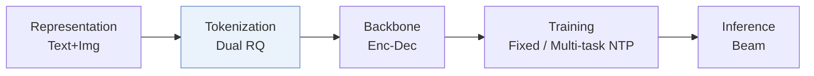
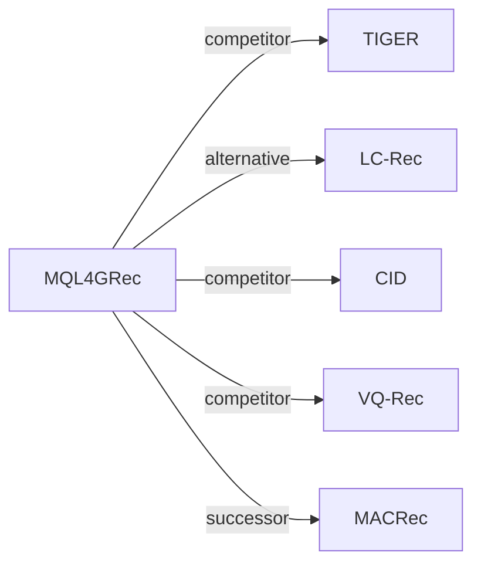

# MQL4GRec

*MULTIMODAL QUANTITATIVE LANGUAGE FOR GEN-ERATIVE RECOMMENDATION* — Zhai et al. · ICLR’25

`I. Informativeness` · `Tokenization`

[Paper](https://arxiv.org/abs/2504.05314) · [Code](https://github.com/zhaijianyang/MQL4GRec) · [Matrix](../../README.md#i--tokenization)

Reading level: Reading Notes (Level 2) · On this page: [TL;DR](#tldr) · [At a Glance](#at-a-glance) · [1. Why This Paper Matters](#1-why-this-paper-matters) · [2. How It Works](#2-how-it-works) · [3. Experimental Findings](#3-experimental-findings) · [4. Limitations & Critical Analysis](#4-limitations--critical-analysis) · [5. Connections to Related Work](#5-connections-to-related-work)

- `Enc-Dec`: Encoder-decoder.
- `Fixed`: SIDs are built first and not changed while the generator trains.
- `Multi-task NTP`: The same NTP loss over several tasks.

### TL;DR

MQL4GRec translates item text and images from several domains into a shared quantitative language and pre-trains generation tasks over it, to transfer recommendation knowledge across domains and modalities.

### At a Glance

| Aspect | Summary |
| :-- | :-- |
| Research Problem | I. Informativeness: Do the SIDs, or the model reading them, carry the collaborative and multimodal signals recommendation needs? |
| Key Contribution | MQL4GRec translates item text and images from several domains into a shared quantitative language and pre-trains generation tasks over it, to transfer recommendation knowledge across domains and modalities. |
| Modified Stage | Tokenization |
| Limitation | With both modalities, pre-training does not improve results on Games, and zero-shot ability on the target domains is weak (Sec. 4.3, Sec. 4.5). |

### 1. Why This Paper Matters

Generative recommenders that build on pre-trained language models carry general linguistic knowledge that does not match recommendation needs, and they rarely use the complementary knowledge in item text and images (Abstract). MQL4GRec turns the content of items from many domains and modalities into one discrete vocabulary, so that a generator trained on source domains can transfer to a target domain.

> "Our key idea is to transform items from different domains and modalities into a unified language, which can serve as a bridge for transferring recommendation knowledge." (Abstract)

Based on arXiv v1.

### 2. How It Works

#### Quantitative Translators

A frozen modal encoder, LLaMA for text or ViT for images, encodes item content (Sec. 3.1). An RQ-VAE per modality quantizes the representation, and each modality has its own codebooks.

> "We train a quantitative translator for each modality, then add prefixes to the codewords from each of the two codebooks to form a dictionary." (Sec. 3.1)

#### Generation Tasks

Next-item generation predicts the next item's quantitative language in the same modality. Asymmetric item generation predicts the image language from a text history, or the reverse (Sec. 3.2). Quantitative language alignment tasks map an item's text language to its image language and back.

#### Pre-Training and Fine-Tuning

Pre-training on the source domains uses only the two next-item generation sub-tasks. Fine-tuning on the target domain uses all generation tasks (Sec. 3.3).

At inference, the generator returns one recommendation list per modality, and a re-ranking step merges the two lists by their item scores (Sec. 3.3, Eq. 7).

### 3. Experimental Findings

**Experimental setup**

- **Datasets**: Amazon Reviews 2018 (May 1996-October 2018). Pre-training on six categories (Pet, Cell, Automotive, Tools, Toys, Sports); target tasks on Instruments (17,112 users / 6,250 items), Arts (22,171 / 9,416), Games (42,259 / 13,839). Users and items with fewer than 5 interactions are filtered; sequences capped at 20 items.
- **Split**: Leave-one-out (allocation not restated beyond the label). Separate zero-shot study: models pre-trained on source categories are tested on the targets without fine-tuning.
- **Candidates**: full catalog (full ranking over the entire item set instead of sample-based evaluation).
- **Visibility**: Main: warm; no unseen-item protocol is defined. Zero-shot: target-domain items are unseen by the pre-trained generator; whether the RQ-VAE translators saw them: not reported.
- **SID**: Separate text (LLaMA) and image (ViT-L/14) quantitative languages from RQ-VAEs with 4 levels x 256 codewords (dimension 32). Colliding items have tokens reassigned by the distances between their residuals and code vectors, instead of an appended identifier.
- **Inference budget**: Beam search with beam size 20 in each modality; the two recommendation lists are re-ranked so items in both rank higher. T5 encoder-decoder with 4 layers each. Hardware, inference batch size, and latency: not reported.
- **Results from**: Table 1 (Instruments, Arts, Games versus sequential, multimodal, and generative baselines); Table 2 (collision handling versus TIGER's appended index); Tables 3-4 (generation tasks and pre-training); Figures 3-4 (pre-training data and epochs); Table 5 (zero-shot).

Sources

- **Datasets**: Pre-training and target categories: [S4.SS1.SSS0.Px1.p1](https://arxiv.org/html/2504.05314v1#S4.SS1.SSS0.Px1.p1) and [A1.p1](https://arxiv.org/html/2504.05314v1#A1.p1); filtering and length: [A1.p2](https://arxiv.org/html/2504.05314v1#A1.p2); statistics: [A1.T6](https://arxiv.org/html/2504.05314v1#A1.T6).
- **Split**: Leave-one-out named only: [S4.SS1.SSS0.Px2.p1](https://arxiv.org/html/2504.05314v1#S4.SS1.SSS0.Px2.p1); zero-shot study: [S4.SS5.p1](https://arxiv.org/html/2504.05314v1#S4.SS5.p1).
- **Candidates**: Full ranking over the entire item set: [S4.SS1.SSS0.Px2.p1](https://arxiv.org/html/2504.05314v1#S4.SS1.SSS0.Px2.p1).
- **Visibility**: Standard split; zero-shot uses target-domain items absent from pre-training: [S4.SS5.p1](https://arxiv.org/html/2504.05314v1#S4.SS5.p1).
- **SID**: 4 levels x 256 x 32 per modality: [A3.p1](https://arxiv.org/html/2504.05314v1#A3.p1); distance-based reassignment for collisions: [S3.SS1.SSS0.Px2.p2](https://arxiv.org/html/2504.05314v1#S3.SS1.SSS0.Px2.p2).
- **Inference budget**: Beam size 20 and dual-list re-ranking: [S4.SS1.SSS0.Px2.p1](https://arxiv.org/html/2504.05314v1#S4.SS1.SSS0.Px2.p1) and [S3.SS3.SSS0.Px2.p1](https://arxiv.org/html/2504.05314v1#S3.SS3.SSS0.Px2.p1); T5 backbone: [A3.p2](https://arxiv.org/html/2504.05314v1#A3.p2).
- **Results from**: Main: [S4.T1](https://arxiv.org/html/2504.05314v1#S4.T1); collisions: [S4.T2](https://arxiv.org/html/2504.05314v1#S4.T2); tasks and pre-training: [S4.T3](https://arxiv.org/html/2504.05314v1#S4.T3), [S4.T4](https://arxiv.org/html/2504.05314v1#S4.T4); zero-shot: [S4.T5](https://arxiv.org/html/2504.05314v1#S4.T5).

- Main comparison: MQL4GRec performs best in most cases across Instruments, Arts, and Games, especially on NDCG (Sec. 4.2, Table 1).
- Pre-training: with both modalities, pre-training improves results on Instruments and Arts but not on Games.

  > "Under dual modalities, pre-training significantly improves performance on the Instruments and Arts datasets; however, it does not yield a notable improvement for the Games dataset, potentially due to overfitting." (Sec. 4.3)

- Zero-shot: pre-trained models without fine-tuning show preliminary but weak zero-shot ability on Instruments and Arts, and none on Games (Sec. 4.5, Table 5).

### 4. Limitations & Critical Analysis

**Our analysis.**

- The two quantizers are trained separately (`Dual RQ`), so the text and image codes are linked only by the generation tasks. MACRec replaces them with `Cross RQ`, which adds cross-modal contrastive learning inside quantization.
- TIGER quantizes text only (`Text`); MQL4GRec adds images (`Text+Img`) and keeps the same `Enc-Dec` generator with `Beam` decoding.

### 5. Connections to Related Work

- **Competitor** · [TIGER](tiger.md): TIGER uses one text modality and an appended index for collisions; MQL4GRec translates text and images into separate quantitative languages and reassigns colliding tokens by distance.
  - Source: MQL4GRec v1, Table 1 baseline TIGER: https://arxiv.org/html/2504.05314v1#S4.T1; collision comparison in Table 2: https://arxiv.org/html/2504.05314v1#S4.SS3.SSS0.Px1.p1 and https://arxiv.org/html/2504.05314v1#S4.T2.
- **Alternative** · [LC-Rec](lc-rec.md): LC-Rec spreads items across the last level with a uniform constraint, which MQL4GRec says does not fully remove collisions.
  - Source: MQL4GRec v1, Section 3.1 Handling Collisions cites Zheng et al. (2023): https://arxiv.org/html/2504.05314v1#S3.SS1.SSS0.Px2.p1.
- **Competitor** · [CID](cid.md): P5-CID uses collaborative indexing for a T5 model; MQL4GRec uses multimodal content codes with cross-modal generation tasks.
  - Source: MQL4GRec v1, baseline P5-CID: https://arxiv.org/html/2504.05314v1#A2.I1.i8.p1; Table 1: https://arxiv.org/html/2504.05314v1#S4.T1.
- **Competitor** · [VQ-Rec](vq-rec.md): VQ-Rec uses product-quantized text codes in a discriminative transferable model; MQL4GRec generates multimodal codes with pre-training across categories.
  - Source: MQL4GRec v1, Table 1 baseline VQ-Rec: https://arxiv.org/html/2504.05314v1#S4.T1.
- **Successor** · [MACRec](macrec.md): MACRec later reuses MQL4GRec's collision reassignment and dual-modality ensemble and adds cross-modal contrastive alignment during quantization.
  - Source: Evidence is from the later MACRec paper: https://arxiv.org/html/2511.15122v2#Sx3.SSx1.SSSx3.p5 and https://arxiv.org/html/2511.15122v2#Sx3.SSx2.SSSx3.p3; MQL4GRec is its main baseline in Table 2: https://arxiv.org/html/2511.15122v2#Sx4.T2.

[View all papers in this cell](../../README.md#i--tokenization)
