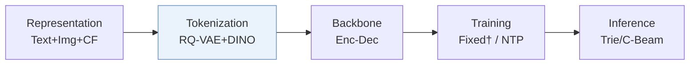
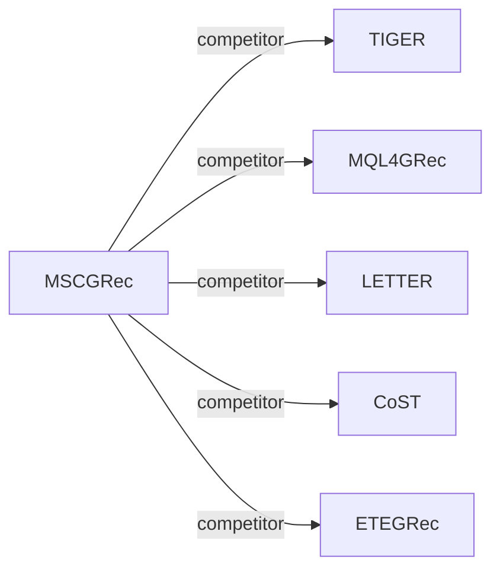

# MSCGRec

*Multimodal Generative Recommendation for Fusing Semantic and Collaborative Signals* — Vandenhirtz et al. · arXiv’26

`I. Informativeness` · `Tokenization` · [Paper](https://arxiv.org/abs/2602.03713) · [Matrix](../../README.md#i--tokenization) · [中文](../zh/papers/mscgrec.md)

Reading level: Overview (Level 1) · On this page: [TL;DR](#tldr) · [At a Glance](#at-a-glance) · [3. Experiments](#3-experimental-findings) · [5. Related Work](#5-connections-to-related-work)

- `Enc-Dec`: Encoder-decoder.
- `NTP`: Next-token prediction loss only; continuing from a pretrained LLM (SFT) also counts as NTP.

### TL;DR

> [!NOTE]
> MSCGRec quantizes images with self-supervised DINO-based learning, adds collaborative features as a separate modality, and restricts training outputs to permissible tokens, to scale generative recommendation to large catalogs.

### At a Glance

| Aspect | Summary |
| :-- | :-- |
| Research Problem | I. Informativeness: Do the SIDs, or the model reading them, carry the collaborative and multimodal signals recommendation needs? |
| Key Contribution | MSCGRec quantizes images with self-supervised DINO-based learning, adds collaborative features as a separate modality, and restricts training outputs to permissible tokens, to scale generative recommendation to large catalogs. |
| Modified Stage | Tokenization |

### 3. Experimental Findings

Experimental setup

- **Datasets**: Amazon 2023 Beauty and Personal Care (724,796 users / 203,843 items), Sports and Outdoors (408,287 / 151,632), and PixelRec (8,886,078 / 407,082). 5-core filtering of users and items; for Amazon, samples with empty or placeholder images are removed and items with identical images are merged into one ID; sequences capped at 20 items.
  - Source: Datasets and preprocessing: [S4.SS1.SSS0.Px1.p1](https://arxiv.org/html/2602.03713v1#S4.SS1.SSS0.Px1.p1); statistics: [S4.T1](https://arxiv.org/html/2602.03713v1#S4.T1).
- **Split**: Chronological leave-one-out into training, validation, and test; for Amazon every item in a training sequence is a separate target, for PixelRec only the last item.
  - Source: Chronological leave-one-out and target construction: [S4.SS1.SSS0.Px1.p1](https://arxiv.org/html/2602.03713v1#S4.SS1.SSS0.Px1.p1).
- **Candidates**: not reported (full catalog versus sampled evaluation candidates); top-K lists from constrained beam search.
  - Source: Metrics only: [S4.SS1.SSS0.Px1.p1](https://arxiv.org/html/2602.03713v1#S4.SS1.SSS0.Px1.p1).
- **Visibility**: warm; no unseen-item protocol is defined. The collaborative modality uses SASRec item embeddings trained on the interaction data.
  - Source: Standard split with no unseen-item protocol; SASRec embeddings as the collaborative modality: [S4.SS1.SSS0.Px1.p1](https://arxiv.org/html/2602.03713v1#S4.SS1.SSS0.Px1.p1) and [S4.SS1.SSS0.Px3.p1](https://arxiv.org/html/2602.03713v1#S4.SS1.SSS0.Px3.p1).
- **SID**: Per-modality residual quantizers (image via DINO self-supervised quantization, LLAMA text, SASRec collaborative) with 3 levels x 256 entries each, applied directly in embedding space; an extra collision level per modality makes each item's code unique (TIGER style). The collaborative codes serve as generation targets.
  - Source: 3 levels x 256 per modality plus a collision level: [S4.SS1.SSS0.Px3.p2](https://arxiv.org/html/2602.03713v1#S4.SS1.SSS0.Px3.p2) and [S3.SS1.p2](https://arxiv.org/html/2602.03713v1#S3.SS1.p2); DINO-based image quantization: [S3.SS2.p2](https://arxiv.org/html/2602.03713v1#S3.SS2.p2).
- **Inference budget**: Constrained beam search with 20 beams; T5 encoder-decoder; training and evaluation on four NVIDIA A100 GPUs. Inference batch size and latency: not reported.
  - Source: Constrained beam search with 20 beams and hardware: [S4.SS1.SSS0.Px3.p3](https://arxiv.org/html/2602.03713v1#S4.SS1.SSS0.Px3.p3); constrained training softmax: [S3.SS3.p2](https://arxiv.org/html/2602.03713v1#S3.SS3.p2).
- **Results from**: Table 2 (Beauty, Sports, PixelRec versus sequential and generative baselines); Table 3 (component ablations, modality Shapley values, image-only).
  - Source: Main: [S4.T2](https://arxiv.org/html/2602.03713v1#S4.T2); ablations and Shapley values: [S4.T3](https://arxiv.org/html/2602.03713v1#S4.T3).

### 5. Connections to Related Work

- **Competitor** · [TIGER](tiger.md): TIGER quantizes one modality; MSCGRec concatenates codes from image, text, and collaborative modalities and trains with a softmax restricted to permissible next codes, keeping TIGER's collision level.
  - Source: MSCGRec v1, baselines TIGER_i and TIGER_t: https://arxiv.org/html/2602.03713v1#S4.SS1.SSS0.Px2.p1; Table 2: https://arxiv.org/html/2602.03713v1#S4.T2; collision level follows TIGER: https://arxiv.org/html/2602.03713v1#S4.SS1.SSS0.Px3.p2.
- **Competitor** · [MQL4GRec](mql4grec.md): MQL4GRec uses separate text and image quantitative languages with collision reassignment; MSCGRec adds a collaborative modality, DINO-based image codes, and constrained training, and found MQL4GRec's reassignment gave no gain under constrained training.
  - Source: MSCGRec v1, follows MQL4GRec's text embeddings and tests its reassignment: https://arxiv.org/html/2602.03713v1#S4.SS1.SSS0.Px3.p1 and https://arxiv.org/html/2602.03713v1#S4.SS1.SSS0.Px3.p2; Table 2: https://arxiv.org/html/2602.03713v1#S4.T2.
- **Competitor** · [LETTER](letter.md): LETTER aligns quantized codes with a sequential recommender inside one tokenizer; MSCGRec keeps collaborative information as its own code modality.
  - Source: MSCGRec v1, LETTER-TIGER baseline: https://arxiv.org/html/2602.03713v1#S4.SS1.SSS0.Px2.p1; Table 2: https://arxiv.org/html/2602.03713v1#S4.T2.
- **Competitor** · [CoST](cost.md): CoST aligns embeddings before and after quantization contrastively; MSCGRec changes the modalities and the training softmax instead.
  - Source: MSCGRec v1, baselines: https://arxiv.org/html/2602.03713v1#S4.SS1.SSS0.Px2.p1; Table 2: https://arxiv.org/html/2602.03713v1#S4.T2.
- **Competitor** · [ETEGRec](etegrec.md): ETEGRec trains tokenizer and generator end to end; MSCGRec quantizes frozen pretrained embeddings per modality.
  - Source: MSCGRec v1, baselines: https://arxiv.org/html/2602.03713v1#S4.SS1.SSS0.Px2.p1; Table 2: https://arxiv.org/html/2602.03713v1#S4.T2.

[View all papers in this cell](../../README.md#i--tokenization)
