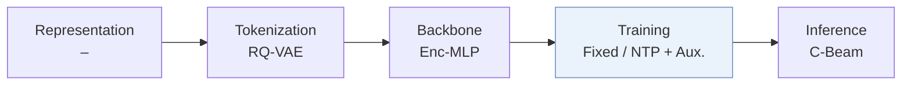
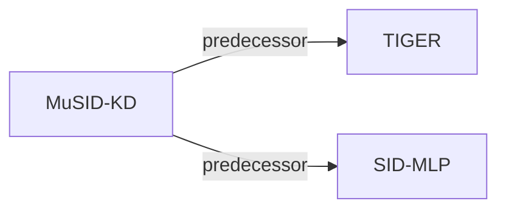

# MuSID-KD

| **Title** | *Multigranularity Knowledge Distillation for Generative Recommendation with Semantic IDs* |
| :-- | :-- |
| **Authors** | Zhang et al. |
| **Venue** | arXiv’26 |
| **Problem × Stage** | `IV. Utility` · `Training` |
| **Links** | [Paper](https://arxiv.org/abs/2610.35218) · [Code](https://anonymous.4open.science/r/m7k2-review-83f9/) · [Matrix](../../README.md#iv--training) · [中文](../zh/papers/musid-kd.md) |
| **Reading level** | Overview (Level 1) |

On this page: [TL;DR](#tldr) · [At a Glance](#at-a-glance) · [3. Experiments](#3-experimental-findings) · [5. Related Work](#5-connections-to-related-work)

- `–`: Not reported in the paper.
- `Enc-MLP`: A history encoder followed by MLP-based prediction heads.
- `Fixed`: SIDs are built first and not changed while the generator trains.
- `NTP + Aux.`: NTP plus another auxiliary loss.
- `C-Beam`: Constrained beam search.

### TL;DR

> [!NOTE]
> MuSID-KD distills a generative teacher into lightweight students by aligning candidate distributions at successive Semantic ID prefix levels and weighting supervision by ranking impact, instead of uniform alignment.

---

### At a Glance

| Aspect | Summary |
| :-- | :-- |
| Research Problem | IV. Utility: Are training and search aimed at what users and the platform value, rather than at token likelihood? |
| Key Contribution | MuSID-KD distills a generative teacher into lightweight students by aligning candidate distributions at successive Semantic ID prefix levels and weighting supervision by ranking impact, instead of uniform alignment. |
| Modified Stage | Training |

---

### 3. Experimental Findings

Experimental setup

- **Datasets**: Amazon Reviews 2014 Beauty/Toys, Amazon Reviews 2023 Video Games, and Steam-100K; histories capped at 20. Filtering rules not reported.
  - Source: Section 6.1: [S6.SS1.p1](https://arxiv.org/html/2610.35218v1#S6.SS1.p1)
- **Split**: Chronological leave-one-out; exact validation/test allocation not reported. Checkpoints selected by validation NDCG@10.
  - Source: Section 6.1 and Appendix B.1: [S6.SS1.p1](https://arxiv.org/html/2610.35218v1#S6.SS1.p1) and [A2.SS1.p1](https://arxiv.org/html/2610.35218v1#A2.SS1.p1) and [S6.SS1.p3](https://arxiv.org/html/2610.35218v1#S6.SS1.p3)
- **Candidates**: Evaluation: not reported. The 64 teacher candidates per request are training support, not sampled evaluation negatives.
  - Source: Section 6.1 separates evaluation from training candidates: [S6.SS1.p1](https://arxiv.org/html/2610.35218v1#S6.SS1.p1) and [S6.SS1.p3](https://arxiv.org/html/2610.35218v1#S6.SS1.p3)
- **Visibility**: warm; no unseen-item protocol is defined. Frozen teacher encoder/token embeddings/mapping shared with students; additional distillation caches use training requests only. Teacher/tokenizer exposure to test items not reported.
  - Source: Sections 6.1/B.1 define no item holdout: [S6.SS1.p2](https://arxiv.org/html/2610.35218v1#S6.SS1.p2) and [A2.SS1.p3](https://arxiv.org/html/2610.35218v1#A2.SS1.p3)
- **SID**: Main RQ-VAE: 4 positions x 256 codes; frozen and shared teacher/student mapping. R-KMeans additionally tested. Unique SIDs assumed; collision handling not reported.
  - Source: Sections 6.1/6.2 and Appendix B.1: [S6.SS1.p2](https://arxiv.org/html/2610.35218v1#S6.SS1.p2) and [S6.SS2.p2](https://arxiv.org/html/2610.35218v1#S6.SS2.p2) and [A2.SS1.p4](https://arxiv.org/html/2610.35218v1#A2.SS1.p4) and [S3.SS1.p1](https://arxiv.org/html/2610.35218v1#S3.SS1.p1)
- **Inference budget**: Constrained beam 50; K=5/10; student batch 32 (teacher throughput batch 64). MuSID-KD MLP/GRU/CNN: 3036/3423/3024 requests/s; GRU/CNN serving totals 0.292/0.331 ms/request. Hardware not reported.
  - Source: Section 6.1/6.5 and Appendix B.3/Table B1: [S6.SS1.p2](https://arxiv.org/html/2610.35218v1#S6.SS1.p2) and [S6.SS5.p1](https://arxiv.org/html/2610.35218v1#S6.SS5.p1) and [A2.SS3.p1](https://arxiv.org/html/2610.35218v1#A2.SS3.p1) and [A2.T6](https://arxiv.org/html/2610.35218v1#A2.T6)
- **Results from**: Original Table 1: Amazon, mean over seeds 42-44; Table S1: Steam; Figure 6: R-KMeans. KD baselines adapted to shared teacher/students/decoding; TIGER is a teacher reference, excluded from student comparisons.
  - Source: Table 1, Figure 6 and Appendix A.1: [S6.T1](https://arxiv.org/html/2610.35218v1#S6.T1) and [S6.F6](https://arxiv.org/html/2610.35218v1#S6.F6) and [A1.T3](https://arxiv.org/html/2610.35218v1#A1.T3)

---

### 5. Connections to Related Work

- **Predecessor** · [TIGER](tiger.md): MuSID-KD uses TIGER as its frozen teacher and shares its history encoder.
  - Source: MuSID-KD v1, Section 6.1: https://arxiv.org/html/2610.35218v1#S6.SS1.p2.
- **Predecessor** · [SID-MLP](sid-mlp.md): SID-MLP supplies the Base KD objective and lightweight student design.
  - Source: MuSID-KD v1, Sections 2.3/6.1: https://arxiv.org/html/2610.35218v1#S2.SS3.p1; https://arxiv.org/html/2610.35218v1#S6.SS1.p2.

[View all papers in this cell](../../README.md#iv--training)
