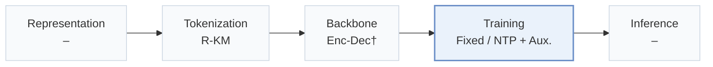
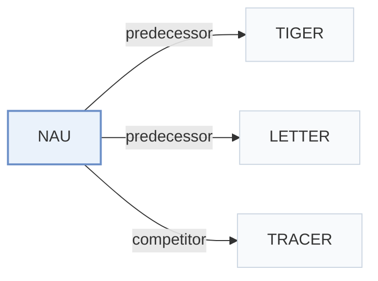

# NAU

[← Problem × Stage Matrix](../../README.md#iv--training) · [Papers by Stage](../index/stages.md) · [Papers by Modality](../index/modality.md) · English | [中文](../zh/papers/nau.md)

| **Title** | *Neighborhood-Aware Unlearning for Generative Recommendation* |
| :-- | :-- |
| **Authors** | Lubitzsch et al. |
| **Venue** | arXiv’26 |
| **Problem × Stage** | `IV. Utility` · `Training` |
| **Links** | [Paper](https://arxiv.org/abs/2610.27232) · [Code](https://github.com/pierre-lubitzsch/neighborhood-aware-unlearning) |
| **Reading level** | Overview (Level 1) |

**On this page**: [TL;DR](#tldr) · [At a Glance](#at-a-glance) · [3. Experiments](#3-experimental-findings) · [5. Related Work](#5-connections-to-related-work)

- `R-KM`: Residual k-means.
- `Enc-Dec†`: Encoder–decoder backbone (inferred).
- `Fixed`: SIDs are built first and not changed while the generator trains.
- `NTP + Aux.`: NTP plus another auxiliary loss.

### TL;DR

> [!NOTE]
> NAU adds explicit control over the probability mass on forgotten items' Semantic ID neighborhoods to interaction-level unlearning, because shared tokens let unlearning degrade neighboring items.

---

### At a Glance

| Aspect | Summary |
| :-- | :-- |
| Research Problem | IV. Utility: Are training and search aimed at what users and the platform value, rather than at token likelihood? |
| Key Contribution | NAU adds explicit control over the probability mass on forgotten items' Semantic ID neighborhoods to interaction-level unlearning, because shared tokens let unlearning degrade neighboring items. |
| Modified Stage | Training |

---

### 3. Experimental Findings

Experimental setup

- **Datasets**: Amazon Beauty, Sports, Toys using released five-core preprocessing. Table 24 additionally lists Food k5 SID diagnostics; its source and preprocessing details not reported.
  - Source: Section 4 and Appendix H Table 24: [S4.p2](https://arxiv.org/html/2610.27232v1#S4.p2) and [A8.T24](https://arxiv.org/html/2610.27232v1#A8.T24)
- **Split**: Chronological train/validation/test; allocation sizes not reported. Training histories capped at 20 items; all unlearning methods start from the same original model.
  - Source: Appendix A: [A1.p1](https://arxiv.org/html/2610.27232v1#A1.p1)
- **Candidates**: not reported; no items are filtered from generated candidates during unlearning evaluation.
  - Source: Section 4 and Appendix A: [S4.p6](https://arxiv.org/html/2610.27232v1#S4.p6) and [A1.p1](https://arxiv.org/html/2610.27232v1#A1.p1)
- **Visibility**: warm; no unseen-item protocol is defined. Users, items and SIDs remain fixed during NAU.
  - Source: Sections 2/4 study interaction deletion with existing items, without an unseen-item protocol: [S2](https://arxiv.org/html/2610.27232v1#S2) and [S4](https://arxiv.org/html/2610.27232v1#S4)
- **SID**: RQ-KMeans/RQ-VAE diagnostics: 3 semantic levels plus fourth deduplication level. Codebook sizes not reported; Table 24 shows 256 occupied first-level RQ-KMeans codes. LETTER and TRACER-compatible tokenizers also evaluated; their sizes not reported.
  - Source: Section 4 and Appendix H Table 24: [S4.p2](https://arxiv.org/html/2610.27232v1#S4.p2) and [A8.T24](https://arxiv.org/html/2610.27232v1#A8.T24)
- **Inference budget**: Top-10 utility/exposure metrics; beam width, inference hardware, inference batch size and recommendation latency not reported. One H200 and NAU's 3.9s measure unlearning per request, not recommendation inference.
  - Source: Section 4 and Appendix D Table 9: [S4.p6](https://arxiv.org/html/2610.27232v1#S4.p6) and [A4.T9](https://arxiv.org/html/2610.27232v1#A4.T9)
- **Results from**: Original Tables 1/3/4: spam/unwanted-item removal; Appendices D/F: extended results. Five data seeds. RQ-KMeans selection uses validation; other-tokenizer operating-point selection uses test results.
  - Source: Section 5 and Appendix D: [S5.p1](https://arxiv.org/html/2610.27232v1#S5.p1) and [S5.p8](https://arxiv.org/html/2610.27232v1#S5.p8) and [S5.p9](https://arxiv.org/html/2610.27232v1#S5.p9) and [A4.p1](https://arxiv.org/html/2610.27232v1#A4.p1)

---

### 5. Connections to Related Work

- **Predecessor** · [TIGER](tiger.md): Supplies the generative backbone for the interaction-unlearning experiments.
  - Source: NAU v1, Section 4: [S4.p2](https://arxiv.org/html/2610.27232v1#S4.p2).
- **Predecessor** · [LETTER](letter.md): Its collaboratively regularized tokenizer is used to test NAU across SID constructions.
  - Source: NAU v1, Section 4 and Appendix D: [S4.p2](https://arxiv.org/html/2610.27232v1#S4.p2); [A4.p5](https://arxiv.org/html/2610.27232v1#A4.p5).
- **Competitor** · [TRACER](tracer.md): Reassigns concept-item SIDs; NAU deletes interactions while preserving the identifiers.
  - Source: NAU v1, Sections 4/6: [S4.p4](https://arxiv.org/html/2610.27232v1#S4.p4); [S6.p2](https://arxiv.org/html/2610.27232v1#S6.p2).

[View all papers in this cell](../../README.md#iv--training)
