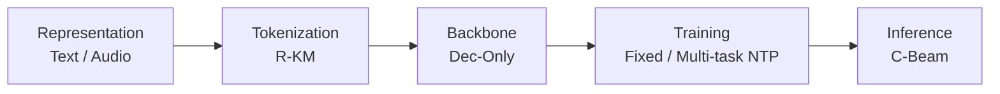
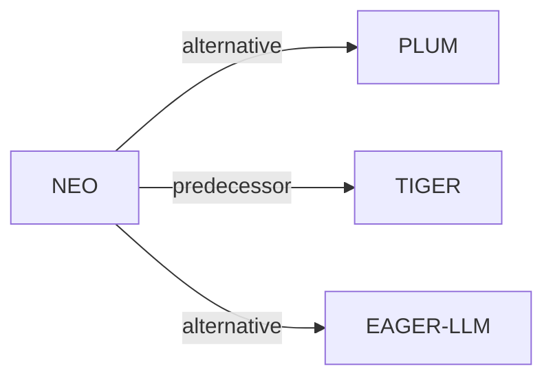

# NEO

*A Unified Language Model for Large Scale Search, Recommendation, and Reasoning* — De Nadai et al. · arXiv’26

`Paradigms, Systems and Benchmarks` · `No single stage`

[Paper](https://arxiv.org/abs/2603.17533) · [Matrix](../../README.md#paradigms-systems-and-benchmarks)

Reading level: Overview (Level 1) · On this page: [TL;DR](#tldr) · [At a Glance](#at-a-glance) · [3. Experimental Findings](#3-experimental-findings) · [5. Connections to Related Work](#5-connections-to-related-work)

- `Text / Audio`: Text or audio representations in different branches or evaluation settings.
- `R-KM`: Residual k-means.
- `Dec-Only`: Decoder-only.
- `Fixed`: SIDs are built first and not changed while the generator trains.
- `Multi-task NTP`: The same NTP loss over several tasks.
- `C-Beam`: Constrained beam search.

### TL;DR

NEO adapts a decoder-only LLM to interleave natural language and typed item Semantic IDs in one sequence, with constrained decoding, to unify search, recommendation, and reasoning without tools.

### At a Glance

| Aspect | Summary |
| :-- | :-- |
| Research Problem | Paradigms, Systems and Benchmarks: Baseline (TIGER), end-to-end multi-stage paradigms, open-source frameworks, benchmarks, and diagnostic resources. |
| Key Contribution | NEO adapts a decoder-only LLM to interleave natural language and typed item Semantic IDs in one sequence, with constrained decoding, to unify search, recommendation, and reasoning without tools. |
| Modified Stage | No single stage |

### 3. Experimental Findings

**Experimental setup**

- **Datasets**: Industrial media logs: >10M episodes, shows, audiobooks and artists; about 15M users; 5M grounding examples, 10M instruction-training examples, 100K test examples. Filtering not reported.
- **Split**: Global temporal protocol: context through t, labels at t+k, evaluation at t+2k; k=1 day for episodes/shows, 7 days for audiobooks. Baselines share train/test windows; dates and validation allocation not reported.
- **Candidates**: not reported; NEO and baselines use the same candidate universe.
- **Visibility**: warm; no unseen-item protocol is defined. User cold-start simulated by removing listening history and retaining user metadata.
- **SID**: Separate residual K-Means vocabularies by type: 4 x 256 for audiobooks/episodes/shows, 4 x 1024 for artists. Each collision bucket resolves to one popularity-selected item.
- **Inference budget**: Trie-constrained beam 30; HR/NDCG@10/30. Top-p alternative: temperature 0.6, top-k 20, top-p 0.95. Inference hardware, batch size and absolute latency not reported; Table 3 latency@10 decreases 2.92% without constraints and 7.91% with sampling.
- **Results from**: Original Tables 5/8/9: production-baseline comparisons, cold/warm users and search breakdowns. Recommendation baseline is GNN/two-tower; search baseline dense retrieval. NEO uses about half the production baseline's historical logs.

Sources

- **Datasets**: Section 4.1: [S4.SS1.p1](https://arxiv.org/html/2603.17533v1#S4.SS1.p1)
- **Split**: Section 4.1.5: [S4.SS1.SSS5.p1](https://arxiv.org/html/2603.17533v1#S4.SS1.SSS5.p1)
- **Candidates**: Section 4.1.5 specifies a common candidate universe but not full-catalog versus sampled evaluation: [S4.SS1.SSS5.p1](https://arxiv.org/html/2603.17533v1#S4.SS1.SSS5.p1)
- **Visibility**: Section 4.1.5 and its cold-user experiment: [S4.SS1.SSS5.p1](https://arxiv.org/html/2603.17533v1#S4.SS1.SSS5.p1) and [S4.SS1.SSS5.Px1.p1](https://arxiv.org/html/2603.17533v1#S4.SS1.SSS5.Px1.p1)
- **SID**: Section 4.1.2: [S4.SS1.SSS2.p2](https://arxiv.org/html/2603.17533v1#S4.SS1.SSS2.p2)
- **Inference budget**: Section 4.2.1 and Table 3: [S4.SS2.SSS1.Px5.p2](https://arxiv.org/html/2603.17533v1#S4.SS2.SSS1.Px5.p2) and [S4.T3](https://arxiv.org/html/2603.17533v1#S4.T3)
- **Results from**: Original Tables 5/8/9 and Sections 4.1.1/4.2.3: [S4.T5](https://arxiv.org/html/2603.17533v1#S4.T5) and [A2.T8](https://arxiv.org/html/2603.17533v1#A2.T8) and [A2.T9](https://arxiv.org/html/2603.17533v1#A2.T9) and [S4.SS1.SSS1](https://arxiv.org/html/2603.17533v1#S4.SS1.SSS1) and [S4.SS2.SSS3.Px1.p1](https://arxiv.org/html/2603.17533v1#S4.SS2.SSS3.Px1.p1)

### 5. Connections to Related Work

- **Alternative** · [PLUM](plum.md): Concurrent SID-LLM adaptation; NEO emphasizes mixed text-ID outputs and multiple item types.
  - Source: NEO v1, Section 2 and Table 1: https://arxiv.org/html/2603.17533v1#S2.SS0.SSS0.Px3.p2; https://arxiv.org/html/2603.17533v1#S2.T1.
- **Predecessor** · [TIGER](tiger.md): Prior SID-based generative retrieval informs NEO's catalog-grounded item representation.
  - Source: NEO v1, Introduction and Section 2, citing Rajput et al. (2024): https://arxiv.org/html/2603.17533v1#S1.p4; https://arxiv.org/html/2603.17533v1#S2.SS0.SSS0.Px3.p1.
- **Alternative** · [EAGER-LLM](eager-llm.md): Motivates testing collaborative SID signals; NEO favors content-derived SIDs in its experiments.
  - Source: NEO v1, Section 4.2.1, citing Hong et al. (2025): https://arxiv.org/html/2603.17533v1#S4.SS2.SSS1.Px4.p1.

[View all papers in this cell](../../README.md#paradigms-systems-and-benchmarks)
