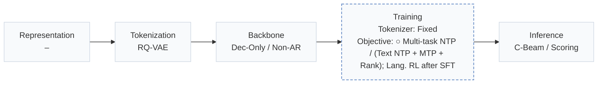
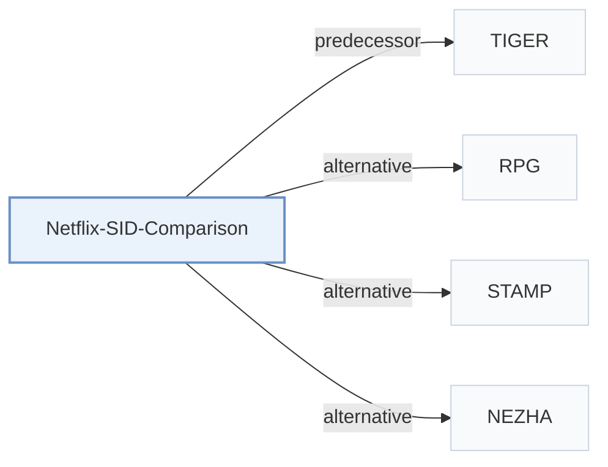

# Netflix-SID-Comparison

[← Problem × Stage Matrix](../../README.md#paradigms-systems-and-benchmarks) · [Papers by Stage](../index/stages.md) · [Papers by Modality](../index/modality.md) · [Papers by Domain](../index/domain.md) · English | [中文](../zh/papers/netflix-sid-comparison.md)

| **Title** | *Personalized LLM Recommendation with Semantic IDs: Autoregressive Beam Search vs. Multi-Token Prediction* |
| :-- | :-- |
| **Authors** | Oh et al. |
| **Venue** | NeurIPS’26 PALM Workshop |
| **Problem × Stage** | `Paradigms, Systems and Benchmarks` · `No single stage` |
| **Changes** | ○ Objective |
| **SID inputs** | `Other` (Content embeddings; constituent modalities unstated) |
| **Domain** | `Long video` |
| **Settings** | `cold-start (item)` |
| **Scenario** | `General Item Recommendation`; `Industrial Data, Offline` |
| **Links** | [Paper](https://arxiv.org/abs/2610.15864) |
| **Reading level** | Overview (Level 1) |

**On this page**: [TL;DR](#tldr) · [3. Experiments](#3-experimental-findings) · [5. Related Work](#5-connections-to-related-work)

- `RQ-VAE`: Residual-Quantized Variational AutoEncoder.
- `Dec-Only / Non-AR`: Decoder-only autoregressive and non-autoregressive prediction variants.
- `Fixed`: SIDs are built first and not changed while the generator trains.
- `Multi-task NTP / (Text NTP + MTP + Rank); Lang. RL after SFT`: Multi-task next-token prediction, or text next-token prediction with multi-token and ranking objectives; language-task reinforcement learning follows supervised fine-tuning.
- `C-Beam / Scoring`: Constrained beam search or direct item scoring, depending on the configuration.

### TL;DR

> [!NOTE]
> Netflix-SID-Comparison evaluates single-head autoregressive beam search against multi-token prediction for LLM Semantic ID generation on ranking quality and serving cost.

---

### 3. Experimental Findings

Experimental setup

- **Datasets**: Proprietary streaming-media member histories, synthetic content QA, and open instruction-following data; >=10M examples/task. Catalog size, exact corpus sizes and filtering not reported.
  - Source: [S4.SS1.SSS0.Px1.p1](https://arxiv.org/html/2610.15864v1#S4.SS1.SSS0.Px1.p1) ; #S4.SS1.SSS0.Px3.p1
- **Split**: Histories snapshotted at a fixed date-hour; internal ranking test averages future-interaction offsets +1 through +7 days. Exact cutoff and train/validation/test sizes not reported; content QA uses a stratified test set.
  - Source: [S4.SS1.SSS0.Px1.p1](https://arxiv.org/html/2610.15864v1#S4.SS1.SSS0.Px1.p1) ; #S4.SS1.SSS0.Px4.p1
- **Candidates**: not reported; trie/request-eligible catalog constraints define serving validity, but the ranking test universe and evaluation negative sampling are not specified.
  - Source: [S3.SS3.SSS1.p1](https://arxiv.org/html/2610.15864v1#S3.SS3.SSS1.p1) ; #S3.SS3.SSS2.p1 ; #S4.SS1.SSS0.Px4.p1
- **Visibility**: Cold-start cohort: titles launched after training cutoff, without training engagement. Generator exposure through content QA and tokenizer fitting exposure not reported; unseen by generator only versus unseen by tokenizer too is not established.
  - Source: [S4.SS1.SSS0.Px4.p1](https://arxiv.org/html/2610.15864v1#S4.SS1.SSS0.Px4.p1) ; #S4.SS3.SSS0.Px1.p1 ; #S4.SS1.SSS0.Px3.p1
- **SID**: Frozen snapshot of RQ-VAE identifiers: 4 x 1024. For collisions (<=1% example rate), return the first entity in the SID bucket.
  - Source: [S3.SS1.p1](https://arxiv.org/html/2610.15864v1#S3.SS1.p1) ; #S4.SS1.SSS0.Px1.p1
- **Inference budget**: Single-head: vLLM constrained beam search with prefix caching; MTP: one-pass per-code distributions and eligible-entity scoring. Beam width, output K, inference batch size and latency not reported. Shared training/inference pool: up to 256 H200/A100-80GB GPUs; inference allocation not reported. MTP throughput is 75% higher on 8B.
  - Source: [S3.SS3](https://arxiv.org/html/2610.15864v1#S3.SS3) ; #S4.SS1.SSS0.Px2.p1 ; #S4.T2 ; #S4.SS2.SSS0.Px2.p1
- **Results from**: Original Tables 1-2: controlled single-head versus MTP quality/system comparison. Tables 3-4: SID recipe versus previous non-SID auxiliary-head baseline; Tables 5-7: ablations. Proprietary scores/costs reported relatively; no imported baseline result table identified.
  - Source: [S4.T1](https://arxiv.org/html/2610.15864v1#S4.T1) ; #S4.T2 ; #S4.T3 ; #S4.T4 ; #S4.SS2.p1

---

### 5. Connections to Related Work

- **Predecessor** · [TIGER](tiger.md): The single-head arm follows TIGER-style autoregressive SID generation with constrained beam search in a multitask streaming-media LLM.
  - Source: Netflix comparison v1, Introduction and Section 3.2.1: [S1.p3](https://arxiv.org/html/2610.15864v1#S1.p3); [S3.SS2.SSS1.p1](https://arxiv.org/html/2610.15864v1#S3.SS2.SSS1.p1).
- **Alternative** · [RPG](rpg.md): RPG pairs parallel SID prediction with graph-constrained decoding; this study strengthens its MTP arm with an auxiliary item-ranking loss and tests moderate four-token SIDs.
  - Source: Netflix comparison v1, Sections 2/3.2.2/4.2: [S2.SS0.SSS0.Px2.p1](https://arxiv.org/html/2610.15864v1#S2.SS0.SSS0.Px2.p1); [S3.SS2.SSS2.Px1.p1](https://arxiv.org/html/2610.15864v1#S3.SS2.SSS2.Px1.p1); [S4.SS2.SSS0.Px3.p1](https://arxiv.org/html/2610.15864v1#S4.SS2.SSS0.Px3.p1).
- **Alternative** · [STAMP](stamp.md): STAMP uses auxiliary multi-token prediction to densify training supervision; this study compares MTP and autoregressive decoding as generation paradigms.
  - Source: Netflix comparison v1, Section 2: [S2.SS0.SSS0.Px2.p1](https://arxiv.org/html/2610.15864v1#S2.SS0.SSS0.Px2.p1).
- **Alternative** · [NEZHA](nezha.md): NEZHA accelerates SID beam search using self-drafting and hash-set verification; this study addresses generation quality and cost rather than only decoding acceleration.
  - Source: Netflix comparison v1, Section 2: [S2.SS0.SSS0.Px3.p1](https://arxiv.org/html/2610.15864v1#S2.SS0.SSS0.Px3.p1).

[View all papers in this cell](../../README.md#paradigms-systems-and-benchmarks)
