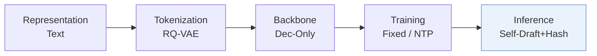
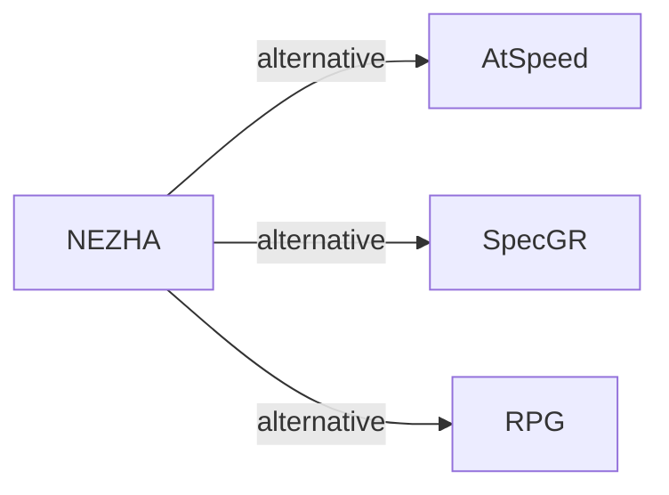

# NEZHA

*A Zero-sacrifice and Hyperspeed Decoding Architecture for Generative Recommendations* — Wang et al. · WWW’26 Industry

`V. Efficiency` · `Inference` · [Paper](https://arxiv.org/abs/2511.18793) · [Matrix](../../README.md#v--inference) · [中文](../zh/papers/nezha.md)

Reading level: Overview (Level 1) · On this page: [TL;DR](#tldr) · [At a Glance](#at-a-glance) · [3. Experiments](#3-experimental-findings) · [5. Related Work](#5-connections-to-related-work)

- `Dec-Only`: Decoder-only.
- `Fixed`: SIDs are built first and not changed while the generator trains.
- `NTP`: Next-token prediction loss only; continuing from a pretrained LLM (SFT) also counts as NTP.
- `Self-Draft+Hash`: Self-drafted candidate generation with hash-set validity checking.

### TL;DR

> [!NOTE]

> NEZHA adds an autoregressive draft head inside the main model for self-drafting and checks drafts against a hash set of valid IDs, instead of separate draft models and model-based verifiers.

### At a Glance

| Aspect | Summary |
| :-- | :-- |
| Research Problem | V. Efficiency: Can it be trained and served within latency and cost budgets? |
| Key Contribution | NEZHA adds an autoregressive draft head inside the main model for self-drafting and checks drafts against a hash set of valid IDs, instead of separate draft models and model-based verifiers. |
| Modified Stage | Inference |

### 3. Experimental Findings

Experimental setup

- **Datasets**: Yelp, Amazon Beauty, Amazon Games; filtering rules not reported. Deployment uses Taobao Search Advertising production data; size, dates and filtering not reported.
  - Source: [S4.SS1.p1](https://arxiv.org/html/2511.18793v1#S4.SS1.p1) ; #S5.p1
- **Split**: Public per-user leave-one-out: last interaction test, penultimate validation, remainder training. Production offline split not reported; online A/B lasts seven days, traffic allocation not reported.
  - Source: [S4.SS1.p1](https://arxiv.org/html/2511.18793v1#S4.SS1.p1) ; #S5.p3
- **Candidates**: not reported
  - Source: Section 4.1 specifies metrics and beam size, not an evaluation universe: [S4.SS1](https://arxiv.org/html/2511.18793v1#S4.SS1)
- **Visibility**: warm; no unseen-item protocol is defined. Tokenizer fitting exposure to test items not reported.
  - Source: [S4.SS1.p1](https://arxiv.org/html/2511.18793v1#S4.SS1.p1) ; #S4.SS1.p4
- **SID**: Public RQ-VAE: 3 x 512, using embeddings of textual item attributes. Production uses three levels with different, unreported codebook sizes. Collision handling not reported; hash-set verification filters invalid generated SIDs.
  - Source: [S4.SS1.p4](https://arxiv.org/html/2511.18793v1#S4.SS1.p4) ; #S3.SS3.p6
- **Inference budget**: Public beam 10, HR/NDCG@5/10; mean prefill+decode latency on Beauty/Games/Yelp: Llama 7.00/7.52/7.41 ms, Qwen 4.41/4.80/4.46 ms. Production benchmark beam 512; 2.6x algorithm speedup, deployed total latency <30 ms including queue savings. GPU model/count and inference batch size not reported.
  - Source: [S4.SS1.p4](https://arxiv.org/html/2511.18793v1#S4.SS1.p4) ; #S3.T3 ; #S1.T1 ; #S1.p3 ; #S5.p2
- **Results from**: Original Table 3: public beam/MTP/NEZHA comparison, means over seeds 42/43/44; Table 4: Yelp ablations. Section 5: production offline hit-rate gains and seven-day online revenue test. No imported baseline results identified.
  - Source: [S3.T3](https://arxiv.org/html/2511.18793v1#S3.T3) ; #S4.T4 ; #S4.SS1.p4 ; #S5.p3

### 5. Connections to Related Work

- **替代方案** · [AtSpeed](atspeed.md): AtSpeed uses a separate draft model and target-model verification; NEZHA uses an internal autoregressive draft head and hash-set validation. AtSpeed is omitted from public comparisons.
  - Source: NEZHA v1, Sections 2.2/4.1: https://arxiv.org/html/2511.18793v1#S2.SS2.p2; https://arxiv.org/html/2511.18793v1#S4.SS1.p2.
- **替代方案** · [SpecGR](specgr.md): SpecGR supports out-of-vocabulary recommendation with speculative inference; NEZHA removes separate drafting and costly target-model verification for fast catalog-valid generation.
  - Source: NEZHA v1, Sections 1/6, citing Ding et al. (2024): https://arxiv.org/html/2511.18793v1#S1.p4; https://arxiv.org/html/2511.18793v1#S6.p2; https://arxiv.org/html/2511.18793v1#S6.p6.
- **替代方案** · [RPG](rpg.md): RPG uses long semantic IDs and graph-based parallel decoding; NEZHA retains sequential dependencies through a lightweight autoregressive draft head.
  - Source: NEZHA v1, Sections 3.2/6: https://arxiv.org/html/2511.18793v1#S3.SS2.p7; https://arxiv.org/html/2511.18793v1#S6.p2.

[查看同格全部论文](../../README.md#v--inference)
