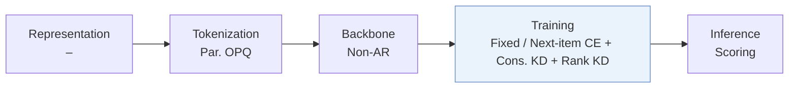
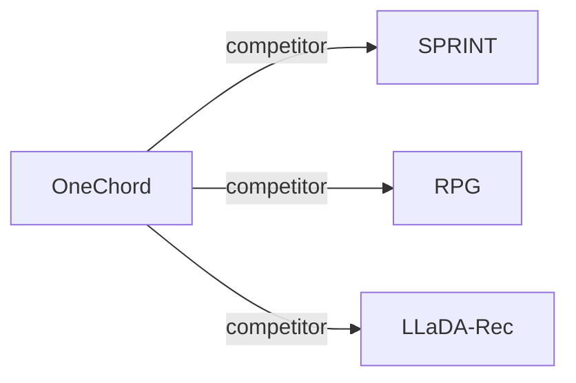

# OneChord

*Distill What You Rank, Recommend in One Pass* — Li et al. · arXiv’26

`IV. Utility` · `Training`

[Paper](https://arxiv.org/abs/2610.25805) · [Code](https://anonymous.4open.science/r/OneChord-D1A2/) · [Matrix](../../README.md#iv--training)

Reading level: Overview (Level 1) · On this page: [TL;DR](#tldr) · [At a Glance](#at-a-glance) · [3. Experimental Findings](#3-experimental-findings) · [5. Connections to Related Work](#5-connections-to-related-work)

- `–`: Not reported in the paper.
- `Non-AR`: Non-autoregressive.
- `Fixed`: SIDs are built first and not changed while the generator trains.
- `Next-item CE + Cons. KD + Rank KD`: Next-item cross-entropy jointly optimized with consistency and ranking distillation.

### TL;DR

OneChord uses one catalog-normalized fusion of Semantic ID evidence and item-matching scores for supervision, distillation, and inference in a parallel decoder, so training targets the ranking used in serving.

### At a Glance

| Aspect | Summary |
| :-- | :-- |
| Research Problem | IV. Utility: Are training and search aimed at what users and the platform value, rather than at token likelihood? |
| Key Contribution | OneChord uses one catalog-normalized fusion of Semantic ID evidence and item-matching scores for supervision, distillation, and inference in a parallel decoder, so training targets the ranking used in serving. |
| Modified Stage | Training |

### 3. Experimental Findings

**Experimental setup**

- **Datasets**: Amazon 2014 5-core Sports/Beauty/Toys; Amazon 2023 5core/last_out_w_his Scientific/Instruments/Games, reconstructing each user's longest chronological sequence.
- **Split**: Last two interactions validation/test; sliding training windows over earlier interactions, history cap 20; one validation/test target per user.
- **Candidates**: full catalog of distinct legal SIDs; identical SIDs share one entry; exact four-code match determines hits.
- **Visibility**: warm; no unseen-item protocol is defined. Fixed OPQ mapping covers every processed item.
- **SID**: Four-code OPQ, 256 codes/position; collisions remain merged as one catalog entry.
- **Inference budget**: One encoder/parallel-decoder pass plus catalog scoring; no beam. Recall/NDCG@5; full-test Top-10 generation 0.23-1.24 s; test batch 256. Hardware and per-request latency: not reported.
- **Results from**: Reported Tables 1/2/3/4: accuracy, full-test cost, ablations, sparsity groups. OneChord accuracy is five-run mean/SD; baselines use common splits, but borrowed-versus-rerun provenance is not reported.

Sources

- **Datasets**: Section 4.1 and Appendix B.1: [S4.SS1.SSS0.Px1.p1](https://arxiv.org/html/2610.25805v1#S4.SS1.SSS0.Px1.p1) and [A2.SS1.p1](https://arxiv.org/html/2610.25805v1#A2.SS1.p1)
- **Split**: Appendix B.1: [A2.SS1.p1](https://arxiv.org/html/2610.25805v1#A2.SS1.p1)
- **Candidates**: Appendix B.1: [A2.SS1.p2](https://arxiv.org/html/2610.25805v1#A2.SS1.p2)
- **Visibility**: Appendix B.1: [A2.SS1.p1](https://arxiv.org/html/2610.25805v1#A2.SS1.p1) and [A2.SS1.p2](https://arxiv.org/html/2610.25805v1#A2.SS1.p2)
- **SID**: Appendix A.5: [A1.SS5.SSS0.Px1.p1](https://arxiv.org/html/2610.25805v1#A1.SS5.SSS0.Px1.p1)
- **Inference budget**: Section 3.6, Section 4.2 and Appendix B.3: [S3.SS6.SSS0.Px3.p1](https://arxiv.org/html/2610.25805v1#S3.SS6.SSS0.Px3.p1) and [S4.SS2.SSS0.Px1.p1](https://arxiv.org/html/2610.25805v1#S4.SS2.SSS0.Px1.p1) and [A2.SS3.SSS0.Px2.p1](https://arxiv.org/html/2610.25805v1#A2.SS3.SSS0.Px2.p1)
- **Results from**: Tables 1-4 and Appendix B.2-B.3: [S3.T1](https://arxiv.org/html/2610.25805v1#S3.T1) and [S3.T2](https://arxiv.org/html/2610.25805v1#S3.T2) and [S4.T3](https://arxiv.org/html/2610.25805v1#S4.T3) and [S4.T4](https://arxiv.org/html/2610.25805v1#S4.T4) and [A2.SS2.p1](https://arxiv.org/html/2610.25805v1#A2.SS2.p1) and [A2.SS3.SSS0.Px3.p1](https://arxiv.org/html/2610.25805v1#A2.SS3.SSS0.Px3.p1)

### 5. Connections to Related Work

- **Competitor** · [SPRINT](sprint.md): SPRINT adds normalized SID/item evidence; OneChord learns and distills the fusion.
  - Source: OneChord v1, Section 2 and Table 1: https://arxiv.org/html/2610.25805v1#S2.SS0.SSS0.Px2.p1; https://arxiv.org/html/2610.25805v1#S3.T1.
- **Competitor** · [RPG](rpg.md): RPG is compared for full-catalog accuracy and complete-test generation cost.
  - Source: OneChord v1, Tables 1-2: https://arxiv.org/html/2610.25805v1#S3.T1; https://arxiv.org/html/2610.25805v1#S3.T2.
- **Competitor** · [LLaDA-Rec](llada-rec.md): LLaDA-Rec is a diffusion-based baseline in the accuracy/cost comparison.
  - Source: OneChord v1, Tables 1-2: https://arxiv.org/html/2610.25805v1#S3.T1; https://arxiv.org/html/2610.25805v1#S3.T2.

[View all papers in this cell](../../README.md#iv--training)
