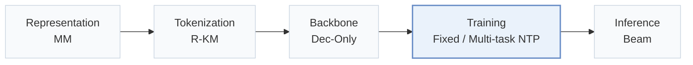
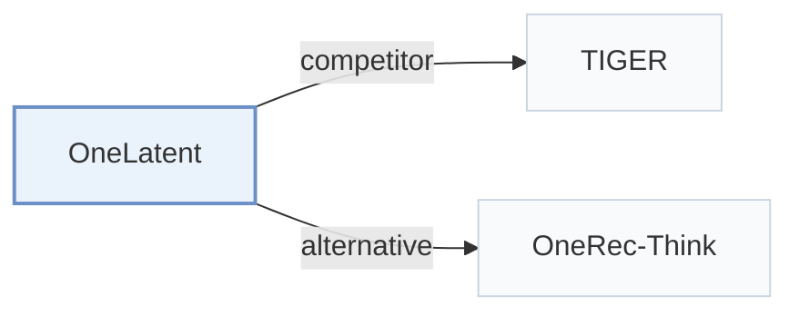

# OneLatent

[← Problem × Stage Matrix](../../README.md#v--training) · [Papers by Stage](../index/stages.md) · [Papers by Modality](../index/modality.md) · English | [中文](../zh/papers/onelatent.md)

| **Title** | *Latent Reasoning for Efficient Foundation Recommendation Models* |
| :-- | :-- |
| **Authors** | Jiang et al. |
| **Venue** | arXiv’26 |
| **Problem × Stage** | `V. Efficiency` · `Training` |
| **Links** | [Paper](https://arxiv.org/abs/2610.30675) |
| **Reading level** | Overview (Level 1) |

**On this page**: [TL;DR](#tldr) · [At a Glance](#at-a-glance) · [3. Experiments](#3-experimental-findings) · [5. Related Work](#5-connections-to-related-work)

- `MM`: Multimodal item representations.
- `R-KM`: Residual k-means.
- `Dec-Only`: Decoder-only.
- `Fixed`: SIDs are built first and not changed while the generator trains.
- `Multi-task NTP`: The same NTP loss over several tasks.
- `Beam`: Autoregressive beam search over Semantic ID tokens.

### TL;DR

> [!NOTE]
> OneLatent compresses explicit chain-of-thought into learnable latent tokens through multi-view teacher traces, staged alignment, and curriculum post-training, instead of generating long reasoning traces at inference.

---

### At a Glance

| Aspect | Summary |
| :-- | :-- |
| Research Problem | V. Efficiency: Can it be trained and served within latency and cost budgets? |
| Key Contribution | OneLatent compresses explicit chain-of-thought into learnable latent tokens through multi-view teacher traces, staged alignment, and curriculum post-training, instead of generating long reasoning traces at inference. |
| Modified Stage | Training |

---

### 3. Experimental Findings

Experimental setup

- **Datasets**: Kuaishou LLM-Rec advertising and seven-day industrial local-services logs. Deduplicate user-item interactions by strongest feedback; remove samples lacking profile/target SID and history items lacking SIDs.
  - Source: Section 4.1.1 and Appendix A.2: [S4.SS1.SSS1.p1](https://arxiv.org/html/2610.30675v1#S4.SS1.SSS1.p1) and [A1.SS2.p2](https://arxiv.org/html/2610.30675v1#A1.SS2.p2) and [A1.SS2.p4](https://arxiv.org/html/2610.30675v1#A1.SS2.p4)
- **Split**: Allocation rule: not reported. SFT/CoT/test counts: industrial 100063/59113/20393; public 60000/30000/10000. Conversion targets use at most 50 preceding interactions.
  - Source: Table 1 and Appendix A.2: [S4.T1](https://arxiv.org/html/2610.30675v1#S4.T1) and [A1.SS2.p3](https://arxiv.org/html/2610.30675v1#A1.SS2.p3)
- **Candidates**: not reported
  - Source: Section 4.1.3 gives generation metrics without a full-catalog/sampled candidate protocol: [S4.SS1.SSS3.p1](https://arxiv.org/html/2610.30675v1#S4.SS1.SSS3.p1)
- **Visibility**: warm; no unseen-item protocol is defined.
  - Source: Sections 4.1.1 and Appendix A.2 define no unseen-item evaluation: [S4.SS1.SSS1.p1](https://arxiv.org/html/2610.30675v1#S4.SS1.SSS1.p1) and [A1.SS2](https://arxiv.org/html/2610.30675v1#A1.SS2)
- **SID**: Multimodal Res-Kmeans, 3 levels x 1024 codes; collision handling: not reported.
  - Source: Section 3.3.1 and Table 10: [S3.SS3.SSS1.p1](https://arxiv.org/html/2610.30675v1#S3.SS3.SSS1.p1) and [A1.T10](https://arxiv.org/html/2610.30675v1#A1.T10)
- **Inference budget**: vLLM beam search; SID/ID Hit@1/16/32/64; three fixed latent tokens, no rationale decoding. 872-instance test: total 3.17 s, 274.29 QPS. Beam width, hardware, inference batch size: not reported.
  - Source: Sections 3.4.3, 4.1.3, 4.4.2 and Table 7: [S3.SS4.SSS3.p1](https://arxiv.org/html/2610.30675v1#S3.SS4.SSS3.p1) and [S4.SS1.SSS3.p1](https://arxiv.org/html/2610.30675v1#S4.SS1.SSS3.p1) and [S4.SS4.SSS2.p1](https://arxiv.org/html/2610.30675v1#S4.SS4.SSS2.p1) and [S4.T7](https://arxiv.org/html/2610.30675v1#S4.T7)
- **Results from**: Reported Tables 2/3/7/9: main, matched-size scaling, efficiency, online A/B. Table 2's final gains compare matched Think-OR, not strongest baseline; baseline borrowed/rerun provenance not reported.
  - Source: Tables 2/3/7/9 and Section 4.2: [S4.T2](https://arxiv.org/html/2610.30675v1#S4.T2) and [S4.T3](https://arxiv.org/html/2610.30675v1#S4.T3) and [S4.T7](https://arxiv.org/html/2610.30675v1#S4.T7) and [S4.T9](https://arxiv.org/html/2610.30675v1#S4.T9) and [S4.SS2.SSS0.Px1.p1](https://arxiv.org/html/2610.30675v1#S4.SS2.SSS0.Px1.p1)

---

### 5. Connections to Related Work

- **Competitor** · [TIGER](tiger.md): TIGER is a SID-based generative baseline in the reported comparison.
  - Source: OneLatent v1, Section 4.1.2 and Table 2: [S4.SS1.SSS2.p1](https://arxiv.org/html/2610.30675v1#S4.SS1.SSS2.p1); [S4.T2](https://arxiv.org/html/2610.30675v1#S4.T2).
- **Alternative** · [OneRec-Think](onerec-think.md): OneRec-Think uses explicit CoT plus RL; OneLatent trains a compact latent interface.
  - Source: OneLatent v1, Section 2.2: [S2.SS2.p1](https://arxiv.org/html/2610.30675v1#S2.SS2.p1).

[View all papers in this cell](../../README.md#v--training)
