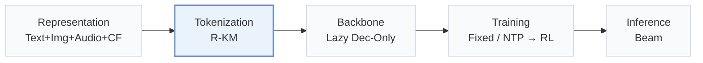
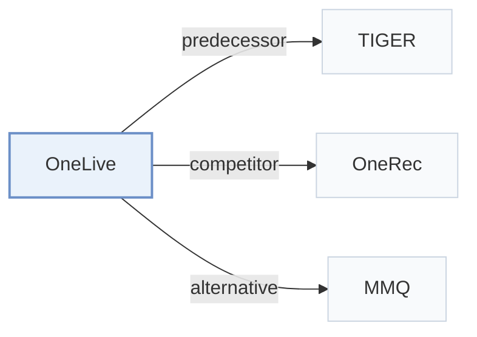

# OneLive

[← Problem × Stage Matrix](../../README.md#vi--tokenization) · [Papers by Stage](../index/stages.md) · [Papers by Modality](../index/modality.md) · English | [中文](../zh/papers/onelive.md)

| **Title** | *Dynamically Unified Generative Framework for Live-Streaming Recommendation* |
| :-- | :-- |
| **Authors** | Wang et al. |
| **Venue** | KDD’26 ADS |
| **Problem × Stage** | `VI. Generalization` · `Tokenization` |
| **Links** | [Paper](https://arxiv.org/abs/2602.08612) |
| **Reading level** | Overview (Level 1) |

**On this page**: [TL;DR](#tldr) · [At a Glance](#at-a-glance) · [3. Experiments](#3-experimental-findings) · [5. Related Work](#5-connections-to-related-work)

- `Text+Img+Audio+CF`: Text, visual, and audio content combined with collaborative signals.
- `R-KM`: Residual k-means.
- `Lazy Dec-Only`: A lazy decoder-only architecture that concentrates decoder computation on target generation.
- `Fixed`: SIDs are built first and not changed while the generator trains.
- `NTP → RL`: NTP, then reinforcement learning (GRPO, GBPO, etc.).
- `Beam`: Autoregressive beam search over Semantic ID tokens.

### TL;DR

> [!NOTE]
> OneLive adapts generative recommendation to live streaming with a dynamic residual-quantization tokenizer, time-aware gated attention, a decoder-only generator with Sequential MTP, and multi-objective alignment.

---

### At a Glance

| Aspect | Summary |
| :-- | :-- |
| Research Problem | VI. Generalization: Does it still work for new items, new domains, and shifting interests? |
| Key Contribution | OneLive adapts generative recommendation to live streaming with a dynamic residual-quantization tokenizer, time-aware gated attention, a decoder-only generator with Sequential MTP, and multi-objective alignment. |
| Modified Stage | Tokenization |

---

### 3. Experimental Findings

Experimental setup

- **Datasets**: Kuaishou live-streaming logs over nearly two months: 400M users, 3M authors, billions of long-view/click interactions. Filtering rules not reported.
  - Source: Appendix B.1.1: [A2.SS1.SSS1.p1](https://arxiv.org/html/2602.08612v1#A2.SS1.SSS1.p1)
- **Split**: Last day test, earlier dates training; validation allocation not reported. Online A/B observed nearly one month on Kuaishou/Kuaishou Lite; traffic allocation not reported.
  - Source: Appendix B.1.1 and Section 3.2: [A2.SS1.SSS1.p1](https://arxiv.org/html/2602.08612v1#A2.SS1.SSS1.p1) and [S3.SS2.p1](https://arxiv.org/html/2602.08612v1#S3.SS2.p1)
- **Candidates**: not reported; only ongoing live streams are eligible.
  - Source: Introduction and Appendix C.2 specify live eligibility/generated-list metrics, not a sampled-negative protocol: [S1.p5](https://arxiv.org/html/2602.08612v1#S1.p5) and [A3.SS2.p1](https://arxiv.org/html/2602.08612v1#A3.SS2.p1)
- **Visibility**: warm; no unseen-item protocol is defined. Collaborative post-alignment and author SID updates use real-time signals; test-author exposure in tokenizer training not reported.
  - Source: Appendix B.1 defines no item holdout: [A2.SS1](https://arxiv.org/html/2602.08612v1#A2.SS1) and [S2.SS1.SSS1.p3](https://arxiv.org/html/2602.08612v1#S2.SS1.SSS1.p3)
- **SID**: Res-Kmeans: 3 levels x 8192 codes. Collision rates measured; collision disambiguation not reported.
  - Source: Section 2.1.2: [S2.SS1.SSS2.p2](https://arxiv.org/html/2602.08612v1#S2.SS1.SSS2.p2)
- **Inference budget**: HR/MRR@64/128; RL beam-top settings 64/256. L20 profiling: MTP graph latency mean/P99 2.25/3.62 ms (3 layers), 2.97/5.04 ms (6 layers); QPS gains 31.8%/62.0%. Main beam width and inference batch size not reported.
  - Source: Section 3.1.2 and Tables 4/5: [S3.SS1.SSS2.p1](https://arxiv.org/html/2602.08612v1#S3.SS1.SSS2.p1) and [S3.T4](https://arxiv.org/html/2602.08612v1#S3.T4) and [S3.T5](https://arxiv.org/html/2602.08612v1#S3.T5)
- **Results from**: Original Table 2: offline long-view/click comparisons on shared industrial logs; Tables 3-5: ablations/serving; Table 6: online A/B.
  - Source: Table 2 and Sections 3.1/3.2: [S2.T2](https://arxiv.org/html/2602.08612v1#S2.T2) and [S3.p1](https://arxiv.org/html/2602.08612v1#S3.p1) and [S3.SS2.p1](https://arxiv.org/html/2602.08612v1#S3.SS2.p1)

---

### 5. Connections to Related Work

- **Predecessor** · [TIGER](tiger.md): OneLive extends SID generation to dynamic live-streaming content.
  - Source: OneLive v1, Appendix A.2 and Table 2: [A1.SS2.p2](https://arxiv.org/html/2602.08612v1#A1.SS2.p2); [S2.T2](https://arxiv.org/html/2602.08612v1#S2.T2).
- **Competitor** · [OneRec](onerec.md): OneRec is adapted as the encoder-decoder live-streaming baseline.
  - Source: OneLive v1, Section 3.1.2 and Table 2; cited Deng et al. (2025) is arXiv:2502.18965: [S3.SS1.SSS2.p1](https://arxiv.org/html/2602.08612v1#S3.SS1.SSS2.p1); [S2.T2](https://arxiv.org/html/2602.08612v1#S2.T2).
- **Alternative** · [MMQ](mmq.md): MMQ aligns content with behavior; OneLive additionally updates author SIDs in real time.
  - Source: OneLive v1, Appendix A.2 and Section 2.1: [A1.SS2.p2](https://arxiv.org/html/2602.08612v1#A1.SS2.p2); [S2.SS1](https://arxiv.org/html/2602.08612v1#S2.SS1).

[View all papers in this cell](../../README.md#vi--tokenization)
