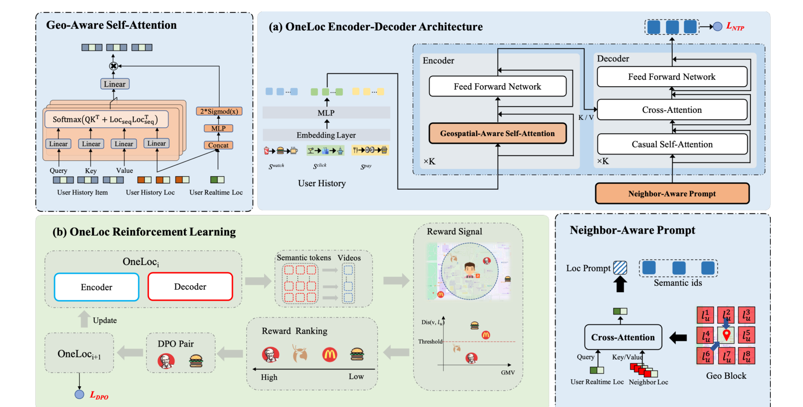

# OneLoc

*Geo-Aware Generative Recommender Systems for Local Life Service* — Wei et al. · arXiv’25

`I. Informativeness` · `Representation` · `POI`

[Paper](https://arxiv.org/abs/2508.14646) · [Matrix](../../README.md#i--representation)

Reading level: Annotated Deep Dive (Level 3) · On this page: [TL;DR](#tldr) · [At a Glance](#at-a-glance) · [1. Why This Paper Matters](#1-why-this-paper-matters) · [2. How It Works](#2-how-it-works) · [3. Experimental Findings](#3-experimental-findings) · [4. Limitations & Critical Analysis](#4-limitations--critical-analysis) · [5. Connections to Related Work](#5-connections-to-related-work)

| Representation | Tokenization | Backbone | Training | Inference |
| :-: | :-: | :-: | :-: | :-: |
| **`Text+Img+Geo†`** | `R-KM` | `Enc-Dec` | `Fixed / NTP → DPO` | `Beam` |

- `R-KM`: Residual k-means.
- `Enc-Dec`: Encoder-decoder.
- `Fixed`: SIDs are built first and not changed while the generator trains.
- `NTP → DPO`: NTP, then preference optimization.

### TL;DR

OneLoc extends end-to-end generative recommendation to local-life videos by adding geographic information to tokenization, encoder attention, and a decoder prompt, and by DPO with geographic and GMV rewards.

### At a Glance

| Aspect | Summary |
| :-- | :-- |
| Research Problem | I. Informativeness: Do the SIDs, or the model reading them, carry the collaborative and multimodal signals recommendation needs? |
| Key Contribution | OneLoc extends end-to-end generative recommendation to local-life videos by adding geographic information to tokenization, encoder attention, and a decoder prompt, and by DPO with geographic and GMV rewards. |
| Modified Stage | Representation |
| Key Findings | In a one-week online A/B test on 10% of traffic, OneLoc reports GMV +21.016% and order volume +17.891% against the production multi-stage pipeline (Sec. 5, Table 4). |
| Limitation | The main offline dataset (KuaiLLSR) and the online test are proprietary, and the paper does not report how SID collisions are handled (Sec. 4.1.1, Sec. 2.2). |

### 1. Why This Paper Matters

In Kuaishou's local-life service, each recommended video is linked to a store location, so a recommendation must match both the user's interest and the user's real-time location (Abstract). The authors state that end-to-end generative recommenders such as OneRec had not yet been built for this setting (Abstract). OneLoc adds geographic information to the tokenizer, the encoder, and the decoder, and aligns the generator with a geographic reward and a GMV reward. LGSID and GeoGR, two other POI papers in the same matrix cell, also add geographic signals in the Representation stage (`Text+Geo+CF`).

> "The first challenge is how to make full use of geographic information. The second challenge is how to balance multiple objectives, including user interests, the distance between user and stores, and some other business objectives." (Abstract)

### 2. How It Works



#### Overview

```
Video content + location context (GeoHash block: coordinates, brand, category)
  │
  ▼  multimodal LLM → one fused item embedding
Geo-aware SID (q1, q2, q3) from 3-level residual k-means, 8,192 codes per level
  │
  ▼  encoder: watch / click / pay sequences, geo-aware self-attention (GA-Attn)
User representation
  │
  ▼  decoder: neighbor-aware prompt e^s, then the SID tokens; next-token prediction
Pre-trained generator θ0
  │
  ▼  beam search → geographic and GMV rewards → preference pairs → DPO
Aligned generator
```

#### Step 1: Geo-Aware Semantic IDs

Each video $`v`$ is assigned a location $`l`$. The location is a GeoHash block with context information such as coordinates, brand, and category (Sec. 2.1). OneLoc follows OneRec and builds SIDs with residual k-means. The input to the first level is one embedding that a multimodal large language model extracts from the video content and the location context.

> "To inject geographic information, each residual $`r^{0}_{i}`$ in the initial residual set $`\mathcal{R}^{0}`$ is represented as an embedding of video content and location context information, extracted by a multimodal large language model." (Sec. 2.2)

At each level $`i`$, k-means on the residuals builds the codebook, and each residual moves to its nearest centroid (Eq. 1–3):

```math
\mathcal{C}^{i} = \mathrm{KMeans}(\mathcal{R}^{i}, N_c), \qquad q^{i}_{j} = \arg\min_{k} \left\| c^{i}_{k} - r^{i}_{j} \right\|, \qquad r^{i+1}_{j} = r^{i}_{j} - c^{i}_{q^{i}_{j}}
```

where:
- $`\mathcal{R}^{i}`$ is the set of residuals at level $`i`$, and $`r^{i}_{j}`$ is the residual of item $`j`$;
- $`\mathcal{C}^{i} = \{c^{i}_{k}\}`$ is the level-$`i`$ codebook of $`N_c`$ centroids;
- $`q^{i}_{j}`$ is the $`i`$-th token of the SID of item $`j`$.

OneLoc uses 3 levels with 8,192 clusters each (Sec. 2.2, Sec. 4.1.4). Geographic information enters only through the fused embedding; there are no separate geographic tokens.

#### Step 2: Geo-Aware Self-Attention in the Encoder

The encoder reads the user's watch, click, and purchase sequences (Eq. 4). Each behavior $`i`$ has a fused embedding $`z_i`$, built by an MLP from its video ID, location ID, and location context embeddings, and a location context embedding $`e^{lc}_i`$ (Eq. 5–7).

> "GA-Attn module is proposed to capture relevant behaviors from the user's interaction history according to the user's real-time location." (Sec. 2.3.3)

GA-Attn adds a location context similarity to the attention scores (Eq. 11–12), then scales each output row with a gate computed from the user's real-time location (Eq. 13–14):

```math
A = \mathrm{Softmax}\left( (Z W_q)(Z W_k)^{\top} / \sqrt{d} + E^{lc} (E^{lc})^{\top} \right), \qquad \widetilde{O} = A (Z W_v) W_o
```

```math
g_i = 2 \cdot \mathrm{Sigmoid}\left( \mathrm{MLP}\left( \mathrm{Concat}(e^{lc}_u, E^{lc}_{i*}) \right) \right), \qquad O_{i*} = g_i\, \widetilde{O}_{i*}
```

where:
- $`Z`$ is the sequence of fused behavior embeddings $`z_i`$, and $`E^{lc}`$ is the sequence of location context embeddings;
- $`W_q, W_k, W_v, W_o`$ are the query, key, value, and output matrices;
- $`e^{lc}_u`$ is the context embedding of the user's real-time location $`l_u`$;
- $`g_i \in (0, 2)`$ scales the $`i`$-th output row.

Each encoder block applies GA-Attn and a feed-forward network, both with RMSNorm and residual connections (Eq. 8–10).

#### Step 3: Neighbor-Aware Prompt and Next-Token Prediction

The decoder starts from a prompt that summarizes the area around the user.

> "In local life service, it is vital to model location contexts surrounding the user, such as surrounding brands, bestselling products, etc. Thus, we use cross-attention to capture the surrounding information." (Sec. 2.4.1)

OneLoc takes the context embeddings of the 8 locations around $`l_u`$ as $`E^{s}`$ and computes one prompt embedding $`e^{s} = \mathrm{CrossAttn}(e^{lc}_u, E^{s})`$, with $`e^{lc}_u`$ as the query (Eq. 15). The decoder input is $`H^{0} = \{e^{s}, e_{q^1_t}, e_{q^2_t}, e_{q^3_t}\}`$ (Eq. 19). Each decoder block has causal self-attention, cross-attention to the encoder output, and a feed-forward network (Eq. 16–18). The output at the prompt predicts the first SID token, the output at the first token predicts the second, and so on:

```math
\hat{y}^{j} = \mathrm{Softmax}\left( \mathrm{MLP}(H^{K}_{j-1}) \right) \in \mathbb{R}^{N_c}, \qquad \mathcal{L}_{ntp} = \sum_{j=1}^{3} -\log \hat{y}^{j}_{q^{j}_{t}}
```

where $`H^{K}_{j-1}`$ is the last-layer decoder output at position $`j-1`$, and $`q^{j}_{t}`$ is the $`j`$-th token of the target SID (Eq. 20–21, Sec. 2.4.2).

#### Step 4: Geographic and GMV Rewards with DPO

Next-token prediction only fits the videos that the previous system exposed (Sec. 2.5). OneLoc therefore defines two rewards. The geographic reward is the inverse distance within a threshold (Eq. 22), and the GMV reward is the output of a GMV scoring model (Eq. 23):

```math
R^{geo}(v, l_u) = \begin{cases} 0 & \text{if } \mathrm{Dis}(v, l_u) \gt D, \\ 1 / \mathrm{Dis}(v, l_u) & \text{otherwise}, \end{cases} \qquad R^{gmv}(v, S, l_u) = \mathrm{GMV}(v, S, l_u)
```

> "The geographic reward signal is proposed to encourage generating videos nearby and thus a closer video would get a higher reward" (Sec. 2.5.1)

For each training sample, the pre-trained model generates $`N`$ videos by beam search (Eq. 24). OneLoc computes both rewards for each video and pairs the video with the highest reward (positive) and the one with the lowest reward (negative) (Sec. 2.5.2). A new model $`\theta_{i+1}`$, initialized from $`\theta_i`$, is trained on these pairs together with next-token prediction:

```math
\mathcal{L}_{dpo} = -\log \sigma\left( \beta \log \frac{p_{\theta_{i+1}}(Q_p \mid S, l_u)}{p_{\theta_{i}}(Q_p \mid S, l_u)} - \beta \log \frac{p_{\theta_{i+1}}(Q_n \mid S, l_u)}{p_{\theta_{i}}(Q_n \mid S, l_u)} \right), \qquad \mathcal{L} = \mathcal{L}_{ntp} + \lambda \mathcal{L}_{dpo}
```

where:
- $`Q_p`$ and $`Q_n`$ are the SIDs of the positive and negative videos;
- the previous iterate $`\theta_i`$ serves as the reference model;
- $`\sigma`$ is the sigmoid function, and $`\lambda = 0.05`$ (Sec. 4.1.4).

Eq. 25 in v1 is printed without $`\sigma`$; the form above follows standard DPO.

```python
import torch
import torch.nn.functional as F

def ga_attn(Z, E_lc, e_u, Wq, Wk, Wv, Wo, gate_mlp):
    """
    Z:        [T, d] fused behavior embeddings z_i (Eq. 6)
    E_lc:     [T, d] location context embeddings of the behaviors (Eq. 7)
    e_u:      [d]    context embedding of the user's real-time location
    gate_mlp: maps [T, 2d] -> [T, 1]
    """
    d = Z.size(-1)
    A = torch.softmax((Z @ Wq) @ (Z @ Wk).T / d ** 0.5 + E_lc @ E_lc.T, dim=-1)        # Eq. 11, [T, T]
    O = A @ (Z @ Wv) @ Wo                                                               # Eq. 12, [T, d]
    g = 2 * torch.sigmoid(gate_mlp(torch.cat([e_u.expand_as(E_lc), E_lc], dim=-1)))     # Eq. 13, [T, 1]
    return g * O                                                                        # Eq. 14

def oneloc_loss(ntp_loss, logp_new_pos, logp_old_pos, logp_new_neg, logp_old_neg, beta, lam=0.05):
    """Sequence log-probabilities of the positive and negative SIDs; old = previous iterate theta_i."""
    margin = beta * ((logp_new_pos - logp_old_pos) - (logp_new_neg - logp_old_neg))
    return ntp_loss + lam * (-F.logsigmoid(margin).mean())                             # Eq. 25-26
```

Simplifications: The code shows one attention head and leaves out RMSNorm, the feed-forward network, and the residual connections of each block. It takes the projection matrices, the gate MLP, and the log-probabilities as inputs, and it does not build preference pairs or run beam search.

### 3. Experimental Findings

**Experimental setup**

- **Datasets**: KuaiLLSR: eight days of uniformly sampled Kuaishou local-life-service short-video interactions, with 60 million users, 900,000 videos, and 440 million interactions; additional filtering rules not reported. Foursquare NYC: 1,042 users, 36,359 POIs, 212,347 interactions; Tokyo: 2,187 users, 59,472 POIs, 545,301 interactions. The public subsets use LibCity preprocessing to filter users and POIs; numerical filtering thresholds not reported.
  - Source: Section 4.1.1 and Table 2 identify the original industrial/public datasets and preprocessing, without numerical LibCity filter thresholds; https://arxiv.org/html/2508.14646v1#S4.SS1.SSS1.p1 and https://arxiv.org/html/2508.14646v1#S4.T2.
- **Split**: KuaiLLSR: streaming training on the first seven days and evaluation on the final day. NYC and Tokyo: each user's check-ins are sorted chronologically, with interaction sequences split 80%/10%/10% for training/validation/testing.
  - Source: Section 4.1.1 states streaming seven-day training plus next-day evaluation and the public 80/10/10 sequence split; https://arxiv.org/html/2508.14646v1#S4.SS1.SSS1.p1.
- **Candidates**: not reported
  - Source: Offline metrics do not disclose full-catalog versus sampled evaluation, and the online statement of identical candidate pools does not determine their size; https://arxiv.org/html/2508.14646v1#S4.SS1.SSS3.p1 and https://arxiv.org/html/2508.14646v1#S5.p1.
- **Visibility**: not reported
  - Source: The paper claims cold-start benefits but does not define generator/tokenizer visibility for a cold-start evaluation; https://arxiv.org/html/2508.14646v1#S4.SS1.SSS1.p1 and https://arxiv.org/html/2508.14646v1#S5.p2.
- **SID**: 3 layers x 8,192 codes per layer, using geo-aware residual K-means; collision handling not reported.
  - Source: Sections 2.2 and 4.1.4 specify three residual-K-means layers of 8,192 codes, but no SID collision-resolution rule; https://arxiv.org/html/2508.14646v1#S2.SS2.p1, https://arxiv.org/html/2508.14646v1#S2.SS2.p3, and https://arxiv.org/html/2508.14646v1#S4.SS1.SSS4.p1.
- **Inference budget**: Production serving uses beam search on NVIDIA A10 GPUs, followed by SID-to-video mapping, GMV scoring, rule-based filtering, and top-K output. Beam width and output K not reported. Dynamic batching, mixed precision, KV caching, and TensorRT are used; numerical inference batch size and latency not reported.
  - Source: Section 3 gives serving hardware and optimizations but no numerical beam width, output K, batch size, or latency; the A800 hardware in Section 4.1.4 is for training; https://arxiv.org/html/2508.14646v1#S3.p1 and https://arxiv.org/html/2508.14646v1#S4.SS1.SSS4.p1.
- **Results from**: Table 1: offline Recall/NDCG at K=5, 10, and 20 on KuaiLLSR, NYC, and Tokyo. Table 3 and Figures 4-5: module/reward ablations. Table 4 and Section 5: one-week online A/B test with 10% treatment traffic, compared with the production multi-stage system.
  - Source: Main offline comparisons and online outcomes are in Tables 1 and 4, with module ablations in Table 3 and Figures 4-5; https://arxiv.org/html/2508.14646v1#S2.T1, https://arxiv.org/html/2508.14646v1#S4.T3, https://arxiv.org/html/2508.14646v1#S4.F4, https://arxiv.org/html/2508.14646v1#S4.F5, https://arxiv.org/html/2508.14646v1#S5.p1, and https://arxiv.org/html/2508.14646v1#S5.T4.

- Foursquare: OneLoc outperforms the baselines in Table 1, which include TIGER and GNPR-SID, on the NYC and Tokyo subsets (Table 1).

  > "Similarly, on the Foursquare global dataset, it attains an average performance boost of 13.18% in Recall@5 and 16.34% in NDCG@5." (Sec. 4.2)

- Online A/B test: OneLoc reports GMV +21.016%, order volume +17.891%, and new local-service buyers +23.027%, with p < 0.01 under two-tailed t-tests (Sec. 5, Table 4).

  > "In this experiment, 10% of the traffic was allocated to the treatment group using the end-to-end OneLoc system, while the control group retained the production-level multi-stage recommendation pipeline" (Sec. 5)

- Ablations: the study covers the neighbor-aware prompt, geo-aware self-attention, and the two rewards, measured by Recall and NDCG, with GMV added for the rewards (Sec. 4.3, Fig. 4, Table 3, Fig. 5). The authors report lower scores for every ablated variant than for the full model. The paper has no ablation of the geo-aware SID.

### 4. Limitations & Critical Analysis

**Stated by the authors.** The paper states no limitations of OneLoc. The conclusion names two directions for future work: scaling laws of model size and sequence length, and RL methods adapted to local-life services (Sec. 7).

**Our analysis.**

- Location enters the SID only through the fused embedding before residual k-means (`Text+Img+Geo†`), so no SID position is tied to geography. LGSID uses geographic indexing with residual quantization (`Geo-Idx+RQ`), and LGRID uses `DSRQ`; both are in the same matrix cell.
- The paper does not state how the two rewards are combined when it ranks the candidates for a preference pair (Sec. 2.5.2).
- The main offline dataset (KuaiLLSR), the GMV scoring model, and the online test are proprietary. Only the Foursquare results can be reproduced from public data (Sec. 4.1.1).
- The paper does not report SID collision handling, the beam width, or the evaluation candidate protocol (Sec. 2.2, Sec. 3, Sec. 4.1.3).
- The v1 front matter still carries template placeholders for the DOI and the conference, so the publication venue is unconfirmed.

### 5. Connections to Related Work

- **Predecessor** · [OneRec](onerec.md): OneRec establishes unified generative retrieval and ranking with preference alignment, while OneLoc develops this direction for local-life video recommendation through geographic modeling and geographic/GMV rewards.
  - Source: OneLoc v1, Section 6.2 explicitly cites Deng et al. (2025), OneRec arXiv:2502.18965, for unified generation and preference alignment: https://arxiv.org/html/2508.14646v1#S6.SS2.p1; Section 2 describes OneLoc's geographic modules and rewards: https://arxiv.org/html/2508.14646v1#S2.p1.
- **Competitor** · [TIGER](tiger.md): TIGER is an evaluated generative baseline using RQ-VAE identifiers; OneLoc uses geo-aware residual-K-means identifiers together with geographic sequence modeling and neighborhood prompts.
  - Source: OneLoc v1, Section 4.1.2 identifies TIGER as a baseline: https://arxiv.org/html/2508.14646v1#S4.SS1.SSS2.p1; Table 1 reports its comparison with OneLoc: https://arxiv.org/html/2508.14646v1#S2.T1; Sections 2 and 2.2 describe OneLoc's added geographic mechanisms: https://arxiv.org/html/2508.14646v1#S2.p1 and https://arxiv.org/html/2508.14646v1#S2.SS2.p1.
- **Competitor** · [GNPR-SID](gnpr-sid.md): GNPR-SID is an evaluated next-POI baseline with geographic semantic identifiers; OneLoc extends geographic modeling into attention, neighborhood prompting, and rewards for local-life video consumption.
  - Source: OneLoc v1, Section 1 explains the geographic-modeling difference: https://arxiv.org/html/2508.14646v1#S1.p2, https://arxiv.org/html/2508.14646v1#S1.p3, and https://arxiv.org/html/2508.14646v1#S1.p4; Table 1 directly compares GNPR-SID and OneLoc: https://arxiv.org/html/2508.14646v1#S2.T1.

[View all papers in this cell](../../README.md#i--representation)
