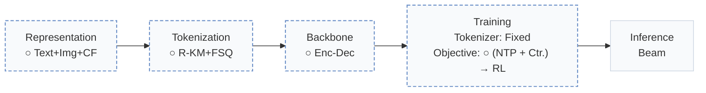
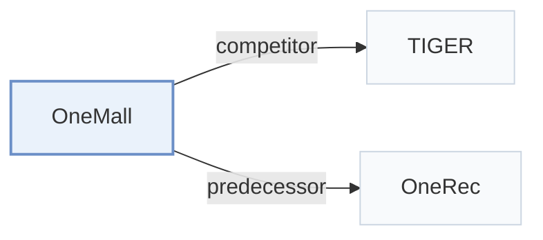

# OneMall

[← Problem × Stage Matrix](../../README.md#paradigms-systems-and-benchmarks) · [Papers by Stage](../index/stages.md) · [Papers by Modality](../index/modality.md) · [Papers by Domain](../index/domain.md) · English | [中文](../zh/papers/onemall.md)

| **Title** | *One Architecture, More Scenarios -- End-to-End Generative Recommender Family at Kuaishou E-Commerce* |
| :-- | :-- |
| **Authors** | Zhang et al. |
| **Venue** | CIKM’26 |
| **Problem × Stage** | `Paradigms, Systems and Benchmarks` · `No single stage` |
| **Changes** | ○ Representation · ○ Tokenization · ○ Backbone · ○ Objective |
| **SID inputs** | A: `Text` + `Img` + `CF` · B: `Text` + `Img` + `CF` · C: `CF` + `unknown` |
| **Domain** | `E-commerce` |
| **Links** | [Paper](https://arxiv.org/abs/2601.21770) |
| **Reading level** | Overview (Level 1) |

**On this page**: [TL;DR](#tldr) · [3. Experiments](#3-experimental-findings) · [5. Related Work](#5-connections-to-related-work)

- `Text+Img+CF`: Text and image representations combined with collaborative signals.
- `R-KM+FSQ`: Residual k-means combined with finite scalar quantization.
- `Enc-Dec`: Encoder-decoder.
- `Fixed`: SIDs are built first and not changed while the generator trains.
- `(NTP + Ctr.) → RL`: Joint next-token and contrastive training, followed by a reinforcement-learning stage; retained losses are specified per paper.
- `Beam`: Autoregressive beam search over Semantic ID tokens.

### TL;DR

> [!NOTE]
> OneMall unifies product-card, short-video, and live-streaming e-commerce in one generator, with a business-aware tokenizer, Query-Former and sparse MoE layers, and a ranking model as reinforcement learning reward.

---

### 3. Experimental Findings

Experimental setup

- **Datasets**: Kuaishou product-card, short-video, and live-streaming logs; dates/sample counts not reported. Tokenizer: 70M product-product pairs (<=40 occurrences/item), 12M video-product pairs from long views 1-5 minutes before product clicks, excluding News/Comedy/Dance/Film-TV/Selfie videos and downsampling frequent products/same-user pairs.
  - Source: Sections 3.1.1 and 4: [S3.SS1.SSS1.p1](https://arxiv.org/html/2601.21770v1#S3.SS1.SSS1.p1) and [S4.p1](https://arxiv.org/html/2601.21770v1#S4.p1)
- **Split**: Offline train/validation/test allocation not reported; simulation replays online requests. Online A/B duration and traffic allocation not reported.
  - Source: Sections 4.2/4.3 describe replay and online tests, not a data split: [S4.SS2.p1](https://arxiv.org/html/2601.21770v1#S4.SS2.p1) and [S4.SS3.p1](https://arxiv.org/html/2601.21770v1#S4.SS3.p1)
- **Candidates**: not reported
  - Source: Section 4 evaluates generated top-K retrieval, without full-catalog/sampled-negative specification: [S4.p1](https://arxiv.org/html/2601.21770v1#S4.p1)
- **Visibility**: warm; no unseen-item protocol is defined. Frozen codebooks can tokenize new uploads; encoder/tokenizer exposure to test items not reported.
  - Source: Sections 2.2/4 define no unseen-item evaluation protocol: [S2.SS2.p1](https://arxiv.org/html/2601.21770v1#S2.SS2.p1) and [S4](https://arxiv.org/html/2601.21770v1#S4)
- **SID**: Two Res-Kmeans levels plus a 4096-code FSQ final level; residual-only baseline uses 3x4096. Final variant's residual codebook sizes not separately stated. FSQ reduces collisions; residual collision resolution not reported.
  - Source: Sections 3.1.3/4.5: [S3.SS1.SSS3.p1](https://arxiv.org/html/2601.21770v1#S3.SS1.SSS3.p1) and [S4.SS5.p1](https://arxiv.org/html/2601.21770v1#S4.SS5.p1) and [S4.SS5.p2](https://arxiv.org/html/2601.21770v1#S4.SS5.p2)
- **Inference budget**: Deployed 0.5B-total/0.1B-active model; HR@50/100/500. Serving beam width, hardware, inference batch size, latency not reported; beam 768 is RL training candidate generation.
  - Source: Sections 4/4.2/4.4: [S4.p1](https://arxiv.org/html/2601.21770v1#S4.p1) and [S4.SS2.p1](https://arxiv.org/html/2601.21770v1#S4.SS2.p1) and [S4.SS4.p1](https://arxiv.org/html/2601.21770v1#S4.SS4.p1)
- **Results from**: Original Table 1: scaling; Table 2: replay versus equally sized SASRec/TIGER with identical input features; Table 3: online A/B; Tables 4/5: RL/tokenizer ablations.
  - Source: Sections 4.2/4.3 and Tables 1-5: [S4.SS2.p1](https://arxiv.org/html/2601.21770v1#S4.SS2.p1) and [S4.T2](https://arxiv.org/html/2601.21770v1#S4.T2) and [S4.T3](https://arxiv.org/html/2601.21770v1#S4.T3) and [S3.T1](https://arxiv.org/html/2601.21770v1#S3.T1) and [S4.T4](https://arxiv.org/html/2601.21770v1#S4.T4) and [S4.T5](https://arxiv.org/html/2601.21770v1#S4.T5)

---

### 5. Connections to Related Work

- **Competitor** · [TIGER](tiger.md): TIGER is the equally sized encoder-decoder replay baseline.
  - Source: OneMall v1, Section 4.2 and Table 2: [S4.SS2.p1](https://arxiv.org/html/2601.21770v1#S4.SS2.p1); [S4.T2](https://arxiv.org/html/2601.21770v1#S4.T2).
- **Predecessor** · [OneRec](onerec.md): OneMall adapts OneRec's end-to-end short-video paradigm to e-commerce scenarios.
  - Source: OneMall v1, Section 1 (Deng et al., 2025, arXiv:2502.18965; distinct from Zhou et al., 2025 Technical Report): [S1.p5](https://arxiv.org/html/2601.21770v1#S1.p5).

[View all papers in this cell](../../README.md#paradigms-systems-and-benchmarks)
