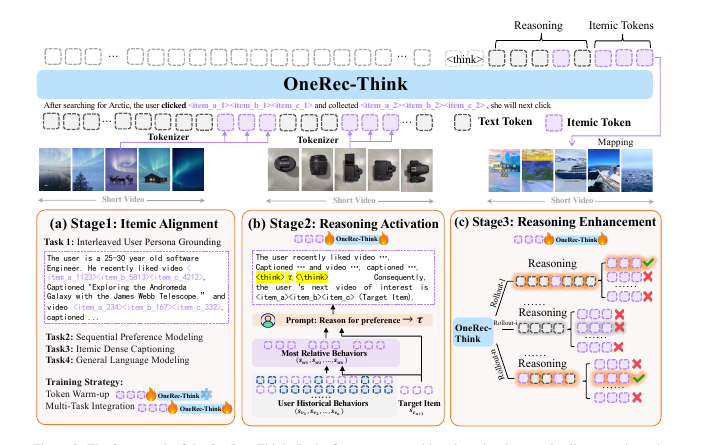

# OneRec-Think: Onerec-think: In-text reasoning for generative recommendation

[Back to Catalog](../../README.md) · [Paper (`https://arxiv.org/abs/2510.11639`)](https://arxiv.org/abs/2510.11639) · [Source Record (`data/papers/onerec-think.yaml`)](../../data/papers/onerec-think.yaml)

> **Summary**: Abstract: "critically lacking the capacity for explicit and controllable reasoning". Candidates: none / III (rule: lack of reasoning is not a class of its own).

## Taxonomy & Table 1 Specification

| Field | Value | Vocabulary Definition |
| :--- | :--- | :--- |
| **Authors & Year** | Liu et al. (2025) | Published / posted in `arXiv’25` |
| **Problem Band** | `III. SID–Model Alignment` | Can the generator read, write, and reason over SIDs, and do the tokenizer and generator work toward the same goal? |
| **Primary Stage** | `Training` | The primary design change sits in the Training stage (Tokenizer update schedule or training Objective). |
| **Representation** | `Text+Img+CF†` |  |
| **Tokenization** | `R-KM†` |  |
| **Backbone** | `Dec-Only` | Decoder-only. |
| **Tokenizer Training** | `Fixed` | SIDs are built first and not changed while the generator trains. |
| **Training Objective** | `NTP → RL` | NTP, then reinforcement learning (GRPO, GBPO, etc.). |
| **Inference Decoding** | `CoT` | Chain-of-thought before the SID. |
| **POI / Local-Life** | `false` | Point-of-interest / geographic recommendation indicator |
| **Code Repository** | Not reported | Official or public implementation link |

## Architecture

## Verbatim Evidence & Rationale

- **`problem`** (arXiv abstract): Abstract: "critically lacking the capacity for explicit and controllable reasoning". Candidates: none / III (rule: lack of reasoning is not a class of its own).
- **`representation`** (§3, p2; OneRec technical report §2.1.1): Paper says itemic tokens come from 'multi-modal and collaborative content' but does not name the visual inputs.
- **`tokenization`** (§3, p2; OneRec technical report (arXiv 2506.13695v4) §2.1.2, Table 11; §5.4.1, p6): Paper only says 'Following OneRec'; R-KM inferred from the OneRec technical report (RQ-Kmeans).

## 旧卡片说明

迁自 `d61aa6c:papers/onerecthink.md`。保留方法说明、实验叙述与局限；本轮只对照现有记录处理明确冲突，未重新逐句核查原论文。分类和规格以页面上方由记录生成的表格为准。

### OneRec-Think：文本内推理生成式推荐

> OneRec-Think 在物品标识生成前加入用户偏好推理，并用多任务对齐和强化学习提升推荐质量与可解释性。

### 研究动机与问题定义

生成式推荐能够直接预测物品标识，但通常缺少可观察的偏好推理。OneRec-Think 试图让 LLM 在同一自回归过程中先形成理由，再生成目标 itemic token，同时兼顾工业响应速度。

### TL;DR（核心摘要）

`用户历史与itemic token → 多任务对齐 → 偏好理由 → 生成itemic token → 推荐物品`

框架包含 itemic alignment、reasoning activation 和 reasoning enhancement 三阶段。多任务预训练融合用户画像、序列偏好、物品描述生成和通用语言建模；随后从裁剪历史中引导理由生成，并用推荐奖励强化推理路径。Think-Ahead 架构将部分推理前置，最终 token 直接对应物品。

### 输入与使用场景

| 方面 | 说明 |
|---|---|
| 使用信息 | 用户行为、用户画像、物品文本和偏好反馈 |
| 信息融入位置 | itemic token 对齐、推理文本和奖励目标 |
| 语义标识结构 | 推理序列后接 itemic token 序列 |
| 适用场景 | 工业序列推荐和可解释推荐 |

### 方法设计

#### 4.1 多任务 Itemic 对齐预训练
OneRec-Think 将 itemic token 与文本 token 放进同一语言空间，训练用户画像、序列偏好、itemic dense captioning 和通用语言建模四类任务。Token warm-up 先学习 itemic embedding，再进行多任务联合整合。

#### 4.2 推理激活
为应对工业行为序列噪声，模型先从裁剪后的相关历史中生成偏好理由，再把这些理由蒸馏到原始行为上下文。推理目标不是独立解释，而是为后续 itemic token 生成提供中间偏好结构。

#### 4.3 推理增强
模型生成多条 reasoning rollout，并用推荐特定奖励比较目标一致性、路径质量和结果可靠性。强化学习进一步筛选能够导向有效 itemic token 的推理路径。

#### 4.4 Think-Ahead 部署架构
论文将部分推理工作前置或离线化，在线阶段快速读取增强后的上下文并生成目标 itemic token，从而在可解释性和工业响应时间之间折中。

### 实验结论

- OneRec-Think 在多个公开基准上报告了较强推荐表现。
- 三阶段训练分别改善语义对齐、推理激活和偏好一致性。
- Think-Ahead 在工业部署中报告了停留时长收益。

### 局限性与研究定位

#### 局限性
- 文本推理增加 token 数量和训练、推理成本。
- 推理奖励依赖用户行为代理信号，可能存在偏差。
- 复杂场景下的实时推理稳定性仍需更多公开验证。

#### 研究定位
OneRec-Think 将显式文本推理嵌入直接 itemic token 生成，适合放在“推理增强生成式推荐”章节。

### 相关资源

- [论文原文](https://arxiv.org/abs/2510.11639)

### 标签

`文本内推理` · `多任务预训练` · `Think-Ahead` · `偏好强化学习`

### 架构图来源

*图源：原论文，图2。图片使用许可待核实。*

---

### 旧总表补充

来源：`d61aa6c:tables/all-methods.md`。

- 核心贡献：在生成物品标识前加入文本内推理。
- 使用场景：工业推荐。

## Peer Methods in `III. SID–Model Alignment` × `Training` (8 peers)

| Method | Venue | Representation | Tokenization | Backbone | Tokenizer | Objective | Inference |
| :--- | :--- | :--- | :--- | :--- | :--- | :--- | :--- |
| [LC-Rec](lc-rec.md) | ICDE’24 | `Text` | `RQ-VAE` | `Dec-Only` | `Fixed` | `Multi-task NTP` | `Beam` |
| [ETEGRec](etegrec.md) | SIGIR’25 | `CF` | `Learn. RQ` | `Enc-Dec` | `Altern.` | `NTP + Ctr.` | `Beam` |
| [GREAM](gream.md) | arXiv’25 | `Text+CF` | `RQ-KM` | `Dec-Only` | `Fixed` | `NTP → RL` | `Beam` |
| [Evo-Rec](evo-rec.md) | arXiv’26 | `Text` | `RQ-VAE` | `Dec-Only` | `Fixed` | `NTP → RL` | `CoT+C-Beam` |
| [GTI](gti.md) | arXiv’26 | `Text+CF / Text` | `RQ-VAE` | `Dec-Only` | `Fixed` | `Multi-task NTP` | `–` |
| [Intent-Driven-News](intent-driven-news.md) | ACL’26 Industry | `Text` | `RQ-VAE` | `Dec-Only` | `Fixed` | `Multi-task NTP` | `CoT+Fuzzy Match` |
| [SIDReasoner](sidreasoner.md) | KDD’26 | `Text` | `RQ-VAE` | `Dec-Only` | `Fixed` | `NTP → RL` | `C-Beam` |
| [Think2Go](think2go.md) | KDD’26 | `Attr+Geo+CF†` | `RQ-VAE` | `Dec-Only` | `Fixed` | `NTP → RL` | `CoT+Beam` |
