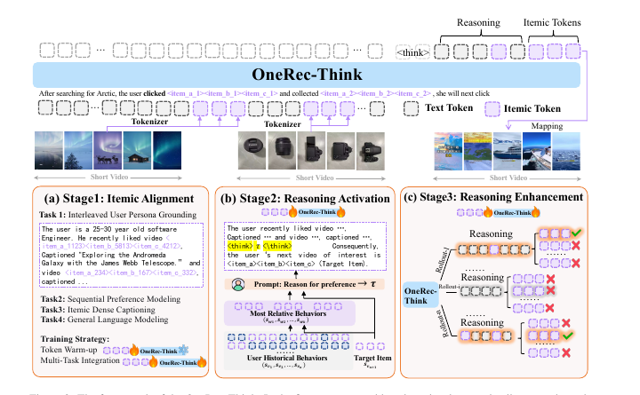

# OneRec-Think

*In-text reasoning for generative recommendation* — Liu et al. · arXiv’25

`III. SID–Model Alignment` · `Training`

[Paper](https://arxiv.org/abs/2510.11639) · [Code](https://github.com/wangshy31/OneRec-Think) · [Matrix](../../README.md#iii--training)

Reading level: Reading Notes (Level 2) · On this page: [TL;DR](#tldr) · [At a Glance](#at-a-glance) · [1. Why This Paper Matters](#1-why-this-paper-matters) · [2. How It Works](#2-how-it-works) · [3. Experimental Findings](#3-experimental-findings) · [4. Limitations & Critical Analysis](#4-limitations--critical-analysis) · [5. Connections to Related Work](#5-connections-to-related-work)

| Representation | Tokenization | Backbone | Training | Inference |
| :-: | :-: | :-: | :-: | :-: |
| `Text+Img+CF†` | `R-KM†` | `Dec-Only` | **`Fixed / NTP → RL`** | `CoT` |

- `Dec-Only`: Decoder-only.
- `Fixed`: SIDs are built first and not changed while the generator trains.
- `NTP → RL`: NTP, then reinforcement learning (GRPO, GBPO, etc.).
- `CoT`: Chain-of-thought before the SID.

### TL;DR

OneRec-Think adds explicit in-text reasoning to OneRec-style generation through item-text alignment, reasoning scaffolding, and a recommendation reward for multiple valid targets, instead of implicit prediction alone.

### At a Glance

| Aspect | Summary |
| :-- | :-- |
| Research Problem | III. SID–Model Alignment: Can the generator read, write, and reason over SIDs, and do the tokenizer and generator work toward the same goal? |
| Key Contribution | OneRec-Think adds explicit in-text reasoning to OneRec-style generation through item-text alignment, reasoning scaffolding, and a recommendation reward for multiple valid targets, instead of implicit prediction alone. |
| Modified Stage | Training |
| Key Findings | In the online A/B test on Kuaishou, the Think-Ahead deployment increases App Stay Time by 0.159% against the online model (Sec. 5.4.2, Table 3). |
| Limitation | Multi-step reasoning conflicts with real-time latency requirements, so the full model runs only offline and a separate real-time OneRec model produces the last itemic token online (Sec. 4.4). |

### 1. Why This Paper Matters

Generative recommenders such as OneRec predict item tokens directly and do not produce explicit, controllable reasoning (Abstract). OneRec-Think lets an LLM write a reasoning sequence and then the next itemic tokens in the same output.

> "In contrast, we reformulate this task to unify reasoning and recommendation in a single autoregressive pass." (Sec. 3)

Based on arXiv v2.

### 2. How It Works

*Figure source: Fig. 2, original paper.*

#### Itemic Alignment

Multi-task pre-training under next-token prediction teaches the LLM to read natural language and itemic tokens together (Sec. 4.1). The four tasks are interleaved user persona grounding, sequential preference modeling, itemic dense captioning, and general language modeling. A token warm-up substage first trains only the itemic token embeddings with the base LLM frozen, and then all parameters are trained jointly.

#### Reasoning Activation

Industrial behavior sequences are noisy. Supervised fine-tuning first extracts reasoning trajectories from pruned user contexts and then uses them to guide rationale generation over the raw behavior data (Sec. 4.2). The rationale and the target item are trained with a joint likelihood.

#### Reasoning Enhancement

RL with GRPO refines the reasoning paths (Sec. 4.3). After each sampled rationale, a constrained beam generates candidates, and the reward is the best position-wise match between a candidate and the target itemic tokens (Eq. 6).

> "To overcome this, we introduce the Rollout-Beam reward that evaluates reasoning capability by the model’s best achievable performance within a constrained beam." (Sec. 4.3)

#### Think-Ahead Serving

The full OneRec-Think model generates the reasoning path and the first two itemic tokens offline (Sec. 4.4).

> "It utilizes the pre-generated item-tokens as a constrained prefix to rapidly produce the final itemic token." (Sec. 4.4)

### 3. Experimental Findings

**Experimental setup**

- **Datasets**: Amazon Beauty, Toys, and Sports; users and items with fewer than 5 interactions are discarded. Industrial: Kuaishou short-video data with daily incremental training on about 20B tokens per day. Retained corpus sizes: not reported.
  - Source: Public datasets: https://arxiv.org/html/2510.11639v2#S5.SS1.p2; filtering and split: https://arxiv.org/html/2510.11639v2#A1.SS1.SSS0.Px2.p1; industrial deployment: https://arxiv.org/html/2510.11639v2#S5.SS4.SSS2.Px1.p1.
- **Split**: Public: leave-one-out (allocation not restated beyond the label); training histories capped at 50 items. Online: one-week A/B test with a 1.29% traffic group.
  - Source: Leave-one-out and history cap: https://arxiv.org/html/2510.11639v2#A1.SS1.SSS0.Px2.p1; online test: https://arxiv.org/html/2510.11639v2#S5.SS4.SSS2.Px1.p1.
- **Candidates**: not reported (full catalog versus sampled evaluation candidates); top-K lists from beam search with width 10.
  - Source: Metrics only: https://arxiv.org/html/2510.11639v2#S5.SS1.p2.
- **Visibility**: warm; no unseen-item protocol is defined.
  - Source: Standard split with no unseen-item protocol: https://arxiv.org/html/2510.11639v2#A1.SS1.SSS0.Px2.p1.
- **SID**: Public: four-level hierarchical semantic IDs with 256 tokens per level (1,024 new tokens). Industrial: three levels x 8,192 itemic tokens (24,576 new tokens), plus item boundary tokens. The tokenizer algorithm is not restated; collision handling: not reported.
  - Source: Public 4 levels x 256; industrial 3 levels x 8,192: https://arxiv.org/html/2510.11639v2#A1.SS1.SSS0.Px2.p1 and https://arxiv.org/html/2510.11639v2#S5.SS4.SSS1.p1; no collision rule found.
- **Inference budget**: Public: beam search with width 10 after the reasoning text (Qwen3-1.7B). Industrial: Think-Ahead serving generates the reasoning and the first two itemic tokens offline with Qwen-8B, then a real-time OneRec model completes the last token online; latency numbers: not reported. Daily training on a cluster of 80 GPUs.
  - Source: Beam width 10 for public evaluation: https://arxiv.org/html/2510.11639v2#A1.SS1.SSS0.Px2.p1; Rollout-Beam reward with width K: https://arxiv.org/html/2510.11639v2#S4.SS3.p2; two-stage serving: https://arxiv.org/html/2510.11639v2#S4.SS4.p2; training cluster: https://arxiv.org/html/2510.11639v2#S5.SS4.SSS1.p1.
- **Results from**: Table 1 (Beauty, Toys, Sports versus sequential and generative baselines); Table 2 (alignment and reasoning ablation on Beauty); Table 3 (online A/B); Table 4 (user and video understanding BertScore).
  - Source: Public: https://arxiv.org/html/2510.11639v2#S4.T1; ablation: https://arxiv.org/html/2510.11639v2#S5.T2; online: https://arxiv.org/html/2510.11639v2#S5.T3; understanding benchmarks: https://arxiv.org/html/2510.11639v2#S5.T4.

- Public benchmarks: OneRec-Think performs best on Amazon Beauty, Toys, and Sports against the baselines in Table 1 (Sec. 5.2).
- Ablation: on Beauty, adding itemic alignment to the base model and then the reasoning mechanism both improve the recommendation metrics (Sec. 5.3, Table 2).

### 4. Limitations & Critical Analysis

**Our analysis.**

- OneRec uses an `Enc-Dec` generator trained with `NTP → DPO`; OneRec-Think uses a `Dec-Only` LLM trained with `NTP → RL` and generates reasoning before the item (`CoT`).
- The online gain comes from a split system in which a different model produces the last token. This suggests that the measured effect mixes the offline reasoning with the online model's own updates.

### 5. Connections to Related Work

- **Competitor** · [TIGER](tiger.md): TIGER generates the next itemic tokens directly; OneRec-Think first generates interleaved text-and-item reasoning and is rewarded with a beam-based signal.
  - Source: OneRec-Think v2, baselines: https://arxiv.org/html/2510.11639v2#S5.SS1.p2 and https://arxiv.org/html/2510.11639v2#A1.SS1.SSS0.Px1.p1; Table 1: https://arxiv.org/html/2510.11639v2#S4.T1.
- **Alternative** · [LC-Rec](lc-rec.md): LC-Rec aligns LLMs to item indices with auxiliary tasks; OneRec-Think adds itemic-textual alignment followed by reasoning activation and RL.
  - Source: OneRec-Think v2, Section 3 and Appendix A.1 cite Zheng et al. (2024): https://arxiv.org/html/2510.11639v2#S3.SS0.SSS0.Px2.p2 and https://arxiv.org/html/2510.11639v2#A1.SS1.SSS0.Px2.p1; not a baseline in Table 1.
- **Alternative** · [GRLM](grlm.md): GRLM later compares against OneRec-Think and replaces numeric itemic tokens with natural-language term IDs.
  - Source: Evidence is from the later GRLM paper: LLM-based baselines and Table 2: https://arxiv.org/html/2601.06798v1#S4.I1.i3.p1 and https://arxiv.org/html/2601.06798v1#S5.T2.

[View all papers in this cell](../../README.md#iii--training)
