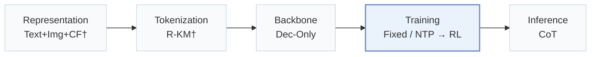
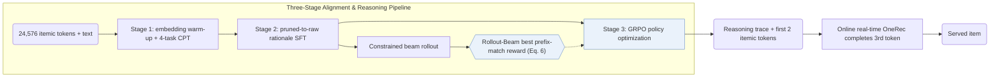
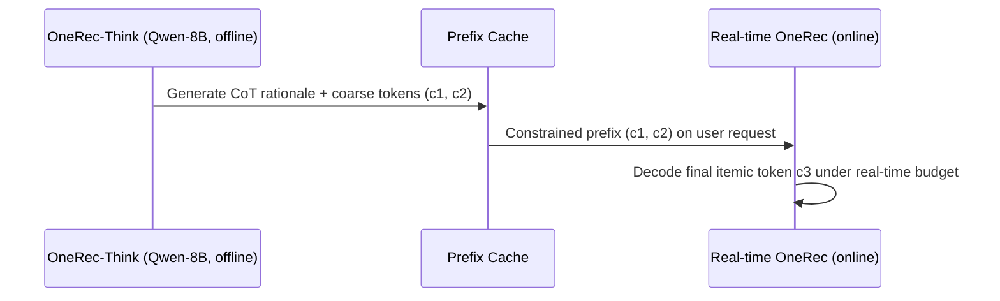
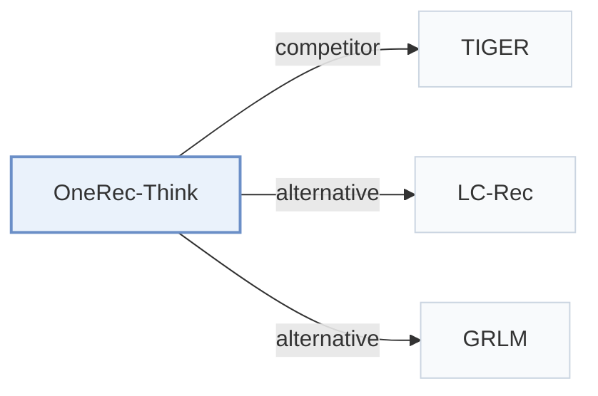

# OneRec-Think

[← Problem × Stage Matrix](../../README.md#iii--training) · [Papers by Stage](../index/stages.md) · [Papers by Modality](../index/modality.md) · English | [中文](../zh/papers/onerec-think.md)

| **Title** | *In-text reasoning for generative recommendation* |
| :-- | :-- |
| **Authors** | Liu et al. |
| **Venue** | arXiv’25 |
| **Problem × Stage** | `III. SID–Model Alignment` · `Training` |
| **Links** | [Paper](https://arxiv.org/abs/2510.11639) · [Code](https://github.com/wangshy31/OneRec-Think) |
| **Reading level** | Reading Notes (Level 2) |

**On this page**: [TL;DR](#tldr) · [At a Glance](#at-a-glance) · [1. Why It Matters](#1-why-this-paper-matters) · [2. Method](#2-how-it-works) · [3. Experiments](#3-experimental-findings) · [4. Limitations](#4-limitations--critical-analysis) · [5. Related Work](#5-connections-to-related-work)

- `Text+Img+CF†`: Text, image, and collaborative representations (inferred).
- `R-KM†`: Residual k-means tokenization (inferred).
- `Dec-Only`: Decoder-only.
- `Fixed`: SIDs are built first and not changed while the generator trains.
- `NTP → RL`: NTP, then reinforcement learning (GRPO, GBPO, etc.).
- `CoT`: Chain-of-thought before the SID.

### TL;DR

> [!NOTE]
> OneRec-Think adds explicit in-text reasoning to OneRec-style generation through item-text alignment, reasoning scaffolding, and a recommendation reward for multiple valid targets, instead of implicit prediction alone.

---

### At a Glance

| Aspect | Summary |
| :-- | :-- |
| Research Problem | III. SID–Model Alignment: Can the generator read, write, and reason over SIDs, and do the tokenizer and generator work toward the same goal? |
| Key Contribution | OneRec-Think adds explicit in-text reasoning to OneRec-style generation through item-text alignment, reasoning scaffolding, and a recommendation reward for multiple valid targets, instead of implicit prediction alone. |
| Modified Stage | Training |
| Key Findings | In Kuaishou's online A/B test, Think-Ahead deployment raises App Stay Time by 0.159% over the production baseline while outperforming sequential and generative baselines on Amazon Beauty, Toys, and Sports (Sec. 5.2, Sec. 5.4.2, Tables 1 and 3). |
| Limitation | Autoregressive chain-of-thought reasoning exceeds strict online latency budgets, forcing the full model to pre-compute prefixes offline while a separate real-time OneRec model completes the final token online (Sec. 4.4). |

---

### 1. Why This Paper Matters

Direct SID generators such as OneRec emit item tokens without explicit intermediate reasoning, limiting interpretability and multi-step intent deduction (Abstract). OneRec-Think unifies natural-language chain-of-thought generation and hierarchical itemic token decoding inside a single autoregressive pass, paired with a split offline-online serving architecture.

> "In contrast, we reformulate this task to unify reasoning and recommendation in a single autoregressive pass." (Sec. 3)

---

### 2. How It Works

#### Itemic Alignment

Next-token continued pre-training bridges natural language and discrete itemic tokens across four tasks: interleaved user persona grounding, sequential preference modeling, itemic dense captioning, and general language modeling (Sec. 4.1). A token warm-up substage first updates only the new itemic embeddings with the LLM backbone frozen before unfreezing all parameters jointly.

#### Reasoning Activation

Because raw industrial interaction logs contain noisy clicks, supervised fine-tuning distills clean reasoning trajectories from pruned user histories and transfers them to supervise joint rationale-and-item likelihood over raw behavior sequences (Sec. 4.2).

#### Reasoning Enhancement

GRPO reinforcement learning refines the generated rationales (Sec. 4.3). Conditioned on each sampled reasoning trace, constrained beam search rolls out candidate SIDs and scores the trace by the highest position-wise token match achieved within the beam against the ground-truth item (Eq. 6).

> "To overcome this, we introduce the Rollout-Beam reward that evaluates reasoning capability by the model’s best achievable performance within a constrained beam." (Sec. 4.3)

#### Think-Ahead Serving

To meet production latency limits, the full OneRec-Think LLM runs asynchronously offline to generate the reasoning trace and the coarse first two itemic tokens, passing those prefixes to an online OneRec model that decodes the final fine-grained token in real time (Sec. 4.4).

> "It utilizes the pre-generated item-tokens as a constrained prefix to rapidly produce the final itemic token." (Sec. 4.4)

---

### 3. Experimental Findings

Experimental setup

- **Datasets**: Amazon Beauty, Toys, and Sports; users and items with fewer than 5 interactions are discarded. Industrial: Kuaishou short-video data with daily incremental training on about 20B tokens per day. Retained corpus sizes: not reported.
  - Source: Public datasets: [S5.SS1.p2](https://arxiv.org/html/2510.11639v2#S5.SS1.p2); filtering and split: [A1.SS1.SSS0.Px2.p1](https://arxiv.org/html/2510.11639v2#A1.SS1.SSS0.Px2.p1); industrial deployment: [S5.SS4.SSS2.Px1.p1](https://arxiv.org/html/2510.11639v2#S5.SS4.SSS2.Px1.p1).
- **Split**: Public: leave-one-out (allocation not restated beyond the label); training histories capped at 50 items. Online: one-week A/B test with a 1.29% traffic group.
  - Source: Leave-one-out and history cap: [A1.SS1.SSS0.Px2.p1](https://arxiv.org/html/2510.11639v2#A1.SS1.SSS0.Px2.p1); online test: [S5.SS4.SSS2.Px1.p1](https://arxiv.org/html/2510.11639v2#S5.SS4.SSS2.Px1.p1).
- **Candidates**: not reported (full catalog versus sampled evaluation candidates); top-K lists from beam search with width 10.
  - Source: Metrics only: [S5.SS1.p2](https://arxiv.org/html/2510.11639v2#S5.SS1.p2).
- **Visibility**: warm; no unseen-item protocol is defined.
  - Source: Standard split with no unseen-item protocol: [A1.SS1.SSS0.Px2.p1](https://arxiv.org/html/2510.11639v2#A1.SS1.SSS0.Px2.p1).
- **SID**: Public: four-level hierarchical semantic IDs with 256 tokens per level (1,024 new tokens). Industrial: three levels x 8,192 itemic tokens (24,576 new tokens), plus item boundary tokens. The tokenizer algorithm is not restated; collision handling: not reported.
  - Source: Public 4 levels x 256; industrial 3 levels x 8,192: [A1.SS1.SSS0.Px2.p1](https://arxiv.org/html/2510.11639v2#A1.SS1.SSS0.Px2.p1) and [S5.SS4.SSS1.p1](https://arxiv.org/html/2510.11639v2#S5.SS4.SSS1.p1); no collision rule found.
- **Inference budget**: Public: beam search with width 10 after the reasoning text (Qwen3-1.7B). Industrial: Think-Ahead serving generates the reasoning and the first two itemic tokens offline with Qwen-8B, then a real-time OneRec model completes the last token online; latency numbers: not reported. Daily training on a cluster of 80 GPUs.
  - Source: Beam width 10 for public evaluation: [A1.SS1.SSS0.Px2.p1](https://arxiv.org/html/2510.11639v2#A1.SS1.SSS0.Px2.p1); Rollout-Beam reward with width K: [S4.SS3.p2](https://arxiv.org/html/2510.11639v2#S4.SS3.p2); two-stage serving: [S4.SS4.p2](https://arxiv.org/html/2510.11639v2#S4.SS4.p2); training cluster: [S5.SS4.SSS1.p1](https://arxiv.org/html/2510.11639v2#S5.SS4.SSS1.p1).
- **Results from**: Table 1 (Beauty, Toys, Sports versus sequential and generative baselines); Table 2 (alignment and reasoning ablation on Beauty); Table 3 (online A/B); Table 4 (user and video understanding BertScore).
  - Source: Public: [S4.T1](https://arxiv.org/html/2510.11639v2#S4.T1); ablation: [S5.T2](https://arxiv.org/html/2510.11639v2#S5.T2); online: [S5.T3](https://arxiv.org/html/2510.11639v2#S5.T3); understanding benchmarks: [S5.T4](https://arxiv.org/html/2510.11639v2#S5.T4).

- Public benchmarks: on Amazon Beauty, Toys, and Sports, OneRec-Think outperforms sequential and generative baselines across all Table 1 metrics (Sec. 5.2, Table 1).
- Stage-wise ablation: on Beauty, adding four-task itemic alignment to the base LLM and subsequently enabling chain-of-thought reasoning + Rollout-Beam RL each yield monotonic ranking gains (Sec. 5.3, Table 2).

---

### 4. Limitations & Critical Analysis

**Our analysis.**

- OneRec trains a sparse-MoE `Enc-Dec` generator via `NTP → DPO` to emit sessions directly; OneRec-Think adapts a `Dec-Only` LLM via `NTP → RL` to emit natural-language `CoT` before the SID.
- Because Think-Ahead serving delegates the final token to a separate online model, the online A/B lift reflects the joint system of offline coarse prefixing plus online real-time completion rather than standalone end-to-end LLM serving.

---

### 5. Connections to Related Work

- **Competitor** · [TIGER](tiger.md): TIGER generates the next itemic tokens directly; OneRec-Think first generates interleaved text-and-item reasoning and is rewarded with a beam-based signal.
  - Source: OneRec-Think v2, baselines: [S5.SS1.p2](https://arxiv.org/html/2510.11639v2#S5.SS1.p2) and [A1.SS1.SSS0.Px1.p1](https://arxiv.org/html/2510.11639v2#A1.SS1.SSS0.Px1.p1); Table 1: [S4.T1](https://arxiv.org/html/2510.11639v2#S4.T1).
- **Alternative** · [LC-Rec](lc-rec.md): LC-Rec aligns LLMs to item indices with auxiliary tasks; OneRec-Think adds itemic-textual alignment followed by reasoning activation and RL.
  - Source: OneRec-Think v2, Section 3 and Appendix A.1 cite Zheng et al. (2024): [S3.SS0.SSS0.Px2.p2](https://arxiv.org/html/2510.11639v2#S3.SS0.SSS0.Px2.p2) and [A1.SS1.SSS0.Px2.p1](https://arxiv.org/html/2510.11639v2#A1.SS1.SSS0.Px2.p1); not a baseline in Table 1.
- **Alternative** · [GRLM](grlm.md): GRLM later compares against OneRec-Think and replaces numeric itemic tokens with natural-language term IDs.
  - Source: Evidence is from the later GRLM paper: LLM-based baselines and Table 2: [S4.I1.i3.p1](https://arxiv.org/html/2601.06798v1#S4.I1.i3.p1) and [S5.T2](https://arxiv.org/html/2601.06798v1#S5.T2).

[View all papers in this cell](../../README.md#iii--training)
