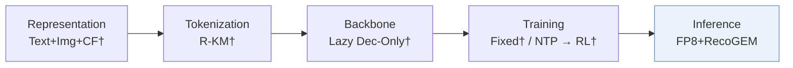

# OneRec-V2-Quantized

*Quantized Inference for OneRec-V2* — Su et al. · arXiv’26

`V. Efficiency` · `Inference` · [Paper](https://arxiv.org/abs/2603.11486) · [Matrix](../../README.md#v--inference) · [中文](../zh/papers/onerec-v2-quantized.md)

Reading level: Overview (Level 1) · On this page: [TL;DR](#tldr) · [At a Glance](#at-a-glance) · [3. Experiments](#3-experimental-findings) · [5. Related Work](#5-connections-to-related-work)

- `Lazy Dec-Only†`: A lazy decoder-only backbone inferred from the adopted model.
- `FP8+RecoGEM`: FP8 inference with the RecoGEM execution framework.

### TL;DR

> [!NOTE]
> OneRec-V2-Quantized applies low-precision floating-point post-training quantization and an optimized inference stack to OneRec-V2, whose weight and activation statistics resemble LLMs more than traditional recommenders.

### At a Glance

| Aspect | Summary |
| :-- | :-- |
| Research Problem | V. Efficiency: Can it be trained and served within latency and cost budgets? |
| Key Contribution | OneRec-V2-Quantized applies low-precision floating-point post-training quantization and an optimized inference stack to OneRec-V2, whose weight and activation statistics resemble LLMs more than traditional recommenders. |
| Modified Stage | Inference |

### 3. Experimental Findings

Experimental setup

- **Datasets**: Production single-column short-video recommendation; online evaluation on Kuaishou and Kuaishou Lite. Dataset dates, sizes and filtering not reported.
  - Source: Sections 5.1/5.3: [S5.SS1.p1](https://arxiv.org/html/2603.11486v1#S5.SS1.p1) and [S5.SS3.p1](https://arxiv.org/html/2603.11486v1#S5.SS3.p1)
- **Split**: Offline split not reported; online A/B runs one week, traffic allocation not reported.
  - Source: Sections 5.1/5.3: [S5.SS1](https://arxiv.org/html/2603.11486v1#S5.SS1) and [S5.SS3.p1](https://arxiv.org/html/2603.11486v1#S5.SS3.p1)
- **Candidates**: not reported
  - Source: Section 5 evaluates serving performance and online engagement without a candidate protocol: [S5](https://arxiv.org/html/2603.11486v1#S5)
- **Visibility**: warm; no unseen-item protocol is defined.
  - Source: Sections 4.1/5 define PTQ and serving tests, without an unseen-item protocol: [S4.SS1.p1](https://arxiv.org/html/2603.11486v1#S4.SS1.p1) and [S5](https://arxiv.org/html/2603.11486v1#S5)
- **SID**: not reported
  - Source: Section 4.1 leaves the base model unchanged but does not specify SID construction: [S4.SS1.p1](https://arxiv.org/html/2603.11486v1#S4.SS1.p1)
- **Inference budget**: 4B fat-MoE, 0.5B active/token, batch 32. FP16 baseline versus FP8 Linear/MoE (Linear accumulation FP32): 139ms to 70ms mean latency; throughput 205 to 394, units not reported. GPU model, beam width and output K not reported.
  - Source: Sections 4.1/5.1/5.2: [S4.SS1.p2](https://arxiv.org/html/2603.11486v1#S4.SS1.p2) and [S5.SS1.p1](https://arxiv.org/html/2603.11486v1#S5.SS1.p1) and [S5.SS1.p2](https://arxiv.org/html/2603.11486v1#S5.SS1.p2) and [S5.SS2.p2](https://arxiv.org/html/2603.11486v1#S5.SS2.p2)
- **Results from**: Original Section 5.2/Figure 3: FP16 versus combined infrastructure/FP8/operator optimization; Table 1: online quality. The full 49% latency reduction and 92% throughput gain include all three changes.
  - Source: Section 5.2/Figure 3 and Section 5.3/Table 1: [S5.SS2.p2](https://arxiv.org/html/2603.11486v1#S5.SS2.p2) and [S5.F3](https://arxiv.org/html/2603.11486v1#S5.F3) and [S5.T1](https://arxiv.org/html/2603.11486v1#S5.T1)

### 5. Connections to Related Work

- **Predecessor** · [OneRec-V2](onerec-v2.md): Provides the unchanged base architecture and training procedure for FP8 deployment.
  - Source: Quantized Inference for OneRec-V2 v1, Introduction and Section 4.1: https://arxiv.org/html/2603.11486v1#S1.p3; https://arxiv.org/html/2603.11486v1#S4.SS1.p1.

[View all papers in this cell](../../README.md#v--inference)
