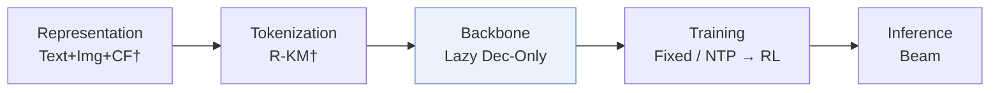
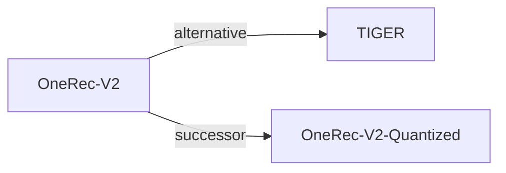

# OneRec-V2

| **Title** | *Technical Report* |
| :-- | :-- |
| **Authors** | Zhou et al. |
| **Venue** | arXiv’25 |
| **Problem × Stage** | `V. Efficiency` · `Backbone` |
| **Links** | [Paper](https://arxiv.org/abs/2508.20900) · [Matrix](../../README.md#v--backbone) · [中文](../zh/papers/onerec-v2.md) |
| **Reading level** | Overview (Level 1) |

On this page: [TL;DR](#tldr) · [At a Glance](#at-a-glance) · [3. Experiments](#3-experimental-findings) · [5. Related Work](#5-connections-to-related-work)

- `Lazy Dec-Only`: A lazy decoder-only architecture that concentrates decoder computation on target generation.
- `Fixed`: SIDs are built first and not changed while the generator trains.
- `NTP → RL`: NTP, then reinforcement learning (GRPO, GBPO, etc.).

### TL;DR

> [!NOTE]
> OneRec-V2 replaces the OneRec encoder-decoder with a lazy decoder-only architecture that cuts sequence-encoding compute, and aligns with real user feedback through duration-aware reward shaping and adaptive ratio clipping.

---

### At a Glance

| Aspect | Summary |
| :-- | :-- |
| Research Problem | V. Efficiency: Can it be trained and served within latency and cost budgets? |
| Key Contribution | OneRec-V2 replaces the OneRec encoder-decoder with a lazy decoder-only architecture that cuts sequence-encoding compute, and aligns with real user feedback through duration-aware reward shaping and adaptive ratio clipping. |
| Modified Stage | Backbone |

---

### 3. Experimental Findings

Experimental setup

- **Datasets**: Kuaishou impressions, August 10-14 2025, for streaming architecture experiments; Kuaishou and Kuaishou Lite feeds for online evaluation. Filtering and dataset sizes not reported.
  - Source: Sections 2.3/4: [S2.SS3.p1](https://arxiv.org/html/2508.20900v4#S2.SS3.p1) and [S4.p1](https://arxiv.org/html/2508.20900v4#S4.p1)
- **Split**: Offline holdout allocation not reported. Online: one week, 5% experimental traffic; V2 serves 25% of degraded traffic within that group (Appendix D wording). Separate 1% group disables caching and serves V2 for every request.
  - Source: Sections 2.3/4 and Appendix D: [S2.SS3.p1](https://arxiv.org/html/2508.20900v4#S2.SS3.p1) and [S4.p1](https://arxiv.org/html/2508.20900v4#S4.p1) and [A4.p1](https://arxiv.org/html/2508.20900v4#A4.p1)
- **Candidates**: not reported
  - Source: Sections 2.3/4 describe training loss and online tests without candidate-enumeration protocol: [S2.SS3](https://arxiv.org/html/2508.20900v4#S2.SS3) and [S4](https://arxiv.org/html/2508.20900v4#S4)
- **Visibility**: warm; no unseen-item protocol is defined. Cold-start video-view metrics are reported, but subset criteria and tokenizer exposure are not reported.
  - Source: Sections 4/5 and Appendix D do not define a held-out unseen-item protocol: [S4](https://arxiv.org/html/2508.20900v4#S4) and [A4.p2](https://arxiv.org/html/2508.20900v4#A4.p2)
- **SID**: 3 semantic tokens using the OneRec-V1 tokenizer; codebook sizes and collision handling not reported here.
  - Source: Section 2.2.2 Tokenizer: [S2.SS2.SSS2.Px1.p1](https://arxiv.org/html/2508.20900v4#S2.SS2.SSS2.Px1.p1)
- **Inference budget**: Online 1B model, context 3000, beam 512, L20 GPUs, latency 36ms, MFU 62%; inference batch size not reported.
  - Source: Section 4: [S4.p1](https://arxiv.org/html/2508.20900v4#S4.p1)
- **Results from**: Original Tables 2-5: architecture/scaling; Tables 6-8: online alignment/deployment comparisons; Table 9: caching disabled. Online improvements are relative to OneRec-V1.
  - Source: Original Tables 2-8 and Appendix D Table 9: [S2.T2](https://arxiv.org/html/2508.20900v4#S2.T2) and [S2.T5](https://arxiv.org/html/2508.20900v4#S2.T5) and [S3.T6](https://arxiv.org/html/2508.20900v4#S3.T6) and [S3.T8](https://arxiv.org/html/2508.20900v4#S3.T8) and [A4.T9](https://arxiv.org/html/2508.20900v4#A4.T9)

---

### 5. Connections to Related Work

- **Alternative** · [TIGER](tiger.md): Earlier generative retrieval contrasts with V2's lazy-decoder compute allocation.
  - Source: OneRec-V2 v4, Introduction and Section 2.1, citing Rajput et al. (2023): https://arxiv.org/html/2508.20900v4#S1.p1; https://arxiv.org/html/2508.20900v4#S2.SS1.
- **Successor** · [OneRec-V2-Quantized](onerec-v2-quantized.md): Adds FP8 post-training quantization and an optimized inference stack.
  - Source: Evidence from Quantized Inference for OneRec-V2 v1, Section 4.1: https://arxiv.org/html/2603.11486v1#S4.SS1.p1.

[View all papers in this cell](../../README.md#v--backbone)
