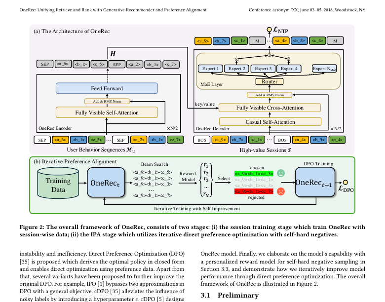

# OneRec: Onerec: Unifying retrieve and rank with generative recommender and iterative preference alignment

[Back to Catalog](../../README.md) · [Paper (`https://arxiv.org/abs/2502.18965`)](https://arxiv.org/abs/2502.18965) · [Source Record (`data/papers/onerec.yaml`)](../../data/papers/onerec.yaml)

> **Summary**: Abstract: "the generative model functions only as a selector during the retrieval stage".

## Taxonomy & Table 1 Specification

| Field | Value | Vocabulary Definition |
| :--- | :--- | :--- |
| **Authors & Year** | Deng et al. (2025) | Published / posted in `arXiv’25` |
| **Problem Band** | `Paradigms, Systems and Benchmarks` | Baseline (TIGER), end-to-end multi-stage paradigms, open-source frameworks, benchmarks, and diagnostic resources. |
| **Primary Stage** | `n/a` | Used for Paradigms, Systems and Benchmarks (psb) rows that are not assigned to a single stage. |
| **Representation** | `Text+CF` |  |
| **Tokenization** | `R-KM` | Residual k-means. |
| **Backbone** | `Enc-Dec` | Encoder-decoder. |
| **Tokenizer Training** | `Fixed` | SIDs are built first and not changed while the generator trains. |
| **Training Objective** | `NTP → DPO` | NTP, then preference optimization. |
| **Inference Decoding** | `Sess. Beam` |  |
| **POI / Local-Life** | `false` | Point-of-interest / geographic recommendation indicator |
| **Code Repository** | Not reported | Official or public implementation link |

## Architecture

## Verbatim Evidence & Rationale

- **`problem`** (arXiv abstract): Abstract: "the generative model functions only as a selector during the retrieval stage".

## 旧卡片说明

迁自 `d61aa6c:papers/onerec.md`。保留方法说明、实验叙述与局限；本轮只对照现有记录处理明确冲突，未重新逐句核查原论文。分类和规格以页面上方由记录生成的表格为准。

### OneRec：检索排序一体化生成式推荐

> OneRec 用生成模型直接产生推荐列表，并通过迭代偏好对齐替代传统的召回-排序级联。

### 研究动机与问题定义

级联系统把召回和排序拆开，模块目标不一致且存在信息损失。OneRec 将会话建模、候选选择和排序统一为列表生成，并研究如何使生成结果贴近真实偏好。

### TL;DR（核心摘要）

`会话历史 → SID列表目标 → 生成模型 → 推荐列表 → 偏好对齐`

模型以会话级物品列表作为训练目标，使用平衡聚类构造物品语义标识，并直接生成列表。训练后通过奖励反馈和迭代 DPO 逐步对齐列表质量；在线阶段生成的 SID 直接对应推荐物品。

### 输入与使用场景

| 方面 | 说明 |
|---|---|
| 使用信息 | 会话交互、物品标识和偏好反馈 |
| 信息融入位置 | 列表目标、生成输入和偏好训练 |
| 语义标识结构 | 列表中的多 token 序列 |
| 适用场景 | 工业会话推荐 |

### 方法设计

#### 3.1 会话级列表生成
OneRec 把单物品 next-item 目标扩展为 session-wise list generation。训练样本包含会话上下文和目标推荐列表，生成器按统一序列格式输出多个物品 SID，并在列表内部处理顺序与重复。

#### 3.2 生成器训练
模型采用编码器-解码器结构，以会话行为和物品标识作为条件。标识由平衡聚类构造，使不同物品在生成词表中具有较好的覆盖和可区分性。

#### 3.3 迭代偏好对齐
训练后使用奖励模型产生偏好信号，构造列表级偏好样本并进行 DPO。迭代过程不断用更新后的模型生成新样本，使生成列表逐步靠近业务偏好。

#### 3.4 系统部署
论文进一步设计线上生成、去重和服务流程，目标是用一个生成模型连接原本分离的召回与排序阶段。

### 实验结论

- OneRec 在论文报告的公开和工业设置中改善了生成式推荐效果。
- 列表级训练和偏好对齐均带来额外收益。

### 局限性与研究定位

#### 局限性
- 列表生成、去重和约束会增加推理工程复杂度。
- 动态物品、极端长尾和跨场景迁移仍需更多验证。

#### 研究定位
OneRec 的主要贡献是以生成列表统一召回与排序，适合放在“端到端工业生成式推荐”章节。

### 标签

`召回排序一体化` · `列表生成` · `偏好对齐` · `工业推荐`

### 架构图来源

*图源：原论文，图2。图片使用许可待核实。*

---

### 旧总表补充

来源：`d61aa6c:tables/all-methods.md`。

- 核心贡献：统一召回与排序。
- 使用场景：工业会话推荐。

## Peer Methods in `Paradigms, Systems and Benchmarks` × `n/a` (11 peers)

| Method | Venue | Representation | Tokenization | Backbone | Tokenizer | Objective | Inference |
| :--- | :--- | :--- | :--- | :--- | :--- | :--- | :--- |
| [TIGER](tiger.md) | NeurIPS’23 | `Text` | `RQ-VAE` | `Enc-Dec` | `Fixed` | `NTP` | `Beam` |
| [FORGE](forge.md) | KDD’26 | `Text+Img` | `RQ-VAE` | `Dec-Only` | `Fixed` | `NTP` | `Dyn. Beam` |
| [GRID](grid.md) | CIKM’25 | `Text` | `R-KM` | `Enc-Dec` | `Fixed` | `NTP` | `Beam` |
| [MiniOneRec](minionerec.md) | arXiv’25 | `Text` | `RQ-VAE` | `Dec-Only` | `Fixed` | `NTP → RL` | `Beam` |
| [GR-Generalize](gr-generalize.md) | arXiv’26 | `Text+SID` | `RQ-VAE` | `Enc-Dec` | `Fixed†` | `NTP†` | `Hybrid` |
| [NEO](neo.md) | arXiv’26 | `Text / Audio` | `R-KM` | `Dec-Only` | `Fixed` | `Multi-task NTP` | `C-Beam` |
| [Netflix-SID-Comparison](netflix-sid-comparison.md) | NeurIPS’26 PALM Workshop | `–` | `RQ-VAE` | `Dec-Only / Non-AR` | `Fixed` | `Multi-task NTP / (Text NTP + MTP + Rank); Lang. RL after SFT` | `C-Beam / Scoring` |
| [OneMall](onemall.md) | CIKM’26 | `Text+Img+CF` | `R-KM+FSQ` | `Enc-Dec` | `Fixed` | `(NTP + Ctr.) → RL` | `Beam` |
| [PLUM](plum.md) | WWW’26 | `Text+Img+CF` | `RQ-VAE` | `Dec-Only` | `Fixed` | `Multi-task NTP` | `Beam` |
| [ReRankID](rerankid.md) | arXiv’26 | `Text` | `R-KM†` | `Dec-Only` | `Fixed` | `NTP → RL` | `CoT+Greedy` |
| [SIDScope](sidscope.md) | arXiv’26 | `–` | `–` | `–` | `–` | `–` | `–` |
