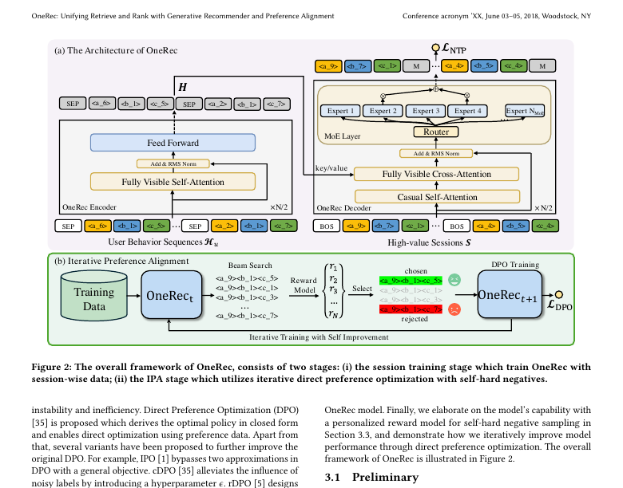
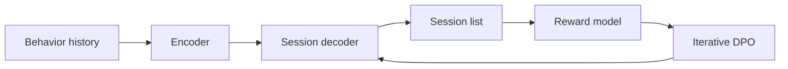

# OneRec

*Unifying retrieve and rank with generative recommender and iterative preference alignment* — Deng et al. · arXiv’25

`Paradigms, Systems and Benchmarks` · `No single stage`

[Paper](https://arxiv.org/abs/2502.18965) · [Matrix](../../README.md#paradigms-systems-and-benchmarks)

Reading level: Reading Notes (Level 2) · On this page: [TL;DR](#tldr) · [At a Glance](#at-a-glance) · [1. Why This Paper Matters](#1-why-this-paper-matters) · [2. How It Works](#2-how-it-works) · [3. Experimental Findings](#3-experimental-findings) · [4. Limitations & Critical Analysis](#4-limitations--critical-analysis) · [5. Connections to Related Work](#5-connections-to-related-work)

| Representation | Tokenization | Backbone | Training | Inference |
| :-: | :-: | :-: | :-: | :-: |
| `Text+CF` | `R-KM` | `Enc-Dec` | `Fixed / NTP → DPO` | `Sess. Beam` |

- `R-KM`: Residual k-means.
- `Enc-Dec`: Encoder-decoder.
- `Fixed`: SIDs are built first and not changed while the generator trains.
- `NTP → DPO`: NTP, then preference optimization.

### TL;DR

OneRec replaces the retrieve-and-rank cascade with one encoder-decoder generator using sparse MoE, generates whole sessions of videos, and aligns preferences by iterative DPO with a reward model.

### At a Glance

| Aspect | Summary |
| :-- | :-- |
| Research Problem | Paradigms, Systems and Benchmarks: Baseline (TIGER), end-to-end multi-stage paradigms, open-source frameworks, benchmarks, and diagnostic resources. |
| Key Contribution | OneRec replaces the retrieve-and-rank cascade with one encoder-decoder generator using sparse MoE, generates whole sessions of videos, and aligns preferences by iterative DPO with a reward model. |
| Modified Stage | No single stage |
| Limitation | In the online test, OneRec improves watch time but is weaker on interaction indicators such as likes (Sec. 6). |

### 1. Why This Paper Matters

Most recommenders run a retrieve-and-rank cascade, and a generative model, when present, only selects candidates in the retrieval stage (Abstract). The authors argue that each stage caps the stage after it.

> "existing methods typically treat each ranker independently, where the effectiveness of each isolated stage serves as the upper bound for the subsequent ranking stage, thereby limiting the performance of the overall ranking system." (Sec. 1)

OneRec replaces the cascade with a single-stage generative model and was deployed in the main scene of Kuaishou (Abstract, Sec. 1).

Based on arXiv v1.

### 2. How It Works

*Figure source: Fig. 2, original paper.*

#### Balanced Semantic IDs

Each item receives a Semantic ID (SID) from balanced K-means, in which every cluster holds the same number of items (Sec. 3.1, Algorithm 1).

#### Session-Wise List Generation

Instead of predicting one next item, OneRec generates the list of items for a whole session and considers the content and order of items within it (Sec. 1). An encoder models the user's history, and a decoder generates the session list (Sec. 3.2).

> "The decoder takes the semantic IDs of the target session as input and generates the target in an auto-regressive manner." (Sec. 3.2)

#### Iterative Preference Alignment

A recommender shows each request only once, so true positive and negative lists for the same request are not available (Abstract). OneRec samples several responses with beam search, scores them with a pre-trained reward model, and pairs the highest-scoring and lowest-scoring responses for DPO (Sec. 3.3.2). The model then generates new samples in the next round.

### 3. Experimental Findings

**Experimental setup**

- **Datasets**: Kuaishou short-video interaction logs; training sessions are built from high-quality user sessions (a session is 5-10 videos per request; the listed criteria include at least 5 videos actually watched, total watch time above a threshold whose value is not given, and interactions such as liking, collecting, or sharing). Dataset size: not reported.
  - Source: Industrial Kuaishou data and session construction: https://arxiv.org/html/2502.18965v1#S3.SS2.p1 and https://arxiv.org/html/2502.18965v1#S4.p1; no dataset statistics found.
- **Split**: Offline: evaluation on a randomly sampled set of test cases in each iteration; the train/test construction is not reported. Online: A/B test on Kuaishou's main-page video scenarios with 1% of main traffic.
  - Source: Offline evaluation on randomly sampled test cases: https://arxiv.org/html/2502.18965v1#S5.SS1.SSS3.p1; online: https://arxiv.org/html/2502.18965v1#S5.SS5.p1.
- **Candidates**: n/a for ranking metrics: generated sessions are scored by a pre-trained reward model (session watch time, view, follow, and like probabilities), not ranked against a candidate set.
  - Source: Reward-model evaluation of generated sessions: https://arxiv.org/html/2502.18965v1#S5.SS1.SSS3.p1.
- **Visibility**: warm; no unseen-item protocol is defined.
  - Source: No unseen-item protocol: https://arxiv.org/html/2502.18965v1#S5.SS1.SSS3.p1.
- **SID**: 3 levels x 8,192 codes from multi-level balanced residual K-means over multimodal video embeddings aligned with user behavior; balanced K-means equalizes cluster sizes. Collision handling: not reported.
  - Source: Balanced residual K-means, L=3 x K=8192: https://arxiv.org/html/2502.18965v1#S3.SS1.p2, https://arxiv.org/html/2502.18965v1#S3.SS1.p3, https://arxiv.org/html/2502.18965v1#S5.SS1.SSS1.p1; no collision rule found.
- **Inference budget**: Beam search with beam size 128 (also used to generate 128 responses per user for DPO); KV-cache decoding with float16 quantization; MoE with 24 experts, 2 active (about 13% of parameters active at inference). Training on NVIDIA A800 GPUs; serving hardware, batch size, and latency: not reported.
  - Source: Beam size 128 online and for DPO sampling; KV cache and float16: https://arxiv.org/html/2502.18965v1#S4.p1 and https://arxiv.org/html/2502.18965v1#S5.SS1.SSS1.p1.
- **Results from**: Table 1 (offline reward-model metrics versus pointwise, listwise, and preference-alignment baselines); Figure 4 (DPO sample ratio); Table 2 (online A/B: OneRec-1B+IPA +1.68% total watch time, +6.56% average view duration).
  - Source: Offline: https://arxiv.org/html/2502.18965v1#S3.T1; DPO ratio: https://arxiv.org/html/2502.18965v1#S5.F4; online: https://arxiv.org/html/2502.18965v1#S5.T2.

- Session-wise generation: OneRec outperforms dot-product retrieval methods and point-wise generation such as TIGER on the reward-model metrics (Sec. 5.2, Table 1).
- Preference alignment: adding IPA further improves the generated sessions (Sec. 5.2, Table 1).

### 4. Limitations & Critical Analysis

**Stated by the authors.** The authors report a weakness found in the online results.

> "Additionally, our analysis of online results reveals that, besides user watch time, our model has limitations in interactive indicators, such as likes." (Sec. 6)

**Our analysis.**

- The DPO pairs are ranked by the reward model, not by observed user feedback on both lists. This suggests that alignment quality is bounded by the reward model.
- MiniOneRec reproduces the pipeline on public data with `RQ-VAE` SIDs over text only (`Text`), a `Dec-Only` generator, and RL in place of DPO (`NTP → RL`).

### 5. Connections to Related Work

- **Competitor** · [TIGER](tiger.md): TIGER generates one next item from RQ-VAE semantic IDs; OneRec generates whole sessions with balanced residual K-means IDs, an MoE encoder-decoder, and iterative DPO.
  - Source: OneRec v1, baselines: https://arxiv.org/html/2502.18965v1#S5.I1.i4.p1; Table 1: https://arxiv.org/html/2502.18965v1#S3.T1; tokenizer contrast with RQ-VAE: https://arxiv.org/html/2502.18965v1#S3.SS1.p2.
- **Successor** · [MiniOneRec](minionerec.md): MiniOneRec later reproduces the OneRec-style SID, SFT, and RL pipeline in open source on public data.
  - Source: Evidence is from the later MiniOneRec paper, Section 1: https://arxiv.org/html/2510.24431v1#S1.p1 and https://arxiv.org/html/2510.24431v1#S1.p3.
- **Alternative** · [GFlowGR](gflowgr.md): GFlowGR later compares against OneRec's IPA alignment and replaces it with a GFlowNet objective over reward-weighted trajectories.
  - Source: Evidence is from the later GFlowGR paper: IPA baseline and Table 2: https://arxiv.org/html/2506.16114v3#S4.I2.i6.p1 and https://arxiv.org/html/2506.16114v3#S4.T2.

[View all papers in this cell](../../README.md#paradigms-systems-and-benchmarks)
