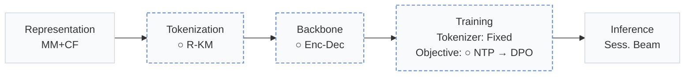
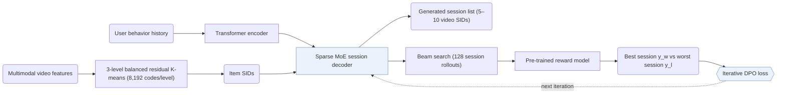
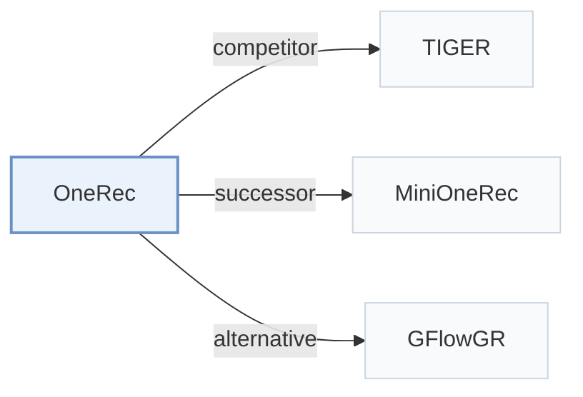

# OneRec

[← Problem × Stage Matrix](../../README.md#paradigms-systems-and-benchmarks) · [Papers by Stage](../index/stages.md) · [Papers by Modality](../index/modality.md) · [Papers by Domain](../index/domain.md) · English | [中文](../zh/papers/onerec.md)

| **Title** | *Unifying retrieve and rank with generative recommender and iterative preference alignment* |
| :-- | :-- |
| **Authors** | Deng et al. |
| **Venue** | arXiv’25 |
| **Problem × Stage** | `Paradigms, Systems and Benchmarks` · `No single stage` |
| **Changes** | ○ Tokenization · ○ Backbone · ○ Objective |
| **SID inputs** | `MM` + `CF` |
| **Domain** | `Short video / Live` |
| **Links** | [Paper](https://arxiv.org/abs/2502.18965) |
| **Reading level** | Reading Notes (Level 2) |

**On this page**: [TL;DR](#tldr) · [At a Glance](#at-a-glance) · [1. Why It Matters](#1-why-this-paper-matters) · [2. Method](#2-how-it-works) · [3. Experiments](#3-experimental-findings) · [4. Limitations](#4-limitations--critical-analysis) · [5. Related Work](#5-connections-to-related-work)

- `MM+CF`: Multimodal item representations aligned with collaborative signals.
- `R-KM`: Residual k-means.
- `Enc-Dec`: Encoder-decoder.
- `Fixed`: SIDs are built first and not changed while the generator trains.
- `NTP → DPO`: NTP, then preference optimization.
- `Sess. Beam`: Session-wise beam search generating a multi-item slate in one pass.

### TL;DR

> [!NOTE]
> OneRec replaces the retrieve-and-rank cascade with one encoder-decoder generator using sparse MoE, generates whole sessions of videos, and aligns preferences by iterative DPO with a reward model.

---

### At a Glance

| Aspect | Summary |
| :-- | :-- |
| Key Findings | OneRec outperforms dot-product retrieval and pointwise generators such as TIGER on offline reward-model metrics (Table 1), and OneRec-1B+IPA reports +1.68% total watch time and +6.56% average view duration in online A/B testing on Kuaishou (Table 2). |
| Limitation | In the online test, OneRec improves watch time but is weaker on interaction indicators such as likes (Sec. 6). |

---

### 1. Why This Paper Matters

Most industrial recommenders run a multi-stage retrieve-and-rank cascade where each stage caps the candidates available to the next, and existing generative models act only as candidate selectors in the retrieval stage.

> "existing methods typically treat each ranker independently, where the effectiveness of each isolated stage serves as the upper bound for the subsequent ranking stage, thereby limiting the performance of the overall ranking system." (Sec. 1)

OneRec replaces the cascade with a single-stage generative model deployed in the main scene of Kuaishou (Abstract, Sec. 1).

---

### 2. How It Works

#### Balanced Semantic IDs

Each video receives a 3-level Semantic ID (SID) with 8,192 codes per level from multi-level balanced residual K-means over behavior-aligned multimodal embeddings, where every cluster holds the same number of items (Sec. 3.1, Algorithm 1).

#### Session-Wise List Generation

Instead of predicting a single next item, OneRec generates the 5–10 item list for a full session and models both the content and ordering of items within the session (Sec. 1). A Transformer encoder encodes the user's interaction history, and a sparse MoE decoder generates the target session SIDs autoregressively (Sec. 3.2).

> "The decoder takes the semantic IDs of the target session as input and generates the target in an auto-regressive manner." (Sec. 3.2)

#### Iterative Preference Alignment

Because a recommender serves only one list per request, ground-truth positive and negative session lists for the same request are not observable in logs. OneRec samples 128 candidate sessions per user via beam search, scores them with a pre-trained reward model, and pairs the highest-scoring and lowest-scoring responses for DPO training (Sec. 3.3.2). The updated generator then samples new preference pairs in the next round.

---

### 3. Experimental Findings

Experimental setup

- **Datasets**: Kuaishou short-video interaction logs; training sessions are built from high-quality user sessions (a session is 5-10 videos per request; the listed criteria include at least 5 videos actually watched, total watch time above a threshold whose value is not given, and interactions such as liking, collecting, or sharing). Dataset size: not reported.
  - Source: Industrial Kuaishou data and session construction: [S3.SS2.p1](https://arxiv.org/html/2502.18965v1#S3.SS2.p1) and [S4.p1](https://arxiv.org/html/2502.18965v1#S4.p1); no dataset statistics found.
- **Split**: Offline: evaluation on a randomly sampled set of test cases in each iteration; the train/test construction is not reported. Online: A/B test on Kuaishou's main-page video scenarios with 1% of main traffic.
  - Source: Offline evaluation on randomly sampled test cases: [S5.SS1.SSS3.p1](https://arxiv.org/html/2502.18965v1#S5.SS1.SSS3.p1); online: [S5.SS5.p1](https://arxiv.org/html/2502.18965v1#S5.SS5.p1).
- **Candidates**: n/a for ranking metrics: generated sessions are scored by a pre-trained reward model (session watch time, view, follow, and like probabilities), not ranked against a candidate set.
  - Source: Reward-model evaluation of generated sessions: [S5.SS1.SSS3.p1](https://arxiv.org/html/2502.18965v1#S5.SS1.SSS3.p1).
- **Visibility**: warm; no unseen-item protocol is defined.
  - Source: No unseen-item protocol: [S5.SS1.SSS3.p1](https://arxiv.org/html/2502.18965v1#S5.SS1.SSS3.p1).
- **SID**: 3 levels x 8,192 codes from multi-level balanced residual K-means over multimodal video embeddings aligned with user behavior; balanced K-means equalizes cluster sizes. Collision handling: not reported.
  - Source: Balanced residual K-means, L=3 x K=8192: [S3.SS1.p2](https://arxiv.org/html/2502.18965v1#S3.SS1.p2), [S3.SS1.p3](https://arxiv.org/html/2502.18965v1#S3.SS1.p3), [S5.SS1.SSS1.p1](https://arxiv.org/html/2502.18965v1#S5.SS1.SSS1.p1); no collision rule found.
- **Inference budget**: Beam search with beam size 128 (also used to generate 128 responses per user for DPO); KV-cache decoding with float16 quantization; MoE with 24 experts, 2 active (about 13% of parameters active at inference). Training on NVIDIA A800 GPUs; serving hardware, batch size, and latency: not reported.
  - Source: Beam size 128 online and for DPO sampling; KV cache and float16: [S4.p1](https://arxiv.org/html/2502.18965v1#S4.p1) and [S5.SS1.SSS1.p1](https://arxiv.org/html/2502.18965v1#S5.SS1.SSS1.p1).
- **Results from**: Table 1 (offline reward-model metrics versus pointwise, listwise, and preference-alignment baselines); Figure 4 (DPO sample ratio); Table 2 (online A/B: OneRec-1B+IPA +1.68% total watch time, +6.56% average view duration).
  - Source: Offline: [S3.T1](https://arxiv.org/html/2502.18965v1#S3.T1); DPO ratio: [S5.F4](https://arxiv.org/html/2502.18965v1#S5.F4); online: [S5.T2](https://arxiv.org/html/2502.18965v1#S5.T2).

- Session-wise generation: OneRec outperforms dot-product retrieval baselines and pointwise generators such as TIGER on offline reward-model metrics across session watch time and interaction probabilities (Sec. 5.2, Table 1).
- Preference alignment: adding iterative preference alignment (IPA) further improves offline session reward scores (Sec. 5.2, Table 1, Fig. 4) and yields +1.68% total watch time and +6.56% average view duration for OneRec-1B+IPA in online A/B testing on Kuaishou (Table 2).

---

### 4. Limitations & Critical Analysis

**Stated by the authors.**

> "Additionally, our analysis of online results reveals that, besides user watch time, our model has limitations in interactive indicators, such as likes." (Sec. 6)

**Our analysis.**

- The DPO pairs are ranked by a pre-trained reward model rather than observed user feedback on competing lists, so alignment quality is bounded by the reward model's fidelity across multiple objectives.
- MiniOneRec reproduces the pipeline on public data with `RQ-VAE` SIDs over text only (`Text`), a `Dec-Only` generator, and RL in place of DPO (`NTP → RL`).

---

### 5. Connections to Related Work

- **Competitor** · [TIGER](tiger.md): TIGER generates one next item from RQ-VAE semantic IDs; OneRec generates whole sessions with balanced residual K-means IDs, an MoE encoder-decoder, and iterative DPO.
  - Source: OneRec v1, baselines: [S5.I1.i4.p1](https://arxiv.org/html/2502.18965v1#S5.I1.i4.p1); Table 1: [S3.T1](https://arxiv.org/html/2502.18965v1#S3.T1); tokenizer contrast with RQ-VAE: [S3.SS1.p2](https://arxiv.org/html/2502.18965v1#S3.SS1.p2).
- **Successor** · [MiniOneRec](minionerec.md): MiniOneRec later reproduces the OneRec-style SID, SFT, and RL pipeline in open source on public data.
  - Source: Evidence is from the later MiniOneRec paper, Section 1: [S1.p1](https://arxiv.org/html/2510.24431v1#S1.p1) and [S1.p3](https://arxiv.org/html/2510.24431v1#S1.p3).
- **Alternative** · [GFlowGR](gflowgr.md): GFlowGR later compares against OneRec's IPA alignment and replaces it with a GFlowNet objective over reward-weighted trajectories.
  - Source: Evidence is from the later GFlowGR paper: IPA baseline and Table 2: [S4.I2.i6.p1](https://arxiv.org/html/2506.16114v3#S4.I2.i6.p1) and [S4.T2](https://arxiv.org/html/2506.16114v3#S4.T2).

[View all papers in this cell](../../README.md#paradigms-systems-and-benchmarks)
