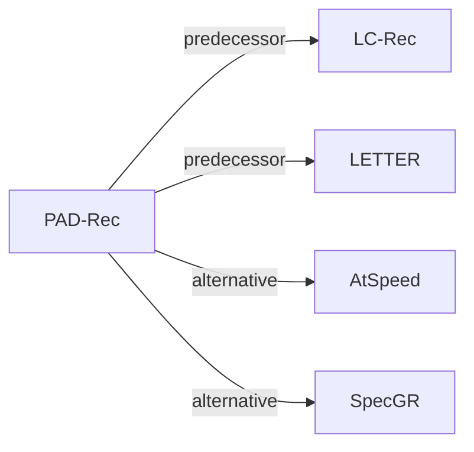

# PAD-Rec

*Position-Aware Drafting for Inference Acceleration in LLM-Based Generative List-Wise Recommendation* — Chen et al. · arXiv’26

`V. Efficiency` · `Inference` · [Paper](https://arxiv.org/abs/2604.27747) · [Code](https://github.com/Jiaju-Chen/PAD-Rec) · [Matrix](../../README.md#v--inference) · [中文](../zh/papers/pad-rec.md)

Reading level: Overview (Level 1) · On this page: [TL;DR](#tldr) · [At a Glance](#at-a-glance) · [3. Experiments](#3-experimental-findings) · [5. Related Work](#5-connections-to-related-work)

- `Text+SID`: Text representation plus semantic IDs (hybrid dense and generative retrieval).
- `Dec-Only`: Decoder-only.
- `Fixed`: SIDs are built first and not changed while the generator trains.
- `Spec. Dec.`: Speculative decoding.

### TL;DR

> [!NOTE]
> PAD-Rec adds gated item-slot and draft-step position embeddings to the draft model of speculative decoding, instead of treating all Semantic ID draft tokens uniformly.

### At a Glance

| Aspect | Summary |
| :-- | :-- |
| Research Problem | V. Efficiency: Can it be trained and served within latency and cost budgets? |
| Key Contribution | PAD-Rec adds gated item-slot and draft-step position embeddings to the draft model of speculative decoding, instead of treating all Semantic ID draft tokens uniformly. |
| Modified Stage | Inference |

### 3. Experimental Findings

Experimental setup

- **Datasets**: Amazon Beauty (12,101 items / 22,363 sequences), Instruments (9,922 / 24,772), Games (17,332 / 49,156), and Yelp (20,033 / 30,431). Users with fewer than 11 interactions are removed; each remaining user's 10 most recent items form the target list.
  - Source: Datasets and statistics: [S5.SS1.SSS1.p1](https://arxiv.org/html/2604.27747v1#S5.SS1.SSS1.p1) and [S5.T1](https://arxiv.org/html/2604.27747v1#S5.T1); preprocessing: [S5.SS1.SSS1.p3](https://arxiv.org/html/2604.27747v1#S5.SS1.SSS1.p3).
- **Split**: User-level 8:1:1 split into training, validation, and test, so all interactions of a user fall in one partition; targets are each user's 10 most recent items.
  - Source: User-level 8:1:1 split: [S5.SS1.SSS1.p4](https://arxiv.org/html/2604.27747v1#S5.SS1.SSS1.p4).
- **Candidates**: n/a for candidate ranking: the model generates a 10-item list that is compared with the user's 10 most recent items (Recall@10, NDCG@10).
  - Source: List-wise recall against the 10-item ground-truth list: [S5.I4.i3.p1](https://arxiv.org/html/2604.27747v1#S5.I4.i3.p1) and [S5.I4.i4.p1](https://arxiv.org/html/2604.27747v1#S5.I4.i4.p1).
- **Visibility**: warm; no unseen-item protocol is defined. Test users are held out from training (user-level split), while items are shared across splits.
  - Source: Test users are disjoint from training users; items are shared: [S5.SS1.SSS1.p4](https://arxiv.org/html/2604.27747v1#S5.SS1.SSS1.p4).
- **SID**: 4-level RQ-VAE semantic IDs over embeddings that integrate semantic and collaborative signals (following LETTER), with separator tokens between items; codebook size and collision handling: not reported.
  - Source: K=4 RQ-VAE codebooks following LETTER, separators between items: [S3.SS1.p3](https://arxiv.org/html/2604.27747v1#S3.SS1.p3) and [S5.SS1.SSS1.p3](https://arxiv.org/html/2604.27747v1#S5.SS1.SSS1.p3).
- **Inference budget**: EAGLE-2-style tree speculative decoding with speculation depth 6 and tree width 10, at temperature 0 and 0.5; target LLM Llama-3.2-1B-Instruct (3B and 8B in scaling). Latency measured on NVIDIA RTX 3090 GPUs in fp16 with batch size 1 after three warm-up runs; Table 3 lists naive target-LLM latency (e.g. Beauty 693.55 at temp 0, units as in the table).
  - Source: Tree-based speculative decoding settings and timing protocol: [S5.SS1.SSS4.p2](https://arxiv.org/html/2604.27747v1#S5.SS1.SSS4.p2) and [S5.SS1.SSS4.p3](https://arxiv.org/html/2604.27747v1#S5.SS1.SSS4.p3); baseline latency: [S5.T3](https://arxiv.org/html/2604.27747v1#S5.T3).
- **Results from**: Table 2 (wall-clock speedup, accepted length, Recall@10, NDCG@10 versus EAGLE-2, HASS, FSPAD, GRIFFIN on four datasets); Table 3 (naive decoding latency); later tables and figures (ablations, model scaling, hyperparameters).
  - Source: Main: [S5.T2](https://arxiv.org/html/2604.27747v1#S5.T2); latency: [S5.T3](https://arxiv.org/html/2604.27747v1#S5.T3); ablations and hyperparameters in Section 5.

### 5. Connections to Related Work

- **Predecessor** · [LC-Rec](lc-rec.md): PAD-Rec accelerates a list-wise LC-Rec target model with speculative decoding, adding item and step position embeddings to the draft head.
  - Source: PAD-Rec v1, implementation on LC-Rec: https://arxiv.org/html/2604.27747v1#S5.SS1.SSS4.p1 and https://arxiv.org/html/2604.27747v1#S5.SS1.SSS1.p5.
- **Predecessor** · [LETTER](letter.md): PAD-Rec obtains its semantic IDs following LETTER's semantic-collaborative embeddings and RQ-VAE.
  - Source: PAD-Rec v1, Section 3.1 and Section 5.1 follow reference [40], LETTER: https://arxiv.org/html/2604.27747v1#S3.SS1.p3 and https://arxiv.org/html/2604.27747v1#S5.SS1.SSS1.p3.
- **Alternative** · [AtSpeed](atspeed.md): AtSpeed also accelerates LLM-based generative recommendation with speculative decoding; PAD-Rec targets list-wise generation with position-aware drafts.
  - Source: PAD-Rec v1, Sections 1 and 2.3 cite AtSpeed: https://arxiv.org/html/2604.27747v1#S1.p2 and https://arxiv.org/html/2604.27747v1#S2.SS3.p1; not a baseline in Table 2.
- **Alternative** · [SpecGR](specgr.md): SpecGR uses speculative generation for inductive recommendation, while PAD-Rec speeds up decoding without changing the target model's outputs.
  - Source: PAD-Rec v1, Section 2.3: https://arxiv.org/html/2604.27747v1#S2.SS3.p1.

[View all papers in this cell](../../README.md#v--inference)
