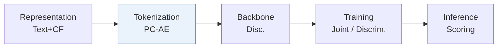
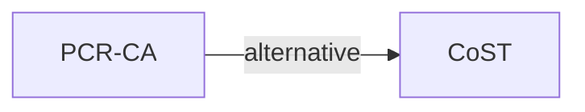

# PCR-CA

*Parallel Codebook Representations with Contrastive Alignment for Multiple-Category App Recommendation* — Tan et al. · KDD’26

`I. Informativeness` · `Tokenization`

[Paper](https://arxiv.org/abs/2508.18166) · [Matrix](../../README.md#i--tokenization)

Reading level: Overview (Level 1) · On this page: [TL;DR](#tldr) · [At a Glance](#at-a-glance) · [3. Experimental Findings](#3-experimental-findings) · [5. Connections to Related Work](#5-connections-to-related-work)

- `PC-AE`: Parallel Codebook Auto-Encoder
- `Disc.`: A discriminative recommendation model that scores candidates.
- `Joint`: The generator loss updates the tokenizer directly.
- `Discrim.`: Scores items; does not generate SIDs.

### TL;DR

PCR-CA learns parallel codebook representations of app text, unlike hierarchical RQ-VAE, and aligns them contrastively with collaborative signals for CTR prediction on multiple-category apps.

### At a Glance

| Aspect | Summary |
| :-- | :-- |
| Research Problem | I. Informativeness: Do the SIDs, or the model reading them, carry the collaborative and multimodal signals recommendation needs? |
| Key Contribution | PCR-CA learns parallel codebook representations of app text, unlike hierarchical RQ-VAE, and aligns them contrastively with collaborative signals for CTR prediction on multiple-category apps. |
| Modified Stage | Tokenization |

### 3. Experimental Findings

**Experimental setup**

- **Datasets**: Microsoft Store impression logs with click/install labels over several months; approximately 80K apps, click rate 6.148%; histories up to 50 interactions. Filtering rules not reported.
- **Split**: Chronological: 340M training interactions and latest 10M validation samples. Table 2 calls evaluation the test set, but a separate test allocation is not reported. Online A/B lasts two weeks.
- **Candidates**: n/a for logged-impression CTR/AUC evaluation; candidate pool for top-10 diversity analysis not reported.
- **Visibility**: Cold-start validation naturally includes apps/users unseen in CTR training. Unseen by CTR predictor only: PC-AE pretraining iterates over all 80K apps; no generative decoder is used.
- **SID**: PC-AE: 4 parallel codebooks x 32 entries, 16-dimensional vectors, selecting/summing two nearest codes per book. Codebooks train jointly with CTR prediction after pretraining. Unique-ID collision resolution: n/a; codes supply predictive features.
- **Inference budget**: Discriminative scoring; beam n/a; top-10 lists for diversity. Simulated throughput: 120K candidate items/s versus base 150K/s on the same unspecified server. Inference hardware, batch size and request latency not reported; offline text embedding costs 22 ms/new app.
- **Results from**: Original Table 2: AUC by app-popularity bucket; Tables 3-4: ablations; Table 5: online A/B. SaviorRec is explicitly reimplemented; no baseline-result reuse stated.

Sources

- **Datasets**: [S4.SS1.p1](https://arxiv.org/html/2508.18166v1#S4.SS1.p1)
- **Split**: [S4.SS1.p1](https://arxiv.org/html/2508.18166v1#S4.SS1.p1) ; #S4.T2 ; #S4.T5
- **Candidates**: [S4.SS1.p1](https://arxiv.org/html/2508.18166v1#S4.SS1.p1) ; #S4.SS1.p6 ; #S4.SS4.p2
- **Visibility**: [S4.SS1.p1](https://arxiv.org/html/2508.18166v1#S4.SS1.p1) ; #S4.SS1.p4
- **SID**: [S3.SS2.p3](https://arxiv.org/html/2508.18166v1#S3.SS2.p3) ; #S3.SS2.p7 ; #S4.SS1.p2
- **Inference budget**: [S4.SS4.p2](https://arxiv.org/html/2508.18166v1#S4.SS4.p2) ; #S4.SS4.p3 ; #S4.SS4.p4
- **Results from**: [S4.T2](https://arxiv.org/html/2508.18166v1#S4.T2) ; #S4.T3 ; #S4.T4 ; #S4.T5 ; #S4.SS1.p2

### 5. Connections to Related Work

- **Alternative** · [CoST](cost.md): CoST uses residual vector quantization; PCR-CA replaces its hierarchy with parallel codebooks for multiple-category app features and CTR prediction.
  - Source: PCR-CA v1, Introduction and Section 2.2, citing Yongchao Zhu et al. (2024): https://arxiv.org/html/2508.18166v1#S1.p4; https://arxiv.org/html/2508.18166v1#S2.SS2.p3.

[View all papers in this cell](../../README.md#i--tokenization)
