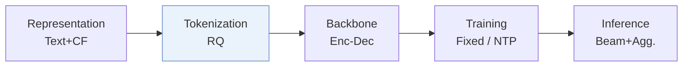
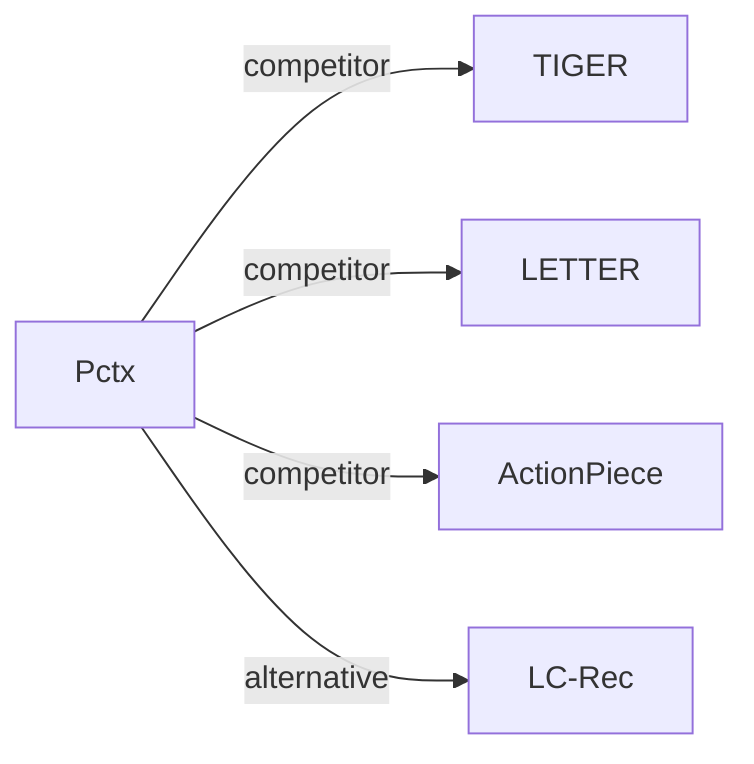

# Pctx

*Tokenizing Personalized Context for Generative Recommendation* — Zhong et al. · CIKM’26

`I. Informativeness` · `Tokenization` · [Paper](https://arxiv.org/abs/2510.21276) · [Code](https://github.com/YoungZ365/Pctx) · [Matrix](../../README.md#i--tokenization) · [中文](../zh/papers/pctx.md)

Reading level: Overview (Level 1) · On this page: [TL;DR](#tldr) · [At a Glance](#at-a-glance) · [3. Experiments](#3-experimental-findings) · [5. Related Work](#5-connections-to-related-work)

- `RQ`: Residual quantization.
- `Enc-Dec`: Encoder-decoder.
- `Fixed`: SIDs are built first and not changed while the generator trains.
- `NTP`: Next-token prediction loss only; continuing from a pretrained LLM (SFT) also counts as NTP.
- `Beam+Agg.`: Beam search followed by aggregation of predictions that refer to the same item.

### TL;DR

> [!NOTE]
> Pctx tokenizes each item with the user's interaction history as context, so the same item can receive different Semantic IDs for different users, instead of one static item-only mapping.

### At a Glance

| Aspect | Summary |
| :-- | :-- |
| Research Problem | I. Informativeness: Do the SIDs, or the model reading them, carry the collaborative and multimodal signals recommendation needs? |
| Key Contribution | Pctx tokenizes each item with the user's interaction history as context, so the same item can receive different Semantic IDs for different users, instead of one static item-only mapping. |
| Modified Stage | Tokenization |

### 3. Experimental Findings

Experimental setup

- **Datasets**: Amazon Reviews 2023: Musical Instruments, Industrial & Scientific, Video Games; exclude users/items with fewer than five interactions; chronological histories capped at 20 items.
  - Source: [S3.SS1.SSS0.Px1.p1](https://arxiv.org/html/2510.21276v1#S3.SS1.SSS0.Px1.p1) ; #A3.SS1.p1
- **Split**: Per-user chronological leave-one-out: most recent item test, penultimate validation, remaining interactions training.
  - Source: [A3.SS3.p1](https://arxiv.org/html/2510.21276v1#A3.SS3.p1)
- **Candidates**: full catalog; full-ranking evaluation rather than negative sampling.
  - Source: [A3.SS3.p1](https://arxiv.org/html/2510.21276v1#A3.SS3.p1)
- **Visibility**: warm; no unseen-item protocol is defined. Auxiliary DuoRec is pretrained on the same training data, and representative contexts come from training interactions; textual-tokenizer fitting exposure to test items not reported.
  - Source: [S2.SS2.p1](https://arxiv.org/html/2510.21276v1#S2.SS2.p1) ; #S2.SS2.SSS1.Px1.p1 ; #S2.SS2.SSS2.p1 ; #A3.SS3.p1
- **SID**: 3 x 256 residual semantic codes plus an auxiliary collision token of unreported vocabulary size; multiple context-conditioned SIDs/item. Same-item IDs differing only in collision token are merged; collision tokens distinguish different items. Main text names RQ-VAE; appendix specifies FAISS quantization.
  - Source: [S2.SS2.SSS2.Px1.p1](https://arxiv.org/html/2510.21276v1#S2.SS2.SSS2.Px1.p1) ; #S2.SS2.SSS2.Px2.p2 ; #A3.SS4.p1
- **Inference budget**: Beam decoding with aggregation of generated SID probabilities per item; Recall/NDCG@5/10. GR baseline beam 50; Pctx-specific beam width not separately reported. Inference hardware, batch size and latency not reported.
  - Source: [S2.SS3.SSS0.Px2.p1](https://arxiv.org/html/2510.21276v1#S2.SS3.SSS0.Px2.p1) ; #A3.SS3.p1 ; #S3.SS1.SSS0.Px3.p1
- **Results from**: Table 1: Pctx experiments with most baseline rows (including TIGER/LETTER) copied from Zheng et al. (2025); other baselines reconstructed. Table 2: ablations; Table 3: ensemble comparisons; Table 6: explainability.
  - Source: [S3.T1](https://arxiv.org/html/2510.21276v1#S3.T1) ; #S3.T2 ; #S3.T3 ; #A3.SS4.p1 ; #A4.T6

### 5. Connections to Related Work

- **Competitor** · [TIGER](tiger.md): TIGER assigns static semantic IDs; Pctx conditions item tokenization on user context and aggregates probabilities across personalized IDs.
  - Source: Pctx v1, Section 2.4 and Table 1; TIGER results are reused from prior work per Appendix C.4: https://arxiv.org/html/2510.21276v1#S2.SS4.SSS0.Px1.p1; https://arxiv.org/html/2510.21276v1#S3.T1; https://arxiv.org/html/2510.21276v1#A3.SS4.p1.
- **Competitor** · [LETTER](letter.md): LETTER injects collaborative information and diversity constraints into item quantization; Pctx adds history-conditioned user interpretations.
  - Source: Pctx v1, Appendix C.2 and Table 1; LETTER results are reused per Appendix C.4: https://arxiv.org/html/2510.21276v1#A3.SS2.p1; https://arxiv.org/html/2510.21276v1#S3.T1; https://arxiv.org/html/2510.21276v1#A3.SS4.p1.
- **Competitor** · [ActionPiece](actionpiece.md): ActionPiece uses adjacent action context; Pctx extends tokenization context to the full user interaction history.
  - Source: Pctx v1, Section 2.4 and Table 1: https://arxiv.org/html/2510.21276v1#S2.SS4.SSS0.Px3.p1; https://arxiv.org/html/2510.21276v1#S3.T1.
- **Alternative** · [LC-Rec](lc-rec.md): LC-Rec is discussed as static tokenization under a universal item-similarity assumption; Pctx maps an item to personalized IDs under different user contexts.
  - Source: Pctx v1, Section 2.4: https://arxiv.org/html/2510.21276v1#S2.SS4.SSS0.Px1.p1.

[View all papers in this cell](../../README.md#i--tokenization)
