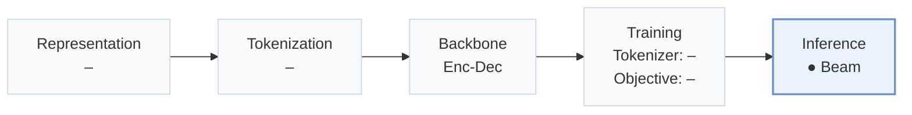
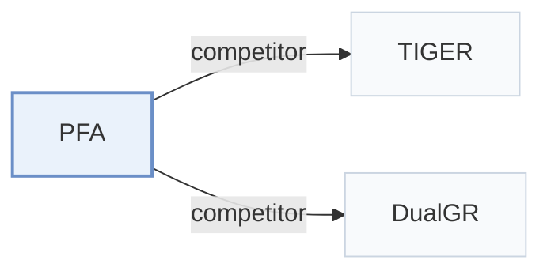

# PFA

[← Problem × Stage Matrix](../../README.md#v--inference) · [Papers by Stage](../index/stages.md) · [Papers by Modality](../index/modality.md) · [Papers by Domain](../index/domain.md) · English | [中文](../zh/papers/pfa.md)

| **Title** | *Attention Can Be Progressively Focused in Long-Sequence Generative Recommendation* |
| :-- | :-- |
| **Authors** | Zhou et al. |
| **Venue** | arXiv’26 |
| **Problem × Stage** | `V. Efficiency` · `Inference` |
| **Changes** | ● Inference |
| **SID inputs** | `Other` (Four-level SIDs; tokenizer inputs unstated) |
| **Domain** | `E-commerce` · `Ads` |
| **Scenario** | `General Item Recommendation`; `Online Experiment or Deployment` |
| **Links** | [Paper](https://arxiv.org/abs/2610.39273) · [Code](https://anonymous.4open.science/r/PFA-review-088D) |
| **Reading level** | Overview (Level 1) |

**On this page**: [TL;DR](#tldr) · [3. Experiments](#3-experimental-findings) · [5. Related Work](#5-connections-to-related-work)

- `Enc-Dec`: Encoder-decoder.
- `Beam`: Autoregressive beam search over Semantic ID tokens.

### TL;DR

> [!NOTE]
> PFA keeps full attention at the first decoding step, then reuses a shared importance ranking across beams to shrink the attended history at later steps, accelerating long-sequence generative decoding.

---

### 3. Experimental Findings

Experimental setup

- **Datasets**: Amazon 2023 Kindle Store (rating>=4, users>=128 positives); Tmall IJCAI-15 clicks; industrial advertising clicks. Click data retain earliest repeated user-item event; public items require >=5 training-instance occurrences, removing invalid users.
  - Source: Section 4.1: [S4.SS1.SSS0.Px1.p1](https://arxiv.org/html/2610.39273v1#S4.SS1.SSS0.Px1.p1) and [S4.SS1.SSS0.Px2.p1](https://arxiv.org/html/2610.39273v1#S4.SS1.SSS0.Px2.p1)
- **Split**: Per-user chronological approximately 90%/5%/5% training/validation/test; rolling-history sliding windows use only behaviors preceding each target; deterministic public split sampling.
  - Source: Section 4.1: [S4.SS1.SSS0.Px2.p1](https://arxiv.org/html/2610.39273v1#S4.SS1.SSS0.Px2.p1)
- **Candidates**: not reported
  - Source: Section 4.1 metrics do not specify full-catalog versus sampled evaluation: [S4.SS1.SSS0.Px4.p1](https://arxiv.org/html/2610.39273v1#S4.SS1.SSS0.Px4.p1)
- **Visibility**: warm; retained public items have >=5 training-instance occurrences. Industrial item exposure is not separately reported.
  - Source: Section 4.1 public filtering and split: [S4.SS1.SSS0.Px2.p1](https://arxiv.org/html/2610.39273v1#S4.SS1.SSS0.Px2.p1)
- **SID**: Four codebooks: 128 codes/position on Kindle/Tmall, 300 on Industry. Tokenizer construction and collision handling: not reported.
  - Source: Section 4.1: [S4.SS1.SSS0.Px5.p1](https://arxiv.org/html/2610.39273v1#S4.SS1.SSS0.Px5.p1)
- **Inference budget**: Beam 100; 5 L20 GPUs, BF16, batch 512/GPU; k=256, retention=0.5; Recall/NDCG@5/10. Encoder+decoding latency: Kindle18/Industry62 ms/batch/GPU, excluding loading/embedding lookup; online RT11 ms.
  - Source: Section 4.1, Section 4.5 and Tables 4/7: [S4.SS1.SSS0.Px6.p1](https://arxiv.org/html/2610.39273v1#S4.SS1.SSS0.Px6.p1) and [S4.SS5](https://arxiv.org/html/2610.39273v1#S4.SS5) and [S4.T4](https://arxiv.org/html/2610.39273v1#S4.T4) and [S4.T7](https://arxiv.org/html/2610.39273v1#S4.T7)
- **Results from**: Reported Tables 3/4/5/6/7: main comparison, ablations, selection timing, token budgets, seven-day online A/B. Online control/treatment histories differ (128/512); offline comparisons hold efficient-method token budgets equal.
  - Source: Tables 3-7: [S4.T3](https://arxiv.org/html/2610.39273v1#S4.T3) and [S4.T4](https://arxiv.org/html/2610.39273v1#S4.T4) and [S4.T5](https://arxiv.org/html/2610.39273v1#S4.T5) and [S4.T6](https://arxiv.org/html/2610.39273v1#S4.T6) and [S4.T7](https://arxiv.org/html/2610.39273v1#S4.T7) and [S4.SS6.p1](https://arxiv.org/html/2610.39273v1#S4.SS6.p1) and [S4.SS1.SSS0.Px3.p1](https://arxiv.org/html/2610.39273v1#S4.SS1.SSS0.Px3.p1)

---

### 5. Connections to Related Work

- **Competitor** · [TIGER](tiger.md): TIGER is the standard generative full-history baseline.
  - Source: PFA v1, Section 4.1 and Table 3: [S4.SS1.SSS0.Px3.p1](https://arxiv.org/html/2610.39273v1#S4.SS1.SSS0.Px3.p1); [S4.T3](https://arxiv.org/html/2610.39273v1#S4.T3).
- **Competitor** · [DualGR](dualgr.md): DualGR retrieves coarse-SID history buckets; PFA shares and reuses an attention-derived history ranking.
  - Source: PFA v1, Sections 4.1/5 and Table 3: [S4.SS1.SSS0.Px3.p1](https://arxiv.org/html/2610.39273v1#S4.SS1.SSS0.Px3.p1); [S5.SS0.SSS0.Px2.p1](https://arxiv.org/html/2610.39273v1#S5.SS0.SSS0.Px2.p1); [S4.T3](https://arxiv.org/html/2610.39273v1#S4.T3).

[View all papers in this cell](../../README.md#v--inference)
