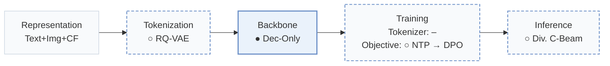
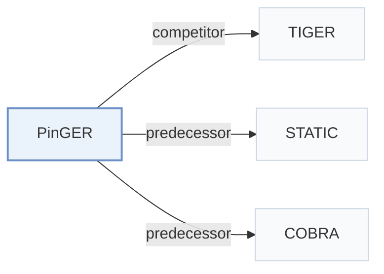

# PinGER

[← Problem × Stage Matrix](../../README.md#v--backbone) · [Papers by Stage](../index/stages.md) · [Papers by Modality](../index/modality.md) · [Papers by Domain](../index/domain.md) · English | [中文](../zh/papers/pinger.md)

| **Title** | *Token-Efficient Generative Retrieval with Semantic IDs* |
| :-- | :-- |
| **Authors** | Li et al. |
| **Venue** | arXiv’26 |
| **Problem × Stage** | `V. Efficiency` · `Backbone` |
| **Changes** | ○ Tokenization · ● Backbone · ○ Objective · ○ Inference |
| **SID inputs** | `Text` + `Img` + `CF` |
| **Domain** | `Image / Article` |
| **Scenario** | `General Item Recommendation`; `Online Experiment or Deployment` |
| **Links** | [Paper](https://arxiv.org/abs/2610.33435) |
| **Reading level** | Overview (Level 1) |

**On this page**: [TL;DR](#tldr) · [3. Experiments](#3-experimental-findings) · [5. Related Work](#5-connections-to-related-work)

- `Text+Img+CF`: Text and image representations combined with collaborative signals.
- `RQ-VAE`: Residual-Quantized Variational AutoEncoder.
- `Dec-Only`: Decoder-only.
- `NTP → DPO`: NTP, then preference optimization.
- `Div. C-Beam`: Constrained beam search with an explicit diversity mechanism.

### TL;DR

> [!NOTE]
> PinGER interleaves Semantic ID and dense tokens with an asymmetric attention mask so serving uses one token per item, and steers retrieval by goal conditioning, reinforcement learning, and diversity penalties.

---

### 3. Experimental Findings

Experimental setup

- **Datasets**: Pinterest session-centric UniPinRec data: historical cross-surface actions paired with target-surface session engagements; session sampling reflects traffic. Filtering rules: not reported.
  - Source: Section 5.1: [S5.SS1.SSS0.Px1.p1](https://arxiv.org/html/2610.33435v1#S5.SS1.SSS0.Px1.p1)
- **Split**: Evaluation uses held-out users in a later, non-overlapping window disjoint from training. Window dates, allocation ratios and validation split: not reported.
  - Source: Section 5.1: [S5.SS1.SSS0.Px1.p1](https://arxiv.org/html/2610.33435v1#S5.SS1.SSS0.Px1.p1)
- **Candidates**: full catalog: generated identifiers resolve against the full production corpus.
  - Source: Section 5.1: [S5.SS1.SSS0.Px1.p1](https://arxiv.org/html/2610.33435v1#S5.SS1.SSS0.Px1.p1)
- **Visibility**: warm; no unseen-item protocol is defined. Users are held out; fresh-content analysis uses Pins created within 28 days, without specified generator/tokenizer item holdouts.
  - Source: Section 5.1 and online fresh-content analysis: [S5.SS1.SSS0.Px1.p1](https://arxiv.org/html/2610.33435v1#S5.SS1.SSS0.Px1.p1) and [S5.SS3.SSS1.p1](https://arxiv.org/html/2610.33435v1#S5.SS3.SSS1.p1)
- **SID**: RQ-VAE 5x2048; content-only PinCLIP input, OmniSage engagement distillation. Index resolves shared-SID item lists; insufficient leaves fall back to coarser prefixes, with round-robin interleaving across beams.
  - Source: Sections 3.2 and 4.3: [S3.SS2.p1](https://arxiv.org/html/2610.33435v1#S3.SS2.p1) and [S4.SS3.p1](https://arxiv.org/html/2610.33435v1#S4.SS3.p1) and [S4.SS3.p2](https://arxiv.org/html/2610.33435v1#S4.SS3.p2)
- **Inference budget**: Offline beam100, Recall@10/100. Online Related Pins beam60/penalty3; notifications beam100/penalty1. Serving L40S at ~200QPS/host: e2e p50/p99 51/77ms (beam60),54/81ms (beam100); batch not reported. Attention microbenchmark: A10G,batch4,history1018.
  - Source: Sections 5.1/5.3, Table 1 and Figure 5: [S5.SS1.SSS0.Px2.p1](https://arxiv.org/html/2610.33435v1#S5.SS1.SSS0.Px2.p1) and [S5.SS3.SSS1.p1](https://arxiv.org/html/2610.33435v1#S5.SS3.SSS1.p1) and [S5.SS3.SSS2.p1](https://arxiv.org/html/2610.33435v1#S5.SS3.SSS2.p1) and [S4.T1](https://arxiv.org/html/2610.33435v1#S4.T1) and [S4.F5](https://arxiv.org/html/2610.33435v1#S4.F5)
- **Results from**: Reported Tables 1/2/3/4: serving, offline PinRec/TIGER comparison, diversity, online A/B; Tables 5-8: context sweep, trie costs, segments, ablations. Borrowed-versus-rerun baseline provenance: not reported.
  - Source: Tables 1-4 and Appendix Tables 5-8: [S4.T1](https://arxiv.org/html/2610.33435v1#S4.T1) and [S5.T2](https://arxiv.org/html/2610.33435v1#S5.T2) and [S5.T3](https://arxiv.org/html/2610.33435v1#S5.T3) and [S5.T4](https://arxiv.org/html/2610.33435v1#S5.T4) and [A1.T5](https://arxiv.org/html/2610.33435v1#A1.T5) and [A1.T8](https://arxiv.org/html/2610.33435v1#A1.T8)

---

### 5. Connections to Related Work

- **Competitor** · [TIGER](tiger.md): TIGER is compared at matched training context and serving-token budgets.
  - Source: PinGER v1, Section 5.2.1 and Table 2: [S5.SS2.SSS1.p1](https://arxiv.org/html/2610.33435v1#S5.SS2.SSS1.p1); [S5.T2](https://arxiv.org/html/2610.33435v1#S5.T2).
- **Predecessor** · [STATIC](static.md): PinGER adopts STATIC's vectorized trie for valid-SID constrained decoding.
  - Source: PinGER v1, Section 4.2: [S4.SS2.p2](https://arxiv.org/html/2610.33435v1#S4.SS2.p2).
- **Predecessor** · [COBRA](cobra.md): PinGER retains COBRA-style SID/dense interleaving during training and removes past SIDs at serving.
  - Source: PinGER v1, Section 2: [S2.SS0.SSS0.Px1.p1](https://arxiv.org/html/2610.33435v1#S2.SS0.SSS0.Px1.p1).

[View all papers in this cell](../../README.md#v--backbone)
