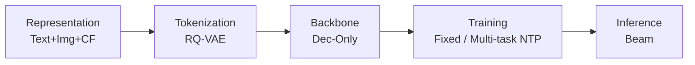
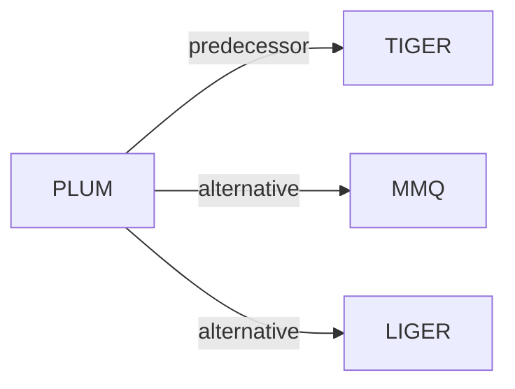

# PLUM

| **Title** | *Adapting Pre-trained Language Models for Industrial-scale Generative Recommendations* |
| :-- | :-- |
| **Authors** | He et al. |
| **Venue** | WWW’26 |
| **Problem × Stage** | `Paradigms, Systems and Benchmarks` · `No single stage` |
| **Links** | [Paper](https://arxiv.org/abs/2510.07784) · [Matrix](../../README.md#paradigms-systems-and-benchmarks) · [中文](../zh/papers/plum.md) |
| **Reading level** | Overview (Level 1) |

On this page: [TL;DR](#tldr) · [At a Glance](#at-a-glance) · [3. Experiments](#3-experimental-findings) · [5. Related Work](#5-connections-to-related-work)

- `Dec-Only`: Decoder-only.
- `Fixed`: SIDs are built first and not changed while the generator trains.
- `Multi-task NTP`: The same NTP loss over several tasks.

### TL;DR

> [!NOTE]
> PLUM adapts a pre-trained LLM to industrial recommendation through Semantic ID tokenization, continued pre-training on domain data, and fine-tuning for generative retrieval, instead of large embedding tables.

---

### At a Glance

| Aspect | Summary |
| :-- | :-- |
| Research Problem | Paradigms, Systems and Benchmarks: Baseline (TIGER), end-to-end multi-stage paradigms, open-source frameworks, benchmarks, and diagnostic resources. |
| Key Contribution | PLUM adapts a pre-trained LLM to industrial recommendation through Semantic ID tokenization, continued pre-training on domain data, and fine-tuning for generative retrieval, instead of large embedding tables. |
| Modified Stage | No single stage |

---

### 3. Experimental Findings

Experimental setup

- **Datasets**: Internal YouTube LFV/Shorts engagement and video metadata; reward-based SFT downsampling. Scaling input: 1536 tokens, roughly 100 recent watches; other filtering rules not reported.
  - Source: Sections 2.2/2.3/3.1/3.4: [S2.SS2.p1](https://arxiv.org/html/2510.07784v1#S2.SS2.p1) and [S2.SS3.p3](https://arxiv.org/html/2510.07784v1#S2.SS3.p3) and [S3.SS1.SSS1.Px1.p1](https://arxiv.org/html/2510.07784v1#S3.SS1.SSS1.Px1.p1) and [S3.SS4.SSS1.Px2.p1](https://arxiv.org/html/2510.07784v1#S3.SS4.SSS1.Px2.p1)
- **Split**: Scaling: shuffle seven consecutive July 2025 days for training; evaluate Day 8. CPT ablation also uses held-out next-day evaluation; main production validation/test allocation not reported.
  - Source: Sections 3.3/3.4: [S3.SS3.SSS2.Px1.p1](https://arxiv.org/html/2510.07784v1#S3.SS3.SSS2.Px1.p1) and [S3.SS4.SSS1.Px2.p1](https://arxiv.org/html/2510.07784v1#S3.SS4.SSS1.Px2.p1)
- **Candidates**: full catalog in the scaling study: billions of videos.
  - Source: Section 3.4 explicitly evaluates against the comprehensive corpus: [S3.SS4.SSS1.Px1.p1](https://arxiv.org/html/2510.07784v1#S3.SS4.SSS1.Px1.p1)
- **Visibility**: warm; no unseen-item protocol is defined. Tokenizer/CPT item exposure relative to next-day tests not reported.
  - Source: Section 3 defines no unseen-item holdout: [S3](https://arxiv.org/html/2510.07784v1#S3)
- **SID**: SID-v2 RQ-VAE: level-l codebook size 2048/2^(l-1); number of levels not reported. If a SID maps to multiple videos, randomly sample one for recall evaluation.
  - Source: Sections 2.1.2/3.2: [S2.SS1.SSS2.p2](https://arxiv.org/html/2510.07784v1#S2.SS1.SSS2.p2) and [S3.SS2.p1](https://arxiv.org/html/2510.07784v1#S3.SS2.p1)
- **Inference budget**: Beam decoding, width not reported; Recall@10 in scaling/ablations; production model 900M activated parameters. Serving hardware/batch size and latency not reported; 1024 v6e TPUs (four 256-TPU trainers) describe scaling training.
  - Source: Sections 2.3/3.1/3.4: [S2.SS3.p4](https://arxiv.org/html/2510.07784v1#S2.SS3.p4) and [S3.SS1.SSS1.Px1.p1](https://arxiv.org/html/2510.07784v1#S3.SS1.SSS1.Px1.p1) and [S3.SS4.SSS1.Px2.p1](https://arxiv.org/html/2510.07784v1#S3.SS4.SSS1.Px2.p1)
- **Results from**: Original Table 2: PLUM/production LEM ratios; Table 3: adding PLUM versus quota-matched LEM+; Tables 4/5: SID/CPT ablations.
  - Source: Tables 2-5 and live protocol: [S3.T2](https://arxiv.org/html/2510.07784v1#S3.T2) and [S3.T3](https://arxiv.org/html/2510.07784v1#S3.T3) and [S3.T4](https://arxiv.org/html/2510.07784v1#S3.T4) and [S3.T5](https://arxiv.org/html/2510.07784v1#S3.T5) and [S3.SS1.SSS2.Px2.p1](https://arxiv.org/html/2510.07784v1#S3.SS1.SSS2.Px2.p1)

---

### 5. Connections to Related Work

- **Predecessor** · [TIGER](tiger.md): PLUM extends TIGER's SID construction and adapts pretrained LLMs.
  - Source: PLUM v1, Sections 1.1.2/2.1.2: https://arxiv.org/html/2510.07784v1#S1.SS1.SSS2.p1; https://arxiv.org/html/2510.07784v1#S2.SS1.SSS2.p2.
- **Alternative** · [MMQ](mmq.md): MMQ generates modality-specific tokens; PLUM fuses embeddings before quantization.
  - Source: PLUM v1, Section 1.1.2: https://arxiv.org/html/2510.07784v1#S1.SS1.SSS2.p2.
- **Alternative** · [LIGER](liger.md): LIGER mixes generated IDs with dense retrieval; PLUM emphasizes SID-LLM adaptation.
  - Source: PLUM v1, Section 1.1.3 (Yang et al., 2024): https://arxiv.org/html/2510.07784v1#S1.SS1.SSS3.p1.

[View all papers in this cell](../../README.md#paradigms-systems-and-benchmarks)
