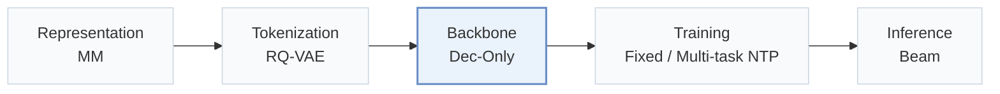
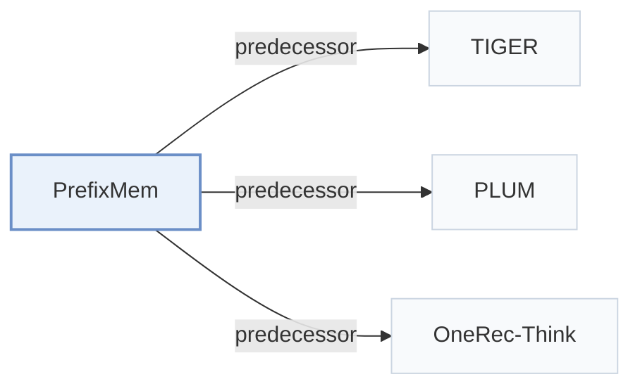

# PrefixMem

[← Problem × Stage Matrix](../../README.md#iii--backbone) · [Papers by Stage](../index/stages.md) · [Papers by Modality](../index/modality.md) · English | [中文](../zh/papers/prefixmem.md)

| **Title** | *LLMs Need Encoders for Semantic IDs Too* |
| :-- | :-- |
| **Authors** | Chen et al. |
| **Venue** | arXiv’26 |
| **Problem × Stage** | `III. SID–Model Alignment` · `Backbone` |
| **Links** | [Paper](https://arxiv.org/abs/2606.00324) |
| **Reading level** | Overview (Level 1) |

**On this page**: [TL;DR](#tldr) · [At a Glance](#at-a-glance) · [3. Experiments](#3-experimental-findings) · [5. Related Work](#5-connections-to-related-work)

- `MM`: Multimodal item representations.
- `RQ-VAE`: Residual-Quantized Variational AutoEncoder.
- `Dec-Only`: Decoder-only.
- `Fixed`: SIDs are built first and not changed while the generator trains.
- `Multi-task NTP`: The same NTP loss over several tasks.
- `Beam`: Autoregressive beam search over Semantic ID tokens.

### TL;DR

> [!NOTE]
> PrefixMem gives an LLM a pre-trainable Semantic ID encoder built from prefix n-gram memory tables, so each token gets a prefix-conditioned representation instead of a plain vocabulary embedding.

---

### At a Glance

| Aspect | Summary |
| :-- | :-- |
| Research Problem | III. SID–Model Alignment: Can the generator read, write, and reason over SIDs, and do the tokenizer and generator work toward the same goal? |
| Key Contribution | PrefixMem gives an LLM a pre-trainable Semantic ID encoder built from prefix n-gram memory tables, so each token gets a prefix-conditioned representation instead of a plain vocabulary embedding. |
| Modified Stage | Backbone |

---

### 3. Experimental Findings

Experimental setup

- **Datasets**: Pinterest: about 10M engagement subsequences (<=32 events), 240M item occurrences, tens of millions of unique items. Filtering rules not reported.
  - Source: Section 4.1: [S4.SS1.p1](https://arxiv.org/html/2606.00324v1#S4.SS1.p1)
- **Split**: Evaluation uses later dates and disjoint users; exact dates/fractions not reported. On 100K held-out examples, a random engagement position is the target and preceding events are history.
  - Source: Sections 4.1/4.3: [S4.SS1.p2](https://arxiv.org/html/2606.00324v1#S4.SS1.p2) and [S4.SS3.p1](https://arxiv.org/html/2606.00324v1#S4.SS3.p1)
- **Candidates**: not reported; retrieval evaluates exact ground-truth SID membership in generated beams.
  - Source: Section 4.3 defines beam SID matching, not sampled item negatives: [S4.SS3.SSS0.Px2.p1](https://arxiv.org/html/2606.00324v1#S4.SS3.SSS0.Px2.p1)
- **Visibility**: warm; no unseen-item protocol is defined. RQ-VAE codebook trained on the full billion-item catalog; evaluation users are disjoint, not explicitly evaluation items.
  - Source: Section 4.1 has user/time holdout but no unseen-item holdout: [S4.SS1.p1](https://arxiv.org/html/2606.00324v1#S4.SS1.p1) and [S4.SS1.p2](https://arxiv.org/html/2606.00324v1#S4.SS1.p2)
- **SID**: RQ-VAE on PinCLIP multimodal embeddings: 5 levels x 2048 codes. Collisions acknowledged; full-SID recall matches codes without resolving item collisions.
  - Source: Sections 4.1/4.3: [S4.SS1.p1](https://arxiv.org/html/2606.00324v1#S4.SS1.p1) and [S4.SS3.p2](https://arxiv.org/html/2606.00324v1#S4.SS3.p2)
- **Inference budget**: Qwen3-1.7B default; five-step SID beam search with K=20/30/50/100; TIGER extension uses beam 10. PrefixMem: 4 hash heads, 2M rows, dimension 256, active at levels 4/5. Hardware, inference batch size, measured latency not reported.
  - Source: Sections 4.2/4.3 and Table 10: [S4.SS2.p1](https://arxiv.org/html/2606.00324v1#S4.SS2.p1) and [S4.SS2.p2](https://arxiv.org/html/2606.00324v1#S4.SS2.p2) and [S4.SS3.SSS0.Px2.p1](https://arxiv.org/html/2606.00324v1#S4.SS3.SSS0.Px2.p1) and [S5.T10](https://arxiv.org/html/2606.00324v1#S5.T10)
- **Results from**: Original Tables 2/3: teacher-forcing/initialization; Table 4: full-SID recall; Tables 9/10: LLM/TIGER transfer; Table 11: SID-Transformer comparison. Same-corpus with/without-encoder experiments.
  - Source: Tables 2-4/9-11: [S5.T2](https://arxiv.org/html/2606.00324v1#S5.T2) and [S5.T3](https://arxiv.org/html/2606.00324v1#S5.T3) and [S5.T4](https://arxiv.org/html/2606.00324v1#S5.T4) and [S5.T9](https://arxiv.org/html/2606.00324v1#S5.T9) and [S5.T10](https://arxiv.org/html/2606.00324v1#S5.T10) and [S5.T11](https://arxiv.org/html/2606.00324v1#S5.T11)

---

### 5. Connections to Related Work

- **Predecessor** · [TIGER](tiger.md): PrefixMem augments TIGER and transfers TIGER-trained memory to an LLM.
  - Source: PrefixMem v1, Section 5.2 and Table 10: [S5.SS2.p5](https://arxiv.org/html/2606.00324v1#S5.SS2.p5); [S5.T10](https://arxiv.org/html/2606.00324v1#S5.T10).
- **Predecessor** · [PLUM](plum.md): PrefixMem follows PLUM's SID-language adaptation and adds prefix-conditioned encoding.
  - Source: PrefixMem v1, Sections 2/3.1: [S2.SS0.SSS0.Px1.p1](https://arxiv.org/html/2606.00324v1#S2.SS0.SSS0.Px1.p1); [S3.SS1.p1](https://arxiv.org/html/2606.00324v1#S3.SS1.p1).
- **Predecessor** · [OneRec-Think](onerec-think.md): PrefixMem simplifies the cited multi-stage SID-language pipeline to single-stage multitask training.
  - Source: PrefixMem v1, Section 3.1 (Liu et al., 2025b, arXiv:2510.11639): [S3.SS1.p2](https://arxiv.org/html/2606.00324v1#S3.SS1.p2).

[View all papers in this cell](../../README.md#iii--backbone)
