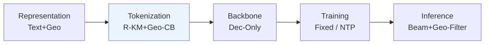
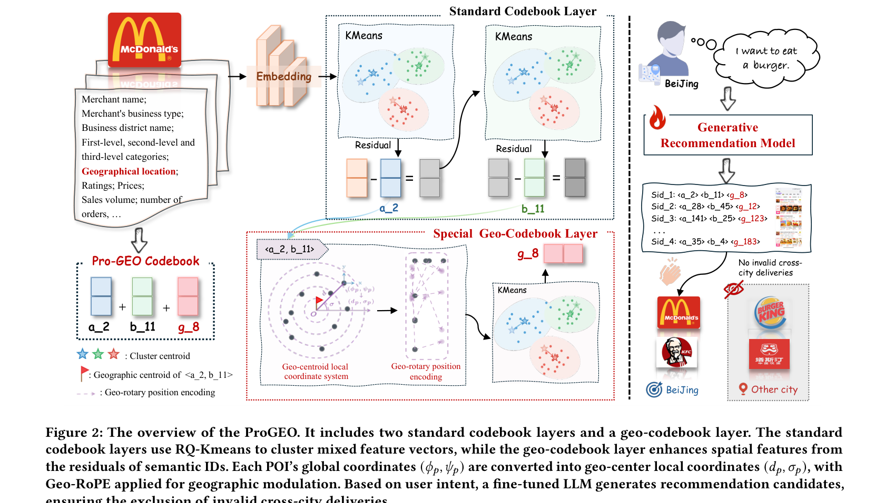
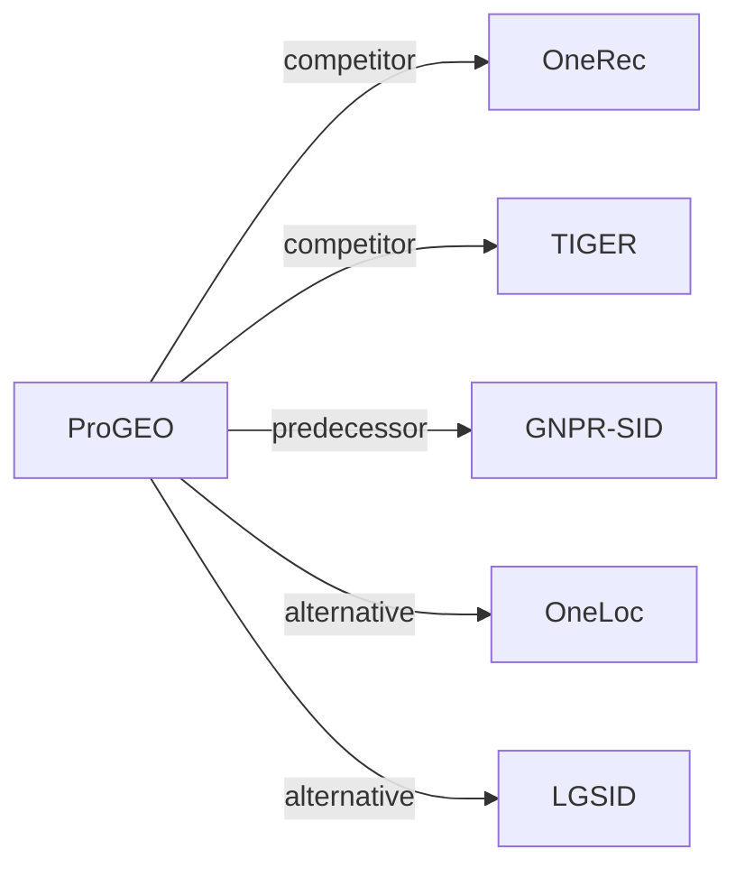

# ProGEO

*Birds of a Feather Cluster Nearby: A Proximity-Aware Geo-Codebook for Local Service Recommendation* — He et al. · arXiv’26

`I. Informativeness` · `Tokenization` · `POI` · [Paper](https://arxiv.org/abs/2604.23156) · [Matrix](../../README.md#i--tokenization) · [中文](../zh/papers/progeo.md)

Reading level: Reading Notes (Level 2) · On this page: [TL;DR](#tldr) · [At a Glance](#at-a-glance) · [1. Why It Matters](#1-why-this-paper-matters) · [2. Method](#2-how-it-works) · [3. Experiments](#3-experimental-findings) · [4. Limitations](#4-limitations--critical-analysis) · [5. Related Work](#5-connections-to-related-work)

- `R-KM+Geo-CB`: Residual k-means combined with a geographic codebook.
- `Dec-Only`: Decoder-only.
- `Fixed`: SIDs are built first and not changed while the generator trains.
- `NTP`: Next-token prediction loss only; continuing from a pretrained LLM (SFT) also counts as NTP.
- `Beam+Geo-Filter`: Beam search with geographically restricted candidates.

### TL;DR

> [!NOTE]
> ProGEO builds a proximity-aware geo-codebook with a geo-centroid local coordinate system and geo-rotary position encoding, so Semantic IDs model semantics and geography jointly.

### At a Glance

| Aspect | Summary |
| :-- | :-- |
| Research Problem | I. Informativeness: Do the SIDs, or the model reading them, carry the collaborative and multimodal signals recommendation needs? |
| Key Contribution | ProGEO builds a proximity-aware geo-codebook with a geo-centroid local coordinate system and geo-rotary position encoding, so Semantic IDs model semantics and geography jointly. |
| Modified Stage | Tokenization |
| Key Findings | On the industrial dataset, ProGEO reports Hit@50 of 0.4243 against 0.4056 for RQ-Kmeans, and an average geographic clustering distance of 25.41 km against 46.71 km for RQ-OPQ (Table 1). |

### 1. Why This Paper Matters

Local service platforms need recommendations that are relevant and also geographically reachable (Abstract). Semantic codebooks cluster items by content alone.

> "existing semantic codebooks neglect geographic constraints, often resulting in recommendations that are semantically relevant yet geographically unreachable." (Abstract)

ProGEO keeps standard semantic codewords and adds a geo-codeword that encodes each POI's position relative to its semantic cluster, so geography becomes part of the Semantic ID (SID) instead of a weak auxiliary feature (Abstract, Sec. 1).

### 2. How It Works

#### Semantic Layers

The first two codebook layers cluster mixed feature vectors with cosine similarity as the metric and pass projection residuals to the next layer (Sec. 3.1). The SID has two standard codebook layers and one geo-codebook layer (Fig. 2).

#### Geo-Centroid Local Coordinates

POIs that share the same two-layer SID form a subset. The actual latitudes and longitudes of these POIs define a geographic centroid, and each POI's global position becomes polar coordinates around it (Sec. 1, Sec. 3.2).

#### Geo-RoPE

Geo-RoPE encodes each POI's offset from the centroid as complex-valued rotations of the residual from the second layer (Sec. 1, Sec. 3.3). The similarity between two rotated vectors then depends on both their semantic factors and their spatial relation.

> "We extend RoPE to the spatial domain, formalizing geographic proximity as rotary operations in high-dimensional feature space." (Sec. 3.3)

#### Generation

In the industrial setting, the LLM prompt contains the search query, the city, and a GeoHash of the user's location (Table 4).

### 3. Experimental Findings

Experimental setup

- **Datasets**: Industrial: two months of transaction records from a Chinese local-life service platform (search query, user location, merchant exposure sequence, interactions); size and filtering not reported. Public: Foursquare NYC (1,083 users / 5,135 POIs) and TKY (2,293 / 7,873), filtered as in GNPR-SID (POIs with fewer than 10 interactions, users with fewer than 10 check-ins removed), and Yelp (150,346 POIs; clustering analysis only).
  - Source: Industrial and public data: [A2.SS1.p1](https://arxiv.org/html/2604.23156v1#A2.SS1.p1); public statistics: [A2.SS2.SSS2.p1](https://arxiv.org/html/2604.23156v1#A2.SS2.SSS2.p1).
- **Split**: Industrial: two months of records for training and additional daily data reserved for validation; the test construction is not reported. Public: preprocessing follows GNPR-SID; the split is not restated.
  - Source: Two-month training with extra daily validation data: [A2.SS1.p1](https://arxiv.org/html/2604.23156v1#A2.SS1.p1); public split follows GNPR-SID but is not restated.
- **Candidates**: Industrial inference: for each generated semantic ID, the 10 POIs closest to the user's location form the candidate set, with beam width 20. Evaluation reports Hit@1, Hit@50, Hit@100 and NDCG@50, @100; full catalog versus sampled not otherwise stated.
  - Source: Ten location-nearest POIs per semantic ID as candidates, then beam search: [A2.SS2.SSS1.p1](https://arxiv.org/html/2604.23156v1#A2.SS2.SSS1.p1); metrics: [A2.SS3.p3](https://arxiv.org/html/2604.23156v1#A2.SS3.p3).
- **Visibility**: warm; no unseen-item protocol is defined.
  - Source: No unseen-item protocol: [A2.SS1.p1](https://arxiv.org/html/2604.23156v1#A2.SS1.p1).
- **SID**: Residual quantization with geographic rotary encoding (Geo-RoPE) at the third layer over 128-dimensional Qwen3-Embedding-8B text embeddings. Codebooks: [512, 512, 512] industrial; [32, 32, 32] NYC/TKY; [64, 64, 64] Yelp. Conflicts: industrial uses closest-location matching among POIs sharing a SID (best in Table 3); public datasets use a TIGER-style fourth-layer code because user location is unavailable.
  - Source: Codebooks [512,512,512] industrial, [32,32,32] NYC/TKY, [64,64,64] Yelp, Geo-RoPE at layer 3: [A2.SS2.SSS1.p1](https://arxiv.org/html/2604.23156v1#A2.SS2.SSS1.p1) and [A2.SS2.SSS2.p1](https://arxiv.org/html/2604.23156v1#A2.SS2.SSS2.p1); conflict strategies: [S4.T3](https://arxiv.org/html/2604.23156v1#S4.T3).
- **Inference budget**: Beam search with width 20 on Qwen2.5-1.5B; all experiments on 8 GPUs with 80GB memory. Inference batch size and latency: not reported.
  - Source: Beam width 20 and hardware: [A2.SS2.SSS1.p1](https://arxiv.org/html/2604.23156v1#A2.SS2.SSS1.p1) and [A2.SS2.SSS2.p1](https://arxiv.org/html/2604.23156v1#A2.SS2.SSS2.p1).
- **Results from**: Table 1 (industrial quantization and recommendation metrics versus RQ-VAE, RQ-Kmeans, HyMiRec-style RQ-Kmeans, RQ-OPQ); Table 2 (geographic attributes); Table 3 (conflict-resolution strategies); Table 6 (public datasets versus RQ-Kmeans); Figures 7-10 (sensitivity and case studies).
  - Source: Main: [S4.T1](https://arxiv.org/html/2604.23156v1#S4.T1); geographic attributes: [S4.T2](https://arxiv.org/html/2604.23156v1#S4.T2); conflicts: [S4.T3](https://arxiv.org/html/2604.23156v1#S4.T3); public: [A2.T6](https://arxiv.org/html/2604.23156v1#A2.T6); sensitivity: [S4.F7](https://arxiv.org/html/2604.23156v1#S4.F7).

- Geo-RoPE layer: applying Geo-RoPE only at the third clustering layer gives the highest CUR (7.67%) and ICR (57.08%) among the tested placements (Sec. 4.3.2, Fig. 5).
- Case study: with Geo-RoPE, the recommended POIs lie close to the user, while the variant without it returns a POI in another city (Sec. 4.5.2).

  > "when Geo-RoPE is introduced, the recommended POIs are concentrated much closer to the user, typically within a 6-kilometer radius." (Sec. 4.5.2)

### 4. Limitations & Critical Analysis

**Our analysis.**

- The geographic signal enters only the third SID token. This suggests that the generator still chooses the semantic cluster before it uses any spatial information.
- OneLoc uses plain `R-KM` codes; ProGEO adds a geo-codebook layer to the same kind of tokenizer (`R-KM+Geo-CB`).
- GNPR-SID also encodes geography in POI SIDs (`Attr+Geo+CF`) but uses a plain `RQ-VAE`, without a dedicated geo-codebook layer.

### 5. Connections to Related Work

- **Competitor** · [OneRec](onerec.md): OneRec's RQ-Kmeans is the second-best tokenizer in Table 1; Pro-GEO injects geographic rotary encoding at the third quantization layer and resolves SID conflicts by user distance.
  - Source: Pro-GEO v1, baseline RQ-Kmeans (Deng et al., 2025): https://arxiv.org/html/2604.23156v1#A2.SS4.p1; Table 1 and public Table 6: https://arxiv.org/html/2604.23156v1#S4.T1 and https://arxiv.org/html/2604.23156v1#A2.T6.
- **Competitor** · [TIGER](tiger.md): TIGER's RQ-VAE is a tokenizer baseline; Pro-GEO also borrows TIGER's fourth-layer code for conflicts on public data where user location is missing.
  - Source: Pro-GEO v1, baseline RQ-VAE: https://arxiv.org/html/2604.23156v1#A2.SS4.p1; Table 1: https://arxiv.org/html/2604.23156v1#S4.T1; Layer-4 coding follows TIGER: https://arxiv.org/html/2604.23156v1#A2.SS2.SSS2.p1.
- **Predecessor** · [GNPR-SID](gnpr-sid.md): Pro-GEO follows GNPR-SID's POI preprocessing for NYC and TKY; GNPR-SID's SIDs carry no explicit geographic encoding.
  - Source: Pro-GEO v1, Appendix B.1 and B.2.2 follow Wang et al. (2025a): https://arxiv.org/html/2604.23156v1#A2.SS1.p1 and https://arxiv.org/html/2604.23156v1#A2.SS2.SSS2.p1.
- **Alternative** · [OneLoc](oneloc.md): OneLoc adds location context to the SID input embedding for local-life video; Pro-GEO rotates residuals by geography inside the quantizer.
  - Source: Pro-GEO v1, Sections 1 and 2.1 cite Wei et al. (2025): https://arxiv.org/html/2604.23156v1#S1.p2 and https://arxiv.org/html/2604.23156v1#S2.SS1.p2.
- **Alternative** · [LGSID](lgsid.md): LGSID aligns LLM embeddings with geographic rewards before quantization; Pro-GEO encodes geography within the quantization layers.
  - Source: Pro-GEO v1, Section 2.1 cites LGSID: https://arxiv.org/html/2604.23156v1#S2.SS1.p2.

[View all papers in this cell](../../README.md#i--tokenization)
