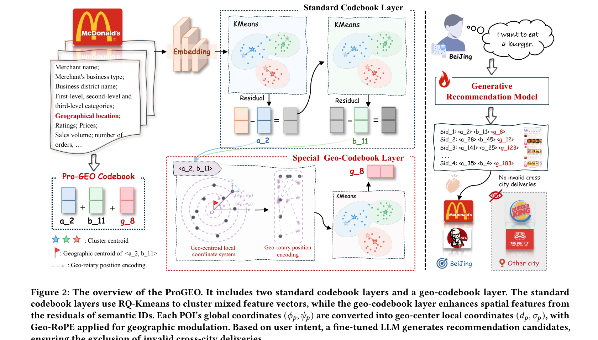

# ProGEO: Birds of a Feather Cluster Nearby: A Proximity-Aware Geo-Codebook for Local Service Recommendation

[Back to Catalog](../../README.md) · [Paper (`https://arxiv.org/abs/2604.23156`)](https://arxiv.org/abs/2604.23156) · [Source Record (`data/papers/progeo.yaml`)](../../data/papers/progeo.yaml)

> **Summary**: Abstract: "existing semantic codebooks neglect geographic constraints, often resulting in recommendations that are semantically relevant yet geographically unreachable". Geographically unreachable is not II (a generated SID that names no real item).

## Taxonomy & Table 1 Specification

| Field | Value | Vocabulary Definition |
| :--- | :--- | :--- |
| **Authors & Year** | He et al. (2026) | Published / posted in `arXiv’26` |
| **Problem Band** | `I. Informativeness` | Do the SIDs, or the model reading them, carry the collaborative and multimodal signals recommendation needs? |
| **Primary Stage** | `Tokenization` | The primary design change sits in the Tokenization stage. |
| **Representation** | `Text+Geo` |  |
| **Tokenization** | `R-KM+Geo-CB` | RQ-Kmeans codebook layers plus a geographic codebook layer (ProGEO). |
| **Backbone** | `Dec-Only` | Decoder-only. |
| **Tokenizer Training** | `Fixed` | SIDs are built first and not changed while the generator trains. |
| **Training Objective** | `NTP` | Next-token prediction loss only; continuing from a pretrained LLM (SFT) also counts as NTP. |
| **Inference Decoding** | `Beam+Geo-Filter` | Beam search with candidates limited to the nearest POIs (ProGEO). |
| **POI / Local-Life** | `true` | Point-of-interest / geographic recommendation indicator |
| **Code Repository** | Not reported | Official or public implementation link |

## Architecture

## Verbatim Evidence & Rationale

- **`problem`** (abstract, p1): Abstract: "existing semantic codebooks neglect geographic constraints, often resulting in recommendations that are semantically relevant yet geographically unreachable". Geographically unreachable is not II (a generated SID that names no real item).
- **`stage`** (Fig. 2, p3; §3, p3–4): Geo-centroid local coordinates and GEO-RoPE both act on the third-layer geographic codebook.
- **`tokenizer`** (Appendix B, p11): The codebook is built first, then Qwen2.5-1.5B is trained.

## 旧卡片说明

迁自 `d61aa6c:papers/progeo.md`。保留方法说明、实验叙述与局限；本轮只对照现有记录处理明确冲突，未重新逐句核查原论文。分类和规格以页面上方由记录生成的表格为准。

### ProGEO：邻近 POI 聚类的距离感知地理码本

> ProGEO 在标准语义码本之外加入地理码本，用局部坐标和旋转位置编码把 POI 邻近关系直接写入 SID。

### 研究动机与问题定义

本地生活推荐要求结果在地理上可达，但常规语义码本只按向量相似性聚类，可能生成语义相关却跨城不可配送的商户。ProGEO 研究如何将地理约束从辅助特征提升为 SID 结构的一部分，同时保留内容语义。

### TL;DR（核心摘要）

`商户内容/地理 → 标准码本量化 → 地理中心局部坐标 → Geo-RoPE地理码本 → 生成推荐`

模型先用标准 RQ-KMeans 得到多级语义 code，再从残差表示中建立地理中心和局部坐标系。Geo-RoPE 将局部距离和方向转为高维旋转，形成特殊 geo-codebook；微调后的 LLM 生成包含地理 code 的 SID，并在结果层面排除跨城无效配送。

### 输入与使用场景

| 方面 | 说明 |
|---|---|
| 使用信息 | 商户文本、类别、价格、地理位置和用户意图 |
| 信息融入位置 | 标准量化、特殊地理码本和生成约束 |
| 语义标识结构 | 标准 code 加 geo code 的多级序列 |
| 适用场景 | 本地生活、配送和地理可达推荐 |

### 方法设计

#### 3.1 语义码本聚类
POI 文本和地理特征用于构建表示，标准码本使用残差 K-means 逐层聚类。每一层产生一个 code，前两层负责表达通用语义，剩余量化空间留给地理关系。

#### 3.2 地理中心局部坐标映射
对于语义簇内的 POI，ProGEO 计算地理中心，并把全球经纬度转换为相对该中心的距离和方向。局部坐标避免直接在全球坐标上建模，使同一语义簇中的邻近关系更容易被量化。

#### 3.3 Geo-RoPE
地理距离和方向被映射为正交旋转变换，作用于残差表示的不同维度。这样，表示内积会随相对空间关系变化，地理相近的 POI 更可能共享或接近特殊 geo code。

#### 3.4 生成推荐与无效结果过滤
用户意图和历史行为输入生成模型，模型输出 POI SID。由于 SID 中含有地理 code，系统可在生成后识别跨城配送等不可行结果；论文图示还展示了按用户位置返回可达商户的流程。

### 实验结论

- 在大规模工业数据集上，ProGEO 报告 Hit@50 提升 1.87%，平均地理聚类距离下降 45.60%。
- 消融结果支持局部坐标、Geo-RoPE 和不同地理信息注入位置对推荐效果的贡献。
- 案例和可视化显示，特殊地理码本能减少语义相关但跨城不可达的推荐。

### 局限性与研究定位

#### 局限性

- 地理码本和跨城过滤依赖业务配送边界，跨平台和跨交通场景的通用性未验证。
- 论文对动态地理边界、实时路网距离以及新增商户的 SID 更新机制报告有限。

#### 研究定位

ProGEO 适合放在“地理结构化语义标识”章节，代表通过专用码本和几何变换增强 SID 空间可行性的路线。

### 相关资源

- [论文原文](https://arxiv.org/abs/2604.23156)

### 标签

`地理码本` · `局部坐标系` · `Geo-RoPE` · `本地生活`

### 架构图来源

*图源：原论文，图2（[论文原文](https://arxiv.org/abs/2604.23156)）。图片使用许可待核实。*

---

### 旧总表补充

来源：`d61aa6c:tables/all-methods.md`。

- 核心贡献：用局部坐标和 Geo-RoPE 将邻近关系写入 SID。
- 使用场景：本地生活与配送推荐。

## Peer Methods in `I. Informativeness` × `Tokenization` (33 peers)

| Method | Venue | Representation | Tokenization | Backbone | Tokenizer | Objective | Inference |
| :--- | :--- | :--- | :--- | :--- | :--- | :--- | :--- |
| [CoST](cost.md) | RecSys’24 | `Text` | `C-RQ` | `Enc-Dec` | `Fixed` | `NTP` | `Beam` |
| [LETTER](letter.md) | CIKM’24 | `Text+CF` | `Learn. RQ` | `Enc-Dec` | `Fixed` | `NTP + Rank` | `C-Beam` |
| [LMIndexer](lmindexer.md) | ICML’24 | `Text` | `Self-Sup. ID` | `Enc-Dec` | `Fixed` | `NTP` | `C-Beam` |
| [ActionPiece](actionpiece.md) | ICML’25 | `Text` | `OPQ` | `Enc-Dec` | `Fixed` | `NTP` | `Ensemble` |
| [ADC-SID](adc-sid.md) | arXiv’25 | `Text+Img+CF` | `MoE-VQ` | `Enc-Dec` | `Fixed†` | `NTP` | `–` |
| [DAS](das.md) | CIKM’25 | `Text+CF` | `Dual RQ` | `Enc-Dec` | `Fixed` | `NTP` | `Beam` |
| [EAGER-LLM](eager-llm.md) | WWW’25 | `Text+CF` | `Dual H-KM` | `Dec-Only` | `Fixed` | `Multi-task NTP` | `Beam` |
| [FlexCode](flexcode.md) | arXiv’25 | `Text+CF` | `Dual RQ-VAE` | `–` | `Joint` | `NTP` | `–` |
| [GenSAR](gensar.md) | RecSys’25 | `Text+CF` | `Shared/Spec. RQ` | `Enc-Dec` | `Fixed` | `Multi-task NTP` | `C-Beam` |
| [GNPR-SID](gnpr-sid.md) | KDD’25 | `Attr+Geo+CF` | `RQ-VAE` | `Dec-Only` | `Fixed` | `NTP` | `–` |
| [GRAM](gram.md) | ACL’25 | `Text+CF` | `H-KM` | `Enc-Dec` | `Fixed` | `NTP` | `C-Beam` |
| [KGTB](kgtb.md) | arXiv’25 | `Attr+Geo+CF` | `KG-RQ` | `Dec-Only` | `Fixed` | `Multi-task NTP` | `–` |
| [MME-SID](mme-sid.md) | CIKM’25 | `Text+Img+CF` | `MM-RQ` | `Dec-Only` | `Fixed` | `NTP` | `Scoring` |
| [MQL4GRec](mql4grec.md) | ICLR’25 | `Text+Img` | `Dual RQ` | `Enc-Dec` | `Fixed` | `Multi-task NTP` | `Beam` |
| [PSRQ](psrq.md) | CIKM’25 | `Text+Img` | `Prog. RQ` | `Encoder` | `Fixed` | `Discrim.` | `Scoring` |
| [QT-Mob](qt-mob.md) | KDD’25 | `Text+Geo` | `RQ-VAE` | `Dec-Only` | `Fixed` | `Multi-task NTP` | `C-Beam` |
| [TokenRec](tokenrec.md) | TKDE’25 | `CF` | `Masked VQ` | `Encoder` | `Fixed` | `Discrim.` | `Scoring` |
| [CapsID](capsid.md) | arXiv’26 | `Text+CF` | `Soft-RQ` | `Dec-Only` | `Fixed` | `NTP` | `C-Beam` |
| [ChronoID](chronoid.md) | arXiv’26 | `Text+Time` | `RQ-VAE / Par. VQ` | `Dec-Only†` | `Fixed` | `NTP` | `Beam†` |
| [GrIS (RecDMoN / RQ-GAE)](gris-recdmon-rq-gae.md) | CIKM’26 | `Text+CF` | `RecDMoN / RQ-VAE` | `Enc-Dec` | `Fixed` | `–` | `–` |
| [MACRec](macrec.md) | AAAI’26 | `Text+Img` | `Cross RQ` | `Enc-Dec` | `Fixed` | `NTP + Ctr.` | `C-Beam` |
| [MMGRec](mmgrec.md) | TOMM’26 | `Text+Img+CF` | `Graph RQ-VAE` | `Enc-Dec` | `Fixed` | `NTP` | `C-Beam` |
| [MMQ](mmq.md) | WSDM’26 | `Text+Img` | `MoE-VQ` | `HeterRec` | `Joint` | `MTP` | `–` |
| [MSCGRec](mscgrec.md) | arXiv’26 | `Text+Img+CF` | `RQ-VAE+DINO` | `Enc-Dec` | `Fixed†` | `NTP` | `Trie/C-Beam` |
| [PCR-CA](pcr-ca.md) | KDD’26 | `Text+CF` | `PC-AE` | `Disc.` | `Joint` | `Discrim.` | `Scoring` |
| [Pctx](pctx.md) | CIKM’26 | `Text+CF` | `RQ` | `Enc-Dec` | `Fixed` | `NTP` | `Beam+Agg.` |
| [RoFiGR](rofigr.md) | arXiv’26 | `Text+Img+CF` | `CF-Aligned MM RQ` | `Enc-Dec` | `Fixed` | `NTP + Aux.` | `C-Beam` |
| [ROS](ros.md) | ACL’26 | `Text+Geo` | `Geo-Prefix+RQ-VAE` | `Dec-Only` | `Fixed` | `NTP → RL` | `CoT+C-Beam` |
| [SPRIG](sprig.md) | CIKM’26 Short | `Text / Audio` | `R-KM` | `Dec-Only` | `Fixed` | `NTP` | `Div. Beam` |
| [Tlow](tlow.md) | CIKM’26 Applied | `Text` | `Flow+PQ` | `Non-AR` | `Fixed` | `MTP + Rel.MSE` | `Scoring` |
| [UniRec](unirec.md) | arXiv’26 | `Text+CF` | `RQ` | `Dec-Only` | `Fixed` | `NTP → DPO` | `C-Beam` |
| [UniSID](unisid.md) | arXiv’26 | `Text+Img+Attr` | `Direct SID Heads` | `–` | `–` | `–` | `–` |
| [VarLenRec (TIGER)](varlenrec-tiger.md) | arXiv’26 | `Text` | `HARQ` | `Enc-Dec` | `Fixed` | `NTP + Aux.` | `C-Beam` |
