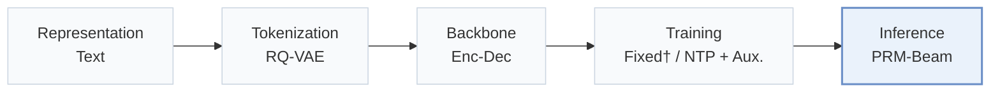
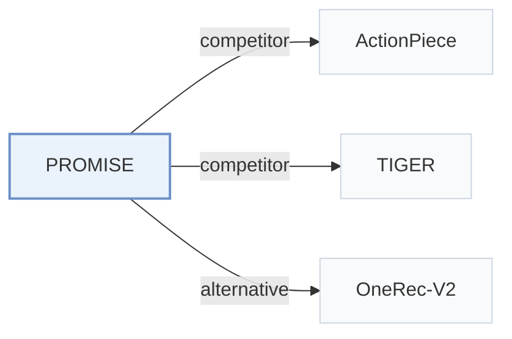

# PROMISE

[← Problem × Stage Matrix](../../README.md#iii--inference) · [Papers by Stage](../index/stages.md) · [Papers by Modality](../index/modality.md) · English | [中文](../zh/papers/promise.md)

| **Title** | *Process Reward Models Unlock Test-Time Scaling Laws in Generative Recommendations* |
| :-- | :-- |
| **Authors** | Guo et al. |
| **Venue** | arXiv’26 |
| **Problem × Stage** | `III. SID–Model Alignment` · `Inference` |
| **Links** | [Paper](https://arxiv.org/abs/2601.04674) |
| **Reading level** | Overview (Level 1) |

**On this page**: [TL;DR](#tldr) · [At a Glance](#at-a-glance) · [3. Experiments](#3-experimental-findings) · [5. Related Work](#5-connections-to-related-work)

- `Text`: Textual item metadata (titles, descriptions, categories, or prompts).
- `RQ-VAE`: Residual-Quantized Variational AutoEncoder.
- `Enc-Dec`: Encoder-decoder.
- `Fixed†`: Tokenizer frozen before generator training (inferred).
- `NTP + Aux.`: NTP plus another auxiliary loss.
- `PRM-Beam`: Process-reward-model guided beam search.

### TL;DR

> [!NOTE]
> PROMISE adds a lightweight process reward model that scores intermediate Semantic ID steps and prunes beam branches with it, to correct early-token semantic drift and scale with inference compute.

---

### At a Glance

| Aspect | Summary |
| :-- | :-- |
| Research Problem | III. SID–Model Alignment: Can the generator read, write, and reason over SIDs, and do the tokenizer and generator work toward the same goal? |
| Key Contribution | PROMISE adds a lightweight process reward model that scores intermediate Semantic ID steps and prunes beam branches with it, to correct early-token semantic drift and scale with inference compute. |
| Modified Stage | Inference |

---

### 3. Experimental Findings

Experimental setup

- **Datasets**: Public: Amazon Beauty and Sports and Outdoors (May 1996-July 2014), following TIGER's preprocessing (users with fewer than 5 reviews removed). Industrial: Kuaishou online-learning logs (over 400 million daily active users, about 50 billion interactions per day, more than 100 million items).
  - Source: Public datasets and TIGER protocol: [S4.SS1.SSS1.p1](https://arxiv.org/html/2601.04674v1#S4.SS1.SSS1.p1); industrial logs: [S4.SS2.SSS1.p2](https://arxiv.org/html/2601.04674v1#S4.SS2.SSS1.p2).
- **Split**: Public: chronological leave-one-out (last item for test, second-to-last for validation, rest for training). Industrial: online learning on real logs; the offline test construction is not reported. Online: 7-day A/B test on Kuaishou and Kuaishou Lite, with 5% of users (about 20 million) in the experimental group and another 5% in the control group for each app.
  - Source: Leave-one-out allocation: [S4.SS1.SSS1.p1](https://arxiv.org/html/2601.04674v1#S4.SS1.SSS1.p1); industrial online learning: [S4.SS2.SSS1.p2](https://arxiv.org/html/2601.04674v1#S4.SS2.SSS1.p2); online A/B groups and length: [S4.SS3.p1](https://arxiv.org/html/2601.04674v1#S4.SS3.p1).
- **Candidates**: not reported (full catalog versus sampled evaluation candidates); public Recall/NDCG at 5 and 10, industrial at 100, 500, 1000 from beam search.
  - Source: Metrics only: [S4.SS1.SSS4.p1](https://arxiv.org/html/2601.04674v1#S4.SS1.SSS4.p1) and [S4.SS2.SSS4.p1](https://arxiv.org/html/2601.04674v1#S4.SS2.SSS4.p1).
- **Visibility**: warm; no unseen-item protocol is defined.
  - Source: No unseen-item protocol: [S4.SS1.SSS1.p1](https://arxiv.org/html/2601.04674v1#S4.SS1.SSS1.p1).
- **SID**: Public: 3-level RQ-VAE x 256 codes. Industrial: residual K-means over multimodal representations, depth 3 x 8,192 codes. Collision handling: not reported.
  - Source: Public 3 x 256 RQ-VAE: [S4.SS1.SSS3.p1](https://arxiv.org/html/2601.04674v1#S4.SS1.SSS3.p1); industrial residual K-means d=3, M=8192: [S4.SS2.SSS1.p2](https://arxiv.org/html/2601.04674v1#S4.SS2.SSS1.p2); no collision rule found.
- **Inference budget**: PRM-guided beam search: expand to K+ candidate paths per step, score them with a lightweight path-level PRM, and keep K'. Industrial: K=K'=1000 with K+ of 4,000 or 6,000; 4 encoder and 4 decoder blocks plus 1 PRM block. Public beam settings, hardware, inference batch size, and latency: not reported.
  - Source: PRM-guided beam: [S3.SS3.p3](https://arxiv.org/html/2601.04674v1#S3.SS3.p3); industrial K=K'=1000 and K+ in {4000, 6000}: [S4.SS2.SSS3.p1](https://arxiv.org/html/2601.04674v1#S4.SS2.SSS3.p1); public beam settings not found.
- **Results from**: Table 1 (Beauty and Sports; baseline numbers taken from the original papers or identical settings); Table 2 (Kuaishou offline versus six deployed retrievers); Table 3 (online A/B); Table 4 (PRM step ablation with hierarchical recall); Figure 4 (test-time scaling of K+).
  - Source: Public: [S4.T1](https://arxiv.org/html/2601.04674v1#S4.T1); industrial: [S4.T2](https://arxiv.org/html/2601.04674v1#S4.T2); online: [S4.T3](https://arxiv.org/html/2601.04674v1#S4.T3); ablation: [S4.T4](https://arxiv.org/html/2601.04674v1#S4.T4); test-time scaling: [S4.SS5.p1](https://arxiv.org/html/2601.04674v1#S4.SS5.p1).

---

### 5. Connections to Related Work

- **Competitor** · [ActionPiece](actionpiece.md): ActionPiece is the strongest public baseline; it changes tokenization, whereas Promise keeps RQ-VAE SIDs and adds a process reward model to steer beam search.
  - Source: Promise v1, generative baselines: [S4.I2.i3.p1](https://arxiv.org/html/2601.04674v1#S4.I2.i3.p1); Table 1 and Section 4.1.5: [S4.T1](https://arxiv.org/html/2601.04674v1#S4.T1) and [S4.SS1.SSS5.p2](https://arxiv.org/html/2601.04674v1#S4.SS1.SSS5.p2).
- **Competitor** · [TIGER](tiger.md): TIGER decodes with standard fixed-width beam search, which Promise argues suffers semantic drift; Promise rescores expanded paths at each step with a PRM.
  - Source: Promise v1, baselines and protocol: [S4.I2.i1.p1](https://arxiv.org/html/2601.04674v1#S4.I2.i1.p1) and [S4.SS1.SSS1.p1](https://arxiv.org/html/2601.04674v1#S4.SS1.SSS1.p1); Table 1: [S4.T1](https://arxiv.org/html/2601.04674v1#S4.T1).
- **Alternative** · [OneRec-V2](onerec-v2.md): OneRec-V2 introduces a lazy decoder and scales parameters; Promise argues that scaling inference compute with PRM-guided search is a cheaper way to scale.
  - Source: Promise v1, Section 6.1 describes OneRec V2 (Zhou et al., 2025c): [S6.SS1.p1](https://arxiv.org/html/2601.04674v1#S6.SS1.p1); Section 4.6.1 contrasts parameter scaling with test-time scaling: [S4.SS6.SSS1.p1](https://arxiv.org/html/2601.04674v1#S4.SS6.SSS1.p1).

[View all papers in this cell](../../README.md#iii--inference)
