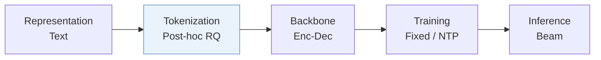
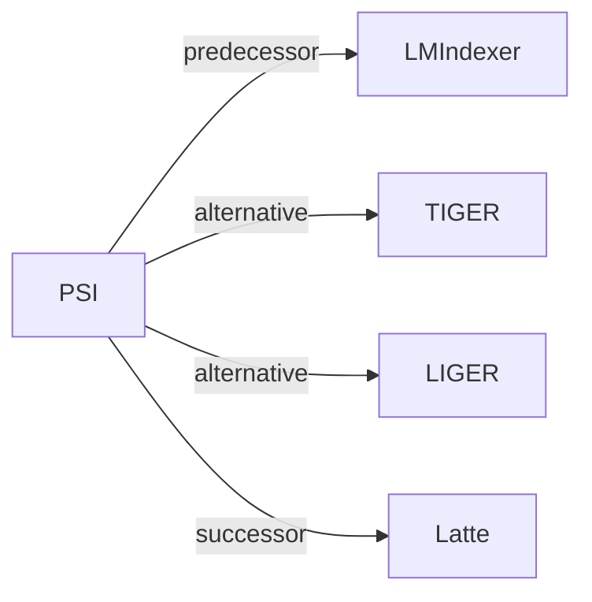

# PSI

*Purely Semantic Indexing for LLM-based Generative Recommendation and Retrieval* — Zhang et al. · arXiv’25

`II. Uniqueness and Validity` · `Tokenization` · [Paper](https://arxiv.org/abs/2509.16446) · [Code](https://github.com/wangshanyw/PurelySemanticIndexing) · [Matrix](../../README.md#ii--tokenization) · [中文](../zh/papers/psi.md)

Reading level: Overview (Level 1) · On this page: [TL;DR](#tldr) · [At a Glance](#at-a-glance) · [3. Experiments](#3-experimental-findings) · [5. Related Work](#5-connections-to-related-work)

- `Enc-Dec`: Encoder-decoder.
- `Fixed`: SIDs are built first and not changed while the generator trains.
- `NTP`: Next-token prediction loss only; continuing from a pretrained LLM (SFT) also counts as NTP.

### TL;DR

> [!NOTE]

> PSI assigns unique, semantic-preserving IDs by relaxing nearest-centroid selection with exhaustive candidate matching or recursive residual searching, instead of appending a non-semantic token to resolve conflicts.

### At a Glance

| Aspect | Summary |
| :-- | :-- |
| Research Problem | II. Uniqueness and Validity: Does every item get its own SID, every generated SID name a real item, and the codebook get used evenly? |
| Key Contribution | PSI assigns unique, semantic-preserving IDs by relaxing nearest-centroid selection with exhaustive candidate matching or recursive residual searching, instead of appending a non-semantic token to resolve conflicts. |
| Modified Stage | Tokenization |

### 3. Experimental Findings

Experimental setup

- **Datasets**: Sequential recommendation on Amazon Beauty (12,101 items / 22,363 users), Sports (18,357 / 35,598), and Toys (11,924 items), keeping users and items with at least 5 interactions, following LMIndexer. Also Amazon Product Search (same domains) and document retrieval on NQ320k and MS MARCO-1M.
  - Source: Recommendation data and LMIndexer protocol: [Sx4.SSx1.p1](https://arxiv.org/html/2509.16446v1#Sx4.SSx1.p1) and [Sx4.SSx2.p2](https://arxiv.org/html/2509.16446v1#Sx4.SSx2.p2); statistics: [Sx4.T2](https://arxiv.org/html/2509.16446v1#Sx4.T2); search and retrieval data: [Sx4.SSx3.p2](https://arxiv.org/html/2509.16446v1#Sx4.SSx3.p2) and [Sx4.T3](https://arxiv.org/html/2509.16446v1#Sx4.T3).
- **Split**: Recommendation: per-user leave-one-out (last for test, second-to-last for validation, rest for training). Product search: the original train/test split. A cold-start test subset keeps targets that appear at most 0 or 1 time in training.
  - Source: Leave-one-out allocation: [Sx4.SSx2.p2](https://arxiv.org/html/2509.16446v1#Sx4.SSx2.p2); cold-start subset: [Sx4.SSx10.p2](https://arxiv.org/html/2509.16446v1#Sx4.SSx10.p2).
- **Candidates**: not reported (full catalog versus sampled evaluation candidates); generation over valid semantic IDs.
  - Source: Metrics and protocol follow LMIndexer; candidate set not restated: [Sx4.SSx1.p1](https://arxiv.org/html/2509.16446v1#Sx4.SSx1.p1).
- **Visibility**: Main: warm; no unseen-item protocol is defined. Cold-start subset: targets appearing at most once in training, including items never seen by the generator; whether the RQ-VAE or clustering indexer was fit with these items: not reported.
  - Source: Cold-start subset with items that appear 0 or 1 time: [Sx4.SSx10.p2](https://arxiv.org/html/2509.16446v1#Sx4.SSx10.p2); the indexer embeds all items including test-only ones.
- **SID**: Purely semantic IDs: conflicts are removed by assigning non-nearest centroids instead of appending a conflict token, via exhaustive candidate matching (ECM, global scoring of top-k combinations) or recursive residual search (RRS, greedy). Applied to RQ-VAE and hierarchical clustering indexers. The level study on Amazon product search compares three-level purely semantic IDs with two levels plus a conflict index (codebook size 256); the conflict-proportion study uses codebook sizes 512, 256, and 192. Levels and codebook sizes for the main tables: not reported.
  - Source: ECM and RRS conflict-free assignment over RQ-VAE or hierarchical clustering: [Sx3.SSx1.p3](https://arxiv.org/html/2509.16446v1#Sx3.SSx1.p3), [Sx3.SSx2.p1](https://arxiv.org/html/2509.16446v1#Sx3.SSx2.p1), [Sx3.SSx3.p1](https://arxiv.org/html/2509.16446v1#Sx3.SSx3.p1); codebook size 256 in the level study: [Sx4.SSx7.SSSx1.p1](https://arxiv.org/html/2509.16446v1#Sx4.SSx7.SSSx1.p1); codebook sizes 512, 256, 192 in the conflict-proportion study: [Sx4.SSx9.p1](https://arxiv.org/html/2509.16446v1#Sx4.SSx9.p1).
- **Inference budget**: T5-base generator initialized from the same checkpoint for all indexers; decoding method and beam width: not reported. All experiments on 2 NVIDIA RTX A6000 GPUs; inference batch size and latency: not reported.
  - Source: T5-base, hardware, training batch: [Sx4.SSx1.p1](https://arxiv.org/html/2509.16446v1#Sx4.SSx1.p1) and [Sx4.SSx2.p3](https://arxiv.org/html/2509.16446v1#Sx4.SSx2.p3); decoding settings not found.
- **Results from**: Table 5 (sequential recommendation on Beauty, Sports, Toys with RQ-VAE and HC indexers, 3 trials); Table 6 (product search); document-retrieval tables; Table 9 (candidate ranking ablation); Figure 5 (cold-start subset).
  - Source: Recommendation: [Sx4.T5](https://arxiv.org/html/2509.16446v1#Sx4.T5); search: [Sx4.T6](https://arxiv.org/html/2509.16446v1#Sx4.T6); ablation: [Sx4.T9](https://arxiv.org/html/2509.16446v1#Sx4.T9); cold start: Figure 5 via [Sx4.SSx10.p2](https://arxiv.org/html/2509.16446v1#Sx4.SSx10.p2).

### 5. Connections to Related Work

- **前序工作** · [LMIndexer](lmindexer.md): PSID follows LMIndexer's tasks, datasets, and setup, and replaces conflict tokens with conflict-free semantic assignment.
  - Source: PSID v1, Section 4.1 follows Jin et al. (2023): https://arxiv.org/html/2509.16446v1#Sx4.SSx1.p1; dataset tables: https://arxiv.org/html/2509.16446v1#Sx4.T2 and https://arxiv.org/html/2509.16446v1#Sx4.T3.
- **替代方案** · [TIGER](tiger.md): TIGER appends a non-semantic conflict token to colliding IDs and uses a heuristic quota for cold-start items; PSID reassigns colliding items to non-nearest centroids so IDs stay fully semantic.
  - Source: PSID v1, Section 1 on fallback tokens: https://arxiv.org/html/2509.16446v1#Sx1.p2; cold-start discussion citing Rajput et al. (2023): https://arxiv.org/html/2509.16446v1#Sx4.SSx10.p1.
- **替代方案** · [LIGER](liger.md): LIGER adds dense retrieval to recover cold-start items; PSID improves cold-start generation by removing unpredictable conflict tokens.
  - Source: PSID v1, Section 4.10 cites Yang et al. (2024): https://arxiv.org/html/2509.16446v1#Sx4.SSx10.p1.
- **后续工作** · [Latte](latte.md): Latte later uses PSID as its base model and its ESM conflict resolution, and adds latent prefix tokens.
  - Source: Evidence is from the later Latte paper: https://arxiv.org/html/2605.06331v1#S5.SS1.SSS0.Px2.p1 and https://arxiv.org/html/2605.06331v1#A4.SS0.SSS0.Px2.p2.

[查看同格全部论文](../../README.md#ii--tokenization)
